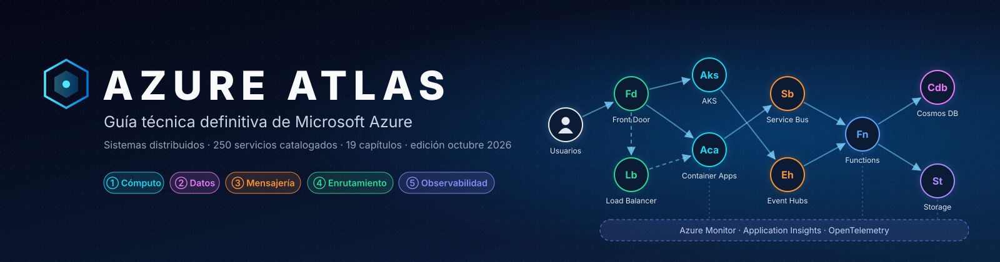
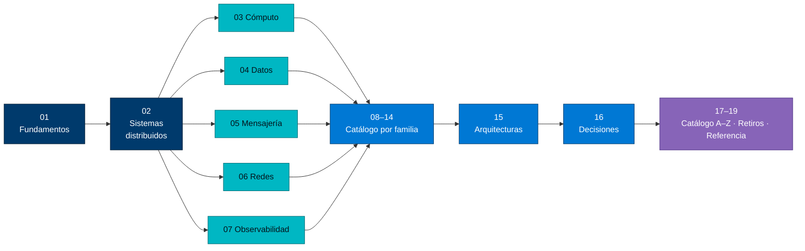
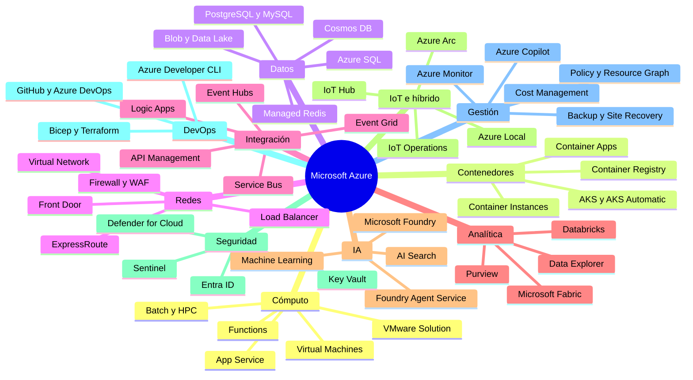
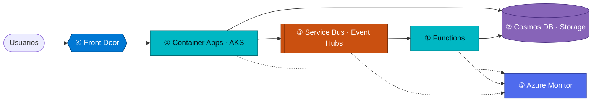

<p align="center">
  
</p>

<p align="center">
  
  
  
  
  
  
</p>

<p align="center">
  <b>Azure Atlas</b> es una guía técnica en español para entender, diseñar y operar sistemas en <b>Microsoft Azure</b>:<br>
  desde la teoría de los sistemas distribuidos hasta el catálogo completo de servicios, con arquitecturas,<br>
  árboles de decisión, código, límites, retiros y novedades verificadas al <b>23 de octubre de 2026</b>.
</p>

---

## Contenido

- [¿Qué es Microsoft Azure?](#qué-es-microsoft-azure)
- [Cómo usar este atlas](#cómo-usar-este-atlas)
- [El universo Azure en un mapa](#el-universo-azure-en-un-mapa)
- [Tabla periódica de servicios](#tabla-periódica-de-servicios)
- [Índice de capítulos](#índice-de-capítulos)
- [Sistemas distribuidos: los cinco pilares](#sistemas-distribuidos-los-cinco-pilares)
- [Azure en cifras](#azure-en-cifras)
- [Qué cambió en 2025–2026](#qué-cambió-en-20252026)
- [Retiros que no puedes ignorar](#retiros-que-no-puedes-ignorar)
- [Línea de tiempo 2008–2026](#línea-de-tiempo-20082026)
- [Azure de un vistazo](#azure-de-un-vistazo)
- [Estructura del repositorio](#estructura-del-repositorio)
- [Convenciones](#convenciones)
- [Metodología y fuentes](#metodología-y-fuentes)

---

## ¿Qué es Microsoft Azure?

**Microsoft Azure** es la plataforma de nube pública de Microsoft: más de 200 productos de infraestructura (IaaS),
plataforma (PaaS), *serverless* y software como servicio (SaaS) que se ejecutan en **más de 70 regiones** y **más de
400 centros de datos** conectados por una red troncal privada. Todo se gestiona a través de un único plano de control,
**Azure Resource Manager**, con identidad de **Microsoft Entra ID** y gobierno de **Azure Policy**.

En 2026 Azure se organiza alrededor de cuatro ideas: **sistemas distribuidos gestionados** (AKS, Container Apps,
Cosmos DB, Service Bus, Event Hubs, Front Door), **datos unificados** (Microsoft Fabric y OneLake), **IA agéntica**
(Microsoft Foundry) y **nube soberana e híbrida** (Azure Arc y Azure Local).

---

## Cómo usar este atlas

| Si eres… | Empieza por | Sigue con | Termina en |
|---|---|---|---|
| **Nuevo en Azure** | [01 · Fundamentos](docs/01-fundamentos-y-plataforma-global.md) | [02 · Sistemas distribuidos](docs/02-sistemas-distribuidos-en-azure.md) | [19 · Glosario](docs/19-referencia-rapida-y-glosario.md) |
| **Arquitecto/a** | [02 · Sistemas distribuidos](docs/02-sistemas-distribuidos-en-azure.md) | [15 · Arquitecturas](docs/15-arquitecturas-de-referencia.md) | [16 · Guías de decisión](docs/16-guias-de-decision.md) |
| **Desarrollador/a** | [03 · Cómputo](docs/03-computo-y-contenedores.md) y [05 · Mensajería](docs/05-mensajeria-e-integracion.md) | [04 · Datos](docs/04-almacenamiento-y-bases-de-datos.md) | [12 · DevOps e IaC](docs/12-desarrollo-devops-e-iac.md) |
| **Operaciones / SRE** | [07 · Observabilidad](docs/07-observabilidad-y-monitoreo.md) | [13 · Gestión y costos](docs/13-gestion-gobierno-costos-y-migracion.md) | [18 · Retiros](docs/18-retiros-y-ciclo-de-vida.md) |
| **Seguridad** | [08 · Identidad y seguridad](docs/08-identidad-y-seguridad.md) | [06 · Redes](docs/06-redes-y-entrega-global.md) | [01 § Gobierno](docs/01-fundamentos-y-plataforma-global.md#6-acceso-y-gobierno) |
| **Datos e IA** | [09 · Datos y analítica](docs/09-datos-y-analitica.md) | [10 · IA](docs/10-ia-y-machine-learning.md) | [15 § IA generativa](docs/15-arquitecturas-de-referencia.md#5-ia-generativa-rag-y-agentes) |



---

## El universo Azure en un mapa



---

## Tabla periódica de servicios

Los **175 servicios activos** más relevantes, agrupados en 13 familias (el catálogo completo tiene 250 entradas,
incluidos los servicios en retiro y retirados). Haz clic para verla a tamaño completo.

<p align="center">
  <a href="assets/azure-atlas-tabla-periodica.svg">
    
  </a>
</p>

> [!TIP]
> El póster y el [catálogo A–Z](docs/17-catalogo-a-z.md) se generan desde [`data/servicios.csv`](data/servicios.csv)
> con `python3 tools/generar_atlas.py`. Para actualizar un servicio, edita una fila y vuelve a ejecutar el script.

---

## Índice de capítulos

| # | Capítulo | Lo que encontrarás | Servicios protagonistas |
|---|---|---|---|
| 01 | [Fundamentos y plataforma global](docs/01-fundamentos-y-plataforma-global.md) | Regiones y zonas, nubes soberanas, jerarquía de recursos, ARM, RBAC, Policy, CAF, WAF, precios, historia 2008–2026 | ARM, Policy, Management groups |
| 02 | [**Sistemas distribuidos en Azure**](docs/02-sistemas-distribuidos-en-azure.md) | Los cinco pilares, CAP/PACELC, consistencia, consenso, semántica de entrega, 30 patrones, SLA compuesto, arquitectura integradora | AKS, Functions, Container Apps, Cosmos DB, Service Bus, Event Hubs, Front Door, Monitor |
| 03 | [Cómputo y contenedores](docs/03-computo-y-contenedores.md) | VM y familias 2026, AKS a fondo, Functions y Durable, Container Apps + Dapr, App Service, comparativas | AKS, Functions, Container Apps |
| 04 | [Almacenamiento y bases de datos](docs/04-almacenamiento-y-bases-de-datos.md) | Redundancia, niveles y *smart tier*, Cosmos DB a fondo (RU, particiones, vectores), Azure SQL, PostgreSQL, Redis | Storage, Cosmos DB, Azure SQL |
| 05 | [Mensajería e integración](docs/05-mensajeria-e-integracion.md) | Mensajes vs eventos vs streams, Service Bus y Event Hubs a fondo, Event Grid, Logic Apps, API Management con AI gateway | Service Bus, Event Hubs, APIM |
| 06 | [Redes y entrega global](docs/06-redes-y-entrega-global.md) | VNet, *hub-spoke*, Front Door y Load Balancer a fondo, elección de balanceador, híbrido, seguridad de red | Front Door, Load Balancer, NAT Gateway |
| 07 | [Observabilidad y monitoreo](docs/07-observabilidad-y-monitoreo.md) | Arquitectura de Azure Monitor, OTLP nativo, OpenTelemetry, trazas distribuidas, KQL, SLO y alertas | Monitor, Application Insights |
| 08 | [Identidad y seguridad](docs/08-identidad-y-seguridad.md) | Zero Trust, Entra ID, identidades sin secretos, Key Vault y HSM, Defender, Sentinel, *confidential computing* | Entra ID, Key Vault, Defender |
| 09 | [Datos y analítica](docs/09-datos-y-analitica.md) | Fabric y OneLake, Databricks, Synapse, Data Factory, tiempo real, Purview, *medallion*, Lambda vs Kappa | Fabric, Databricks, Data Explorer |
| 10 | [IA y machine learning](docs/10-ia-y-machine-learning.md) | Microsoft Foundry (Models, Agent Service, IQ, Tools), AI Search, Azure ML, RAG y agentes, IA responsable | Foundry, AI Search |
| 11 | [IoT, borde, híbrido y soberanía](docs/11-iot-edge-hibrido-y-soberania.md) | IoT Hub, IoT Operations, Digital Twins, Azure Arc, Azure Local desconectado | IoT Operations, Arc, Local |
| 12 | [Desarrollo, DevOps e IaC](docs/12-desarrollo-devops-e-iac.md) | Bicep vs Terraform, Deployment Stacks, CI/CD con OIDC, despliegue progresivo, pruebas de carga y caos | GitHub, Bicep, azd |
| 13 | [Gestión, gobierno, costos y migración](docs/13-gestion-gobierno-costos-y-migracion.md) | FinOps, Resource Graph, Update Manager, Backup vs Site Recovery, Azure Migrate, agentes de Azure Copilot | Cost Management, Backup, Migrate |
| 14 | [Web, móvil, comunicaciones y escritorio](docs/14-web-movil-comunicaciones-y-escritorio.md) | Static Web Apps, Communication Services, Maps, AVD vs Windows 365, SAP, salud, cuántica | ACS, AVD, Static Web Apps |
| 15 | [Arquitecturas de referencia](docs/15-arquitecturas-de-referencia.md) | Web global activa-activa, microservicios, Big Data, IoT, IA/agentes, transaccional, híbrido | — |
| 16 | [Guías de decisión](docs/16-guias-de-decision.md) | Árboles de decisión de cómputo, datos, mensajería, identidad, analítica, IA y conectividad | — |
| 17 | [Catálogo A–Z](docs/17-catalogo-a-z.md) | 250 servicios con familia, estado, fecha de retiro y capítulo | Todos |
| 18 | [Retiros y ciclo de vida](docs/18-retiros-y-ciclo-de-vida.md) | Retiros 2024–2031, Gantt de urgencia, diccionario de renombres, consultas para encontrar lo afectado | — |
| 19 | [Referencia rápida y glosario](docs/19-referencia-rapida-y-glosario.md) | SLA, límites, CLI, convenciones de nombres y 60 términos | — |

---

## Sistemas distribuidos: los cinco pilares

> En el ecosistema de Microsoft Azure, el diseño y despliegue de sistemas distribuidos se fundamenta en servicios
> gestionados que resuelven los retos clásicos de la computación distribuida: **escalabilidad, consistencia,
> tolerancia a fallos y comunicación asíncrona**.

| Pilar | Servicios | Lo esencial | Matiz de experto |
|---|---|---|---|
| **① Cómputo y orquestación** | [AKS](docs/03-computo-y-contenedores.md#3-azure-kubernetes-service-aks) · [Functions](docs/03-computo-y-contenedores.md#4-azure-functions) · [Container Apps](docs/03-computo-y-contenedores.md#5-azure-container-apps-y-dapr) | Kubernetes gestionado; *serverless* por eventos; microservicios con **Dapr** (estado, *service discovery*, pub/sub) | AKS **Automatic** gestiona hasta los nodos; Functions *in-process* termina el **10-nov-2026** |
| **② Datos distribuidos** | [Cosmos DB](docs/04-almacenamiento-y-bases-de-datos.md#3-azure-cosmos-db) · [Storage](docs/04-almacenamiento-y-bases-de-datos.md#2-azure-storage) | Replicación global activa, **5 niveles de consistencia**; redundancia LRS/ZRS/GRS/GZRS | Strong no admite multi-write y cuesta 2× RU en lecturas |
| **③ Mensajería e integración** | [Service Bus](docs/05-mensajeria-e-integracion.md#3-azure-service-bus) · [Event Hubs](docs/05-mensajeria-e-integracion.md#4-azure-event-hubs) | Colas y topics empresariales; *streaming* de millones de eventos/s compatible con Kafka | FIFO solo con **sesiones**; Event Hubs ordena solo **por partición** |
| **④ Enrutamiento global** | [Front Door](docs/06-redes-y-entrega-global.md#3-azure-front-door) · [Load Balancer](docs/06-redes-y-entrega-global.md#4-azure-load-balancer) | L7 global en el borde con WAF; L4 regional o global | Load Balancer reparte por **hash de 5 tuplas**, no *round-robin* |
| **⑤ Observabilidad** | [Azure Monitor / Application Insights](docs/07-observabilidad-y-monitoreo.md) | Trazas distribuidas, mapa de aplicación, logs centralizados | Ingesta **OTLP nativa** GA desde jun-2026 |



¿Qué combinación elegir para tu caso (web global, microservicios, Big Data, IoT, IA)? Consulta la
[matriz de selección](docs/02-sistemas-distribuidos-en-azure.md#7-qué-combinación-elegir) y las
[arquitecturas de referencia](docs/15-arquitecturas-de-referencia.md).

---

## Azure en cifras

| Indicador (oct-2026) | Valor |
|---|---|
| Regiones anunciadas | **70+** (Hyderabad abrió en ago-2026; Saudi Arabia East llega en nov-2026; East US 3 a inicios de 2027) |
| Centros de datos | **400+** |
| Red troncal | **370 000+ millas** de fibra terrestre y submarina |
| Sitios de borde | **190+** |
| Productos y servicios | **200+** (250 entradas en este catálogo, incluidas capacidades y servicios retirados) |
| Modelos en Microsoft Foundry | **11 000+** |
| Silicio propio | Cobalt 100/200 (CPU Arm), Maia 200 (IA), Azure Boost, Azure Integrated HSM |

---

## Qué cambió en 2025–2026

| Área | Novedad | Estado |
|---|---|---|
| IA | Azure AI Foundry → **Microsoft Foundry**; Azure AI Services → **Foundry Tools**; modelos **Claude** de Anthropic junto a OpenAI, xAI, DeepSeek, Meta y Mistral | 🟢 |
| IA | **Microsoft Agent Framework 1.0**, *hosted agents*, *toolboxes* MCP/A2A, Foundry IQ, Microsoft Discovery | 🟢/🟡 |
| Cómputo | **AKS Automatic** con *node pools* de sistema gestionados; Azure Container Linux; AKS en *bare metal* (🟡) | 🟢 |
| Cómputo | Container Apps **Sandboxes** (micro-VM) y **Express**; GPU *serverless* | 🟢 |
| Cómputo | VM **v7** AMD Turin e Intel Xeon 6 (hasta 372 vCPU); **Cobalt 200** (🟡) | 🟢 |
| Datos | **Azure DocumentDB**, **Azure HorizonDB** (🟡), **Azure Managed Redis**, SQL Server 2025 | 🟢 |
| Datos | Cosmos DB: índices secundarios globales, *failover* por partición, búsqueda híbrida, *dynamic data masking* | 🟢 |
| Datos | Blob **smart tier** (niveles automáticos) | 🟢 |
| Mensajería | Geo-replicación de **Service Bus Premium** y **Event Hubs Premium/Dedicated** | 🟢 |
| Integración | API Management **Premium v2**, AI gateway con MCP y A2A, tier **AI Gateway** (🟡) | 🟢 |
| Redes | **NAT Gateway StandardV2** (zona-redundante, 100 Gbps); subredes privadas por defecto; Front Door con WebSocket | 🟢 |
| Observabilidad | Ingesta **OTLP nativa** y auto-instrumentación en AKS | 🟢 |
| Seguridad | Identidades para agentes (**Entra Agent ID**), *passkeys* sincronizadas, Azure Cloud HSM | 🟢/🟡 |
| Operaciones | **Azure SRE Agent** GA; agentes de **Azure Copilot** (🟡) | 🟢 |
| Soberanía | **Azure Local desconectado**, Microsoft 365 Local, Foundry Local | 🟢 |
| Analítica | **Fabric IQ** (ontología), agentes de datos, *mirroring* de Oracle y SAP | 🟢/🟡 |

---

## Retiros que no puedes ignorar

| Fecha | Qué se retira | Migra a |
|---|---|---|
| **10-nov-2026** | Azure Functions *in-process* (.NET), .NET 8/9 y PowerShell 7.4 en Functions | *Isolated worker* + .NET 10 |
| **nov-2026** | AKS 1.34 · parches de NGINX en *application routing* | AKS 1.35+ · Gateway API |
| **31-ene-2027** | Azure Blueprints | Template Specs + Deployment Stacks + Policy |
| **22-feb-2027** | Azure Deployment Environments | `azd` + pipelines + Deployment Stacks |
| **31-mar-2027** | Front Door (classic) · Cloud Services (extended support) · Sentinel en el portal de Azure · Redis Enterprise · Content Moderator | Front Door Std/Premium · VMSS/AKS · portal de Defender · Managed Redis · Content Safety |
| **30-sep-2027** | CDN classic · NSG flow logs · Automation State Configuration | Front Door · VNet flow logs · Machine Configuration |
| **2028** | Spring Apps, kubenet, Dedicated HSM, Dev Box, Azure Cache for Redis, Linux Consumption | Container Apps, CNI Overlay, Cloud HSM, Windows 365, Managed Redis, Flex Consumption |

Lista completa, Gantt y consultas para encontrar recursos afectados: [18 · Retiros y ciclo de vida](docs/18-retiros-y-ciclo-de-vida.md).

---

## Línea de tiempo 2008–2026

| Año | Hito |
|---|---|
| **2008** | Anuncio de **Windows Azure** en la PDC (proyecto *Red Dog*) |
| **2010** | Disponibilidad comercial (1 de febrero) y SQL Azure |
| **2012–2013** | IaaS con VM Windows y **Linux** (preview 2012, GA 2013) |
| **2014** | Renombre a **Microsoft Azure**; ExpressRoute; Event Hubs |
| **2015–2016** | App Service, Azure ML, DocumentDB; **Functions** y Service Fabric GA |
| **2017** | **Cosmos DB**, Container Instances, Event Grid, Azure Stack |
| **2018** | **AKS GA**, zonas de disponibilidad GA, Azure DevOps |
| **2019** | **Azure Arc**, Synapse, Bastion, Lighthouse; alianza con OpenAI |
| **2020–2021** | Communication Services, Azure Stack HCI; Container Apps y Azure OpenAI en preview |
| **2022** | **Container Apps GA** |
| **2023** | **Azure OpenAI GA**, Azure AD → **Microsoft Entra ID**, **Microsoft Fabric GA**, chips Cobalt y Maia |
| **2024** | **Azure AI Foundry**, **Azure Local**, Functions Flex Consumption, VM Cobalt 100 |
| **2025** | **AKS Automatic**, Managed Redis, **Microsoft Foundry** con Claude, DocumentDB, HorizonDB (preview), agentes de Azure Copilot |
| **2026** | Agentes en producción (Agent Framework, SRE Agent), Azure Local desconectado, OTLP nativo, ACA Sandboxes, Cobalt 200 (preview), nuevas regiones |

Detalle y diagrama en [01 § Línea de tiempo](docs/01-fundamentos-y-plataforma-global.md#13-línea-de-tiempo-20082026).

---

## Azure de un vistazo

| Dimensión | Detalle |
|---|---|
| Modelos de servicio | IaaS (VM, redes, discos) · PaaS (App Service, Azure SQL, Container Apps) · *Serverless* (Functions, Logic Apps) · SaaS (Microsoft 365, Dynamics 365, Fabric) |
| Lenguajes con SDK oficial | .NET, Java, Python, JavaScript/TypeScript, Go, Rust, C/C++ (y REST para cualquier otro) |
| Sistemas operativos | Windows Server y las principales distribuciones Linux (Ubuntu, RHEL, SUSE, Debian, Azure Linux, Oracle Linux) |
| Bases de datos | SQL Server/Azure SQL, PostgreSQL, MySQL, Cosmos DB, MongoDB (DocumentDB), Cassandra, Redis, Oracle |
| Modelos de nube | Pública, híbrida (Arc, Azure Local), multicloud (Arc, Fabric *shortcuts*), soberana |
| **Fortalezas** | Integración con el ecosistema Microsoft (Entra, Microsoft 365, GitHub), IA de frontera multi-proveedor, híbrido maduro, cumplimiento normativo amplio |
| **Retos** | Amplitud del catálogo (curva de aprendizaje), gobierno de costos, ritmo de renombres y retiros, variación de disponibilidad por región |

---

## Estructura del repositorio

```text
.
├── README.md                     ← estás aquí (portada e índice)
├── docs/                         ← 19 capítulos
│   ├── 01-fundamentos-y-plataforma-global.md
│   ├── 02-sistemas-distribuidos-en-azure.md
│   ├── 03 … 14                   ← un capítulo por familia de servicios
│   ├── 15-arquitecturas-de-referencia.md
│   ├── 16-guias-de-decision.md
│   ├── 17-catalogo-a-z.md        ← generado desde data/servicios.csv
│   ├── 18-retiros-y-ciclo-de-vida.md
│   └── 19-referencia-rapida-y-glosario.md
├── data/servicios.csv            ← fuente única del catálogo y del póster
├── tools/generar_atlas.py        ← regenera catálogo, póster y banner (Python 3, sin dependencias)
├── assets/                       ← banner y tabla periódica en SVG
└── LICENSE                       ← Apache 2.0
```

```bash
# Regenerar catálogo A–Z, póster y banner después de editar data/servicios.csv
python3 tools/generar_atlas.py
```

---

## Convenciones

| Símbolo | Significado |
|---|---|
| 🟢 | Disponible de forma general (GA) |
| 🟡 | *Preview* (pública o controlada) |
| 🟠 | Retiro anunciado (con fecha) |
| ⛔ | Retirado |
| 🆕 | Novedad 2025–2026 |
| Recuadros *Note*, *Tip*, *Important*, *Warning*, *Caution* | Notas, consejos, puntos clave, advertencias y precauciones |

Colores de los diagramas: **azul** = entrada y red · **turquesa** = cómputo · **naranja** = mensajería ·
**morado** = datos · **rojo** = seguridad · **índigo** = observabilidad.

---

## Metodología y fuentes

- **Fecha de corte:** 23 de octubre de 2026. Las novedades posteriores (por ejemplo, Microsoft Ignite 2026 en
  noviembre) no están incluidas.
- **Fuentes:** documentación de Microsoft Learn, avisos de *Azure Updates* (novedades y retiros), páginas de ciclo de
  vida de Microsoft, blogs oficiales de producto (Build 2026, Ignite 2025, FabCon/SQLCon 2026) y notas de versión
  (AKS). Los diagramas se validaron con Mermaid 10.9 y 11.4.
- **Límites:** cifras como SLA, límites, precios y disponibilidad por región cambian con frecuencia y dependen del tier;
  verifica en la documentación oficial antes de tomar decisiones contractuales. Este atlas no es documentación oficial
  de Microsoft.
- **Contribuir:** abre un *issue* o *pull request*; para el catálogo, edita `data/servicios.csv` y ejecuta el generador.

---

<p align="center">
  Hecho con ☁️ para la comunidad hispanohablante · Licencia <a href="LICENSE">Apache 2.0</a> ·
  <a href="https://azure.microsoft.com/">azure.microsoft.com</a>
</p>
