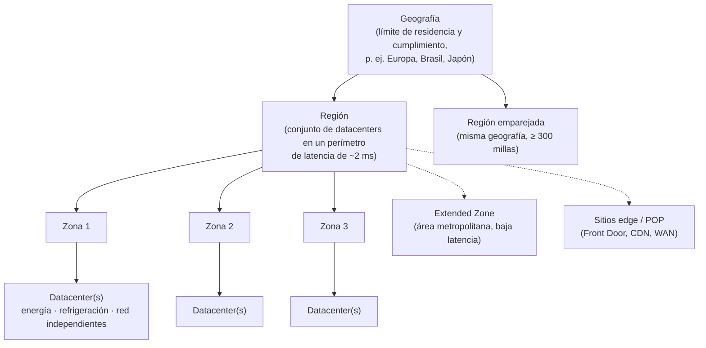
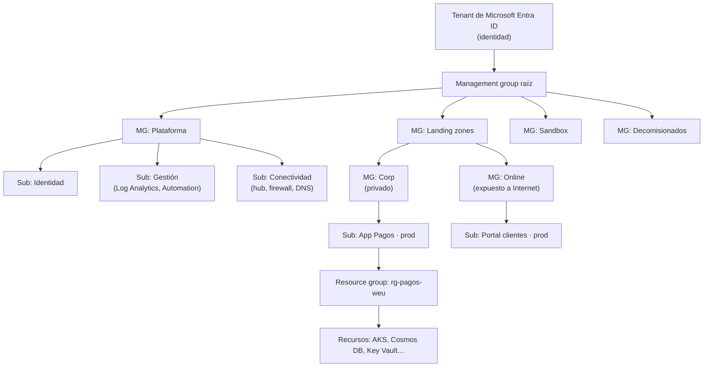
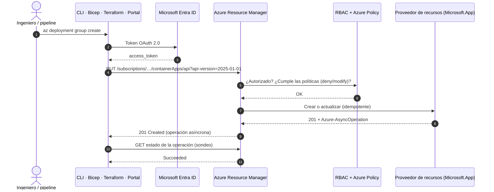
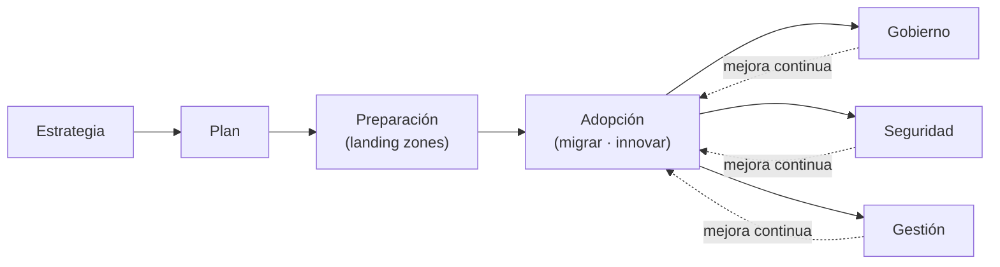
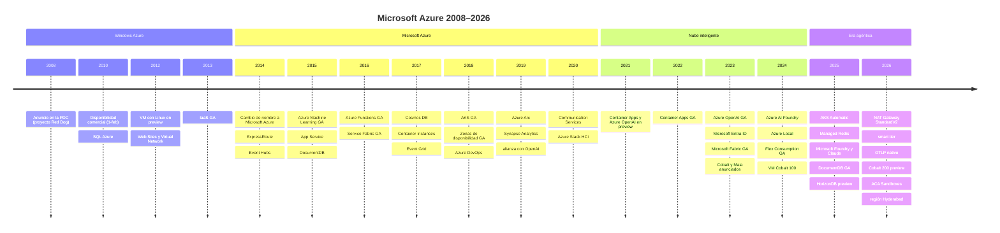

<div align="center">

# 01 · Fundamentos y plataforma global

**Infraestructura global · Jerarquía de recursos · Azure Resource Manager · Gobierno · CAF · Well-Architected · Precios**

[🏠 Índice](../README.md) · [02 · Sistemas distribuidos ➡](02-sistemas-distribuidos-en-azure.md)

</div>

---

## Contenido

1. [Azure en cifras (octubre 2026)](#1-azure-en-cifras-octubre-2026)
2. [Infraestructura global](#2-infraestructura-global)
3. [Nubes soberanas y residencia de datos](#3-nubes-soberanas-y-residencia-de-datos)
4. [Jerarquía de recursos](#4-jerarquía-de-recursos)
5. [Azure Resource Manager](#5-azure-resource-manager)
6. [Acceso y gobierno](#6-acceso-y-gobierno)
7. [Cloud Adoption Framework y landing zones](#7-cloud-adoption-framework-y-landing-zones)
8. [Well-Architected Framework](#8-well-architected-framework)
9. [Modelos de servicio y responsabilidad compartida](#9-modelos-de-servicio-y-responsabilidad-compartida)
10. [Facturación y modelos de precio](#10-facturación-y-modelos-de-precio)
11. [Herramientas para trabajar con Azure](#11-herramientas-para-trabajar-con-azure)
12. [Versionado: Azure no tiene "versión"](#12-versionado-azure-no-tiene-versión)
13. [Línea de tiempo 2008–2026](#13-línea-de-tiempo-20082026)
14. [Referencias](#14-referencias)

---

## 1. Azure en cifras (octubre 2026)

| Indicador | Valor | Fuente/nota |
|---|---|---|
| Regiones anunciadas | **Más de 70** | Cifra titular de Microsoft (incluye regiones anunciadas; páginas antiguas aún dicen "60+") |
| Centros de datos | **Más de 400** | Blog de Azure, 2026 |
| Países con regiones | Más de 30 | Sin contar la nube operada por 21Vianet en China |
| Fibra óptica propia (terrestre y submarina) | **Más de 370 000 millas** (~600 000 km) | Red troncal privada de Microsoft |
| Sitios de borde (*edge*) | **Más de 190** | POP usados por Front Door y la WAN de Microsoft |
| Productos y servicios | Más de 200 | Según la clasificación del catálogo de Azure |
| Regiones recientes | Indonesia Central y Malaysia West (2025), Hyderabad, India (ago-2026) | Saudi Arabia East (3 zonas) llega en **nov-2026**; East US 3 (Atlanta) a inicios de 2027 |

---

## 2. Infraestructura global



| Concepto | Definición | Implicaciones de diseño |
|---|---|---|
| **Geografía** | Mercado que agrupa regiones y define límites de residencia de datos | Elige la geografía por cumplimiento normativo |
| **Región** | Conjunto de datacenters interconectados por una red de baja latencia | No todos los servicios ni SKU existen en todas las regiones |
| **Zona de disponibilidad** | Uno o más datacenters con infraestructura independiente dentro de una región (mínimo 3 por región habilitada) | Usa servicios **zona-redundantes** o despliega en varias zonas para 99,99 % |
| **Par de regiones** | Dos regiones de la misma geografía con actualizaciones secuenciales y prioridad de recuperación | Las regiones nuevas pueden **no tener par**: la estrategia multirregión moderna elige regiones por latencia y capacidad, no solo por par |
| **Extended Zone** | Extensión pequeña de una región en una metrópoli | Latencia ultrabaja y residencia local para cargas seleccionadas |
| **Sitio edge** | POP de la red de Microsoft | Front Door, CDN, entrada a la dorsal |

> [!TIP]
> Los números de zona (1, 2, 3) son **lógicos por suscripción**. Si coordinas despliegues zonales entre suscripciones,
> consulta el mapeo físico con la API `checkZonePeers`.

---

## 3. Nubes soberanas y residencia de datos

| Oferta | Para | Claves |
|---|---|---|
| **Azure Government** | Agencias de EE. UU. y su cadena de suministro | Regiones físicamente aisladas, personal verificado, FedRAMP High, DoD IL; regiones Secret/Top Secret aparte |
| **Azure operado por 21Vianet** | China continental | Operación independiente por un socio local |
| **Microsoft Sovereign Cloud** | Gobiernos y sectores regulados (especial énfasis en Europa) | **Sovereign Public Cloud** (controles de soberanía sobre la nube pública), **Sovereign Private Cloud** (Azure Local, incluso **desconectado**, GA feb-2026, con Microsoft 365 Local y Foundry Local) y nubes de socios nacionales |
| Nubes de socios nacionales | Francia (Bleu), Alemania (Delos Cloud) | Operación local por entidades nacionales |
| **EU Data Boundary** | Clientes de la UE/AELC | Datos de clientes y datos personales almacenados y procesados dentro de la UE (completado en 2025) |

---

## 4. Jerarquía de recursos



| Nivel | Qué es | Herencia | Límite útil |
|---|---|---|---|
| Tenant de Entra ID | Directorio de identidades | — | Un tenant puede tener muchas suscripciones |
| Management group | Contenedor de gobierno | RBAC y Policy se heredan hacia abajo | Hasta 6 niveles de profundidad (sin contar raíz y suscripción) |
| Suscripción | Unidad de facturación, cuotas y límite de escala | Hereda del MG | Úsala como **límite de *blast radius*** (subscription vending) |
| Resource group | Contenedor de ciclo de vida | Hereda de la suscripción | Agrupa lo que se despliega y elimina junto |
| Recurso | Instancia de un servicio | Hereda del RG | Tiene un *resource ID* único |

```text
/subscriptions/{subId}/resourceGroups/rg-pagos-weu/providers/Microsoft.DocumentDB/databaseAccounts/cosmos-pagos
```

---

## 5. Azure Resource Manager

ARM es el **plano de control** único: portal, CLI, PowerShell, SDK, Bicep, Terraform y Azure Copilot hablan con la
misma API REST, que autentica (Entra ID), autoriza (RBAC), evalúa políticas (Azure Policy) y delega en el
**proveedor de recursos** de cada servicio (`Microsoft.Compute`, `Microsoft.Storage`…).



| Concepto | Por qué importa |
|---|---|
| **Plano de control vs plano de datos** | ARM gestiona recursos; el plano de datos (leer un blob, consultar Cosmos DB) va directo al servicio con su propia autorización |
| **Idempotencia** | Un `PUT` con la misma definición produce el mismo estado: base de la IaC declarativa |
| **Operaciones asíncronas** | Respuestas `201/202` con cabeceras `Azure-AsyncOperation`/`Location` |
| **Límites de solicitudes (*throttling*)** | ARM aplica cubos de tokens; respeta `Retry-After` en respuestas `429` |
| **Bloqueos** (`CanNotDelete`, `ReadOnly`) | Protegen recursos críticos incluso frente a propietarios |
| **Etiquetas** | Costos, propietario, entorno; impónlas con Azure Policy |
| **Azure Resource Graph** | Consultas KQL sobre todo el inventario de recursos de todas las suscripciones |

---

## 6. Acceso y gobierno

### 6.1 Azure RBAC

| Rol integrado | Puede | No puede |
|---|---|---|
| **Owner** | Todo, incluido asignar roles | — |
| **Contributor** | Crear y gestionar recursos | Asignar roles |
| **Reader** | Ver recursos | Cambiar nada |
| **Role Based Access Control Administrator** | Gestionar asignaciones de roles (con condiciones) | Gestionar recursos |
| **User Access Administrator** | Gestionar el acceso | Gestionar recursos |
| Roles de plano de datos (p. ej., *Storage Blob Data Reader*, *Cosmos DB Built-in Data Contributor*) | Acceder a datos | Gestionar el recurso |

Buenas prácticas: asignar a **grupos**, no a usuarios; mínimo privilegio; **PIM** para elevación *just-in-time*;
condiciones **ABAC** (por ejemplo, restringir a contenedores con cierta etiqueta); identidades administradas para
cargas de trabajo.

### 6.2 Azure Policy

| Efecto | Comportamiento |
|---|---|
| `deny` | Bloquea la creación o el cambio no conforme |
| `audit` / `auditIfNotExists` | Registra el incumplimiento |
| `modify` / `append` | Corrige propiedades o etiquetas al vuelo |
| `deployIfNotExists` | Despliega lo que falte (p. ej., diagnóstico, agentes) con tareas de remediación |
| `denyAction` | Impide acciones concretas (p. ej., eliminar) |
| `manual` / `disabled` | Atestación manual / desactivado |

Las **iniciativas** agrupan políticas (p. ej., *Microsoft Cloud Security Benchmark*, ISO 27001, PCI DSS); las
**exenciones** documentan excepciones con fecha de caducidad.

> [!WARNING]
> **Azure Blueprints** se retira el **31-ene-2027** (fases: sin nuevas definiciones desde 31-jul-2026, sin nuevas
> asignaciones desde 31-oct-2026, sin modificar asignaciones desde 31-dic-2026). Reemplázalo con **Template Specs +
> Deployment Stacks** (con *deny settings*) y **Azure Policy**.

---

## 7. Cloud Adoption Framework y landing zones



Una **Azure landing zone** es el entorno base, preconfigurado con identidad, red, seguridad, gobierno y gestión, sobre
el que aterrizan las cargas de trabajo:

| Componente | Landing zone de plataforma | Landing zone de aplicación |
|---|---|---|
| Responsable | Equipo de plataforma | Equipo de producto |
| Contenido | Identidad, conectividad (hub/Virtual WAN, DNS, firewall), gestión (Log Analytics, Defender, Backup) | Suscripción por app/entorno con políticas heredadas |
| Automatización | Acelerador de ALZ (Bicep o Terraform con **Azure Verified Modules**) | *Subscription vending* |

---

## 8. Well-Architected Framework

| Pilar | Pregunta guía | Principios clave | Herramientas de Azure |
|---|---|---|---|
| **Confiabilidad** | ¿Se recupera y sigue operando ante fallos? | Diseñar para fallos, redundancia por zonas/regiones, probar recuperación | Zonas, Chaos Studio, Azure Backup, Site Recovery |
| **Seguridad** | ¿Protege confidencialidad, integridad y disponibilidad? | Zero Trust, mínimo privilegio, cifrado en todas partes | Entra ID, Defender for Cloud, Key Vault, Policy |
| **Optimización de costos** | ¿Genera valor por cada unidad gastada? | Modelo de costos, *rightsizing*, compromisos | Cost Management, Advisor, reservas, Savings Plan |
| **Excelencia operativa** | ¿Se opera de forma predecible y automatizada? | IaC, despliegues seguros, observabilidad | Bicep/Terraform, GitHub Actions, Azure Monitor |
| **Eficiencia de rendimiento** | ¿Escala para satisfacer la demanda? | Escalado horizontal, particionamiento, pruebas de carga | Autoescalado, Azure Load Testing, cachés |

Cada servicio tiene su **guía de servicio** WAF y Azure Advisor puntúa tu entorno por pilar (*Advisor Score*).

---

## 9. Modelos de servicio y responsabilidad compartida

| Responsabilidad | On-premises | IaaS | PaaS | SaaS |
|---|---|---|---|---|
| Datos, cuentas e identidades | Cliente | Cliente | Cliente | Cliente |
| Dispositivos (móviles y PC) | Cliente | Cliente | Cliente | Cliente |
| Aplicación | Cliente | Cliente | Compartida | Microsoft |
| Controles de red | Cliente | Cliente | Compartida | Microsoft |
| Sistema operativo | Cliente | Cliente | Microsoft | Microsoft |
| Hosts, red física, datacenter | Cliente | Microsoft | Microsoft | Microsoft |

> [!IMPORTANT]
> En **todos** los modelos, los **datos, las identidades y los accesos** son responsabilidad del cliente. La mayoría de
> incidentes en la nube provienen de configuraciones e identidades, no de la infraestructura física.

---

## 10. Facturación y modelos de precio

| Elemento | Opciones |
|---|---|
| Acuerdos | Microsoft Customer Agreement (MCA), Enterprise Agreement (EA), Cloud Solution Provider (CSP), pago por uso |
| Cuenta gratuita | Crédito inicial por tiempo limitado, servicios populares gratis 12 meses y servicios siempre gratuitos con límites |
| Descuentos | Reservas (1–3 años), Savings Plan for Compute, Spot, Azure Hybrid Benefit, precios Dev/Test |
| Herramientas | Calculadora de precios, calculadora TCO, **Cost Management** (presupuestos, alertas, anomalías, exportaciones FOCUS), FinOps toolkit |
| Asignación | Etiquetas, grupos de recursos, suscripciones por producto, reglas de asignación de costos |

---

## 11. Herramientas para trabajar con Azure

| Herramienta | Para | Ejemplo |
|---|---|---|
| Azure portal | Exploración visual | — |
| **Azure CLI** | Automatización multiplataforma | `az group create -n rg-demo -l westeurope` |
| Azure PowerShell (módulo Az) | Automatización en PowerShell | `New-AzResourceGroup -Name rg-demo -Location westeurope` |
| Cloud Shell | Terminal en el navegador con herramientas preinstaladas | — |
| **Bicep** | IaC nativa de Azure (transpila a ARM JSON) | `az deployment group create -f main.bicep` |
| **Terraform** (azurerm / azapi) | IaC multicloud | `terraform apply` |
| **Azure Developer CLI (azd)** | De plantilla a app desplegada | `azd up` |
| SDK (.NET, Java, Python, JS/TS, Go, Rust) | Integración desde código | `DefaultAzureCredential` en todos los lenguajes |
| VS Code + extensiones de Azure | Desarrollo local | — |
| **Azure Copilot** (antes Copilot in Azure) | Asistencia conversacional y **agentes** (migración, despliegue, optimización, observabilidad, resiliencia, solución de problemas; en preview controlada desde Ignite 2025) | — |
| **Azure SRE Agent** (GA mar-2026) | Operaciones asistidas por IA: diagnóstico, mitigación y *postmortems* | — |

---

## 12. Versionado: Azure no tiene "versión"

Azure no publica un número de versión monolítico. Cada servicio evoluciona de forma continua y se versiona por
separado:

- **API REST de ARM y de cada servicio**: fechas (`api-version=2025-01-01`), con variantes `-preview`.
- **SDK**: versionado semántico por paquete (`Azure.Messaging.ServiceBus 7.x`).
- **Runtimes gestionados**: ciclos de soporte propios (Kubernetes en AKS, runtime de Functions, versiones de
  PostgreSQL o de Dapr).
- **Ciclo de vida**: las retiradas se anuncian con antelación (normalmente 3 años para servicios GA y menos para
  *previews*) en *Azure Updates* y en las recomendaciones de **Azure Advisor**. Consulta
  [18 · Retiros y ciclo de vida](18-retiros-y-ciclo-de-vida.md).

---

## 13. Línea de tiempo 2008–2026



| Año | Hito | Detalle |
|---|---|---|
| 2008 | **Windows Azure** anunciado | PDC 2008 (octubre), proyecto *Red Dog* |
| 2010 | Disponibilidad general | 1 de febrero de 2010; SQL Azure |
| 2012 | IaaS en preview | VM Windows y **Linux**, Web Sites, Virtual Network ("Meet Windows Azure", junio) |
| 2013 | IaaS GA | Virtual Machines generalmente disponibles (abril) |
| 2014 | **Microsoft Azure** | Cambio de nombre (marzo–abril) que refleja el soporte multiplataforma; ExpressRoute; Event Hubs |
| 2015 | Plataforma de datos y PaaS | Azure ML GA, App Service, DocumentDB GA, Azure IoT Suite, nuevo portal |
| 2016 | Serverless | Azure Functions GA, Service Fabric GA, Bot Service y Cognitive Services en preview |
| 2017 | Nube distribuida | **Cosmos DB** (Build), Container Instances, Event Grid, Azure Stack |
| 2018 | Contenedores y zonas | **AKS GA** (junio), zonas de disponibilidad GA, Azure DevOps, Front Door en preview, Databricks GA |
| 2019 | Híbrido | **Azure Arc** anunciado, Synapse Analytics, Bastion, Lighthouse, inversión inicial en OpenAI |
| 2020 | Comunicaciones | Azure Communication Services, Azure Stack HCI, Static Web Apps (preview) |
| 2021 | Bases de la era IA | Container Apps y Azure OpenAI en preview |
| 2022 | Microservicios serverless | **Container Apps GA** (mayo), primeras VM Arm (Ampere Altra) GA |
| 2023 | IA generativa | **Azure OpenAI GA** (enero), GPT-4 en Azure, Azure AD → **Microsoft Entra ID** (julio), **Microsoft Fabric GA** (noviembre), Azure AI Studio, chips Cobalt 100 y Maia 100 |
| 2024 | Plataforma de IA | **Azure AI Foundry**, Azure Stack HCI → **Azure Local**, Functions **Flex Consumption** GA, VM Cobalt 100, IoT Operations GA |
| 2025 | Agentes | **AKS Automatic** GA, **Azure Managed Redis** GA, geo-replicación de Event Hubs, Foundry Agent Service, **Microsoft Foundry** (Ignite) con modelos **Claude** de Anthropic, **Azure DocumentDB** GA, **HorizonDB** (preview), agentes de Azure Copilot, Geo-Replication de Service Bus, retiro de Basic LB/IP pública |
| 2026 | Soberanía y agentes en producción | NAT Gateway StandardV2 y VM v7 (ene), Azure Local desconectado (feb), SRE Agent GA y Fabric IQ (mar), *smart tier* (abr), Microsoft Agent Framework 1.0, Build 2026 (jun: Cobalt 200, AKS bare metal, Container Linux, ACA Sandboxes, Microsoft Discovery GA), OTLP nativo, región **Hyderabad** (ago), Sandboxes GA (sep), Saudi Arabia East (nov) |

---

## 14. Referencias

- [Azure global infrastructure](https://azure.microsoft.com/explore/global-infrastructure/) · [Regions and availability zones](https://learn.microsoft.com/azure/reliability/availability-zones-overview)
- [Azure Resource Manager overview](https://learn.microsoft.com/azure/azure-resource-manager/management/overview)
- [Azure Policy](https://learn.microsoft.com/azure/governance/policy/overview) · [Azure RBAC](https://learn.microsoft.com/azure/role-based-access-control/overview)
- [Cloud Adoption Framework](https://learn.microsoft.com/azure/cloud-adoption-framework/) · [Azure landing zones](https://learn.microsoft.com/azure/cloud-adoption-framework/ready/landing-zone/)
- [Azure Well-Architected Framework](https://learn.microsoft.com/azure/well-architected/)
- [Microsoft Sovereign Cloud](https://www.microsoft.com/microsoft-sovereign-cloud) · [EU Data Boundary](https://learn.microsoft.com/privacy/eudb/eu-data-boundary-learn)

---

<div align="center">

[🏠 Índice](../README.md) · [02 · Sistemas distribuidos ➡](02-sistemas-distribuidos-en-azure.md)

</div>
