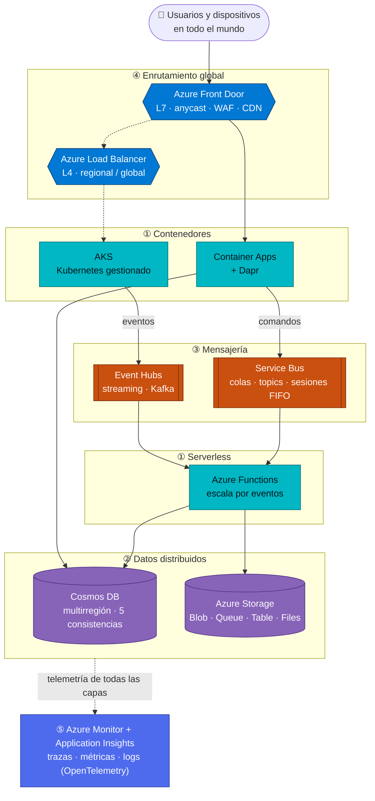
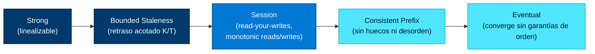
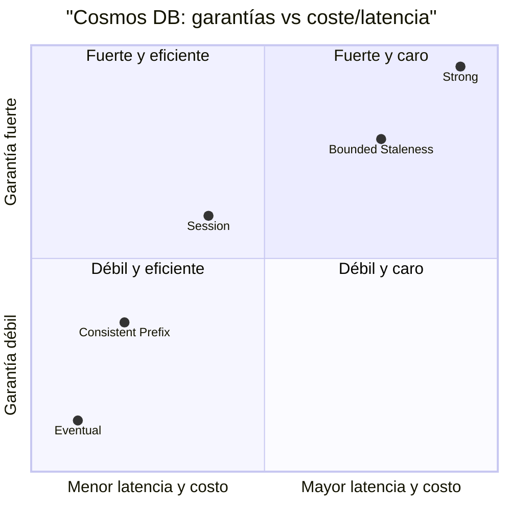
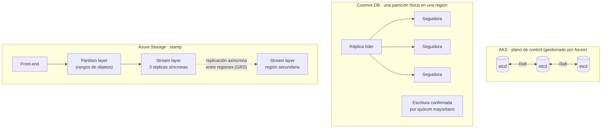
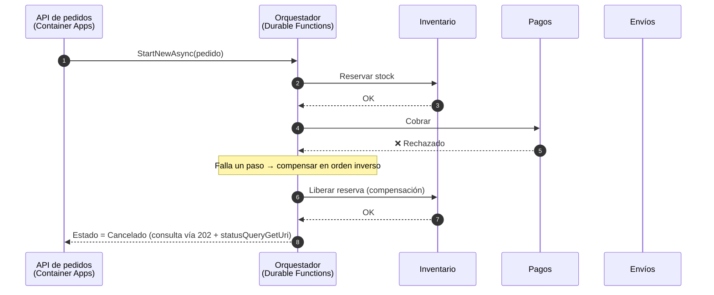
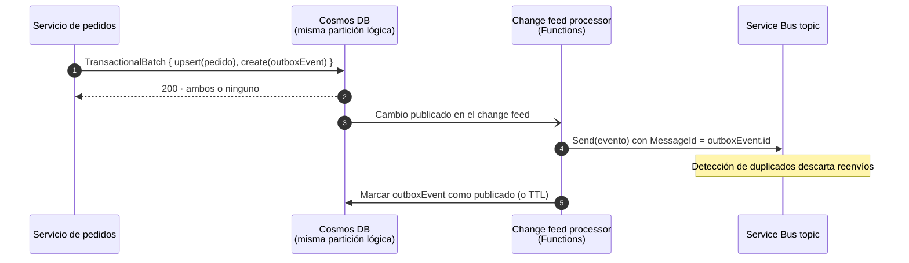
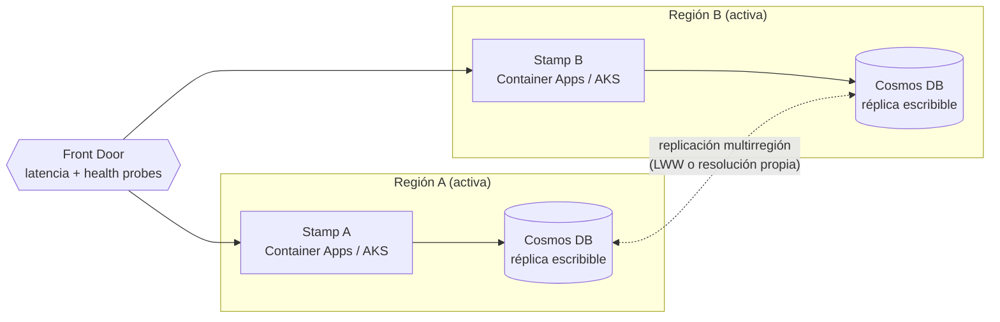
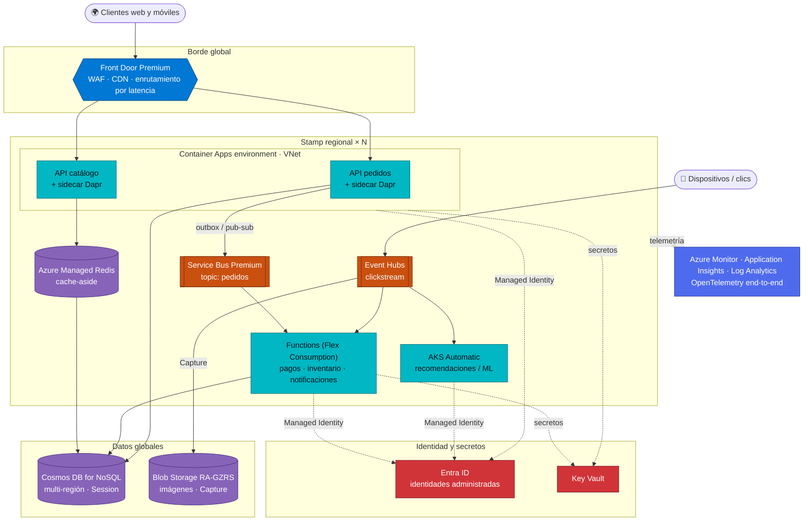
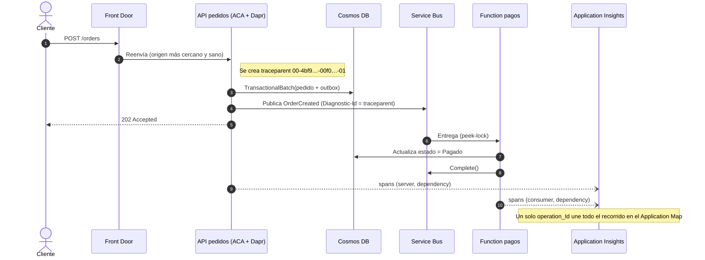

# 02 · Sistemas distribuidos en Azure

**Escalabilidad · Consistencia · Tolerancia a fallos · Comunicación asíncrona**

[⬅ 01 · Fundamentos](01-fundamentos-y-plataforma-global.md) · [🏠 Índice](../README.md) · [03 · Cómputo ➡](03-computo-y-contenedores.md)

> En el ecosistema de Microsoft Azure, el diseño y despliegue de sistemas distribuidos se fundamenta en
> **servicios gestionados** que resuelven los retos clásicos de la computación distribuida:
> **escalabilidad, consistencia, tolerancia a fallos y comunicación asíncrona**.

Este capítulo es el corazón del atlas. Organiza los servicios de Azure en **cinco pilares**, explica la teoría
que hay debajo de cada uno (CAP, PACELC, consenso, semántica de entrega) y termina con una arquitectura de
referencia completa y una matriz para elegir la combinación exacta de servicios según el tipo de sistema.

> [!NOTE]
> Estado verificado a **octubre de 2026**. Cada pilar tiene su capítulo de inmersión profunda (03 a 07), con
> límites, SKU, ejemplos de código y checklists de producción.

---

## Contenido

1. [Los retos clásicos y su respuesta en Azure](#1-los-retos-clásicos-y-su-respuesta-en-azure)
2. [Los cinco pilares](#2-los-cinco-pilares)
3. [Teoría que no caduca](#3-teoría-que-no-caduca)
4. [Patrones de diseño cloud y su servicio en Azure](#4-patrones-de-diseño-cloud-y-su-servicio-en-azure)
5. [Resiliencia: zonas, regiones y SLA compuesto](#5-resiliencia-zonas-regiones-y-sla-compuesto)
6. [Arquitectura de referencia integradora](#6-arquitectura-de-referencia-integradora)
7. [¿Qué combinación elegir?](#7-qué-combinación-elegir)
8. [Checklist del arquitecto distribuido](#8-checklist-del-arquitecto-distribuido)
9. [Referencias](#9-referencias)

---

## 1. Los retos clásicos y su respuesta en Azure

| Reto | Qué significa de verdad | Mecanismo que usa Azure | Servicios protagonistas |
|---|---|---|---|
| **Escalabilidad** | Crecer añadiendo nodos (*scale-out*) sin rediseñar; repartir datos y trabajo | Particionamiento (*sharding*), autoescalado basado en eventos (KEDA), conjuntos de escalado | AKS, Functions, Container Apps, Cosmos DB, Event Hubs |
| **Consistencia** | Qué ve un lector tras una escritura concurrente o remota | Réplicas con quórum, niveles de consistencia configurables, ETags (concurrencia optimista) | Cosmos DB, Azure Storage, Azure SQL |
| **Tolerancia a fallos** | Seguir operando cuando falla un proceso, nodo, zona o región | Replicación síncrona entre zonas, asíncrona entre regiones, *health probes*, *failover* automático | Zonas de disponibilidad, Front Door, Load Balancer, Cosmos DB (PPAF), almacenamiento ZRS/GZRS |
| **Comunicación asíncrona** | Desacoplar productores y consumidores en tiempo y en disponibilidad | Colas, pub/sub, *streaming* con log particionado, reintentos y *dead-lettering* | Service Bus, Event Hubs, Event Grid, Dapr pub/sub |
| **Observabilidad** *(el reto oculto)* | Entender una petición que atraviesa decenas de procesos | Trazas distribuidas W3C Trace Context, OpenTelemetry, correlación de logs | Azure Monitor, Application Insights, Managed Prometheus/Grafana |
| **Identidad y confianza** *(el otro reto oculto)* | Autenticar servicio a servicio sin secretos | Identidades administradas, federación de identidades de carga, mTLS | Microsoft Entra ID, Key Vault, Dapr/Istio mTLS |

---

## 2. Los cinco pilares

### 2.1 Pilar ① — Cómputo y orquestación de microservicios

| Servicio | Rol en un sistema distribuido | Garantía o capacidad clave | Inmersión |
|---|---|---|---|
| **Azure Kubernetes Service (AKS)** | Estándar más usado para sistemas distribuidos basados en contenedores. Azure gestiona el **plano de control** (API server, etcd con consenso Raft, scheduler, controladores) y el `kube-scheduler` reparte los pods entre nodos independientes agrupados en *node pools* | SLA del API server 99,95 % (tier Standard con zonas); hasta 5 000 nodos por clúster; **AKS Automatic** (GA sep-2025) gestiona también nodos, escalado y actualizaciones | [03 § AKS](03-computo-y-contenedores.md#3-azure-kubernetes-service-aks) |
| **Azure Functions** | Cómputo *serverless* que ejecuta código bajo demanda en respuesta a eventos distribuidos, escalando horizontalmente de forma automática y transparente | Plan **Flex Consumption**: escala por función hasta 1 000 instancias, integración con VNet, instancias *always ready*. **Durable Functions** para orquestaciones con estado | [03 § Functions](03-computo-y-contenedores.md#4-azure-functions) |
| **Azure Container Apps** | Microservicios sin gestionar Kubernetes directamente (corre sobre AKS + KEDA + Envoy). Soporte nativo para **Dapr** (*Distributed Application Runtime*): estado, *service discovery*, pub/sub, actores, workflows | Escala a cero, revisiones inmutables con división de tráfico, GPU *serverless*, **Sandboxes** con micro-VM (GA sep-2026) | [03 § Container Apps](03-computo-y-contenedores.md#5-azure-container-apps-y-dapr) |

> [!TIP]
> **Regla rápida:** ¿necesitas la API completa de Kubernetes (operadores, CRD, *service mesh* propio)? → **AKS**.
> ¿Microservicios HTTP/eventos sin operar clústeres? → **Container Apps**. ¿Código corto disparado por eventos? →
> **Functions**. La [guía de decisión de cómputo](16-guias-de-decision.md#1-cómputo) lo desarrolla.

### 2.2 Pilar ② — Almacenamiento y bases de datos distribuidas

| Servicio | Rol | Garantía clave | Inmersión |
|---|---|---|---|
| **Azure Cosmos DB** | Base de datos NoSQL insignia para sistemas distribuidos globalmente: replicación geográfica activa con un clic, escrituras multirregión y **cinco niveles de consistencia** (Strong, Bounded Staleness, Session, Consistent Prefix, Eventual) | SLA de latencia < 10 ms en P99 para lecturas y escrituras de 1 KB; disponibilidad hasta **99,999 %** multirregión; *per-partition automatic failover* (GA) | [04 § Cosmos DB](04-almacenamiento-y-bases-de-datos.md#3-azure-cosmos-db) |
| **Azure Storage** (Blob, Queue, Table, Files) | Datos estructurados y no estructurados con redundancia local, de zona o geográfica (LRS, ZRS, GRS, GZRS y variantes RA-) | Hasta **16 nueves** de durabilidad anual (GRS/GZRS); consistencia fuerte dentro de la región primaria | [04 § Storage](04-almacenamiento-y-bases-de-datos.md#2-azure-storage) |

> [!IMPORTANT]
> "Replicación con un clic" no significa "consistencia gratis". En Cosmos DB, **Strong** no está disponible con
> escrituras multirregión y las lecturas Strong/Bounded Staleness consumen **el doble de RU** porque leen de dos
> réplicas (quórum minoritario). Elige el nivel por caso de uso, no por defecto.

### 2.3 Pilar ③ — Mensajería e integración (desacoplamiento)

| Servicio | Rol | Garantía clave | Inmersión |
|---|---|---|---|
| **Azure Service Bus** | *Message broker* empresarial con colas y temas (*topics/subscriptions*). Crítico para comunicación asíncrona de alto valor: pedidos, pagos, comandos | *At-least-once* con *peek-lock*; **FIFO garantizado solo con sesiones de mensajes** (`SessionId`); transacciones, detección de duplicados, *dead-letter queue*; geo-replicación Premium (GA dic-2025) | [05 § Service Bus](05-mensajeria-e-integracion.md#3-azure-service-bus) |
| **Azure Event Hubs** | Plataforma de *data streaming* capaz de procesar **millones de eventos por segundo**; ideal para arquitecturas orientadas a eventos y telemetría | Log particionado y ordenado **por partición**; consumidores independientes con *checkpointing*; compatible con Apache Kafka; geo-replicación Premium/Dedicated (GA jul-2025) | [05 § Event Hubs](05-mensajeria-e-integracion.md#4-azure-event-hubs) |

> [!WARNING]
> Un error común es asumir que una cola de Service Bus entrega "en orden" por defecto. Con varios consumidores
> compitiendo, *prefetch* y reintentos, el orden global **no** está garantizado. Para orden estricto por entidad
> (pedido, cliente, dispositivo) usa **sesiones**; en Event Hubs, usa una **clave de partición** estable.

### 2.4 Pilar ④ — Enrutamiento y balanceo de carga global

| Servicio | Capa | Rol | Garantía clave | Inmersión |
|---|---|---|---|---|
| **Azure Front Door** | L7 (HTTP/S) global | Enrutador global escalable y seguro sobre la red de Microsoft (190+ sitios *edge*, anycast): dirige a cada usuario al *backend* más cercano o con mejor rendimiento; WAF, CDN, TLS en el borde | SLA 99,99 %; enrutamiento por latencia, prioridad o peso; orígenes privados vía Private Link (Premium) | [06 § Front Door](06-redes-y-entrega-global.md#3-azure-front-door) |
| **Azure Load Balancer** | L4 (TCP/UDP) regional o global | Distribuye el tráfico de red entre instancias para alta disponibilidad local; *pass-through* sin proxy | SLA 99,99 % (Standard); distribución por hash de 5 tuplas; **Global tier** para balanceo entre regiones | [06 § Load Balancer](06-redes-y-entrega-global.md#4-azure-load-balancer) |

> [!NOTE]
> Load Balancer no hace *round-robin*: reparte por **hash de 5 tuplas** (IP/puerto origen, IP/puerto destino,
> protocolo). Con muchos clientes la distribución es uniforme en agregado; con pocos clientes de larga duración
> puede no serlo. Para afinidad usa modos de 2 o 3 tuplas.

### 2.5 Pilar ⑤ — Monitoreo y observabilidad

| Servicio | Rol | Capacidad clave | Inmersión |
|---|---|---|---|
| **Azure Monitor / Application Insights** | Seguir el flujo de una petición entre múltiples servidores: **rastreo distribuido**, mapa de aplicación y centralización de logs para entender la salud real de todo el ecosistema | OpenTelemetry nativo (ingesta OTLP GA jun-2026), W3C Trace Context, KQL sobre Log Analytics, Managed Prometheus/Grafana, alertas dinámicas | [07 · Observabilidad](07-observabilidad-y-monitoreo.md) |

---

## 3. Teoría que no caduca

### 3.1 Las ocho falacias de la computación distribuida

Formuladas por L. Peter Deutsch y James Gosling en Sun Microsystems, siguen siendo la mejor lista de verificación de
supuestos peligrosos. Así las neutraliza Azure:

| # | Falacia | Realidad | Mitigación en Azure |
|---|---|---|---|
| 1 | La red es confiable | Paquetes se pierden, conexiones se cortan | Reintentos con *backoff* exponencial y *jitter* en todos los SDK de Azure; colas con *dead-letter* |
| 2 | La latencia es cero | Cruzar regiones cuesta decenas o cientos de ms | Front Door en el borde, Cosmos DB con lecturas locales, cachés (Azure Managed Redis) |
| 3 | El ancho de banda es infinito | Hay cuotas por VM, NIC y cuenta | *Claim-check* (Blob + mensaje ligero), compresión en Front Door, Event Hubs Capture |
| 4 | La red es segura | Todo es atacable | Private Link, NSG, Azure Firewall, WAF, TLS 1.2+ obligatorio, Zero Trust con Entra ID |
| 5 | La topología no cambia | Pods y nodos aparecen y desaparecen | DNS interno de Kubernetes/Container Apps, *service discovery* de Dapr, *health probes* |
| 6 | Hay un único administrador | Varios equipos, suscripciones, tenants | Management groups, Azure Policy, RBAC, Azure Lighthouse |
| 7 | El transporte no cuesta | Serialización, salida de datos (*egress*) y TLS cuestan | Protocolos binarios (AMQP, gRPC), mantener tráfico intrarregional, Private Link |
| 8 | La red es homogénea | Híbrido, multicloud, borde | Azure Arc, Azure Local, ExpressRoute, IoT Operations |

### 3.2 CAP y PACELC aplicados a Azure

**CAP** (Brewer, 2000): ante una partición de red (P) un sistema elige entre consistencia (C) y disponibilidad (A).
**PACELC** (Abadi, 2010) completa la idea: *si hay Partición, A o C; si no (Else), Latencia o Consistencia*.

| Servicio y configuración | Durante partición (P→A/C) | En operación normal (E→L/C) | Lectura práctica |
|---|---|---|---|
| Cosmos DB · Strong (una región de escritura) | C | C | Linealizable; latencia de escritura = RTT a la región más lejana |
| Cosmos DB · Bounded Staleness | C (dentro de la ventana) | C/L | Retraso acotado por K versiones o T segundos |
| Cosmos DB · Session (por defecto) | A | L | *Read-your-writes* por sesión (token de sesión) |
| Cosmos DB · Consistent Prefix / Eventual | A | L | Máxima disponibilidad y menor coste en RU |
| Cosmos DB · escrituras multirregión | A | L | Conflictos resueltos con *Last-Writer-Wins* o lógica propia |
| Azure Storage (región primaria) | C | C | Consistencia fuerte intrarregional |
| Azure Storage · secundaria RA-GRS/RA-GZRS | A | L | Replicación asíncrona; consulta `Last Sync Time` |
| Azure SQL · réplica geográfica | C (primaria) / A (secundarias legibles) | C (primaria) / L (secundarias) | Replicación asíncrona; *failover groups* |
| Azure Managed Redis · geo-replicación activa | A | L | Convergencia mediante CRDT |
| DNS / Traffic Manager | A | L | Consistencia eventual gobernada por TTL |

> [!CAUTION]
> CAP/PACELC es un **modelo mental**, no una etiqueta oficial. La tabla es una aproximación pedagógica: los
> servicios combinan mecanismos distintos por capa (control vs datos, intra vs inter región).

### 3.3 El espectro de consistencia

| Nivel Cosmos DB | Garantía formal | Coste de lectura | Úsalo para |
|---|---|---|---|
| **Strong** | Linealizabilidad | 2× RU (quórum minoritario local) | Saldos, inventario crítico, *leader election* |
| **Bounded Staleness** | Lecturas con retraso ≤ K versiones o T tiempo | 2× RU | Marcadores, precios con tolerancia acotada |
| **Session** | *Read-your-writes*, lecturas y escrituras monótonas, *writes-follow-reads* en la sesión | 1× RU | 90 % de las apps (carritos, perfiles) |
| **Consistent Prefix** | Nunca ves escrituras fuera de orden | 1× RU | Feeds sociales, comentarios |
| **Eventual** | Convergencia | 1× RU | Contadores, likes, telemetría no crítica |

### 3.4 Tiempo, orden y causalidad

Los relojes físicos derivan; los sistemas distribuidos ordenan con **relojes lógicos**. Azure expone esos
mecanismos así:

| Mecanismo | Dónde aparece en Azure | Para qué sirve |
|---|---|---|
| Número de secuencia monótono | `SequenceNumber` en Service Bus; `SequenceNumber` y `Offset` por partición en Event Hubs | Ordenar y reanudar lectura (*checkpoint*) |
| Marca de tiempo de servidor | `_ts` en Cosmos DB; `EnqueuedTimeUtc` en mensajería | Resolución de conflictos LWW, TTL |
| Token de sesión | Cabecera `x-ms-session-token` en Cosmos DB | Garantizar *read-your-writes* entre peticiones |
| ETag | Cosmos DB, Storage, ARM (`If-Match`) | Concurrencia optimista: evitar *lost updates* |
| Lease (arrendamiento) | Blob lease (15–60 s o infinito); *lease container* del change feed | Elección de líder, reparto de particiones |
| Trace context | `traceparent` / `tracestate` (W3C) en Application Insights | Causalidad entre servicios en una traza |

### 3.5 Consenso y replicación bajo el capó

- **AKS:** etcd usa **Raft**; tolera la caída de una minoría de miembros. Azure lo opera por ti.
- **Cosmos DB:** cada partición física es un *replica-set* (cuatro réplicas en la región, repartidas en zonas si
  están habilitadas). Las escrituras se confirman por quórum mayoritario; las lecturas Session/Prefix/Eventual
  leen de una réplica y Strong/Bounded de dos.
- **Azure Storage:** arquitectura de *stamps* (front-end, *partition layer*, *stream layer*). Dentro de la región la
  replicación es **síncrona** (LRS en un datacenter, ZRS entre zonas); entre regiones es **asíncrona** (GRS/GZRS).

### 3.6 Semántica de entrega por servicio

| Servicio | Por defecto | Cómo lograr "efectivamente una vez" |
|---|---|---|
| Service Bus · *peek-lock* | *At-least-once* | Detección de duplicados por `MessageId` (ventana hasta 7 días) + consumidor idempotente; transacciones dentro del *namespace* |
| Service Bus · *receive-and-delete* | *At-most-once* | No aplica (aceptas pérdida) |
| Event Hubs | *At-least-once* (reprocesa desde el último *checkpoint*) | Clave de idempotencia en el destino (p. ej., `id` de Cosmos DB = `partition+sequenceNumber`) |
| Event Grid | *At-least-once* con reintentos (por defecto hasta 24 h) y *dead-letter* a Blob | Deduplicar por `id` del evento CloudEvents |
| Storage Queues | *At-least-once* (timeout de visibilidad) | `DequeueCount` + idempotencia |
| Dapr pub/sub | *At-least-once* | Idempotencia en el *handler* |
| Durable Functions | Reproducción determinista (*replay*) del orquestador | Actividades idempotentes |

> [!TIP]
> "Exactly-once" de extremo a extremo no existe en redes asíncronas: se construye con
> **at-least-once + idempotencia**. Diseña cada consumidor para que procesar dos veces el mismo mensaje no tenga efecto.

### 3.7 Modos de falla que debes diseñar

| Falla | Ejemplo en Azure | Defensa |
|---|---|---|
| Caída (*crash*) | Nodo de AKS reiniciado por mantenimiento | Réplicas ≥ 2, `PodDisruptionBudget`, zonas |
| Omisión | Respuesta perdida tras un *commit* | Idempotencia, reintentos seguros |
| Temporización | Dependencia lenta (P99 alto) | *Timeouts* agresivos, *hedged requests*, *bulkheads* |
| Falla gris (*gray failure*) | Nodo "sano" según *probe* pero degradado | Probes de profundidad, detección por métricas de cliente, *outlier detection* |
| Falla metaestable | Tormenta de reintentos tras un pico | *Jitter*, *circuit breaker*, *load shedding*, cuotas (API Management) |
| Partición de red | Pérdida de conectividad entre regiones | Elección explícita AP/CP, escrituras multirregión o *failover* |
| Falla de región | Incidente regional | Arquitectura multirregión activa-activa o activa-pasiva probada con Chaos Studio |

---

## 4. Patrones de diseño cloud y su servicio en Azure

| Categoría | Patrón | Problema que resuelve | Implementación en Azure |
|---|---|---|---|
| Mensajería | **Queue-Based Load Leveling** | Picos que saturan un servicio | Service Bus / Storage Queues + Functions o KEDA |
| Mensajería | **Competing Consumers** | Procesar en paralelo | Varias réplicas leyendo la misma cola de Service Bus |
| Mensajería | **Publisher-Subscriber** | Difundir eventos a N interesados | Service Bus topics, Event Grid, Dapr pub/sub |
| Mensajería | **Claim-Check** | Mensajes grandes | Payload en Blob Storage, referencia (SAS o identidad) en el mensaje |
| Mensajería | **Sequential Convoy** | Orden por entidad con paralelismo global | Sesiones de Service Bus |
| Mensajería | **Priority Queue** | Clientes VIP primero | Colas separadas o filtros de suscripción + consumidores dedicados |
| Mensajería | **Asynchronous Request-Reply** | Operaciones largas tras HTTP | `202 Accepted` + endpoint de estado (Durable Functions lo trae de serie) |
| Datos | **CQRS** | Lecturas y escrituras con necesidades distintas | Escritura en Cosmos DB → *change feed* → vistas de lectura |
| Datos | **Event Sourcing** | Auditoría completa y reconstrucción | Event Hubs / Cosmos DB como log de eventos + proyecciones |
| Datos | **Materialized View** | Consultas caras | *Change feed* de Cosmos DB, Global Secondary Indexes (GA) |
| Datos | **Sharding** | Datos que no caben en un nodo | Clave de partición de Cosmos DB, SQL Hyperscale, PostgreSQL elastic clusters |
| Datos | **Cache-Aside** | Latencia y coste de lectura | Azure Managed Redis |
| Datos | **Valet Key** | Subir o descargar sin pasar por tu API | SAS de delegación de usuario en Blob Storage |
| Datos | **Index Table** | Consultar por atributos no clave | Global Secondary Indexes de Cosmos DB, tablas índice |
| Consistencia | **Saga** | Transacciones entre servicios sin 2PC | Durable Functions (orquestada) o Service Bus/Event Grid (coreografiada) |
| Consistencia | **Transactional Outbox** | Escribir dato y publicar evento atómicamente | *Transactional batch* de Cosmos DB + *change feed* → Service Bus |
| Consistencia | **Compensating Transaction** | Deshacer pasos ya confirmados | Actividades de compensación en Durable Functions / Logic Apps |
| Resiliencia | **Retry** | Fallos transitorios | Políticas de reintento de los SDK, políticas de resiliencia de Dapr |
| Resiliencia | **Circuit Breaker** | Proteger dependencias degradadas | Dapr resiliency, Polly (.NET), Istio *outlier detection* |
| Resiliencia | **Bulkhead** | Aislar fallos | *Node pools* separados, *namespaces* de Service Bus por dominio |
| Resiliencia | **Health Endpoint Monitoring** | Detectar instancias enfermas | Probes de Front Door/Load Balancer, *liveness/readiness* en Kubernetes |
| Resiliencia | **Leader Election** | Una sola instancia coordinadora | Blob lease, *Lease API* de Kubernetes |
| Resiliencia | **Throttling / Rate Limiting** | Proteger capacidad | Políticas `rate-limit-by-key` de API Management, WAF *rate limit* |
| Arquitectura | **Geode** | Usuarios globales con baja latencia | Front Door + despliegues regionales + Cosmos DB multirregión |
| Arquitectura | **Deployment Stamps** | Escala por celdas y aislamiento de *blast radius* | Plantillas Bicep por *stamp* + Front Door |
| Arquitectura | **Strangler Fig** | Modernizar un monolito por partes | API Management o Front Door enrutando por ruta |
| Arquitectura | **Anti-Corruption Layer** | Aislar modelos heredados | API Management, Logic Apps |
| Arquitectura | **Backends for Frontends** | APIs por tipo de cliente | API Management + Container Apps por canal |
| Arquitectura | **Gateway Routing / Aggregation / Offloading** | Un punto de entrada | API Management, Application Gateway, Front Door |
| Arquitectura | **Sidecar / Ambassador** | Capacidades transversales sin tocar código | Dapr, Istio (complemento de AKS) |
| Seguridad | **Federated Identity** | Autenticación sin secretos | Microsoft Entra ID, identidades de carga federadas |
| Seguridad | **Gatekeeper** | Validar antes de llegar al *backend* | WAF de Front Door/Application Gateway, API Management |

### 4.1 Saga orquestada con Durable Functions

### 4.2 Transactional Outbox con Cosmos DB

---

## 5. Resiliencia: zonas, regiones y SLA compuesto

### 5.1 Matemática del SLA compuesto

- **En serie** (A depende de B): `SLA = SLA_A × SLA_B`
- **En paralelo** (A o B sirven): `SLA = 1 − (1 − SLA_A) × (1 − SLA_B)`

| Cadena (valores ilustrativos) | Cálculo | SLA resultante | Inactividad máx./mes (≈730 h) |
|---|---|---|---|
| Front Door → Container Apps → Cosmos DB (1 región) | 0,9999 × 0,9995 × 0,9999 | **99,93 %** | ≈ 31 min |
| La misma cadena desplegada en **dos regiones** activas | 1 − (1 − 0,9993)² , y × Front Door | **≈ 99,99 %** | ≈ 4 min |

> [!IMPORTANT]
> Un SLA es un compromiso **contractual de crédito**, no una garantía física. Los valores exactos dependen del tier,
> de usar zonas y de la configuración. Consulta siempre el documento oficial *Service Level Agreements for Online
> Services* antes de comprometer un SLO con tu negocio.

### 5.2 Estrategias de recuperación ante desastres

| Estrategia | RTO típico | RPO típico | Coste relativo | Servicios clave |
|---|---|---|---|---|
| Backup y restauración | Horas a días | Horas | $ | Azure Backup, almacenamiento GRS, restauración PITR |
| *Pilot light* | Decenas de minutos | Minutos | $$ | Datos replicados + cómputo mínimo apagado (IaC lista) |
| *Warm standby* (activo-pasivo) | Minutos | Segundos a minutos | $$$ | SQL *failover groups*, Service Bus geo-replicación, Front Door por prioridad |
| Activo-activo multirregión | Segundos (casi cero) | ≈ 0 a segundos | $$$$ | Cosmos DB multi-write, Front Door por latencia, despliegues idénticos por *stamp* |

### 5.3 Zonas de disponibilidad: lo que hay que saber

- Una **zona** es un grupo de centros de datos con energía, refrigeración y red independientes dentro de una región.
- Los servicios son **zonales** (los fijas a una zona: VM, disco), **redundantes de zona** (Azure reparte réplicas:
  ZRS, Cosmos DB con AZ, Service Bus Premium) o **no regionales/globales** (Front Door, Entra ID, Traffic Manager).
- El número lógico de zona (1, 2, 3) **se mapea distinto por suscripción**: la zona 1 de tu suscripción puede ser la
  zona física 2 de otra. Usa la API `checkZonePeers` si coordinas entre suscripciones.

---

## 6. Arquitectura de referencia integradora

Un sistema de comercio global que usa los cinco pilares a la vez:

### 6.1 Recorrido de una petición con trazado distribuido

---

## 7. ¿Qué combinación elegir?

Respuesta directa a la pregunta "¿qué tipo de sistema distribuido estás construyendo?":

| Escenario | Cómputo | Datos | Mensajería | Enrutamiento | Observabilidad | Arquitectura completa |
|---|---|---|---|---|---|---|
| **App web global** | Container Apps o App Service por región | Cosmos DB multirregión + Managed Redis | Service Bus para tareas en segundo plano | Front Door Premium (+ WAF) | Application Insights + disponibilidad | [15 § 1](15-arquitecturas-de-referencia.md#1-aplicación-web-global-activa-activa) |
| **Microservicios** | AKS (plataforma propia) o Container Apps + Dapr | Base por servicio: Cosmos DB, Azure SQL, PostgreSQL | Service Bus (comandos) + Event Grid (eventos) | Front Door → API Management → servicios | OTel + Application Map + Managed Grafana | [15 § 2](15-arquitecturas-de-referencia.md#2-microservicios-en-aks-o-container-apps) |
| **Big Data / streaming** | Fabric Spark, Databricks, Stream Analytics, Functions | OneLake / ADLS Gen2 (Delta), Eventhouse | Event Hubs (Kafka) | Private Link, ExpressRoute | Monitor + métricas de *lag* | [15 § 3](15-arquitecturas-de-referencia.md#3-big-data-y-streaming-en-tiempo-real) |
| **IoT industrial** | IoT Operations en el borde, Functions | Eventhouse, Digital Twins, ADLS | IoT Hub, Event Grid MQTT, Event Hubs | — | Monitor + alertas de dispositivo | [15 § 4](15-arquitecturas-de-referencia.md#4-iot-industrial-del-borde-a-la-nube) |
| **IA / agentes / RAG** | Foundry Agent Service, Container Apps (GPU, Sandboxes) | AI Search (Foundry IQ), Cosmos DB vectorial | Service Bus para tareas largas | API Management *AI gateway* | Trazas OTel GenAI en Foundry + App Insights | [15 § 5](15-arquitecturas-de-referencia.md#5-ia-generativa-rag-y-agentes) |
| **Transaccional empresarial** | App Service / AKS | Azure SQL (Business Critical o Hyperscale) | Service Bus Premium (sesiones, transacciones) | Application Gateway + Front Door | Monitor + SQL Insights | [15 § 6](15-arquitecturas-de-referencia.md#6-sistema-transaccional-empresarial) |
| **Híbrido / soberano** | Azure Local + AKS Arc | SQL Server habilitado por Arc | Event Grid en el borde, Service Bus | ExpressRoute | Azure Monitor vía Arc | [15 § 7](15-arquitecturas-de-referencia.md#7-híbrido-y-nube-soberana) |

---

## 8. Checklist del arquitecto distribuido

- [ ] Cada dependencia tiene **timeout**, **reintentos con jitter** y **circuit breaker**.
- [ ] Todos los consumidores de mensajes son **idempotentes** (clave natural o `MessageId`).
- [ ] El orden se garantiza **solo donde importa** (sesiones/partición), no globalmente.
- [ ] El nivel de consistencia de cada contenedor de Cosmos DB está **justificado por caso de uso**.
- [ ] La **clave de partición** tiene alta cardinalidad y distribuye lecturas y escrituras.
- [ ] Hay **dead-letter queues** monitoreadas con alertas y un proceso de reprocesamiento.
- [ ] Servicios críticos desplegados **redundantes de zona**; el plan multirregión está **probado** (Chaos Studio).
- [ ] Se propagan `traceparent`/`tracestate` en HTTP **y** en mensajería.
- [ ] No hay secretos en código: **identidades administradas** + Key Vault.
- [ ] Se definieron **SLO** (no solo SLA) con presupuesto de error y alertas por *burn rate*.
- [ ] La infraestructura es **IaC** (Bicep/Terraform) y los despliegues son progresivos (*canary*, *blue-green*).
- [ ] Se ejecutaron pruebas de carga (Azure Load Testing) a 2× el pico esperado.

---

## 9. Referencias

- [Azure Architecture Center — Cloud design patterns](https://learn.microsoft.com/azure/architecture/patterns/)
- [Azure Well-Architected Framework](https://learn.microsoft.com/azure/well-architected/)
- [Consistency levels in Azure Cosmos DB](https://learn.microsoft.com/azure/cosmos-db/consistency-levels)
- [Message sessions (Service Bus)](https://learn.microsoft.com/azure/service-bus-messaging/message-sessions)
- [Event Hubs features and terminology](https://learn.microsoft.com/azure/event-hubs/event-hubs-features)
- [Distributed tracing and telemetry correlation (Application Insights)](https://learn.microsoft.com/azure/azure-monitor/app/distributed-trace-data)
- [Mission-critical workloads on Azure](https://learn.microsoft.com/azure/well-architected/mission-critical/)
- Brewer, E. *Towards Robust Distributed Systems* (PODC 2000) · Abadi, D. *Consistency Tradeoffs in Modern
  Distributed Database System Design* (IEEE Computer, 2012) · Calder, B. et al. *Windows Azure Storage: A Highly
  Available Cloud Storage Service with Strong Consistency* (SOSP 2011) · Huang, P. et al. *Gray Failure: The
  Achilles' Heel of Cloud-Scale Systems* (HotOS 2017).

---

[⬅ 01 · Fundamentos](01-fundamentos-y-plataforma-global.md) · [🏠 Índice](../README.md) · [03 · Cómputo ➡](03-computo-y-contenedores.md)

