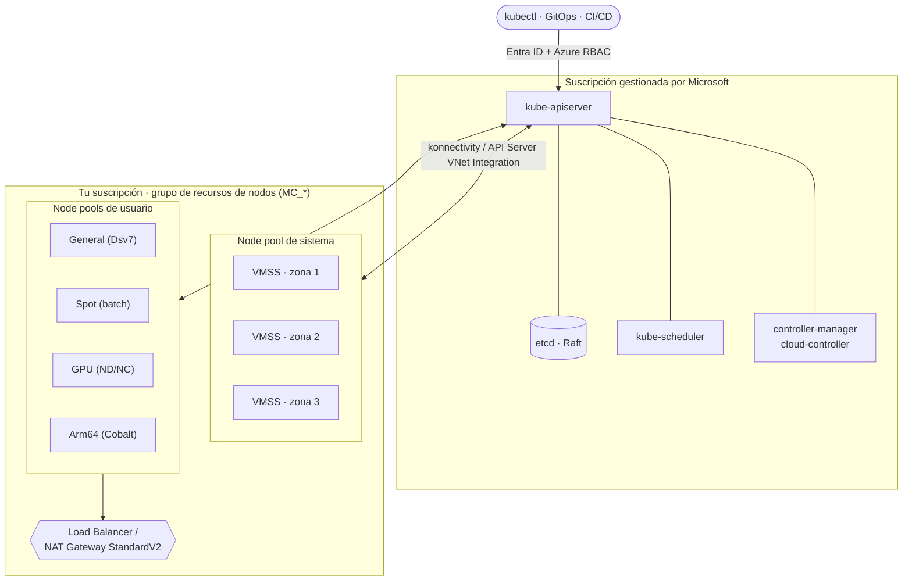
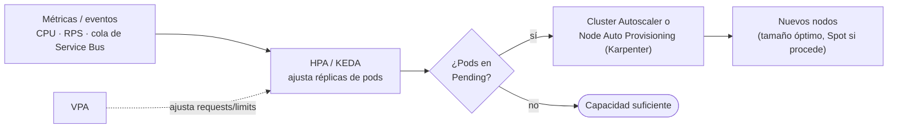
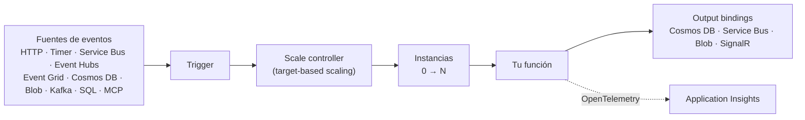
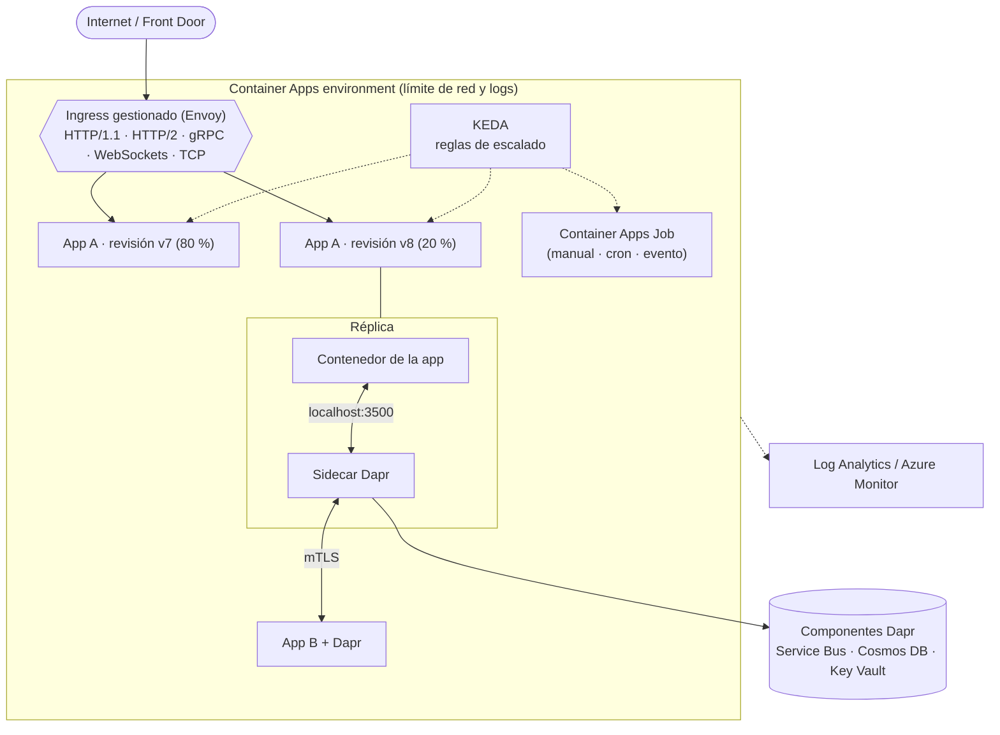

<div align="center">

# 03 · Cómputo y contenedores

**Máquinas virtuales · AKS · Azure Functions · Container Apps + Dapr · App Service · Batch · HPC**

[⬅ 02 · Sistemas distribuidos](02-sistemas-distribuidos-en-azure.md) · [🏠 Índice](../README.md) · [04 · Datos ➡](04-almacenamiento-y-bases-de-datos.md)

</div>

> [!NOTE]
> **Leyenda de estado** usada en todo el atlas: 🟢 GA · 🟡 Preview · 🟠 En retiro (fecha) · ⛔ Retirado ·
> 🆕 Novedad 2025–2026. Estado verificado a **octubre de 2026**.

---

## Contenido

1. [Mapa del cómputo en Azure](#1-mapa-del-cómputo-en-azure)
2. [Máquinas virtuales](#2-máquinas-virtuales)
3. [Azure Kubernetes Service (AKS)](#3-azure-kubernetes-service-aks)
4. [Azure Functions](#4-azure-functions)
5. [Azure Container Apps y Dapr](#5-azure-container-apps-y-dapr)
6. [Azure App Service](#6-azure-app-service)
7. [Resto del catálogo de cómputo](#7-resto-del-catálogo-de-cómputo)
8. [Comparativa final](#8-comparativa-final)
9. [Novedades y retiros](#9-novedades-y-retiros)
10. [Referencias](#10-referencias)

---

## 1. Mapa del cómputo en Azure

```mermaid
flowchart LR
    subgraph IAAS["IaaS · máximo control"]
        VM["Virtual Machines"]
        VMSS["Virtual Machine<br/>Scale Sets"]
        DH["Dedicated Host"]
        AVS["Azure VMware<br/>Solution"]
    end
    subgraph CAAS["CaaS · contenedores"]
        AKS["AKS"]
        ARO["Azure Red Hat<br/>OpenShift"]
        ACI["Container<br/>Instances"]
    end
    subgraph PAAS["PaaS · plataforma"]
        ACA["Container Apps"]
        APP["App Service"]
        SF["Service Fabric"]
        BATCH["Batch"]
    end
    subgraph FAAS["FaaS · serverless"]
        FN["Functions"]
        LA["Logic Apps"]
    end
    IAAS -->|"menos operación"| CAAS -->|"menos operación"| PAAS -->|"menos operación"| FAAS
    classDef i fill:#003A6C,color:#fff,stroke:#001b33
    classDef c fill:#0078D4,color:#fff,stroke:#003A6C
    classDef p fill:#00B7C3,color:#04121a,stroke:#006B74
    classDef f fill:#50E6FF,color:#04121a,stroke:#0099BC
    class VM,VMSS,DH,AVS i
    class AKS,ARO,ACI c
    class ACA,APP,SF,BATCH p
    class FN,LA f
```



| Servicio | Modelo | Estado | En una frase | Escala a cero |
|---|---|---|---|---|
| Virtual Machines | IaaS | 🟢 | VM Windows/Linux con control total del SO | No |
| Virtual Machine Scale Sets (Flexible) | IaaS | 🟢 | Flotas de VM idénticas o mixtas con autoescalado y zonas | Sí (a 0 instancias) |
| Spot Virtual Machines | IaaS | 🟢 | Capacidad sobrante con descuento alto, desalojable | — |
| Azure Dedicated Host | IaaS | 🟢 | Servidor físico dedicado para cumplimiento o licencias | No |
| Azure Compute Fleet | IaaS | 🟢 | Aprovisiona miles de VM mezclando tamaños y Spot/estándar | — |
| Azure VMware Solution | IaaS | 🟢 | Nube privada VMware (vSphere, vSAN, NSX) sobre bare metal | No |
| Azure Kubernetes Service | CaaS | 🟢 | Kubernetes gestionado; modo **Automatic** o Standard | Nodos de usuario sí |
| Azure Red Hat OpenShift | CaaS | 🟢 | OpenShift operado conjuntamente por Microsoft y Red Hat | No |
| Azure Container Instances | CaaS | 🟢 | Contenedores bajo demanda sin orquestador, por segundo | Sí |
| Azure Container Apps | PaaS/serverless | 🟢 | Microservicios serverless sobre Kubernetes + KEDA + Dapr + Envoy | Sí |
| Azure App Service | PaaS | 🟢 | Web apps y APIs (código o contenedor) con *slots* y autoescalado | No |
| Azure Functions | FaaS | 🟢 | Código disparado por eventos, facturación por ejecución | Sí |
| Azure Service Fabric | PaaS | 🟢 | Plataforma de microservicios con estado (*Reliable Services/Actors*) | No |
| Azure Batch | PaaS | 🟢 | Trabajos paralelos y HPC a gran escala | Sí |
| Azure CycleCloud | IaaS-orq. | 🟢 | Orquesta clústeres HPC (Slurm, PBS Pro, LSF, Grid Engine) | — |
| Azure Container Registry | Soporte | 🟢 | Registro OCI privado con geo-replicación y *tasks* | — |
| Azure Kubernetes Fleet Manager | Soporte | 🟢 | Gobierno y actualizaciones de hasta 1 000 clústeres 🆕 | — |
| Azure Compute Gallery / VM Image Builder | Soporte | 🟢 | Imágenes doradas versionadas y replicadas | — |
| Azure Spring Apps | PaaS | 🟠 31-mar-2028 | Migrar a Container Apps o AKS | — |
| Cloud Services (extended support) | PaaS | 🟠 31-mar-2027 | Migrar a VMSS, App Service o AKS | — |

---

## 2. Máquinas virtuales

### 2.1 Cómo leer el nombre de una VM

`Standard_D16ads_v5` se descompone así:

| Parte | Valor | Significado |
|---|---|---|
| Familia | `D` | Propósito general |
| vCPU | `16` | Número de vCPU |
| Aditivos | `a` | Procesador AMD |
| | `d` | Disco temporal local |
| | `s` | Compatible con Premium Storage |
| Versión | `v5` | Generación de hardware |

Otros aditivos: `p` = Arm (Cobalt), `l` = poca memoria por vCPU, `m` = memoria intensiva, `i` = tamaño aislado,
`b` = rendimiento de almacenamiento en bloque mejorado, `t` = memoria mínima, `C` = *confidential*.

### 2.2 Familias (octubre 2026)

| Familia | Propósito | Series destacadas actuales | Cuándo |
|---|---|---|---|
| **B** | *Burstable* | Bsv2, Basv2, Bpsv2 (Arm) | Dev/test, cargas con picos esporádicos |
| **D** | Propósito general | 🆕 Dsv7/Dlsv7 (Intel Xeon 6, GA may-2026), 🆕 Dasv7/Dalsv7 (AMD EPYC "Turin", GA ene-2026), Dpsv6 (Cobalt 100), Dsv6, Dasv6 | Web, APIs, microservicios, bases medianas |
| **E** | Memoria | 🆕 Esv7, 🆕 Easv7, Epsv6, Esv6 | Bases de datos, caché, analítica en memoria |
| **F** | Cómputo | 🆕 Fasv7/Falsv7/Famsv7, Fsv2 | Batch, *gaming servers*, codificación |
| **L** | Almacenamiento | Lsv3, Lasv3 y sucesoras | NoSQL, data warehouses con NVMe local |
| **M** | Memoria masiva | Mv3/Msv3 | SAP HANA y bases de varios TiB |
| **N** | GPU | NCads H100 v5 (cómputo), ND H100/H200 v5, ND MI300X v5, ND GB200 v6, ND GB300 v6 (IA a escala), NVads A10 v5 / NVads V710 v5 (visualización) | Entrenamiento, inferencia, VDI gráfico |
| **H** | HPC | HBv4, HBv5, HX | CFD, simulación, ciencias |
| **DC/EC** | *Confidential* | DCasv5/ECasv5 (AMD SEV-SNP), DCesv5/ECesv5 (Intel TDX), NCC H100 v5 (GPU confidencial) | Datos en uso cifrados |
| **Cobalt 200** | Arm de Microsoft | 🟡 *Early access* (Build 2026), hasta 128 vCPU, +50 % vs Cobalt 100 | Linux nativo de nube y agentes |

> [!TIP]
> Las generaciones v7 prometen hasta **+35 %** (AMD Turin) y **+20 %** (Intel Xeon 6) de rendimiento frente a v6, y en
> agosto de 2026 llegaron tamaños de **372 vCPU y 2,8 TiB** de memoria. Antes de reservar capacidad, compara
> precio/rendimiento con pruebas reales.

### 2.3 Disponibilidad y SLA de VM

| Configuración | SLA de conectividad | Protege contra |
|---|---|---|
| VM única con Premium SSD, Premium SSD v2 o Ultra Disk | 99,9 % | Fallas de host (con *live migration*) |
| VM única con Standard SSD | 99,5 % | — |
| VM única con Standard HDD | 95 % | — |
| Dos o más VM en un **availability set** | 99,95 % | Fallas de rack (*fault domains*) y mantenimiento (*update domains*) |
| Dos o más VM en **zonas de disponibilidad** distintas | 99,99 % | Pérdida de un datacenter completo |

**Virtual Machine Scale Sets** en modo **Flexible** es la opción recomendada para flotas: mezcla tamaños, reparte
en zonas y *fault domains*, combina Spot y capacidad regular, y se integra con Load Balancer y Application Gateway.

### 2.4 Modelos de precio de cómputo

| Modelo | Ahorro orientativo* | Compromiso | Ideal para |
|---|---|---|---|
| Pago por uso | — | Ninguno | Cargas impredecibles |
| Reservas (1 o 3 años) | hasta ~72 % | Tamaño/región concretos | Cargas estables 24×7 |
| Savings Plan for Compute | hasta ~65 % | Gasto horario fijo | Flotas cambiantes entre familias y regiones |
| Spot | hasta ~90 % | Desalojo con 30 s de aviso | Batch, CI, renderizado, nodos Spot de AKS |
| Azure Hybrid Benefit | Licencias Windows Server/SQL Server/RHEL/SLES | Licencias con Software Assurance | Migraciones *lift-and-shift* |

\* Cifras de marketing de Microsoft; dependen de región, serie y plazo. Desde el 1-jul-2026 se retiraron reservas
para algunas familias antiguas de VM: usa Savings Plan o series nuevas.

---

## 3. Azure Kubernetes Service (AKS)

### 3.1 Arquitectura



Azure opera el **plano de control** (API server, etcd, scheduler y controladores) sin costo en el tier Free y con
SLA financiero en Standard/Premium. Tú decides los *node pools* (en modo Standard) o dejas que AKS los gestione
(modo **Automatic**).

### 3.2 Tiers del plano de control y modos

| Tier | SLA del API server | Escala | Extras | Para |
|---|---|---|---|---|
| **Free** | Sin SLA financiero (SLO 99,5 %) | Recomendado ≤ 10 nodos | — | Dev/test, aprendizaje |
| **Standard** | 99,95 % con zonas · 99,9 % sin zonas | Hasta 5 000 nodos | Escala de API server reforzada | Producción |
| **Premium** | Igual que Standard | Igual que Standard | **Long Term Support**: 2 años por versión | Regulados, ciclos de cambio lentos |

| Capacidad | AKS Standard (modo clásico) | 🆕 AKS Automatic (GA sep-2025) |
|---|---|---|
| Node pools | Los diseñas y operas tú | Gestionados; **node pools de sistema administrados (GA Build 2026)** |
| Escalado de nodos | Cluster Autoscaler o NAP opcional | Node Auto Provisioning (Karpenter) siempre activo |
| Red | A elección | Azure CNI Overlay + Cilium |
| Ingress | A elección | Routing de aplicaciones gestionado |
| Actualizaciones | Canales configurables | Automáticas con ventanas de mantenimiento |
| Seguridad | Configurable | Workload Identity, *Deployment Safeguards*, Image Cleaner, API server con VNet |
| Observabilidad | Opcional | Managed Prometheus, Container Insights y Grafana preconfigurados |

### 3.3 Redes

| Modelo de red | IP de los pods | Escala | Estado | Notas |
|---|---|---|---|---|
| **Azure CNI Overlay** | Espacio privado superpuesto (no consume IP de la VNet) | Muy alta | 🟢 Recomendado | Opción por defecto moderna |
| **Azure CNI Powered by Cilium** | Overlay o VNet | Muy alta | 🟢 | Plano de datos eBPF, políticas de red eficientes |
| Azure CNI (subred de nodos) | IP de la VNet por pod | Limitada por la subred | 🟢 | Pods accesibles directamente desde la VNet |
| Azure CNI (subred de pods, asignación dinámica) | IP de una subred dedicada | Alta | 🟢 | Segmentación por *node pool* |
| kubenet | NAT en el nodo | Hasta 400 nodos | 🟠 31-mar-2028 | Migrar a CNI Overlay |
| BYO CNI | La que traigas | — | 🟢 | Soporte limitado de Microsoft |

**Advanced Container Networking Services (ACNS)** añade observabilidad de flujos (Hubble/Retina), filtrado por FQDN y
políticas L7 sobre Cilium.

**Entrada de tráfico (ingress) en 2026**

| Opción | API | Estado |
|---|---|---|
| Application routing add-on (NGINX gestionado) | Ingress | 🟠 Parches críticos hasta **nov-2026** (el proyecto upstream ingress-nginx terminó su mantenimiento en mar-2026) |
| Application routing con **Gateway API** | Gateway API | 🟢 Ruta de migración oficial; convive con NGINX para migrar por DNS |
| Application Gateway for Containers | Ingress + Gateway API | 🟢 Con WAF (GA) |
| Complemento de *service mesh* basado en Istio | Gateway API / Istio | 🟢 |

**Salida de tráfico (egress):** *outbound rules* del Load Balancer, **NAT Gateway StandardV2** administrado (opción por
defecto para clústeres nuevos con `managedNATGateway` desde oct-2026) o UDR hacia Azure Firewall.

### 3.4 Escalado en dos niveles



| Componente | Nivel | Señal | Comentario |
|---|---|---|---|
| Horizontal Pod Autoscaler | Pods | CPU/memoria/métricas personalizadas | Nativo de Kubernetes |
| **KEDA** (complemento) | Pods | 60+ *scalers*: Service Bus, Event Hubs, Kafka, Prometheus, cron | Permite escalar a cero |
| Vertical Pod Autoscaler (complemento) | Pods | Uso histórico | No combinar con HPA sobre la misma métrica |
| Cluster Autoscaler | Nodos | Pods pendientes | Por *node pool* |
| **Node Auto Provisioning** | Nodos | Pods pendientes | Elige el tamaño de VM óptimo (Karpenter) |
| Virtual nodes | Nodos virtuales | — | Ráfagas sobre Container Instances |

### 3.5 Identidad y seguridad

| Capa | Mecanismo recomendado |
|---|---|
| Acceso humano al API server | Integración con **Microsoft Entra ID** + Azure RBAC para Kubernetes; cuentas locales deshabilitadas |
| Identidad de pods | **Microsoft Entra Workload ID** (emisor OIDC + credencial federada; sin secretos) |
| Secretos | Secrets Store CSI Driver con Key Vault; cifrado KMS de etcd con clave propia |
| Superficie del API server | Clúster privado o **API Server VNet Integration**; rangos IP autorizados |
| Política | Azure Policy (Gatekeeper) + *Deployment Safeguards* |
| Cadena de suministro | Firma de imágenes (Notation) e *Image Integrity*; ACR con *quarantine* |
| Nodos | Azure Linux / 🆕 **Azure Container Linux** (GA Build 2026, host inmutable orientado a contenedores); canal de parches de seguridad del SO |
| Runtime | Microsoft Defender for Containers; nodos sobre VM *confidential* cuando aplica |

### 3.6 Versiones y ciclo de vida

| Versión | GA en AKS | Fin de soporte (EOL) | Nota |
|---|---|---|---|
| 1.34 | nov-2025 | **nov-2026** | Actualiza ya |
| 1.35 | mar-2026 | mar-2027 | |
| 1.36 | ~jun-2026 | ~jun-2027 | Consulta el calendario oficial |

- Soporte comunitario de **12 meses** por versión menor; **LTS** (tier Premium) añade un año más.
- Canales de autoactualización del clúster: `patch`, `stable`, `rapid`, `node-image`; del SO del nodo:
  `NodeImage`, `SecurityPatch`, `Unmanaged`. Usa **ventanas de mantenimiento planificado**.
- **Azure Kubernetes Fleet Manager** orquesta *update runs* por etapas (dev → staging → prod) entre clústeres y, desde
  Build 2026, gobierna también clústeres **habilitados por Arc** (hasta 1 000 miembros por *fleet*).
- Retiros: Azure Linux 2.0 sin soporte desde nov-2025; nodos **Windows Server 2022** hasta 15-mar-2027 (migra a
  Windows Server 2025, GA); **Ubuntu 22.04** hasta 30-jun-2027.

### 3.7 Almacenamiento para pods

| Opción | Acceso | Uso típico |
|---|---|---|
| Azure Disk CSI | RWO, bloque | Bases de datos con StatefulSet |
| Azure Files CSI (SMB/NFS) | RWX | Contenido compartido |
| Azure Blob CSI (BlobFuse/NFS) | RWX, objeto | Datasets de IA, archivos grandes |
| Azure Container Storage | Volúmenes sobre NVMe local o discos | Baja latencia, cachés, IA |
| Azure NetApp Files | RWX alto rendimiento | SAP, HPC, Oracle |
| Azure Managed Lustre | Sistema de archivos paralelo | Entrenamiento de modelos, HPC |

### 3.8 IA en AKS

- **KAITO** (*Kubernetes AI Toolchain Operator*): despliega modelos abiertos e inferencia (vLLM) con un CRD.
- *Node pools* GPU con el operador de NVIDIA; nodos Arm64 y clústeres mixtos x86/Arm.
- 🆕 **AKS en bare metal** (🟡 Build 2026): sin hipervisor, acceso directo a NVLink y RDMA.
- 🆕 **Anyscale on Azure** (🟡): Ray gestionado para IA distribuida.

### 3.9 Ejemplo: clúster AKS Automatic + escalado por Service Bus

```bash
# Clúster AKS Automatic (Standard tier, zonas, Workload Identity, NAP)
az aks create \
  --resource-group rg-plataforma \
  --name aks-prod-weu \
  --sku automatic \
  --location westeurope \
  --generate-ssh-keys

az aks get-credentials -g rg-plataforma -n aks-prod-weu
```

```yaml
# KEDA: escala el worker según la longitud de la cola (de 0 a 50 réplicas)
apiVersion: keda.sh/v1alpha1
kind: ScaledObject
metadata:
  name: worker-pedidos
spec:
  scaleTargetRef:
    name: worker-pedidos
  minReplicaCount: 0
  maxReplicaCount: 50
  triggers:
    - type: azure-servicebus
      metadata:
        namespace: sb-comercio-prod
        queueName: pedidos
        messageCount: "20"      # objetivo de mensajes por réplica
      authenticationRef:
        name: keda-workload-identity  # TriggerAuthentication con podIdentity: azure-workload
```

### 3.10 Límites clave

| Recurso | Límite |
|---|---|
| Nodos por clúster (Standard/Premium) | 5 000 |
| *Node pools* por clúster | 100 |
| Nodos por *node pool* | 1 000 |
| Pods por nodo | Hasta 250 (CNI Overlay/Cilium) |
| Miembros por *fleet* | 1 000 🆕 |

### 3.11 Checklist de producción AKS

- [ ] Tier **Standard** o **Premium**, *node pool* de sistema con 3 nodos en 3 zonas (o AKS Automatic).
- [ ] Azure CNI Overlay + Cilium; políticas de red *default deny* por *namespace*.
- [ ] Entra ID + Azure RBAC; cuentas locales deshabilitadas; Workload Identity para pods.
- [ ] `requests`/`limits` en todos los contenedores; `PodDisruptionBudget` y *topology spread* por zona.
- [ ] Ingress migrado de NGINX a **Gateway API** antes de que termine nov-2026.
- [ ] Ventanas de mantenimiento, canal `stable` y Fleet Manager para actualizaciones por etapas.
- [ ] Managed Prometheus + Grafana + Container Insights + alertas recomendadas activadas.
- [ ] Defender for Containers y Azure Policy con iniciativas de línea base.

---

## 4. Azure Functions

### 4.1 Modelo de ejecución



### 4.2 Planes de hospedaje

| Plan | SO | Escala a cero | Máx. instancias | *Timeout* por defecto / máx. | VNet | Arranque en frío | Estado |
|---|---|---|---|---|---|---|---|
| **Flex Consumption** | Linux | Sí | 1 000 (escalado por función) | 30 min / ilimitado | Sí | Mitigado con instancias *always ready* | 🟢 Recomendado |
| Consumption | Windows | Sí | 200 | 5 min / 10 min | No | Sí | 🟢 (heredado) |
| Consumption | Linux | Sí | 100 | 5 min / 10 min | No | Sí | 🟠 30-sep-2028 → Flex |
| Premium (Elastic Premium EP1–EP3) | Windows/Linux | No (mín. 1) | 100 (Windows) | 30 min / ilimitado* | Sí | Sin arranque en frío (*pre-warmed*) | 🟢 |
| Dedicated (App Service plan) | Windows/Linux | No | Según plan | 30 min / ilimitado* | Sí | No (con *Always On*) | 🟢 |
| Container Apps | Linux | Sí | Según entorno | Según entorno | Sí | Según réplicas mínimas | 🟢 |

\* Las funciones HTTP deben responder en **230 s** (límite del balanceador frontal) sin importar el *timeout*: para
procesos largos usa el patrón **asíncrono de Durable Functions** (`202 Accepted` + URL de estado).

### 4.3 Runtime y lenguajes (octubre 2026)

| Lenguaje | Modelo recomendado | Avisos de ciclo de vida |
|---|---|---|
| C# / .NET | **Isolated worker** (.NET 10 LTS) | 🟠 El modelo **in-process termina el 10-nov-2026** (máx. .NET 8). .NET 8 y 9 también salen de soporte el 10-nov-2026 |
| JavaScript / TypeScript | Modelo de programación Node.js v4 | Usa versiones LTS de Node |
| Python | Modelo de programación v2 (decoradores) | Usa versiones soportadas de Python |
| Java | Maven/Gradle | — |
| PowerShell | 7.x | 🟠 Soporte de **PowerShell 7.4 termina el 10-nov-2026** |
| Go, Rust, otros | *Custom handlers* | — |

> [!WARNING]
> Runtime **1.x** terminó su soporte extendido el 14-sep-2026 y runtime **v3** en Linux Consumption dejó de ejecutarse
> el 30-sep-2026. Solo el runtime **4.x** está soportado.

### 4.4 Durable Functions: orquestación con estado

| Patrón | Para qué |
|---|---|
| Encadenamiento (*function chaining*) | Pasos secuenciales con estado |
| *Fan-out / fan-in* | Paralelizar y agregar resultados |
| API HTTP asíncrona | Procesos largos detrás de HTTP |
| Monitor | Sondeo flexible hasta que se cumpla una condición |
| Interacción humana | Esperar aprobaciones con *timeout* |
| Agregador (*Durable Entities*) | Estado direccionable por clave |

**Backends de estado:** Azure Storage (por defecto), MSSQL, Netherite y el gestionado **Durable Task Scheduler**
(SKU Dedicated GA nov-2025; SKU Consumption GA abr-2026 con hasta 500 acciones/s, retención de 30 días, panel
integrado y RBAC con Entra ID).

```csharp
// .NET isolated · orquestación fan-out/fan-in
[Function(nameof(ProcesarLote))]
public static async Task<int> ProcesarLote([OrchestrationTrigger] TaskOrchestrationContext ctx)
{
    var archivos = await ctx.CallActivityAsync<string[]>(nameof(ListarArchivos), "entrada/");
    var tareas = archivos.Select(a => ctx.CallActivityAsync<int>(nameof(ProcesarArchivo), a));
    int[] resultados = await Task.WhenAll(tareas);   // el orquestador se reanuda por replay determinista
    return resultados.Sum();
}
```

```python
# Python v2 · Service Bus (sesiones) → Cosmos DB con identidad administrada
import azure.functions as func, json

app = func.FunctionApp()

@app.service_bus_queue_trigger(arg_name="msg", queue_name="pedidos",
                               connection="ServiceBus", is_sessions_enabled=True)
@app.cosmos_db_output(arg_name="doc", database_name="comercio",
                      container_name="pedidos", connection="Cosmos")
def procesar_pedido(msg: func.ServiceBusMessage, doc: func.Out[func.Document]):
    pedido = json.loads(msg.get_body())
    pedido["id"] = msg.message_id          # idempotencia: el mismo mensaje reescribe el mismo documento
    pedido["estado"] = "procesado"
    doc.set(func.Document.from_dict(pedido))
```

### 4.5 Escalado: lo que hay que saber

- **Target-based scaling**: el *scale controller* calcula instancias = eventos pendientes ÷ objetivo por instancia
  (Service Bus, Event Hubs, Storage Queues, Cosmos DB, Kafka).
- **Event Hubs**: el paralelismo máximo efectivo es el **número de particiones** (un *lease* por partición).
- **Service Bus con sesiones**: el paralelismo es el número de sesiones activas; dentro de una sesión el orden se mantiene.
- **Flex Consumption**: escalado **por función** (HTTP, Blob y Durable comparten grupos), concurrencia configurable
  por instancia y tamaños de memoria de instancia (512 MB, 2 GB, 4 GB).

### 4.6 Checklist de producción Functions

- [ ] Plan **Flex Consumption** (o Premium si necesitas Windows o cero arranque en frío absoluto).
- [ ] Apps .NET migradas a **isolated worker** antes del 10-nov-2026.
- [ ] Conexiones basadas en **identidad** (`__fullyQualifiedNamespace`, `__accountName`) en lugar de cadenas con secretos.
- [ ] *Handlers* idempotentes; `maxDeliveryCount` y DLQ revisados.
- [ ] Application Insights con muestreo adecuado y OpenTelemetry habilitado.
- [ ] Integración con VNet + *private endpoints* para Storage, Service Bus y Cosmos DB.

---

## 5. Azure Container Apps y Dapr

### 5.1 Arquitectura



### 5.2 Perfiles de carga (*workload profiles*)

| Perfil | Recursos | Facturación | Uso |
|---|---|---|---|
| **Consumption** | Hasta 4 vCPU / 8 GiB por réplica | Por segundo de vCPU y GiB + solicitudes; escala a cero | Mayoría de microservicios |
| **Dedicated** (familias D y E) | Nodos dedicados de propósito general o memoria | Por instancia de perfil | Cargas constantes, aislamiento, más memoria |
| **GPU serverless** (T4, A100) | GPU por réplica, escala a cero | Por segundo de GPU | Inferencia, modelos de Foundry |
| **GPU dedicada** (NC A100) | Nodos GPU dedicados | Por instancia | Inferencia sostenida |

### 5.3 Revisiones, tráfico y escalado

- Cada cambio de plantilla crea una **revisión inmutable**. En modo *multiple revisions* puedes repartir tráfico por
  porcentaje (canario) o por etiqueta (*blue-green*: `https://<app>---green.<env>.azurecontainerapps.io`).
- Escalado con **KEDA**: reglas HTTP (solicitudes concurrentes), TCP, CPU/memoria o cualquier *scaler* (Service Bus,
  Event Hubs, Kafka, Redis, cron). Réplicas de 0 hasta **1 000** por revisión.

```bash
# Despliegue canario: 90 % a la revisión estable, 10 % a la nueva
az containerapp revision set-mode -n api-pedidos -g rg-app --mode multiple
az containerapp ingress traffic set -n api-pedidos -g rg-app \
  --revision-weight api-pedidos--v7=90 api-pedidos--v8=10
```

### 5.4 Dapr: el runtime de aplicaciones distribuidas

Dapr se ejecuta como **sidecar** junto a cada réplica y expone *building blocks* por HTTP/gRPC en `localhost`. Tu
código no depende del SDK de cada servicio de Azure: cambia el componente y no el código.

| *Building block* | API (`localhost:3500/v1.0/...`) | Respaldo típico en Azure | Problema distribuido que resuelve |
|---|---|---|---|
| Invocación de servicios | `/invoke/{appId}/method/{m}` | DNS del entorno + mTLS | *Service discovery*, reintentos, cifrado |
| Gestión de estado | `/state/{store}` | Cosmos DB, Azure SQL, Redis, Table Storage | Estado con ETag y transacciones |
| Pub/Sub | `/publish/{pubsub}/{topic}` | Service Bus, Event Hubs, Redis Streams | Mensajería *at-least-once* con CloudEvents |
| Bindings | `/bindings/{name}` | Blob, Storage Queues, Event Grid, cron | Integración entrada/salida |
| Actores | `/actors/{type}/{id}` | Store de estado transaccional | Concurrencia por entidad (modelo de actores virtuales) |
| Secretos | `/secrets/{store}` | Key Vault | Lectura segura de secretos |
| Configuración | `/configuration/{store}` | App Configuration | Configuración dinámica |
| Bloqueo distribuido | `/lock/{store}` | Redis | Exclusión mutua entre réplicas |
| Workflows | API de workflow | Store de estado | Orquestación durable (similar a Durable Functions) |

```yaml
# Componente pub/sub de Dapr sobre Service Bus con identidad administrada (sin secretos)
componentType: pubsub.azure.servicebus.topics
version: v1
metadata:
  - name: namespaceName
    value: sb-comercio-prod.servicebus.windows.net
  - name: azureClientId
    value: 00000000-0000-0000-0000-000000000000   # client ID de la identidad administrada
scopes:
  - api-pedidos
  - worker-inventario
```

```bash
# Publicar un evento sin SDK de Service Bus en el código
curl -X POST http://localhost:3500/v1.0/publish/pubsub/pedidos \
  -H "Content-Type: application/json" \
  -d '{"pedidoId":"A-1001","total":129.90}'
```

> [!TIP]
> En Container Apps, Dapr es **gestionado por la plataforma**: activas el sidecar por app (`appId`, `appPort`), defines
> componentes a nivel de entorno con `scopes` y la plataforma actualiza el runtime (versiones `x.y.z-msft.N`). Define
> **políticas de resiliencia de Dapr** (reintentos, *timeouts*, *circuit breakers*) por componente.

### 5.5 Capacidades especiales

| Capacidad | Estado | Para qué |
|---|---|---|
| **Jobs** (manual, programado, por evento) | 🟢 | Procesamiento por lotes, migraciones, *runners* de CI |
| **Dynamic sessions** | 🟢 | Sandboxes Hyper-V para ejecutar código generado por IA (intérprete de código o contenedor propio) |
| 🆕 **Sandboxes** | 🟢 GA sep-2026 | Cómputo efímero con **micro-VM**, *snapshots*, políticas de *egress*, volúmenes persistentes, suspender/reanudar; base de agentes |
| 🆕 **Container Apps Express** | 🟢 | De imagen a app HTTP pública con arranque sub-segundo (sin Dapr) |
| GPU *serverless* | 🟢 | Inferencia con escala a cero |
| Integración con .NET Aspire / `azd` | 🟢 | Del *app host* local a la nube con un comando |
| Componentes Java gestionados | 🟢 | Spring Cloud Config, Eureka, Admin (destino de Azure Spring Apps) |
| Functions sobre Container Apps | 🟢 | Modelo de programación de Functions con la plataforma de ACA |

> [!NOTE]
> **Foundry Agent Service** se ejecuta sobre Container Apps y en Build 2026 se reportaron más de **20 000 clientes**:
> ACA es hoy la base de cómputo de los agentes de IA en Azure.

### 5.6 Container Apps frente a AKS

| Criterio | Container Apps | AKS |
|---|---|---|
| API de Kubernetes | No expuesta | Completa |
| Operación de clúster | Ninguna | Tú o AKS Automatic |
| Escala a cero | Nativa | Con KEDA en *node pools* de usuario |
| Dapr | Gestionado | Extensión de clúster |
| Operadores/CRD propios | No | Sí |
| Service mesh | mTLS integrado | Istio add-on o el que elijas |
| Ideal para | Equipos de producto que quieren velocidad | Equipos de plataforma, cargas complejas o multi-tenant |

### 5.7 Checklist de producción Container Apps

- [ ] Entorno con **VNet propia**, perfiles de carga y redundancia de zona.
- [ ] Identidad administrada para ACR, Key Vault, Service Bus y Cosmos DB.
- [ ] *Health probes* (*startup*, *liveness*, *readiness*) definidas.
- [ ] Reglas de escalado con `minReplicas ≥ 1` en servicios sensibles a latencia.
- [ ] Revisiones múltiples + canario para despliegues de riesgo.
- [ ] Componentes Dapr con `scopes` mínimos y políticas de resiliencia.

---

## 6. Azure App Service

| Plan | Uso | Destacado |
|---|---|---|
| Free / Shared | Pruebas | Sin SLA |
| Basic | Dev/test | Escalado manual |
| Standard | Producción ligera | *Slots*, autoescalado |
| **Premium v3** | Producción | Más rendimiento, redundancia de zona, *slots* y escalado elevado |
| Isolated v2 (App Service Environment v3) | Aislamiento de red total | Inquilino único dentro de tu VNet |

Capacidades clave: **deployment slots** con *swap* sin caída, *automatic scaling*, autenticación integrada (*Easy
Auth*), integración con VNet y *private endpoints*, **contenedores sidecar** en Linux, WebJobs, certificados
administrados, *health check* y diagnóstico integrado. SLA 99,95 %.

---

## 7. Resto del catálogo de cómputo

| Servicio | Qué es | Claves técnicas | Estado |
|---|---|---|---|
| **Azure Container Instances** | Contenedores sin orquestador | *Container groups* (similar a pods), Linux/Windows, *confidential containers*, base de los *virtual nodes* de AKS | 🟢 |
| **Azure Batch** | Paralelismo masivo | *Pools* → *jobs* → *tasks*; nodos Spot; imágenes personalizadas; integración con Storage | 🟢 |
| **Azure CycleCloud** | Orquestador HPC | Slurm (CycleCloud Workspace for Slurm), PBS Pro, LSF, Grid Engine | 🟢 |
| **Azure Service Fabric** | Plataforma de microservicios con estado | *Reliable Services/Actors*, clústeres administrados; motor detrás de servicios de Azure como Azure SQL y Cosmos DB | 🟢 |
| **Azure Red Hat OpenShift** | OpenShift gestionado | Operado conjuntamente por Microsoft y Red Hat; SLA 99,95 % | 🟢 |
| **Azure VMware Solution** | VMware en Azure | Hosts bare metal dedicados (AV36P, AV52, AV64); HCX para migración | 🟢 |
| **Azure Container Registry** | Registro OCI | Tiers Basic/Standard/Premium; geo-replicación, Private Link, *artifact streaming*, ACR Tasks, *connected registry* | 🟢 |
| **Azure Compute Gallery** | Imágenes y apps de VM | Versionado, replicación regional, compartir entre tenants | 🟢 |
| **Azure VM Image Builder** | Construcción de imágenes | Basado en HashiCorp Packer | 🟢 |
| **Azure Dedicated Host** | Servidor físico | Control de mantenimiento, licencias por núcleo | 🟢 |
| **Azure Spring Apps** | Spring Boot gestionado | Destino: Container Apps (componentes Java) o AKS | 🟠 31-mar-2028 |
| **Cloud Services (extended support)** | PaaS clásico | Destino: VMSS, App Service, AKS | 🟠 31-mar-2027 |

---

## 8. Comparativa final

| Criterio | VM / VMSS | AKS | Container Apps | App Service | Functions (Flex) | ACI | Batch |
|---|---|---|---|---|---|---|---|
| Unidad de despliegue | VM | Pod | Contenedor/revisión | App/contenedor | Función | Grupo de contenedores | Tarea |
| Control | Total | Alto | Medio | Medio | Bajo | Bajo | Medio |
| Escala a cero | Sí (VMSS a 0) | Parcial | Sí | No | Sí | Sí | Sí |
| Escala máx. orientativa | Miles de VM | 5 000 nodos | 1 000 réplicas/revisión | 30 instancias (más en ASE) | 1 000 instancias | Cuota regional | Miles de nodos |
| Dapr nativo | No | Extensión | **Sí** | No | Bindings Dapr | No | No |
| Facturación | VM/hora | Nodos (+ tier) | vCPU·s + GiB·s | Plan | GB·s + always ready | vCPU·s + GiB·s | Nodos |
| Mejor para | *Lift-and-shift*, control de SO | Plataformas, cargas complejas | Microservicios, APIs, agentes | Web/API clásica | Eventos, integración | Tareas aisladas | HPC, render |

Árbol de decisión completo: [16 · Guías de decisión](16-guias-de-decision.md#1-cómputo).

---

## 9. Novedades y retiros

| Fecha | Novedad o cambio |
|---|---|
| sep-2025 | 🟢 AKS Automatic GA |
| nov-2025 | 🟢 Durable Task Scheduler (Dedicated) GA · Azure Linux 2.0 sin soporte en AKS |
| ene-2026 | 🟢 VM AMD Turin v7 (Dasv7, Easv7, Fasv7…) GA |
| mar-2026 | 🟢 AKS 1.35 GA · fin del mantenimiento upstream de ingress-nginx |
| abr-2026 | 🟢 Durable Task Scheduler (Consumption) GA |
| may-2026 | 🟢 VM Intel Xeon 6 v7 (Dsv7, Esv7) GA · Azure Integrated HSM en AMD v7 |
| jun-2026 | 🟢 Managed system node pools (AKS Automatic) GA · Azure Container Linux GA · Fleet Manager para Arc GA · 🟡 AKS bare metal · 🟡 Cobalt 200 · 🟡 Anyscale on Azure · 🟡 ACA Sandboxes y Express |
| ago-2026 | 🟢 Tamaños v7 de 248 y 372 vCPU |
| sep-2026 | 🟢 ACA Sandboxes GA · ⛔ Functions 1.x y runtime v3 en Linux Consumption |
| oct-2026 | 🟢 NAT Gateway StandardV2 por defecto en AKS |
| **10-nov-2026** | 🟠 Fin de Functions *in-process*, .NET 8/9 y PowerShell 7.4 en Functions |
| nov-2026 | 🟠 Fin de AKS 1.34 y de los parches del add-on NGINX de AKS |
| 15-mar-2027 | 🟠 Nodos Windows Server 2022 en AKS |
| 31-mar-2027 | 🟠 Cloud Services (extended support) |
| 30-jun-2027 | 🟠 Ubuntu 22.04 en AKS |
| 31-mar-2028 | 🟠 Azure Spring Apps · kubenet en AKS |
| 30-sep-2028 | 🟠 Functions en Linux Consumption |

Línea de tiempo completa en [18 · Retiros y ciclo de vida](18-retiros-y-ciclo-de-vida.md).

---

## 10. Referencias

- [AKS documentation](https://learn.microsoft.com/azure/aks/) · [Supported Kubernetes versions](https://learn.microsoft.com/azure/aks/supported-kubernetes-versions) · [AKS release notes](https://github.com/Azure/AKS/releases)
- [Azure Functions hosting options](https://learn.microsoft.com/azure/azure-functions/functions-scale) · [Flex Consumption plan](https://learn.microsoft.com/azure/azure-functions/flex-consumption-plan)
- [Durable Functions overview](https://learn.microsoft.com/azure/azure-functions/durable/durable-functions-overview)
- [Azure Container Apps](https://learn.microsoft.com/azure/container-apps/) · [Dapr in Container Apps](https://learn.microsoft.com/azure/container-apps/dapr-overview) · [Dapr docs](https://docs.dapr.io/)
- [Virtual machine sizes](https://learn.microsoft.com/azure/virtual-machines/sizes/overview) · [VM naming conventions](https://learn.microsoft.com/azure/virtual-machines/vm-naming-conventions)
- [Choose an Azure compute service](https://learn.microsoft.com/azure/architecture/guide/technology-choices/compute-decision-tree)

---

<div align="center">

[⬅ 02 · Sistemas distribuidos](02-sistemas-distribuidos-en-azure.md) · [🏠 Índice](../README.md) · [04 · Datos ➡](04-almacenamiento-y-bases-de-datos.md)

</div>
