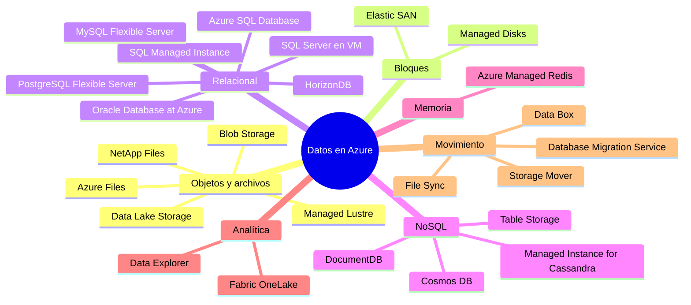
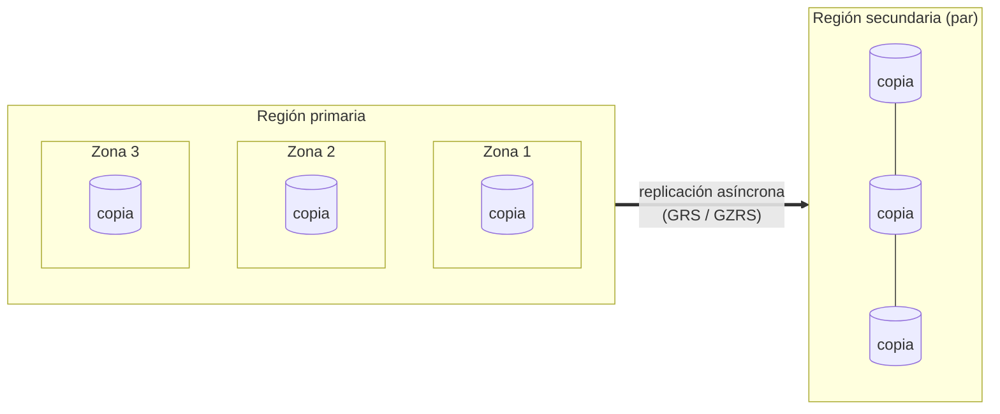
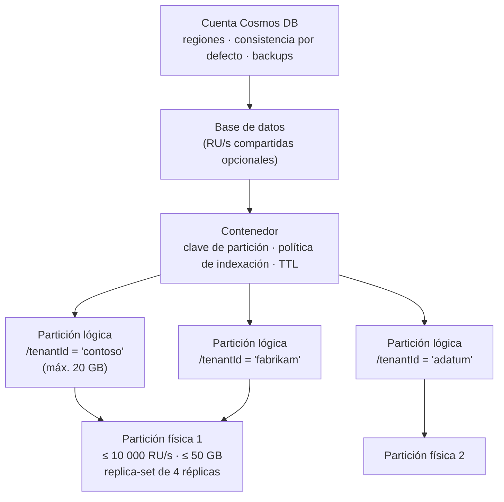
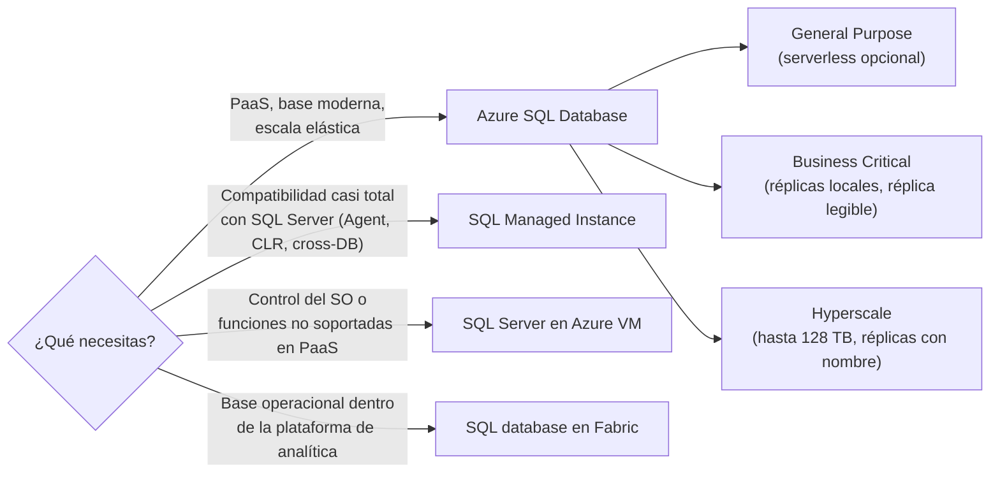

<div align="center">

# 04 · Almacenamiento y bases de datos

**Azure Storage · Cosmos DB · Azure SQL · PostgreSQL · MySQL · DocumentDB · Managed Redis · discos y archivos**

[⬅ 03 · Cómputo](03-computo-y-contenedores.md) · [🏠 Índice](../README.md) · [05 · Mensajería ➡](05-mensajeria-e-integracion.md)

</div>

---

## Contenido

1. [Mapa de datos en Azure](#1-mapa-de-datos-en-azure)
2. [Azure Storage](#2-azure-storage)
3. [Azure Cosmos DB](#3-azure-cosmos-db)
4. [Familia relacional](#4-familia-relacional)
5. [NoSQL, caché y motores especializados](#5-nosql-caché-y-motores-especializados)
6. [Discos, archivos y almacenamiento de alto rendimiento](#6-discos-archivos-y-almacenamiento-de-alto-rendimiento)
7. [Cómo elegir el almacén de datos](#7-cómo-elegir-el-almacén-de-datos)
8. [Novedades y retiros](#8-novedades-y-retiros)
9. [Referencias](#9-referencias)

---

## 1. Mapa de datos en Azure



| Servicio | Tipo | Estado (oct-2026) | En una frase |
|---|---|---|---|
| Blob Storage | Objetos | 🟢 | Almacén de objetos a escala de exabytes con niveles Hot/Cool/Cold/Archive y 🆕 *smart tier* |
| Data Lake Storage (Gen2) | Objetos + jerárquico | 🟢 | Blob con espacio de nombres jerárquico, ACL POSIX y driver ABFS |
| Azure Files | Archivos | 🟢 | Recursos compartidos SMB/NFS administrados; modelo *provisioned v2* |
| Queue Storage | Colas | 🟢 | Colas simples y baratas (mensajes de 64 KiB) |
| Table Storage | Clave-atributo | 🟢 | NoSQL clave/valor de bajo costo |
| Managed Disks | Bloques | 🟢 | Ultra, Premium SSD v2, Premium SSD, Standard SSD, Standard HDD |
| Elastic SAN | Bloques (iSCSI) | 🟢 | SAN como servicio para consolidar volúmenes |
| Azure NetApp Files | Archivos empresariales | 🟢 | NFS/SMB de latencia sub-milisegundo (SAP, Oracle, HPC) |
| Azure Managed Lustre | Sistema de archivos paralelo | 🟢 | HPC e IA con integración con Blob |
| Azure Cosmos DB | NoSQL multimodelo | 🟢 | Distribuida globalmente, 5 consistencias, vector y full-text |
| Azure DocumentDB | Documentos (MongoDB) | 🟢 GA Ignite 2025 | Compatible con MongoDB sobre motor open source (antes Cosmos DB for MongoDB vCore) |
| Azure SQL Database | Relacional PaaS | 🟢 | SQL Server gestionado: General Purpose, Business Critical, Hyperscale, serverless |
| Azure SQL Managed Instance | Relacional PaaS | 🟢 | Compatibilidad casi total con SQL Server (Agent, CLR, *cross-database*) |
| SQL Server en Azure VM | Relacional IaaS | 🟢 | Control total; SQL Server 2025 disponible |
| SQL database en Microsoft Fabric | Relacional SaaS | 🟢 | Base operacional integrada en Fabric |
| Azure Database for PostgreSQL | Relacional PaaS | 🟢 | Flexible Server + *elastic clusters* (Citus) |
| Azure HorizonDB | Relacional (compatible PostgreSQL) | 🟡 Preview (Ignite 2025) | Escala horizontal: hasta 3 072 vCores y 128 TB, 15 réplicas |
| Azure Database for MySQL | Relacional PaaS | 🟢 | Flexible Server con HA de zona |
| Oracle Database@Azure | Relacional (Oracle) | 🟢 | Exadata y Autonomous Database dentro de datacenters de Azure |
| Azure Managed Redis | En memoria | 🟢 | Redis Enterprise gestionado, hasta 99,999 % con geo-replicación activa |
| Managed Instance for Apache Cassandra | Columnar ancho | 🟢 | Cassandra gestionado, clústeres híbridos |
| Azure Cache for Redis | En memoria | 🟠 Enterprise: 31-mar-2027 · Basic/Standard/Premium: 30-sep-2028 | Migrar a Azure Managed Redis |
| Cosmos DB for PostgreSQL | Relacional distribuido | 🟠 31-mar-2029 (sin nuevas implementaciones) | Migrar a PostgreSQL *elastic clusters* |
| Azure Database for MariaDB | Relacional | ⛔ sep-2025 | Migrado a MySQL Flexible Server |
| Azure SQL Edge | Relacional en el borde | ⛔ sep-2025 | SQL Server en contenedores / Azure Local |

---

## 2. Azure Storage

### 2.1 Tipos de cuenta

| Tipo | Servicios | Rendimiento | Cuándo |
|---|---|---|---|
| **Standard general-purpose v2** | Blob, Data Lake, Files, Queue, Table | Estándar (HDD/SSD) | Opción por defecto |
| Premium block blobs | Blob, Data Lake | SSD, baja latencia | IoT, analítica interactiva, alta tasa de transacciones |
| Premium file shares | Files (SMB/NFS) | SSD | Archivos empresariales, contenedores |
| Premium page blobs | Page blobs | SSD | Escenarios de discos no administrados |
| ~~General-purpose v1 y Blob Storage heredada~~ | — | — | ⛔ Retiradas el **13-oct-2026**; las restantes se migraron automáticamente a GPv2 (puede cambiar la factura) |

### 2.2 Redundancia



| Opción | Copias | Dónde | Durabilidad anual | Lectura en secundaria | Protege contra |
|---|---|---|---|---|---|
| **LRS** | 3 | Un datacenter | ≥ 11 nueves | — | Falla de disco/rack |
| **ZRS** | 3 | Tres zonas | ≥ 12 nueves | — | Falla de un datacenter |
| **GRS** | 6 | LRS + LRS en región secundaria | ≥ 16 nueves | No | Desastre regional |
| **RA-GRS** | 6 | Igual que GRS | ≥ 16 nueves | **Sí** | Desastre regional + lectura continua |
| **GZRS** | 6 | ZRS + LRS en secundaria | ≥ 16 nueves | No | Zona y región |
| **RA-GZRS** | 6 | Igual que GZRS | ≥ 16 nueves | **Sí** | Máxima resiliencia |

> [!TIP]
> La replicación geográfica es **asíncrona**: tras un *failover* puede haber pérdida de datos recientes. Consulta la
> propiedad `LastSyncTime` y diseña escrituras críticas para tolerarlo. Puedes iniciar *failover* **planificado**
> (sin pérdida, para simulacros) o **no planificado** (forzado) gestionado por el cliente.

### 2.3 Niveles de acceso de Blob

| Nivel | Retención mínima | Latencia de acceso | Costo de almacenamiento | Costo de acceso | Uso |
|---|---|---|---|---|---|
| **Hot** | — | ms | $$$ | $ | Datos activos |
| **Cool** | 30 días | ms | $$ | $$ | Copias de seguridad recientes, datos poco accedidos |
| **Cold** | 90 días | ms | $ | $$$ | Datos raramente accedidos pero inmediatos |
| **Archive** | 180 días | Horas (rehidratación: estándar hasta 15 h, alta prioridad < 1 h para objetos < 10 GB) | ¢ | $$$$ | Retención legal, cumplimiento |
| 🆕 **Smart tier** | — | ms | Automático | Sin cargos por transición, eliminación anticipada ni recuperación (cuota de monitoreo) | Patrones de acceso desconocidos |

**Smart tier** (GA 14-abr-2026, Blob y Data Lake): mueve objetos de Hot → Cool tras 30 días sin acceso y → Cold
tras 90 días, y los devuelve a Hot al leerlos. Microsoft reportó que más del 50 % de la capacidad gestionada se movió
a niveles más fríos desde la *preview*. Para reglas deterministas usa **lifecycle management**:

```json
{
  "rules": [{
    "name": "archivar-logs",
    "enabled": true,
    "type": "Lifecycle",
    "definition": {
      "filters": { "blobTypes": ["blockBlob"], "prefixMatch": ["logs/"] },
      "actions": {
        "baseBlob": {
          "tierToCool":    { "daysAfterModificationGreaterThan": 30 },
          "tierToArchive": { "daysAfterModificationGreaterThan": 180 },
          "delete":        { "daysAfterModificationGreaterThan": 2555 }
        }
      }
    }
  }]
}
```

### 2.4 Objetivos de escala relevantes

| Recurso | Objetivo orientativo |
|---|---|
| Capacidad por cuenta | 5 PiB por defecto (ampliable) |
| Solicitudes por cuenta | ~20 000 por segundo (ampliable) |
| Tamaño máximo de block blob | ~190,7 TiB (50 000 bloques × 4 000 MiB) |
| Solicitudes a un único blob | ~500 por segundo |
| Mensaje de Queue Storage | 64 KiB; TTL configurable (incluso sin caducidad) |
| Entidad de Table Storage | 1 MiB, hasta 252 propiedades; ~2 000 entidades/s por partición |

> [!IMPORTANT]
> Las particiones de Blob se basan en el **nombre** (cuenta + contenedor + blob). Prefijos secuenciales (fechas al
> inicio, contadores) concentran carga en un rango; añade un prefijo de *hash* si escribes miles de objetos por segundo.

### 2.5 Protección de datos

| Capacidad | Protege contra | Nota |
|---|---|---|
| *Soft delete* de blobs y contenedores | Borrado accidental | 1 a 365 días |
| Versionado | Sobrescritura | Cada escritura crea una versión |
| Restauración a un punto en el tiempo | Corrupción lógica masiva | Requiere versionado, *change feed* y *soft delete* |
| Inmutabilidad (WORM) | Ransomware, cumplimiento | Retención temporal o *legal hold*, a nivel de contenedor o versión |
| *Change feed* | Auditoría/replicación | Log ordenado de cambios de blobs |
| *Object replication* | Copia asíncrona entre cuentas | Útil para distribuir contenido |
| Azure Backup para Blob y Files | Copias fuera de la cuenta | Bóveda con inmutabilidad y *soft delete* |
| Bloqueo de recursos y *soft delete* de cuenta | Borrado de la cuenta | Complementa RBAC |

### 2.6 Seguridad

- **Autorización con Microsoft Entra ID** (roles *Storage Blob Data Reader/Contributor/Owner*) y **deshabilitar Shared
  Key** cuando sea posible; para acceso delegado usa **SAS de delegación de usuario** (firmada con credenciales de Entra).
- Red: *private endpoints* por subservicio (blob, dfs, file, queue, table), firewall de cuenta, *network security
  perimeter*.
- Cifrado en reposo siempre activo (claves de Microsoft o **claves administradas por el cliente** en Key Vault/Managed
  HSM) y cifrado de infraestructura opcional (doble cifrado). TLS 1.2 como mínimo.
- **Microsoft Defender for Storage**: detección de amenazas y *malware scanning* al subir archivos.

### 2.7 Movimiento y gestión de datos

| Herramienta | Para |
|---|---|
| AzCopy | Copias masivas por línea de comandos (servidor a servidor) |
| Azure Storage Mover | Migraciones gestionadas desde NAS (SMB/NFS) |
| Azure File Sync | Caché híbrida de Azure Files en Windows Server |
| Data Box | Transferencia offline de grandes volúmenes |
| **Storage Actions** | Operaciones *serverless* sobre millones de blobs (etiquetar, mover, eliminar) |
| Eventos de Blob vía Event Grid | Disparar procesamiento al crear/eliminar blobs |

### 2.8 Ejemplo: cuenta resiliente y acceso sin secretos

```bash
az storage account create -g rg-datos -n stcomercioprod01 \
  --location westeurope --sku Standard_RAGZRS --kind StorageV2 \
  --min-tls-version TLS1_2 --allow-shared-key-access false \
  --allow-blob-public-access false --default-action Deny
```

```python
from azure.identity import DefaultAzureCredential
from azure.storage.blob import BlobServiceClient

svc = BlobServiceClient("https://stcomercioprod01.blob.core.windows.net",
                        credential=DefaultAzureCredential())   # identidad administrada en Azure
svc.get_container_client("facturas").upload_blob("2026/10/F-1001.pdf", open("F-1001.pdf", "rb"))
```

### 2.9 Checklist Azure Storage

- [ ] Redundancia **ZRS** o **GZRS/RA-GZRS** en producción.
- [ ] Shared Key y acceso público deshabilitados; Entra ID + SAS de delegación de usuario.
- [ ] *Private endpoints* y firewall en modo `Deny`.
- [ ] *Soft delete*, versionado e inmutabilidad según criticidad.
- [ ] Smart tier o reglas de *lifecycle* para optimizar costos.
- [ ] Defender for Storage habilitado; alertas de capacidad y de *throttling* (`503`/`ServerBusy`).

---

## 3. Azure Cosmos DB

### 3.1 Modelo de recursos y particionamiento



- La **partición lógica** agrupa ítems con el mismo valor de clave (límite 20 GB). Cosmos DB reparte particiones lógicas
  en **particiones físicas** (≤ 10 000 RU/s y ≤ 50 GB cada una) y las divide automáticamente al crecer.
- **Claves de partición jerárquicas** (hasta 3 niveles, p. ej. `/tenantId` → `/userId` → `/sessionId`) superan el
  límite de 20 GB por inquilino y mantienen consultas dirigidas.
- 🆕 **Cambio de clave de partición** en línea (GA) para reparticionar sin detener escrituras.

### 3.2 APIs

| API | Protocolo | Estado | Úsala cuando |
|---|---|---|---|
| **NoSQL** | Nativo (SQL sobre JSON) | 🟢 | Proyectos nuevos: todas las capacidades llegan aquí primero (vector, full-text, GSI) |
| MongoDB (basada en RU) | MongoDB wire protocol | 🟢 | Apps MongoDB que necesitan distribución global de Cosmos DB |
| Apache Cassandra | CQL | 🟢 | Migraciones de Cassandra sin operar clústeres |
| Apache Gremlin | Gremlin | 🟢 | Grafos |
| Table | Azure Table | 🟢 | Evolución premium de Table Storage |
| PostgreSQL | PostgreSQL + Citus | 🟠 31-mar-2029 | Solo clústeres existentes → *elastic clusters* |

> [!NOTE]
> **Azure DocumentDB** (antes *Cosmos DB for MongoDB vCore*) es un servicio aparte, facturado por vCore y compatible
> con MongoDB sobre el motor open source DocumentDB. Ver [§5](#5-nosql-caché-y-motores-especializados).

### 3.3 Diseño de la clave de partición

| Regla | Por qué |
|---|---|
| Alta cardinalidad (miles o millones de valores) | Reparte almacenamiento y RU entre particiones físicas |
| Distribución uniforme de escrituras | Evita particiones calientes (*hot partitions*) que provocan `429` |
| Alineada con el filtro de las consultas frecuentes | Consultas dirigidas a una partición cuestan menos RU |
| Ítems relacionados en la misma partición | Permite *transactional batch* y procedimientos almacenados |
| Si no hay candidata natural | Clave sintética (`tenant-año`) o jerárquica |

### 3.4 Request Units y modos de capacidad

**1 RU** ≈ lectura puntual (*point read* por `id` + clave de partición) de un ítem de 1 KB. Escribir 1 KB cuesta
~5 RU con indexación por defecto; las consultas dependen de índices y de cuántas particiones tocan.

| Modo | Facturación | Ideal para |
|---|---|---|
| Aprovisionado manual | RU/s fijas por hora | Tráfico estable y predecible |
| **Autoscale** | Máximo configurado; escala entre 10 % y 100 % | Tráfico variable; con *dynamic scaling* por región y partición |
| Serverless | RU consumidas | Dev/test, tráfico intermitente |
| Nivel gratuito | 1 000 RU/s + 25 GB gratis por cuenta | Proyectos pequeños |

```text
Lectura puntual (1 KB, Session) ........ 1 RU
Lectura puntual (1 KB, Strong) ......... 2 RU   (quórum de 2 réplicas)
Upsert 1 KB con indexación por defecto . ~5–6 RU
Consulta cross-partition ............... suma de RU por partición tocada
```

### 3.5 Distribución global y alta disponibilidad

| Configuración | SLA de disponibilidad | Escrituras | Notas |
|---|---|---|---|
| Una región, sin zonas | 99,99 % | Una región | Entornos no críticos |
| Una región **con zonas** | 99,995 % | Una región | Réplicas repartidas en 3 zonas |
| Varias regiones, una de escritura | 99,999 % lecturas | Una región; *failover* gestionado por el servicio | Strong posible (regiones < 8 000 km por defecto) |
| Varias regiones, **multi-write** | 99,999 % lecturas y escrituras | Todas las regiones | Resolución de conflictos LWW (`_ts` o ruta propia) o procedimiento personalizado |

- **SLA de latencia**: < 10 ms en P99 para lecturas y escrituras de ítems de 1 KB dentro de la región.
- 🆕 **Per-partition automatic failover (GA)**: conmuta solo las particiones afectadas en vez de toda la cuenta.
- Los SDK enrutan a la región preferida (`PreferredRegions`/`ApplicationPreferredRegions`) y reintentan en otra ante
  fallos regionales.

### 3.6 Indexación, búsqueda y vectores

| Capacidad | Estado | Detalle |
|---|---|---|
| Indexación automática | 🟢 | Todas las propiedades por defecto; excluye rutas para ahorrar RU de escritura |
| Índices compuestos | 🟢 | `ORDER BY` múltiple y filtros con rango |
| Índices espaciales | 🟢 | GeoJSON |
| **Vector search** | 🟢 | Índices `flat`, `quantizedFlat` y **DiskANN** (hasta 4 096 dimensiones), función `VectorDistance` |
| **Full-text search** | 🟢 | Puntuación BM25 (`FullTextScore`) |
| **Búsqueda híbrida** | 🟢 | Fusión RRF de vector + texto |
| 🆕 Semantic reranking | 🟡 Build 2026 | Reordenación semántica en el motor |
| 🆕 Integrated embeddings | 🟡 | Embeddings generados automáticamente al escribir |
| 🆕 **Global Secondary Indexes** | 🟢 | Contenedor sincronizado con **otra clave de partición** (consultas por atributo alternativo sin *cross-partition*) |

```sql
-- Top 5 productos más parecidos (vector) que además contienen "montaña" (híbrido con RRF)
SELECT TOP 5 c.id, c.nombre
FROM c
ORDER BY RANK RRF(VectorDistance(c.embedding, @qvec), FullTextScore(c.descripcion, "montaña"))
```

### 3.7 Change feed: el sistema nervioso de Cosmos DB

| Modo | Qué entrega | Estado |
|---|---|---|
| *Latest version* (por defecto) | Última versión de cada ítem creado o actualizado | 🟢 |
| *All versions and deletes* | Cada cambio intermedio y los borrados | 🟢 GA |

Consumo: **trigger de Azure Functions**, *change feed processor* de los SDK (con *lease container* para repartir
particiones entre instancias), modelo *pull*, Spark y **mirroring en Microsoft Fabric** (casi en tiempo real, sin ETL).
Patrones: CQRS, vistas materializadas, *outbox*, sincronización con AI Search, auditoría.

### 3.8 Transacciones y concurrencia

- **Transactional batch**: hasta 100 operaciones atómicas dentro de **una partición lógica**.
- Procedimientos almacenados y *triggers* en JavaScript (también por partición lógica).
- Concurrencia optimista con **ETag**: `IfMatchEtag` falla con `412 Precondition Failed` si otro escribió antes.

### 3.9 Seguridad, backup e integraciones

| Área | Capacidad |
|---|---|
| Identidad | RBAC del plano de datos con Entra ID; deshabilitar autenticación por claves (`disableLocalAuth`) |
| Red | *Private endpoints*, firewall IP, *network security perimeter* |
| Cifrado | En reposo siempre; CMK opcional; **Always Encrypted** del lado del cliente |
| Enmascaramiento | 🆕 **Dynamic Data Masking** (GA, API NoSQL) |
| Backup | Periódico (por defecto) o **continuo** con restauración a un punto en el tiempo (7 o 30 días) |
| Integraciones | Fabric (*mirroring* GA, **Cosmos DB en Fabric** GA), Functions, Logic Apps Standard (conector integrado GA), Kafka, Spark, 🆕 **MCP Toolkit** para agentes, 🆕 emulador Linux GA, 🆕 Cosmos DB Shell (🟡) |

### 3.10 Ejemplo (Python): clave jerárquica y lectura puntual

```python
from azure.cosmos import CosmosClient, PartitionKey
from azure.identity import DefaultAzureCredential

client = CosmosClient("https://cosmos-comercio.documents.azure.com",
                      credential=DefaultAzureCredential(),
                      preferred_locations=["West Europe", "North Europe"])
db = client.create_database_if_not_exists("comercio")
pedidos = db.create_container_if_not_exists(
    id="pedidos",
    partition_key=PartitionKey(path=["/tenantId", "/clienteId"], kind="MultiHash"),
    offer_throughput=None)  # cuenta serverless o RU compartidas

pedidos.upsert_item({"id": "A-1001", "tenantId": "contoso", "clienteId": "c-77", "total": 129.9})
item = pedidos.read_item("A-1001", partition_key=["contoso", "c-77"])   # 1 RU con Session
```

### 3.11 Anti-patrones frecuentes

| Anti-patrón | Consecuencia | Corrección |
|---|---|---|
| Clave de partición `/fecha` o `/estado` | Particiones calientes y `429` | Clave de alta cardinalidad o jerárquica |
| Consultas sin filtro de partición en rutas calientes | RU multiplicadas | *Point reads*, GSI, desnormalizar |
| Ítems que crecen sin límite (arrays infinitos) | Costo de escritura creciente, límite de 2 MB | Modelar como ítems separados |
| Strong por defecto "por si acaso" | 2× RU y mayor latencia | Session salvo requisito explícito |
| Crear un `CosmosClient` por petición | Agotamiento de conexiones | *Singleton* por proceso |
| Indexar todo en contenedores de solo escritura | RU de escritura altas | Excluir rutas o `indexingMode: none` |

### 3.12 Checklist Cosmos DB

- [ ] Clave de partición validada con datos reales; métricas de *normalized RU consumption* por partición revisadas.
- [ ] Zonas habilitadas y al menos dos regiones para cargas críticas; PPAF o *service-managed failover* activo.
- [ ] Nivel de consistencia justificado; SDK con regiones preferidas.
- [ ] `disableLocalAuth = true`, RBAC del plano de datos y *private endpoints*.
- [ ] Backup continuo; política de TTL para datos efímeros.
- [ ] Alertas de `429`, latencia P99 y disponibilidad; Insights de Cosmos DB en Azure Monitor.

---

## 4. Familia relacional

### 4.1 Azure SQL



| Nivel (vCore) | Arquitectura | Latencia de E/S | Alta disponibilidad | Para |
|---|---|---|---|---|
| **General Purpose** | Cómputo sin estado + almacenamiento remoto | Media | Conmutación a otro nodo | Mayoría de cargas; *serverless* con autopausa |
| **Business Critical** | Grupo de disponibilidad (4 réplicas) con SSD local | Muy baja | Réplicas síncronas + **réplica legible incluida** | OLTP crítico |
| **Hyperscale** | Cómputo + *page servers* + log service | Baja | Réplicas HA y hasta 30 réplicas con nombre | Bases grandes y de crecimiento rápido |

- SLA 99,99 % (99,995 % en Business Critical/Premium con redundancia de zona). *Failover groups* para DR
  multirregión con un punto de conexión estable.
- **SQL Server 2025** (GA nov-2025) y Azure SQL incorporan tipo `vector`, índices vectoriales DiskANN, JSON nativo,
  expresiones regulares y llamadas REST desde T-SQL; *mirroring* hacia Fabric.
- **Oferta gratuita** de Azure SQL Database (General Purpose serverless) para prototipos.
- SQL Managed Instance: General Purpose (incluida la generación nueva con más IOPS y bases por instancia) y Business
  Critical; *link* con SQL Server on-premises para DR híbrida.
- 🆕 En SQLCon 2026, SQL database en Fabric sumó auditoría, CMK y *Dynamic Data Masking* (GA); SQL Server en
  Azure Local llegó a GA en modos conectado y desconectado (sep-2026).

### 4.2 PostgreSQL, MySQL, HorizonDB y Oracle

| Servicio | Opciones de cómputo | Alta disponibilidad | Destacados |
|---|---|---|---|
| **Azure Database for PostgreSQL** (Flexible Server) | Burstable, General Purpose, Memory Optimized | Réplica en espera síncrona en otra zona; réplicas de lectura entre regiones | Extensiones `pgvector`, `pg_diskann`, `azure_ai`, PostGIS, `pg_cron`; **elastic clusters** (Citus) para escalar horizontalmente |
| 🆕 **Azure HorizonDB** | Escala horizontal (hasta 3 072 vCores) | Hasta 15 réplicas sobre almacenamiento compartido autoescalable (128 TB) | Compatible con PostgreSQL; hasta 3× más rápido que PostgreSQL open source según Microsoft (🟡 preview) |
| **Azure Database for MySQL** (Flexible Server) | Burstable, General Purpose, Business Critical | HA con espera en otra zona; réplicas de lectura | MySQL 8.0 y 8.4 LTS |
| **Oracle Database@Azure** | Exadata Database Service, Autonomous Database | Infraestructura Exadata gestionada por Oracle en datacenters de Azure | Latencia baja con apps en Azure, facturación por Azure Marketplace |

> [!NOTE]
> Single Server de PostgreSQL (retirado mar-2025) y de MySQL (retirado sep-2024) ya no existen: todo nuevo despliegue
> es **Flexible Server**.

---

## 5. NoSQL, caché y motores especializados

| Servicio | Modelo | Puntos fuertes | Cuándo elegirlo |
|---|---|---|---|
| **Azure DocumentDB** | Documentos compatible con MongoDB (facturación por vCore) | Motor open source (DocumentDB), vector y full-text, HA y réplicas entre regiones | Apps MongoDB que quieren portabilidad híbrida/multicloud |
| **Azure Managed Redis** | Clave-valor en memoria (Redis Enterprise) | Tiers Memory Optimized, Balanced, Compute Optimized y Flash; redundancia de zona por defecto; **geo-replicación activa** (CRDT) hasta 99,999 %; módulos JSON, búsqueda/vectores, Bloom, TimeSeries | Caché, sesiones, colas ligeras, *rate limiting*, búsqueda vectorial en memoria |
| **Table Storage** | Clave-atributo | Muy barato, escalable | Metadatos, catálogos simples |
| **Managed Instance for Apache Cassandra** | Columnar ancho | Clústeres híbridos con nodos on-premises | Migraciones de Cassandra con control de configuración |
| **Azure Data Explorer** | Series temporales/logs (Kusto) | Ingesta masiva y KQL | Telemetría, observabilidad, IoT → ver [09](09-datos-y-analitica.md) |
| **Azure AI Search** | Índice de búsqueda/vectores | Híbrida, *semantic ranker*, recuperación agéntica | RAG y búsqueda empresarial → ver [10](10-ia-y-machine-learning.md) |

> [!WARNING]
> **Azure Cache for Redis**: la creación de instancias nuevas se bloqueó (abr-2026 para clientes nuevos; oct-2026 para
> existentes). Enterprise/Enterprise Flash se retira el **31-mar-2027** y Basic/Standard/Premium el **30-sep-2028**.
> Migra a **Azure Managed Redis**.

---

## 6. Discos, archivos y almacenamiento de alto rendimiento

### 6.1 Managed Disks

| Tipo | Máx. IOPS por disco | Máx. rendimiento | Ajuste independiente de IOPS/MB/s | Uso |
|---|---|---|---|---|
| **Ultra Disk** | Hasta 400 000 | Hasta 10 000 MB/s | Sí, en caliente | SAP HANA, bases de datos de nivel superior |
| **Premium SSD v2** | Hasta 80 000 | Hasta 1 200 MB/s | Sí | La mejor relación precio/rendimiento para bases de datos |
| Premium SSD | Hasta 20 000 | Hasta 900 MB/s | No (por tamaño, con *bursting*) | Producción general |
| Standard SSD | Hasta 6 000 | Hasta 750 MB/s | No | Web, dev/test |
| Standard HDD | Hasta 2 000 | Hasta 500 MB/s | No | Backups, datos poco accedidos |

Discos con **ZRS** (Premium/Standard SSD) para conmutar VM entre zonas, *shared disks* para clústeres de conmutación,
*snapshots* incrementales y cifrado con CMK o *encryption at host*.

### 6.2 Archivos y alto rendimiento

| Servicio | Protocolos | Destacado |
|---|---|---|
| **Azure Files** | SMB 3.x, NFS 4.1, REST | Modelo **provisioned v2** (pagas capacidad, IOPS y MB/s por separado), identidad con Entra/AD DS, *snapshots* |
| **Azure NetApp Files** | NFSv3/v4.1, SMB, dual | Latencia sub-ms, *snapshots* instantáneos, replicación entre regiones y zonas, volúmenes grandes |
| **Elastic SAN** | iSCSI | Consolida volúmenes de VM, AKS y AVS en un pool con rendimiento compartido |
| **Azure Managed Lustre** | Lustre | Sistema de archivos paralelo para IA/HPC integrado con Blob (importar/exportar) |
| ~~Azure HPC Cache~~ | — | ⛔ Retirado sep-2025 → Managed Lustre |

---

## 7. Cómo elegir el almacén de datos

| Necesidad | Primera opción | Alternativas |
|---|---|---|
| Documentos JSON a escala global con baja latencia | Cosmos DB for NoSQL | Azure DocumentDB |
| Relacional OLTP con SQL Server | Azure SQL Database | SQL Managed Instance, SQL en VM |
| Relacional open source | PostgreSQL Flexible Server | MySQL Flexible Server, HorizonDB (preview) |
| Escala horizontal relacional | Azure SQL Hyperscale / PostgreSQL elastic clusters | HorizonDB |
| Caché y sesiones | Azure Managed Redis | — |
| Archivos binarios, data lake | Blob / Data Lake Storage | OneLake (Fabric) |
| Archivos compartidos para *lift-and-shift* | Azure Files | Azure NetApp Files |
| Telemetría y series temporales | Azure Data Explorer / Eventhouse | Cosmos DB con TTL |
| Búsqueda y RAG | Azure AI Search | Vectores en Cosmos DB, PostgreSQL o Azure SQL |
| Grafos | Cosmos DB for Apache Gremlin | Fabric (grafos en Fabric IQ) |
| Oracle sin reescritura | Oracle Database@Azure | Oracle en VM |

Árbol de decisión gráfico en [16 · Guías de decisión](16-guias-de-decision.md#2-datos).

---

## 8. Novedades y retiros

| Fecha | Cambio |
|---|---|
| mar-2025 | ⛔ PostgreSQL Single Server |
| may-2025 | 🟢 Azure Managed Redis GA |
| sep-2025 | ⛔ MariaDB, Azure SQL Edge, HPC Cache |
| nov-2025 | 🟢 Azure DocumentDB · 🟢 SQL Server 2025 · 🟡 Azure HorizonDB |
| 2025–2026 | 🟢 Cosmos DB: GSI, PPAF, *all versions and deletes*, Dynamic Data Masking, cambio de clave de partición, emulador Linux, mirroring y Cosmos DB en Fabric |
| mar-2026 | 🟢 SQLCon: novedades GA en SQL database en Fabric |
| abr-2026 | 🟢 Blob **smart tier** GA · bloqueo de creación de Azure Cache for Redis para clientes nuevos |
| jun-2026 | 🟡 Cosmos DB MCP Toolkit, *semantic reranking*, *integrated embeddings* |
| sep-2026 | 🟢 SQL Server en Azure Local (conectado y desconectado) |
| 13-oct-2026 | ⛔ Cuentas GPv1 y Blob Storage heredadas (migración automática a GPv2) |
| 31-mar-2027 | 🟠 Azure Cache for Redis Enterprise |
| 30-sep-2028 | 🟠 Azure Cache for Redis Basic/Standard/Premium |
| 31-mar-2029 | 🟠 Cosmos DB for PostgreSQL |

---

## 9. Referencias

- [Azure Storage redundancy](https://learn.microsoft.com/azure/storage/common/storage-redundancy) · [Access tiers](https://learn.microsoft.com/azure/storage/blobs/access-tiers-overview) · [Scalability targets](https://learn.microsoft.com/azure/storage/common/scalability-targets-standard-account)
- [Azure Cosmos DB documentation](https://learn.microsoft.com/azure/cosmos-db/) · [Partitioning](https://learn.microsoft.com/azure/cosmos-db/partitioning-overview) · [Request units](https://learn.microsoft.com/azure/cosmos-db/request-units) · [Vector search](https://learn.microsoft.com/azure/cosmos-db/nosql/vector-search)
- [Azure SQL documentation](https://learn.microsoft.com/azure/azure-sql/) · [PostgreSQL Flexible Server](https://learn.microsoft.com/azure/postgresql/) · [MySQL Flexible Server](https://learn.microsoft.com/azure/mysql/)
- [Azure Managed Redis](https://learn.microsoft.com/azure/redis/) · [Managed disk types](https://learn.microsoft.com/azure/virtual-machines/disks-types)
- [Choose a data store](https://learn.microsoft.com/azure/architecture/guide/technology-choices/data-store-overview)

---

<div align="center">

[⬅ 03 · Cómputo](03-computo-y-contenedores.md) · [🏠 Índice](../README.md) · [05 · Mensajería ➡](05-mensajeria-e-integracion.md)

</div>
