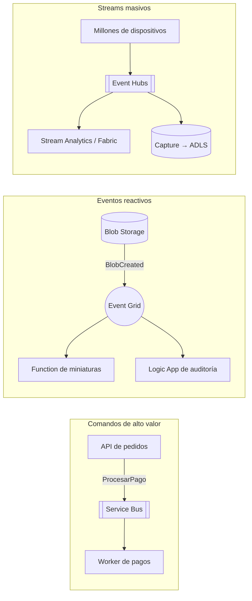
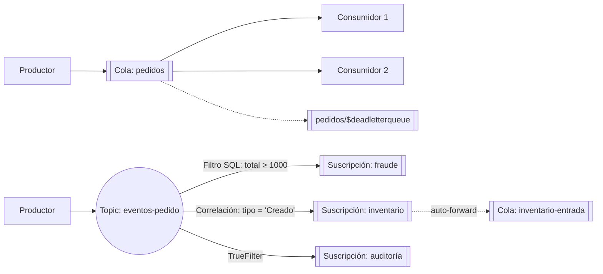
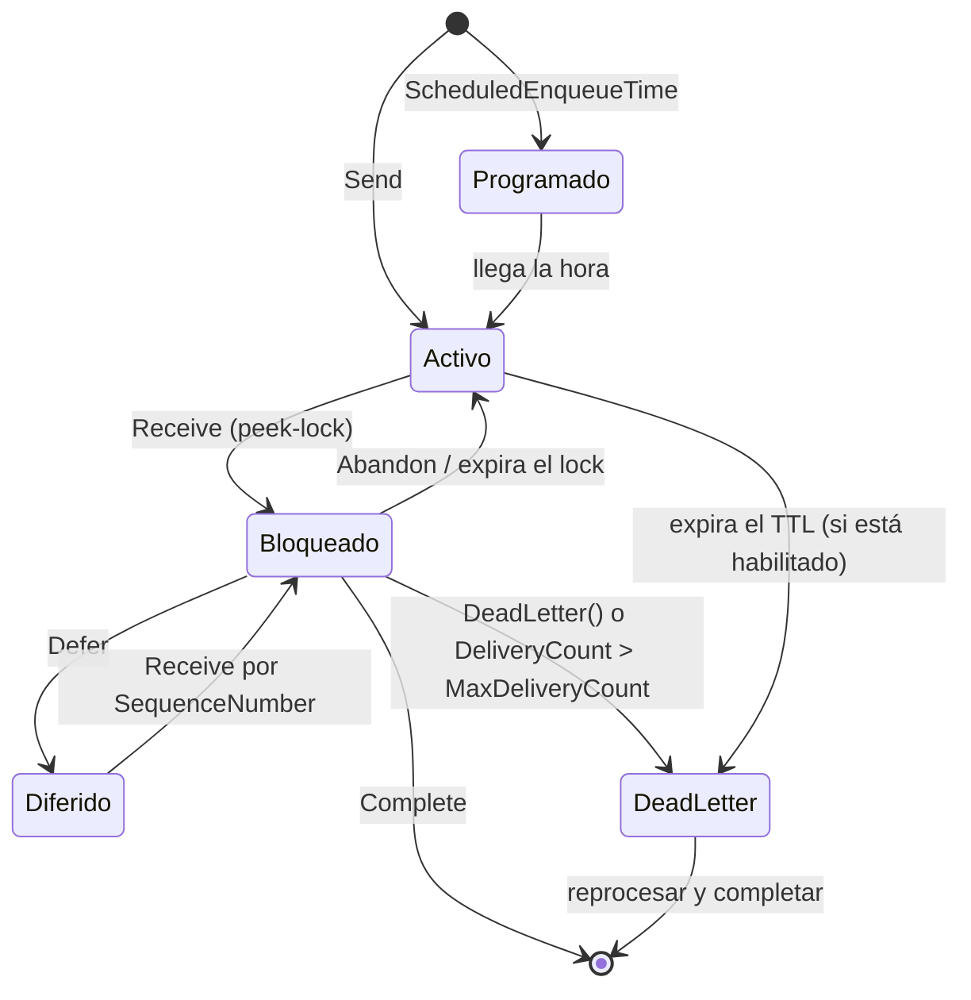
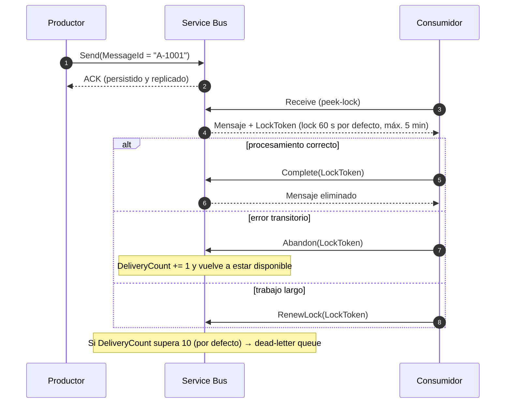
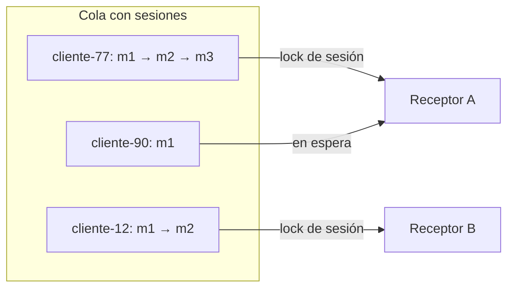
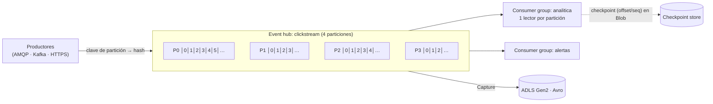
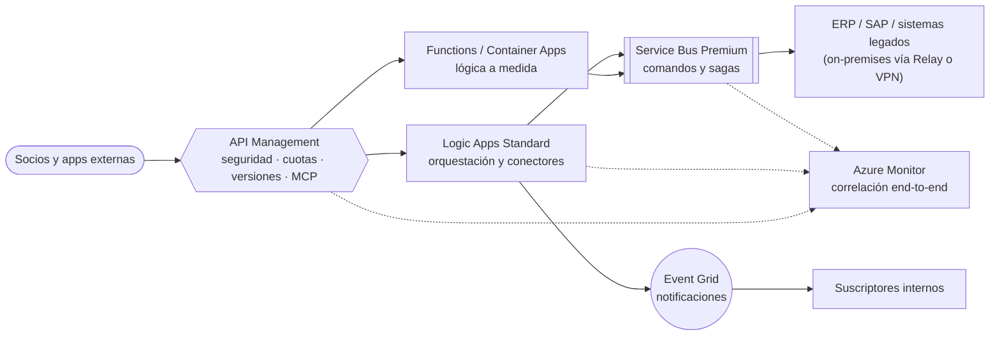

<div align="center">

# 05 · Mensajería e integración

**Service Bus · Event Hubs · Event Grid · Storage Queues · Logic Apps · API Management · Web PubSub · SignalR · Relay**

[⬅ 04 · Datos](04-almacenamiento-y-bases-de-datos.md) · [🏠 Índice](../README.md) · [06 · Redes ➡](06-redes-y-entrega-global.md)

</div>

---

## Contenido

1. [Mensajes, eventos y streams](#1-mensajes-eventos-y-streams)
2. [Comparativa de servicios de mensajería](#2-comparativa-de-servicios-de-mensajería)
3. [Azure Service Bus](#3-azure-service-bus)
4. [Azure Event Hubs](#4-azure-event-hubs)
5. [Azure Event Grid](#5-azure-event-grid)
6. [Storage Queues frente a Service Bus](#6-storage-queues-frente-a-service-bus)
7. [Logic Apps y API Management](#7-logic-apps-y-api-management)
8. [Tiempo real y conectividad híbrida](#8-tiempo-real-y-conectividad-híbrida)
9. [Arquitectura de integración de referencia](#9-arquitectura-de-integración-de-referencia)
10. [Novedades y retiros](#10-novedades-y-retiros)
11. [Referencias](#11-referencias)

---

## 1. Mensajes, eventos y streams

| Concepto | Intención del emisor | Ejemplo | Servicio natural |
|---|---|---|---|
| **Mensaje (comando)** | "Haz esto" — el emisor espera que alguien lo procese exactamente una vez a efectos de negocio | `ProcesarPago`, `ReservarStock` | **Service Bus** |
| **Evento discreto** | "Esto pasó" — notificación ligera; al emisor no le importa quién reacciona | `BlobCreated`, `PedidoCreado` | **Event Grid** |
| **Stream de eventos** | "Esto está pasando continuamente" — serie temporal ordenada para análisis | Telemetría, *clickstream*, logs | **Event Hubs** |



---

## 2. Comparativa de servicios de mensajería

| Característica | Service Bus | Event Hubs | Event Grid | Storage Queues |
|---|---|---|---|---|
| Patrón | Colas y pub/sub empresarial | Log particionado (*streaming*) | Enrutamiento de eventos (push/pull) y MQTT | Cola simple |
| Entrega | *At-least-once* (*peek-lock*) o *at-most-once* | *At-least-once* desde *checkpoint* | *At-least-once* con reintentos | *At-least-once* |
| Orden | FIFO por **sesión** | Por **partición** | No garantizado | No garantizado |
| Tamaño de mensaje | 256 KB (Standard) · 100 MB (Premium) | 1 MB | 1 MB | 64 KiB |
| Retención | Hasta que se consume (TTL configurable) | 1 a 90 días según tier | Hasta 24 h de reintentos (configurable) | TTL configurable |
| Re-lectura | No (se consume) | **Sí** (desde cualquier *offset*) | No | No |
| Transacciones | Sí (dentro del *namespace*) | No | No | No |
| Duplicados | Detección integrada | Idempotencia del consumidor | Idempotencia del consumidor | Idempotencia del consumidor |
| DLQ | Integrada | No (reprocesas desde el log) | *Dead-letter* a Blob | Patrón manual (*poison queue*) |
| Protocolos | AMQP 1.0, HTTPS, JMS 2.0 (Premium) | AMQP, **Kafka**, HTTPS | HTTPS, **MQTT 3.1.1/5** | HTTPS |
| Escala típica | Miles de mensajes/s por MU | **Millones de eventos/s** | Millones de eventos/s | ~2 000 mensajes/s por cola |

> [!TIP]
> No es "uno u otro": un sistema maduro combina los tres. Event Grid notifica, Service Bus transporta los comandos
> de negocio y Event Hubs absorbe la telemetría.

---

## 3. Azure Service Bus

### 3.1 Arquitectura y tiers



| Capacidad | Basic | Standard | Premium |
|---|---|---|---|
| Colas | ✅ | ✅ | ✅ |
| Topics y suscripciones | — | ✅ | ✅ |
| Sesiones (FIFO), transacciones, duplicados, *auto-forward* | — | ✅ | ✅ |
| Recursos | Compartidos | Compartidos (pago por operación) | **Dedicados** (Messaging Units 1, 2, 4, 8, 16) |
| Tamaño máximo de mensaje | 256 KB | 256 KB | **100 MB** |
| Red privada (*private endpoints*), CMK, JMS 2.0 | — | — | ✅ |
| Redundancia de zona y **geo-replicación** | — | — | ✅ |
| Latencia predecible | — | — | ✅ |

### 3.2 Ciclo de vida de un mensaje



### 3.3 *Peek-lock* paso a paso



### 3.4 Sesiones: FIFO de verdad

- Un mensaje con `SessionId = "cliente-77"` solo lo procesa **un receptor a la vez** (bloqueo de sesión), en el
  **orden de llegada**. Distintas sesiones se procesan en paralelo.
- La sesión tiene **estado** (`SetSessionState`) para implementar máquinas de estados o *sequential convoys*.
- *Request-reply*: el emisor envía con `ReplyToSessionId` y espera la respuesta en una cola de respuestas por sesión.



### 3.5 Funciones avanzadas

| Función | Qué hace | Clave de uso |
|---|---|---|
| Detección de duplicados | Descarta mensajes con `MessageId` repetido dentro de una ventana (por defecto 10 min, máx. 7 días) | Usa IDs de negocio deterministas |
| Transacciones | Recibir + enviar atómicamente (*send-via*) dentro del *namespace* | *Exactly-once* de procesamiento entre colas |
| Mensajes programados | Entrega en una fecha futura | Recordatorios, reintentos diferidos |
| *Deferral* | Aparta un mensaje para recuperarlo por `SequenceNumber` | Procesar fuera de orden de forma controlada |
| *Auto-forwarding* | Encadena entidades | *Fan-in*, escalar topologías |
| TTL y *dead-lettering* | Expiración y cuarentena | Monitorea la DLQ siempre |
| Filtros y acciones | SQL (`total > 1000 AND pais = 'MX'`) o correlación (más eficiente) | Prefiere filtros de correlación |
| *Prefetch* y lotes | Menos viajes de red | Ajusta al tiempo de *lock* |
| Mensajes grandes (Premium) | Hasta 100 MB | Para más, usa *claim-check* con Blob |
| Particionamiento (Premium) | Reparte el *namespace* en particiones | Mayor rendimiento; orden por `PartitionKey`/`SessionId` |

### 3.6 Alta disponibilidad y recuperación ante desastres

| Mecanismo | Replica | RPO | Modo | Tier |
|---|---|---|---|---|
| Zonas de disponibilidad | Metadatos y datos dentro de la región | 0 | Automático | Premium (en regiones con zonas) |
| **Geo-Disaster Recovery** (alias) | **Solo metadatos** (entidades, filtros) | Mensajes en vuelo se pierden | Conmutación manual del alias | Standard/Premium |
| 🆕 **Geo-Replication** (GA dic-2025) | **Metadatos y datos** | 0 (síncrono) o configurable (asíncrono) | Promoción planificada o forzada de la secundaria | Premium |

> [!NOTE]
> Geo-Replication admite hoy **una región secundaria**, no se combina con Geo-DR y en *namespaces* particionados sigue
> en *preview*. Elige replicación síncrona si no toleras pérdida, aceptando mayor latencia de escritura.

### 3.7 Código (.NET): sesiones, idempotencia y DLQ

```csharp
// Productor: FIFO por cliente + MessageId determinista para la detección de duplicados
await using var client = new ServiceBusClient("sb-comercio-prod.servicebus.windows.net",
                                              new DefaultAzureCredential());
ServiceBusSender sender = client.CreateSender("pedidos");
await sender.SendMessageAsync(new ServiceBusMessage(BinaryData.FromObjectAsJson(pedido))
{
    SessionId = pedido.ClienteId,
    MessageId = pedido.Id,
    ApplicationProperties = { ["tipo"] = "PedidoCreado" }
});

// Consumidor: orden estricto dentro de la sesión, paralelismo entre sesiones
ServiceBusSessionProcessor processor = client.CreateSessionProcessor("pedidos",
    new ServiceBusSessionProcessorOptions
    {
        MaxConcurrentSessions = 16,
        MaxConcurrentCallsPerSession = 1,
        AutoCompleteMessages = false
    });

processor.ProcessMessageAsync += async args =>
{
    try
    {
        await ProcesarIdempotenteAsync(args.Message);          // misma entrada ⇒ mismo efecto
        await args.CompleteMessageAsync(args.Message);
    }
    catch (DatosInvalidosException ex)
    {
        await args.DeadLetterMessageAsync(args.Message, "DatosInvalidos", ex.Message);
    }
};
processor.ProcessErrorAsync += args => { log.LogError(args.Exception, "Service Bus"); return Task.CompletedTask; };
await processor.StartProcessingAsync();
```

### 3.8 Límites clave

| Recurso | Límite |
|---|---|
| Suscripciones por topic | 2 000 |
| Filtros SQL por topic | 2 000 |
| Filtros de correlación por topic | 100 000 |
| Ventana de detección de duplicados | 7 días |
| Duración del *lock* | 5 min (renovable) |
| Saltos de *auto-forward* | 4 |

### 3.9 Checklist Service Bus

- [ ] Premium en producción crítica (aislamiento, red privada, zonas, geo-replicación).
- [ ] Autenticación con **Entra ID** (`Azure Service Bus Data Sender/Receiver`); SAS deshabilitado si es posible.
- [ ] SDK actuales (`Azure.Messaging.ServiceBus` y equivalentes): los SDK heredados se retiraron el **30-sep-2026**.
- [ ] Sesiones solo donde el orden es requisito; `MessageId` de negocio para duplicados.
- [ ] Alertas sobre `DeadletteredMessages`, `ActiveMessages` (*backlog*) y `ServerErrors`/`ThrottledRequests`.
- [ ] Ejercicio de *failover* de Geo-Replication documentado y probado.

---

## 4. Azure Event Hubs

### 4.1 Modelo de log particionado



- Cada **partición** es una secuencia ordenada e inmutable de eventos con `offset` y `sequenceNumber`.
- El orden está garantizado **solo dentro de una partición**: usa una clave de partición (`deviceId`, `userId`) para
  mantener juntos los eventos de una entidad.
- Cada **consumer group** es una vista independiente del log (equivale a un consumidor de Kafka). Un lector por
  partición y grupo es lo recomendado (máximo 5 simultáneos).
- El consumidor guarda su posición (**checkpoint**) y, tras un reinicio, **reprocesa** desde ahí: diseña para
  *at-least-once*.

### 4.2 Tiers

| | Basic | Standard | Premium | Dedicated |
|---|---|---|---|---|
| Unidad de capacidad | Throughput Unit (TU) | TU (+ *auto-inflate*) | Processing Unit (1–16 PU) | Capacity Unit (CU) |
| Capacidad por unidad | 1 MB/s o 1 000 eventos/s de entrada; 2 MB/s de salida | Igual (hasta 40 TU) | Aislamiento de recursos | Clúster de inquilino único |
| Retención | 1 día | 7 días | Hasta 90 días | Hasta 90 días |
| Consumer groups | 1 | 20 | 100 por event hub | 1 000 por event hub |
| Particiones por event hub | 32 | 32 | 100 (ampliables) | 1 024 |
| Kafka | — | ✅ | ✅ | ✅ |
| Capture | — | ✅ (costo extra) | ✅ incluido | ✅ incluido |
| Private Link, CMK | — | — | ✅ | ✅ |
| 🆕 Geo-replicación (GA jul-2025) | — | — | ✅ | ✅ |

### 4.3 ¿Cuántas particiones?

- El **paralelismo máximo de consumo** de un grupo = número de particiones.
- Regla práctica: `particiones ≥ max(ingesta_MBps / 1, consumidores_paralelos_previstos)`, con holgura para crecer.
- En Basic/Standard el número es fijo; en Premium/Dedicated puede **aumentarse** (cuidado: cambia el mapeo
  clave → partición para eventos nuevos).

### 4.4 Ecosistema de consumo

| Consumidor | Cuándo |
|---|---|
| `EventProcessorClient` / `EventHubConsumerClient` con *checkpoint store* en Blob | Microservicios propios con balanceo de particiones |
| Trigger de Azure Functions | Procesamiento *serverless* (escala hasta el número de particiones) |
| Azure Stream Analytics | Consultas SQL en *streaming*, ventanas temporales, editor sin código |
| Microsoft Fabric Eventstream / Eventhouse | Analítica en tiempo real con KQL |
| Clientes Apache Kafka, Kafka Connect, Flink, Spark | Ecosistema Kafka sin operar brokers |
| Capture | Volcado continuo a ADLS/Blob (Avro; Parquet mediante el editor sin código) |

### 4.5 Compatibilidad con Apache Kafka

```properties
# El namespace de Event Hubs actúa como clúster Kafka (event hub = topic)
bootstrap.servers=eh-telemetria.servicebus.windows.net:9093
security.protocol=SASL_SSL
sasl.mechanism=OAUTHBEARER          # con Entra ID; alternativa: PLAIN con usuario "$ConnectionString"
```

### 4.6 Código (Python): consumidor con *checkpoint*

```python
import asyncio
from azure.identity.aio import DefaultAzureCredential
from azure.eventhub.aio import EventHubConsumerClient
from azure.eventhub.extensions.checkpointstoreblobaio import BlobCheckpointStore

async def main():
    cred = DefaultAzureCredential()
    store = BlobCheckpointStore("https://stcheckpoints.blob.core.windows.net", "checkpoints", credential=cred)
    client = EventHubConsumerClient(
        fully_qualified_namespace="eh-telemetria.servicebus.windows.net",
        eventhub_name="clickstream", consumer_group="analitica",
        checkpoint_store=store, credential=cred)

    async def on_event(ctx, event):
        await procesar(event.body_as_json())       # idempotente: clave = partición + sequence_number
        await ctx.update_checkpoint(event)          # en producción: cada N eventos o T segundos

    async with client:
        await client.receive(on_event=on_event, starting_position="-1")

asyncio.run(main())
```

### 4.7 Checklist Event Hubs

- [ ] Número de particiones dimensionado para el pico y el paralelismo de consumo.
- [ ] Clave de partición estable cuando importa el orden por entidad.
- [ ] Un *consumer group* por aplicación consumidora; *checkpoints* periódicos (no por evento).
- [ ] *Auto-inflate* (Standard) o PU suficientes (Premium); alertas de `ThrottledRequests` y *lag* de consumo.
- [ ] Capture o Fabric para retención histórica más allá de 7/90 días.
- [ ] Geo-replicación (Premium/Dedicated) para cargas críticas.

---

## 5. Azure Event Grid

| Modalidad | Entrega | Destinos/clientes | Para |
|---|---|---|---|
| **Basic** (topics de sistema, personalizados, dominios, *partner topics*) | Push HTTP con reintentos exponenciales (por defecto 30 intentos o 24 h) y *dead-letter* a Blob | Functions, Logic Apps, Service Bus, Event Hubs, Storage Queues, webhooks | Reaccionar a eventos de recursos de Azure y aplicaciones |
| **Namespaces** | **Pull** (HTTP), push y **broker MQTT** (3.1.1 y 5.0) | Clientes MQTT (IoT), consumidores que leen a su ritmo | IoT, comunicaciones de dispositivo a nube, *fan-out* a gran escala |

- Esquemas **CloudEvents 1.0** (recomendado; obligatorio en *namespaces*) o Event Grid.
- Filtros por tipo de evento, prefijo/sufijo de sujeto y filtros avanzados sobre los datos.
- Entrega con **identidad administrada** hacia destinos de Azure.

```bash
# Suscribir una Function a los blobs nuevos de un contenedor
az eventgrid event-subscription create \
  --name nuevas-facturas \
  --source-resource-id $(az storage account show -n stcomercioprod01 -g rg-datos --query id -o tsv) \
  --endpoint-type azurefunction \
  --endpoint "$FUNC_ID/functions/ProcesarFactura" \
  --included-event-types Microsoft.Storage.BlobCreated \
  --subject-begins-with /blobServices/default/containers/facturas/
```

---

## 6. Storage Queues frente a Service Bus

| Criterio | Storage Queues | Service Bus queues |
|---|---|---|
| Tamaño de mensaje | 64 KiB | 256 KB / 100 MB |
| Tamaño de cola | Hasta la capacidad de la cuenta (cientos de TiB) | Decenas de GB por entidad |
| Orden | No | FIFO con sesiones |
| Transacciones, duplicados, DLQ, programados | No (manual) | Sí |
| Modelo de *lock* | Timeout de visibilidad | *Peek-lock* con renovación |
| Protocolo | HTTPS/REST | AMQP 1.0 (eficiente, conexiones persistentes) |
| Costo | Muy bajo | Mayor (Premium dedicado) |
| Úsalo para | Trabajo en segundo plano simple y masivo | Flujos de negocio con garantías |

---

## 7. Logic Apps y API Management

### 7.1 Azure Logic Apps

| | Consumption | Standard |
|---|---|---|
| Inquilino | Multiinquilino | Inquilino único (plan Workflow Standard o despliegue híbrido sobre Kubernetes con Arc) |
| Facturación | Por acción ejecutada | Por plan/recursos |
| Flujos | Con estado | Con estado y **sin estado** (baja latencia) |
| Conectores | 1 400+ administrados | Administrados + **integrados** (se ejecutan en proceso) |
| Red | Limitada | Integración con VNet y *private endpoints* |
| Desarrollo | Portal | VS Code, CI/CD, varios flujos por app |

Capacidades: **Integration Account** para B2B (AS2, X12, EDIFACT, mapas XSLT/Liquid), Data Mapper, ruta de migración
desde BizTalk Server e **ISE** (retirado ago-2024), y flujos **agénticos** que combinan conectores con modelos de
Microsoft Foundry.

### 7.2 Azure API Management

| Generación | Tiers | Destacado |
|---|---|---|
| Clásica | Consumption, Developer (sin SLA), Basic, Standard, Premium | Premium: multirregión, zonas, inyección en VNet, *self-hosted gateway* |
| **v2** | Basic v2, Standard v2, **Premium v2** (GA mar-2026) | Aprovisionamiento rápido, integración/inyección en VNet, escala mayor |
| 🆕 **AI Gateway** | Tier dedicado (🟡 preview jul-2026) | Modelos de Foundry, AWS Bedrock, Google Vertex AI, OpenAI y Anthropic con tarjetas de política |

**Gateway de IA y agentes** (políticas `llm-*`): límites de tokens por consumidor, métricas de tokens, caché semántica,
balanceo y *circuit breaker* entre *backends* de modelos, seguridad de contenido; exponer APIs REST como **servidores
MCP** y gobernar servidores MCP existentes (versionado, observabilidad de herramientas, productos); seguridad de
contenido para **MCP y A2A** (GA jun-2026). **Azure API Center** complementa con inventario, gobierno y registro de
APIs y servidores MCP.

```xml
<!-- Límite de 5 000 tokens/min por suscripción y métricas de consumo -->
<policies>
  <inbound>
    <base />
    <llm-token-limit counter-key="@(context.Subscription.Id)"
                     tokens-per-minute="5000" estimate-prompt-tokens="true" />
    <llm-emit-token-metric namespace="genai">
      <dimension name="Subscription" value="@(context.Subscription.Id)" />
    </llm-emit-token-metric>
  </inbound>
</policies>
```

---

## 8. Tiempo real y conectividad híbrida

| Servicio | Qué resuelve | Claves |
|---|---|---|
| **Azure Web PubSub** | WebSockets gestionados a gran escala | Pub/sub por grupos, compatibilidad con Socket.IO, autenticación por token |
| **Azure SignalR Service** | Escalar ASP.NET Core SignalR | Modos Default, Serverless (con Functions) y Classic |
| **Azure Notification Hubs** | Push móvil multiplataforma | APNs, FCM v1, WNS; etiquetas y plantillas; millones de dispositivos |
| **Azure Relay** | Exponer servicios on-premises sin abrir puertos | Hybrid Connections (WebSockets) y WCF Relay |

---

## 9. Arquitectura de integración de referencia



---

## 10. Novedades y retiros

| Fecha | Cambio |
|---|---|
| ago-2024 | ⛔ Integration Service Environment (Logic Apps) |
| jul-2025 | 🟢 Geo-replicación de Event Hubs Premium/Dedicated |
| dic-2025 | 🟢 Geo-Replication de Service Bus Premium |
| mar-2026 | 🟢 API Management Premium v2 |
| jun-2026 | 🟢 APIM: soporte de modelos Anthropic y Vertex AI, seguridad de contenido para MCP/A2A · 🟡 API unificada de modelos |
| jul-2026 | 🟡 Tier **AI Gateway** de API Management |
| 30-sep-2026 | ⛔ SDK heredados de Service Bus (`WindowsAzure.ServiceBus`, `Microsoft.Azure.ServiceBus`, etc.) y API de plano de control antiguas |

---

## 11. Referencias

- [Compare Azure messaging services](https://learn.microsoft.com/azure/service-bus-messaging/compare-messaging-services)
- [Service Bus documentation](https://learn.microsoft.com/azure/service-bus-messaging/) · [Message sessions](https://learn.microsoft.com/azure/service-bus-messaging/message-sessions) · [Geo-Replication](https://learn.microsoft.com/azure/service-bus-messaging/service-bus-geo-replication)
- [Event Hubs documentation](https://learn.microsoft.com/azure/event-hubs/) · [Event Hubs for Apache Kafka](https://learn.microsoft.com/azure/event-hubs/azure-event-hubs-apache-kafka-overview) · [Geo-replication](https://learn.microsoft.com/azure/event-hubs/geo-replication)
- [Event Grid documentation](https://learn.microsoft.com/azure/event-grid/) · [MQTT broker](https://learn.microsoft.com/azure/event-grid/mqtt-overview)
- [Logic Apps](https://learn.microsoft.com/azure/logic-apps/) · [API Management](https://learn.microsoft.com/azure/api-management/) · [AI gateway in API Management](https://learn.microsoft.com/azure/api-management/genai-gateway-capabilities)

---

<div align="center">

[⬅ 04 · Datos](04-almacenamiento-y-bases-de-datos.md) · [🏠 Índice](../README.md) · [06 · Redes ➡](06-redes-y-entrega-global.md)

</div>
