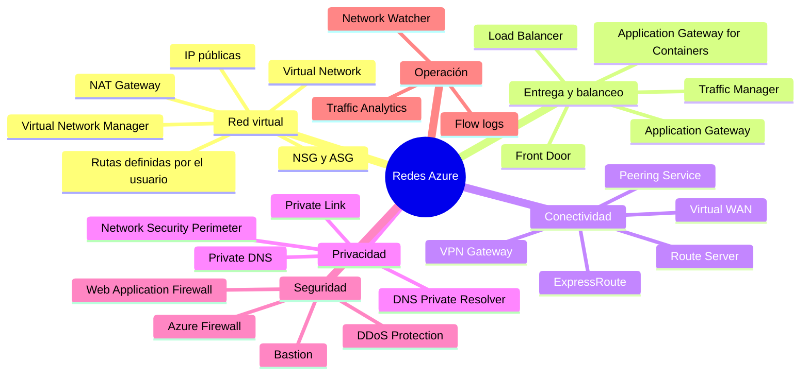
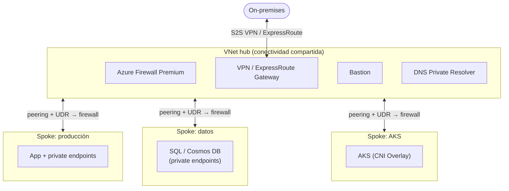
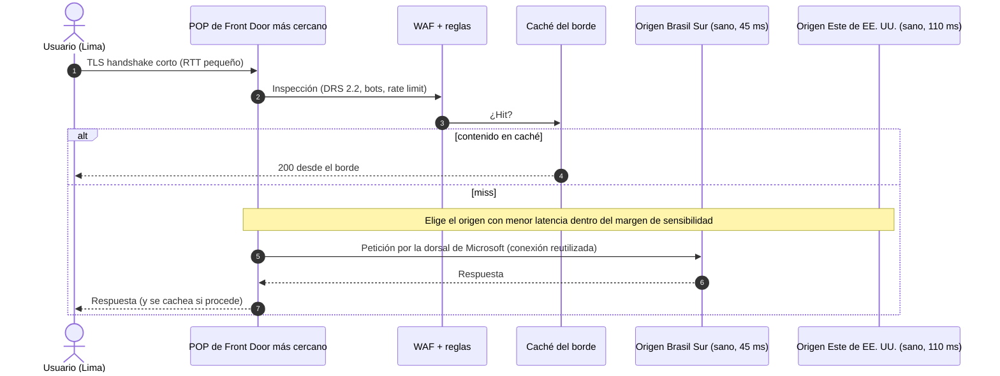
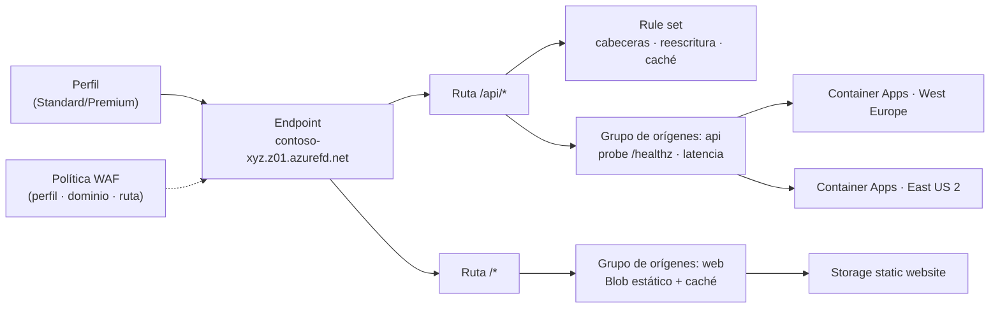
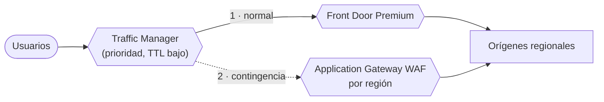
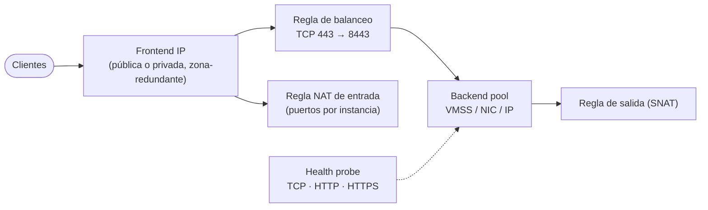
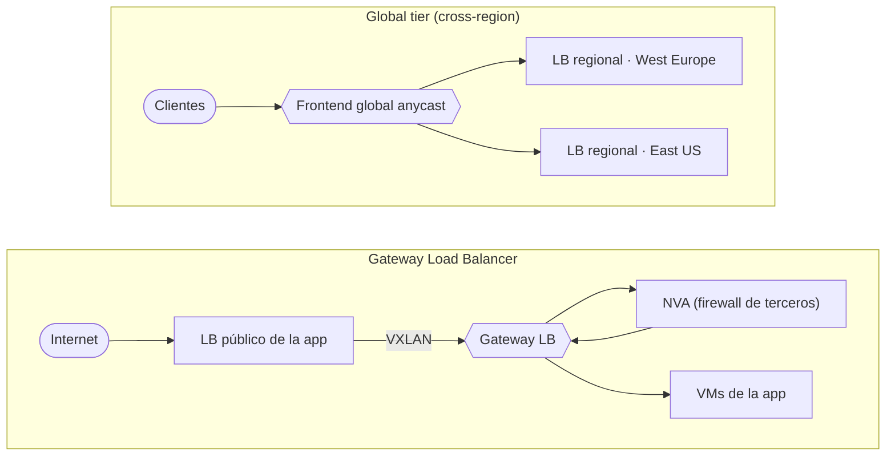
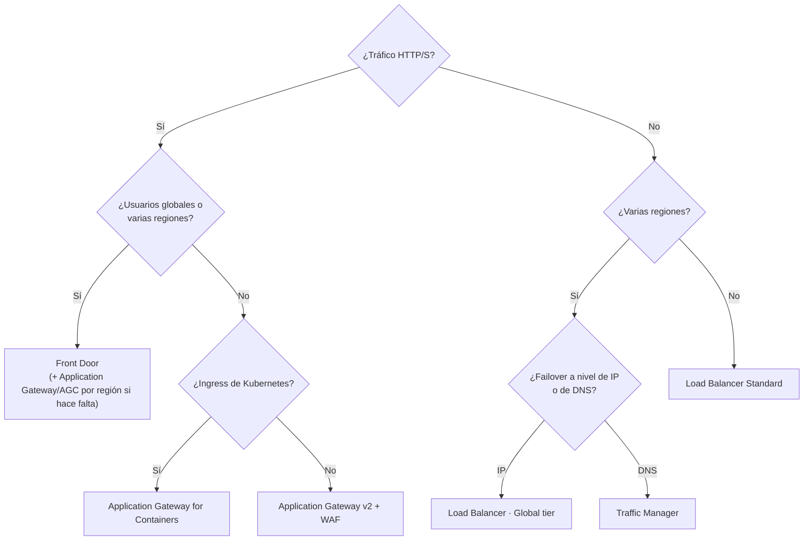

<div align="center">

# 06 · Redes y entrega global

**Front Door · Load Balancer · Application Gateway · Traffic Manager · VNet · Private Link · ExpressRoute · Firewall**

[⬅ 05 · Mensajería](05-mensajeria-e-integracion.md) · [🏠 Índice](../README.md) · [07 · Observabilidad ➡](07-observabilidad-y-monitoreo.md)

</div>

---

## Contenido

1. [Mapa de redes en Azure](#1-mapa-de-redes-en-azure)
2. [Fundamentos de la red virtual](#2-fundamentos-de-la-red-virtual)
3. [Azure Front Door](#3-azure-front-door)
4. [Azure Load Balancer](#4-azure-load-balancer)
5. [Elegir el balanceador correcto](#5-elegir-el-balanceador-correcto)
6. [Application Gateway y Traffic Manager](#6-application-gateway-y-traffic-manager)
7. [Conectividad híbrida](#7-conectividad-híbrida)
8. [Seguridad de red](#8-seguridad-de-red)
9. [Operación y diagnóstico](#9-operación-y-diagnóstico)
10. [Novedades y retiros](#10-novedades-y-retiros)
11. [Referencias](#11-referencias)

---

## 1. Mapa de redes en Azure



| Servicio | Capa | Ámbito | Estado | Función |
|---|---|---|---|---|
| Virtual Network | L3 | Regional | 🟢 | Red privada aislada con subredes |
| Virtual Network Manager | L3 | Multisuscripción | 🟢 | Topologías (*hub-spoke*, *mesh*) y reglas de seguridad de administrador centralizadas |
| NAT Gateway | L4 | Zonal / 🆕 zona-redundante (StandardV2) | 🟢 | Salida a Internet sin agotar SNAT |
| Azure Front Door | L7 | **Global** | 🟢 (classic 🟠 31-mar-2027) | Entrada global HTTP/S, WAF, CDN |
| Azure Load Balancer | L4 | Regional / Global | 🟢 (Basic ⛔ sep-2025) | Balanceo TCP/UDP de paso |
| Application Gateway v2 | L7 | Regional | 🟢 (v1 ⛔ abr-2026) | Proxy inverso regional con WAF |
| Application Gateway for Containers | L7 | Regional | 🟢 | Ingress/Gateway API para AKS |
| Traffic Manager | DNS | Global | 🟢 | Enrutamiento por DNS a cualquier *endpoint* |
| VPN Gateway | L3 | Regional | 🟢 (SKU sin zona ⛔ sep-2026) | Sitio a sitio y punto a sitio cifrado |
| ExpressRoute | L2/L3 | Privado | 🟢 | Conexión privada dedicada (hasta 400 Gbps con Direct) |
| Virtual WAN | L3 | Global | 🟢 | *Hubs* gestionados con enrutamiento y seguridad |
| Route Server | Control BGP | Regional | 🟢 | Intercambio BGP con NVA |
| Private Link / Private Endpoint | L3 | Regional | 🟢 | Servicios PaaS en tu VNet con IP privada |
| Network Security Perimeter | Perímetro PaaS | Multirrecurso | 🟢 GA ago-2025 | Límite lógico para recursos PaaS fuera de la VNet |
| Azure DNS / Private DNS / DNS Private Resolver | DNS | Global/Regional | 🟢 | Zonas públicas y privadas, resolución híbrida |
| Azure Firewall | L3–L7 | Regional | 🟢 | Firewall con estado (Basic, Standard, Premium) |
| DDoS Protection | L3/L4 | Regional | 🟢 | Mitigación adaptativa (Network o IP Protection) |
| Azure Bastion | Acceso | Regional | 🟢 | RDP/SSH por navegador sin IP públicas |
| Network Watcher | Diagnóstico | Regional | 🟢 | Monitor de conexión, *flow logs*, captura de paquetes |

---

## 2. Fundamentos de la red virtual

### 2.1 Bloques esenciales

| Elemento | Qué es | Detalle experto |
|---|---|---|
| Espacio de direcciones | Rangos CIDR privados (RFC 1918) o públicos propios | Planifica sin solapes con on-premises y otras VNets (IPAM de Virtual Network Manager ayuda) |
| Subred | Segmento de la VNet | Azure reserva 5 IP por subred; algunos servicios exigen subred delegada o dedicada |
| NSG / ASG | Reglas *stateful* L3/L4 | Agrupa VM por rol con ASG en lugar de listas de IP |
| UDR | Tablas de rutas personalizadas | Fuerza tráfico a Azure Firewall/NVA (`0.0.0.0/0` → firewall) |
| Peering | Conexión entre VNets (regional o global) | No transitivo: usa *hub* con firewall, Virtual WAN o Virtual Network Manager |
| Service endpoints | Ruta óptima a PaaS desde la subred | El PaaS sigue con IP pública |
| **Private endpoints** | NIC con IP privada para un recurso PaaS | Requiere zona **Private DNS** `privatelink.*` enlazada |
| DNS Private Resolver | Reenvío DNS entrante/saliente | Resolución híbrida sin VM DNS |

> [!WARNING]
> **Fin del acceso de salida por defecto**: después del **31-mar-2026**, las VNets nuevas crean **subredes privadas por
> defecto** y las VM ya no obtienen salida implícita a Internet. Define un método explícito: **NAT Gateway**, reglas de
> salida del Load Balancer, IP pública de instancia o un firewall.

### 2.2 Topologías de referencia



| Topología | Cuándo | Ventaja | Costo de operación |
|---|---|---|---|
| ***Hub-spoke*** tradicional | Control fino, NVA de terceros | Máxima flexibilidad | Alto (rutas, firewall, DNS manuales) |
| **Virtual WAN** | Muchas sucursales/regiones, SD-WAN | *Hubs* gestionados, *routing intent* con firewall | Bajo |
| Malla con Virtual Network Manager | Comunicación directa entre spokes | Conectividad declarativa | Medio |

---

## 3. Azure Front Door

### 3.1 Cómo funciona

Front Door es un **proxy inverso L7 global** que vive en el *edge* de Microsoft (190+ sitios conectados por la
dorsal privada de Microsoft). Una IP **anycast** atrae al usuario al punto de presencia más cercano, donde se termina
TCP/TLS (*split TCP*), se aplican WAF, reglas y caché, y la petición viaja por la red de Microsoft hasta el mejor origen.



### 3.2 Tiers

| Capacidad | Standard | Premium | Classic |
|---|---|---|---|
| Entrega de contenido estático y dinámico | ✅ | ✅ | ✅ |
| Dominios personalizados y certificados administrados | ✅ | ✅ | ✅ |
| Motor de reglas avanzado | ✅ | ✅ | Limitado |
| WAF con reglas personalizadas | ✅ | ✅ | ✅ |
| **WAF con reglas administradas (DRS) y protección contra bots** | — | ✅ | ✅ (con costo aparte) |
| **Orígenes privados con Private Link** | — | ✅ | — |
| Informes de seguridad avanzados | — | ✅ | — |
| Estado | 🟢 | 🟢 | 🟠 Retiro **31-mar-2027**; sin nuevos perfiles desde abr-2025 |

### 3.3 Modelo de configuración



### 3.4 Enrutamiento y sondeos de salud

| Mecanismo | Cómo funciona | Configuración clave |
|---|---|---|
| **Latencia** (por defecto) | Envía al origen más rápido; los que estén dentro de la *latency sensitivity* (ms) se consideran equivalentes | `additionalLatencyInMilliseconds` |
| **Prioridad** | Activo-pasivo: prioridad 1 hasta que falla | `priority` por origen |
| **Peso** | Reparto proporcional entre equivalentes | `weight` 1–1000 |
| Afinidad de sesión | Cookie del borde fija el origen | Úsala con moderación (rompe el reparto) |
| *Health probes* | HEAD/GET HTTP(S) desde muchos POP | Intervalo, ruta `/healthz`, tamaño de muestra y éxitos requeridos |

> [!TIP]
> Haz que `/healthz` compruebe **dependencias críticas** (base de datos, colas) con un *timeout* corto: si el
> origen está "vivo pero inútil", Front Door debe sacarlo de rotación (defensa contra fallas grises).

### 3.5 Seguridad en el borde

- **WAF**: *Default Rule Set* 2.x (🆕 DRS 2.2 GA), *Bot Manager*, límites de tasa, filtrado geográfico, reglas
  personalizadas; 🆕 políticas WAF a nivel de **perfil y ruta** (🟡 sep-2026; gana la más específica). DRS 1.x y CRS
  3.0/3.1 terminan su soporte el **26-feb-2027**.
- **Orígenes privados** con Private Link (Premium) hacia App Service, Storage, Container Apps, Load Balancer interno o
  Application Gateway: el origen no necesita IP pública.
- **Autenticación del origen con identidad administrada** (GA) y cabecera `X-Azure-FDID` para aceptar solo tráfico de
  tu perfil.
- TLS: certificados administrados o propios desde Key Vault; los conjuntos de cifrado DHE se desactivaron el 1-abr-2026.
- Protección DDoS L3/L4 de la plataforma incluida.

### 3.6 Novedades 2026

| Capacidad | Estado |
|---|---|
| WebSocket (habilitado por defecto) | 🟢 may-2026 |
| *Edge actions*: JavaScript ligero en el borde sobre micro-VM Hyperlight | 🟡 jul-2026 |
| Actualizaciones de reglas por lotes | 🟢 ago-2026 |
| Políticas WAF por perfil y por ruta | 🟡 sep-2026 |

### 3.7 Diseñar para la falla del propio borde

Front Door es global y altamente disponible (SLA 99,99 %), pero los incidentes de configuración globales existen
(Microsoft publicó mejoras de resiliencia tras los incidentes de octubre de 2025). Para cargas de misión crítica,
Microsoft documenta una **redundancia de enrutamiento global**: Traffic Manager delante de Front Door con una ruta
alternativa (Application Gateway regional u otra CDN) que se activa si el borde falla.



### 3.8 Ejemplo (Bicep): perfil Premium con origen privado

```bicep
resource afd 'Microsoft.Cdn/profiles@2024-02-01' = {
  name: 'afd-comercio'
  location: 'global'
  sku: { name: 'Premium_AzureFrontDoor' }
}

resource ep 'Microsoft.Cdn/profiles/afdEndpoints@2024-02-01' = {
  parent: afd
  name: 'comercio'
  location: 'global'
  properties: { enabledState: 'Enabled' }
}

resource og 'Microsoft.Cdn/profiles/originGroups@2024-02-01' = {
  parent: afd
  name: 'api'
  properties: {
    loadBalancingSettings: { sampleSize: 4, successfulSamplesRequired: 3, additionalLatencyInMilliseconds: 50 }
    healthProbeSettings: { probePath: '/healthz', probeProtocol: 'Https', probeRequestType: 'GET', probeIntervalInSeconds: 30 }
  }
}

resource originWeu 'Microsoft.Cdn/profiles/originGroups/origins@2024-02-01' = {
  parent: og
  name: 'aca-weu'
  properties: {
    hostName: 'api-pedidos.westeurope.azurecontainerapps.io'
    originHostHeader: 'api-pedidos.westeurope.azurecontainerapps.io'
    priority: 1
    weight: 1000
    sharedPrivateLinkResource: {
      privateLink: { id: acaEnvironmentId }
      groupId: 'managedEnvironments'
      privateLinkLocation: 'westeurope'
      requestMessage: 'Front Door → Container Apps'
    }
  }
}
```

### 3.9 Checklist Front Door

- [ ] Perfil **Premium** si necesitas WAF administrado u orígenes privados; migración de *classic* antes del 31-mar-2027.
- [ ] Orígenes que solo aceptan tráfico de tu perfil (Private Link o `X-Azure-FDID` + etiqueta de servicio `AzureFrontDoor.Backend`).
- [ ] *Health probes* profundas y al menos dos regiones por grupo de orígenes.
- [ ] Reglas de caché explícitas; compresión activada; *purge* automatizado en el pipeline.
- [ ] WAF en modo **Prevention** tras un periodo en *Detection*; DRS 2.x.
- [ ] Logs de acceso y WAF a Log Analytics con alertas por picos de 4xx/5xx.

---

## 4. Azure Load Balancer

### 4.1 Componentes



### 4.2 SKUs y niveles

| | Basic | **Standard** | Gateway | **Standard · Global tier** |
|---|---|---|---|---|
| Estado | ⛔ Retirado 30-sep-2025 (sigue funcionando sin soporte ni SLA) | 🟢 | 🟢 | 🟢 |
| Ámbito | Regional | Regional | Regional | **Entre regiones** |
| Backend máx. | 300 instancias | 5 000 instancias | NVA | LB regionales |
| Zonas | No | Zona-redundante o zonal | Sí | Frontend global anycast |
| Seguridad | Abierto por defecto | **Cerrado por defecto** (requiere NSG) | Encadenamiento transparente | — |
| SLA | Ninguno | 99,99 % | 99,99 % | 99,99 % |
| Uso | — | Producción | Insertar NVA de terceros sin cambiar rutas | Failover regional instantáneo para tráfico L4 |

### 4.3 Modos de distribución

| Modo | Hash sobre | Efecto |
|---|---|---|
| **Por defecto** | 5 tuplas (IP/puerto origen y destino, protocolo) | Cada conexión nueva puede ir a otra instancia |
| *Client IP* | 2 tuplas (IP origen y destino) | Misma IP de cliente → misma instancia |
| *Client IP and protocol* | 3 tuplas | Igual, distinguiendo TCP y UDP |

Otras capacidades: **HA ports** (todas las puertas y protocolos en LB interno, ideal para NVA), **Floating IP**
(*Direct Server Return*, clústeres SQL AG), **TCP reset** al expirar el *idle timeout* (4 a 100 minutos),
**estado administrativo** para sacar instancias de rotación sin tocar el *probe*, y reglas NAT de entrada v2 para
rangos de puertos en VMSS.

### 4.4 SNAT, salida y NAT Gateway

- Cada conexión saliente usa un puerto SNAT; con muchas conexiones a un mismo destino aparece el **agotamiento de
  SNAT** (fallos intermitentes de conexión).
- Mejor práctica: **NAT Gateway** en la subred. 🆕 **StandardV2** (GA ene-2026): redundante de zona, hasta
  **100 Gbps y 10 millones de paquetes/s**, IPv4 e IPv6, mismo precio que Standard; requiere IP públicas StandardV2.
  ICMP de salida GA (jun-2026) y opción por defecto para salida gestionada en AKS (oct-2026).
- Reutiliza conexiones (HTTP *keep-alive*, *pooling*) en tu código: es la mitigación más barata.

### 4.5 Gateway Load Balancer y Global tier



### 4.6 Checklist Load Balancer

- [ ] SKU **Standard** con frontend zona-redundante; ninguna dependencia de Basic.
- [ ] NSG explícitos (Standard es seguro por defecto).
- [ ] *Probes* HTTP(S) sobre un endpoint de salud real, no solo TCP.
- [ ] Salida con **NAT Gateway StandardV2**; alertas sobre `SNAT Connection Count` fallidas y `Used SNAT Ports`.
- [ ] Métrica *Data Path Availability* y *Health Probe Status* en alertas.

---

## 5. Elegir el balanceador correcto

| | Front Door | Traffic Manager | Application Gateway | Load Balancer |
|---|---|---|---|---|
| Capa | L7 | DNS | L7 | L4 |
| Ámbito | Global | Global | Regional | Regional / Global |
| Protocolos | HTTP/S, WebSocket | Cualquiera (solo resuelve DNS) | HTTP/S, WebSocket, HTTP/2 | TCP/UDP |
| WAF | ✅ | — | ✅ | — |
| Caché/CDN | ✅ | — | — | — |
| Terminación TLS | ✅ (borde) | — | ✅ | — (de paso) |
| *Failover* | Segundos (*probes*) | Según TTL DNS | Segundos | Segundos |
| Típico | Apps web globales | Failover DNS, *endpoints* no HTTP | Apps regionales, ingress AKS | Servicios TCP/UDP, NVA, VM |



---

## 6. Application Gateway y Traffic Manager

**Application Gateway v2** es el proxy inverso L7 regional: enrutamiento por ruta y *host*, reescritura de cabeceras
y URL, afinidad, terminación y re-cifrado TLS, autoescalado, zonas y **WAF** (CRS/DRS de OWASP, bots). La v1 se
retiró el **28-abr-2026**. **Application Gateway for Containers** es su evolución para AKS: implementa **Ingress API y
Gateway API**, actualiza la configuración casi al instante y admite WAF (GA).

**Traffic Manager** responde consultas DNS con el *endpoint* adecuado según el método:

| Método | Decide por |
|---|---|
| Prioridad | Activo-pasivo |
| Ponderado | Reparto por peso |
| Rendimiento | Latencia desde la región del resolvedor DNS |
| Geográfico | País/región del usuario (soberanía de datos) |
| Multivalor | Devuelve varias IP sanas |
| Subred | Rango IP del cliente |

---

## 7. Conectividad híbrida

| Servicio | Ancho de banda | Cifrado | SLA | Claves |
|---|---|---|---|---|
| **VPN Gateway** (S2S, P2S, VNet-to-VNet) | Hasta decenas de Gbps agregados según SKU | IPsec/IKE, OpenVPN, IKEv2 | 99,95 % (activo-activo y zonas) | Solo SKU **AZ** desde sep-2026 (las VpnGw1–5 sin zona se migraron automáticamente); P2S con Entra ID |
| **ExpressRoute** | 50 Mbps – 10 Gbps por circuito; **Direct** 10/100 Gbps y 🆕 **400 Gbps** | Privado (MACsec en Direct, IPsec opcional) | 99,95 % | Global Reach (on-prem ↔ on-prem), FastPath, **ExpressRoute Metro** (dos ubicaciones de *peering*) |
| **Virtual WAN** | Escala de *hub* gestionado | Según conexión | 99,95 %+ | *Secured hubs* con Azure Firewall y *routing intent*, SD-WAN de socios |
| **Route Server** | Plano de control | — | 99,95 % | BGP con NVA para propagar rutas sin UDR manuales |
| **Peering Service** | Internet optimizado | — | — | Conectividad a Microsoft 365/Azure por ISP socios |

---

## 8. Seguridad de red

| Servicio | Tiers / opciones | Capacidades |
|---|---|---|
| **Azure Firewall** | Basic, Standard, **Premium** | Reglas L3–L7, FQDN, inteligencia de amenazas; Premium añade **IDPS**, inspección TLS, filtrado de URL y categorías web; Firewall Manager y políticas jerárquicas |
| **Web Application Firewall** | En Front Door, Application Gateway, AGC | OWASP, bots, *rate limiting*, exclusiones |
| **DDoS Protection** | Network Protection (por VNet), IP Protection (por IP) | Ajuste adaptativo, métricas, respuesta rápida y protección de costos (Network Protection) |
| **NSG / ASG** | — | Microsegmentación *stateful*; *security admin rules* de Virtual Network Manager para imponer reglas globales |
| **Azure Bastion** | Developer, Basic, Standard, Premium | RDP/SSH sin IP públicas; Premium con grabación de sesiones y acceso privado |
| **Private Link** | Private endpoint / Private Link service | Consumir y publicar servicios por IP privada |
| **Network Security Perimeter** | — | Perímetro lógico para PaaS (Storage, Cosmos DB, Service Bus, Event Hubs, Key Vault, Monitor…) con modo aprendizaje y logs |

---

## 9. Operación y diagnóstico

| Herramienta | Uso |
|---|---|
| **Connection Monitor** | Latencia y pérdida extremo a extremo (Azure ↔ on-prem) |
| **VNet flow logs** + Traffic Analytics | Flujos a nivel de VNet (reemplazan a los NSG flow logs, que se retiran el 30-sep-2027) |
| IP flow verify / Next hop / Effective routes | Depurar NSG y rutas |
| Packet capture | Captura en VM o VMSS |
| Network Insights (Azure Monitor) | Topología y salud de todos los recursos de red |

---

## 10. Novedades y retiros

| Fecha | Cambio |
|---|---|
| 15-ene-2025 | ⛔ Azure CDN de Edgio |
| abr-2025 | Sin nuevos perfiles Front Door *classic* |
| ago-2025 | 🟢 Network Security Perimeter |
| 30-sep-2025 | ⛔ Load Balancer Basic e IP pública Basic |
| ene-2026 | 🟢 NAT Gateway StandardV2 (zona-redundante, 100 Gbps) |
| 31-mar-2026 | Subredes privadas por defecto en VNets nuevas (fin de la salida implícita) |
| 1-abr-2026 | Front Door y CDN desactivan cifrados DHE |
| 28-abr-2026 | ⛔ Application Gateway v1 |
| 2026 | 🟢 Puertos de 400 Gbps en ExpressRoute Direct · Front Door: WebSocket GA, *edge actions* (🟡), WAF por ruta (🟡) |
| 30-sep-2026 | ⛔ SKU VpnGw1–5 sin zona (migradas a AZ) |
| 26-feb-2027 | 🟠 DRS 1.x y CRS 3.0/3.1 del WAF |
| 31-mar-2027 | 🟠 Front Door (classic) |
| 30-sep-2027 | 🟠 Azure CDN Standard from Microsoft (classic) · NSG flow logs |

---

## 11. Referencias

- [Azure networking documentation](https://learn.microsoft.com/azure/networking/)
- [Azure Front Door](https://learn.microsoft.com/azure/frontdoor/) · [Global routing redundancy for mission-critical web apps](https://learn.microsoft.com/azure/architecture/guide/networking/global-web-applications/overview)
- [Azure Load Balancer](https://learn.microsoft.com/azure/load-balancer/) · [Gateway Load Balancer](https://learn.microsoft.com/azure/load-balancer/gateway-overview) · [Cross-region (Global) Load Balancer](https://learn.microsoft.com/azure/load-balancer/cross-region-overview)
- [Load-balancing options decision guide](https://learn.microsoft.com/azure/architecture/guide/technology-choices/load-balancing-overview)
- [NAT Gateway](https://learn.microsoft.com/azure/nat-gateway/) · [Default outbound access](https://learn.microsoft.com/azure/virtual-network/ip-services/default-outbound-access)
- [Hub-spoke network topology](https://learn.microsoft.com/azure/architecture/networking/architecture/hub-spoke) · [Virtual WAN](https://learn.microsoft.com/azure/virtual-wan/)

---

<div align="center">

[⬅ 05 · Mensajería](05-mensajeria-e-integracion.md) · [🏠 Índice](../README.md) · [07 · Observabilidad ➡](07-observabilidad-y-monitoreo.md)

</div>
