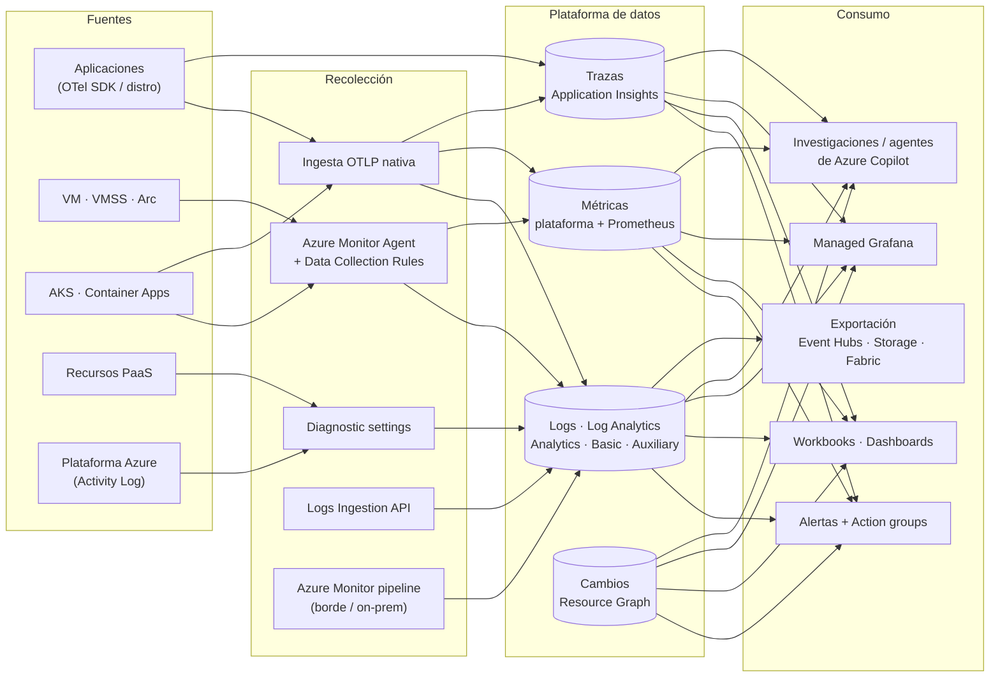
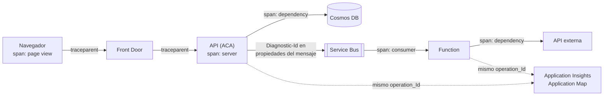

<div align="center">

# 07 · Observabilidad y monitoreo

**Azure Monitor · Application Insights · Log Analytics · OpenTelemetry · Managed Prometheus · Managed Grafana · alertas**

[⬅ 06 · Redes](06-redes-y-entrega-global.md) · [🏠 Índice](../README.md) · [08 · Seguridad ➡](08-identidad-y-seguridad.md)

</div>

> En un sistema distribuido, seguir el flujo de una petición entre múltiples servidores es complejo.
> Azure Monitor y Application Insights proporcionan **rastreo distribuido**, **mapas de aplicación** y
> **centralización de logs** para entender la salud real de todo el ecosistema.

---

## Contenido

1. [Arquitectura de Azure Monitor](#1-arquitectura-de-azure-monitor)
2. [Los tipos de datos](#2-los-tipos-de-datos)
3. [Recolección: agentes, DCR y OTLP](#3-recolección-agentes-dcr-y-otlp)
4. [Application Insights y OpenTelemetry](#4-application-insights-y-opentelemetry)
5. [Rastreo distribuido de extremo a extremo](#5-rastreo-distribuido-de-extremo-a-extremo)
6. [KQL: recetario del operador](#6-kql-recetario-del-operador)
7. [Alertas, SLO y respuesta](#7-alertas-slo-y-respuesta)
8. [Contenedores, Prometheus y Grafana](#8-contenedores-prometheus-y-grafana)
9. [Observabilidad de IA y agentes](#9-observabilidad-de-ia-y-agentes)
10. [Costos de observabilidad](#10-costos-de-observabilidad)
11. [Novedades y retiros](#11-novedades-y-retiros)
12. [Referencias](#12-referencias)

---

## 1. Arquitectura de Azure Monitor



---

## 2. Los tipos de datos

| Tipo | Almacén | Retención | Lenguaje | Para |
|---|---|---|---|---|
| **Métricas de plataforma** | Base de métricas de Azure Monitor | 93 días | Explorador de métricas | Alertas rápidas, autoescalado |
| **Métricas Prometheus** | Azure Monitor workspace | 18 meses | PromQL | Kubernetes y apps nativas de nube |
| **Logs** | Log Analytics workspace | Interactiva hasta 2 años; total hasta 12 años | KQL | Investigación, correlación, auditoría |
| **Trazas, peticiones, dependencias, excepciones** | Application Insights (tablas en Log Analytics) | Según el workspace | KQL | APM y rastreo distribuido |
| **Activity Log** | Plano de control | 90 días (más si lo exportas) | KQL | Quién cambió qué |
| **Cambios de recursos** | Resource Graph | 14 días | KQL (ARG) | Correlacionar incidentes con cambios |

**Planes de tabla en Log Analytics**

| Plan | Consulta | Alertas | Costo de ingesta | Para |
|---|---|---|---|---|
| **Analytics** | Completa | ✅ | $$$ | Datos de operación y seguridad críticos |
| **Basic** | KQL con limitaciones, pago por consulta | Limitadas | $ | Logs de depuración de alto volumen |
| **Auxiliary** | Consultas ocasionales | — | ¢ | Auditoría y cumplimiento, retención barata |

---

## 3. Recolección: agentes, DCR y OTLP

| Mecanismo | Qué recoge | Notas |
|---|---|---|
| **Azure Monitor Agent (AMA)** | Logs y métricas de SO (VM, VMSS, Arc) | Reemplazó al agente de Log Analytics (MMA, retirado ago-2024); se configura con **Data Collection Rules** |
| **Data Collection Rules** | Qué recoger, transformar (KQL) y enviar | Transformaciones en ingesta para filtrar o enmascarar PII |
| 🆕 **Ingesta OTLP nativa** (GA 4-jun-2026) | Trazas, métricas y logs OpenTelemetry | Vía OpenTelemetry Collector con autenticación Entra, AMA o el complemento de AKS |
| **Diagnostic settings** | Logs de recursos y métricas de plataforma | A Log Analytics, Storage, Event Hubs o socios |
| **Logs Ingestion API** | Logs personalizados vía REST | Reemplaza a la *HTTP Data Collector API*, retirada en sep-2026 |
| **Azure Monitor pipeline** | Ingesta a escala en el borde/on-prem | Filtra y agrega antes de enviar |
| Container Insights / VM Insights | Experiencias curadas | Basadas en AMA y Prometheus |

```yaml
# OpenTelemetry Collector → Azure Monitor (OTLP) con autenticación de Entra ID (fragmento ilustrativo)
receivers:
  otlp:
    protocols: { grpc: {}, http: {} }
processors:
  batch: {}
exporters:
  otlphttp/azuremonitor:
    endpoint: ${env:AZMON_OTLP_ENDPOINT}       # endpoint de ingesta OTLP de tu recurso
    auth: { authenticator: azureauth }
extensions:
  azureauth: { managed_identity: { client_id: ${env:AZURE_CLIENT_ID} } }
service:
  extensions: [azureauth]
  pipelines:
    traces:  { receivers: [otlp], processors: [batch], exporters: [otlphttp/azuremonitor] }
    metrics: { receivers: [otlp], processors: [batch], exporters: [otlphttp/azuremonitor] }
    logs:    { receivers: [otlp], processors: [batch], exporters: [otlphttp/azuremonitor] }
```

---

## 4. Application Insights y OpenTelemetry

| Capacidad | Qué aporta |
|---|---|
| **Application Map** | Topología inferida de dependencias con latencias y fallos por arista |
| *Transaction search* y detalle de transacción | La traza completa de una operación (*waterfall*) |
| Rendimiento y fallos | Percentiles por operación, dependencias y excepciones agrupadas |
| **Live Metrics** | Telemetría en segundos durante un despliegue |
| **Availability tests** | Pruebas estándar multirregión (las *URL ping tests* se retiraron el 30-sep-2026) y `TrackAvailability` personalizado |
| Profiler y Snapshot Debugger | Rutas calientes de código y estado en excepciones de producción |
| Muestreo | Adaptativo/fijo (o muestreo OTel) para controlar costo sin romper trazas |

**Instrumentación recomendada (2026): Azure Monitor OpenTelemetry Distro** para .NET, Java, Node.js y Python, o
**auto-instrumentación** sin cambios de código en App Service, Functions y AKS (Java y Node.js GA may-2026).

```csharp
// ASP.NET Core: una línea para trazas, métricas y logs vía OpenTelemetry
builder.Services.AddOpenTelemetry().UseAzureMonitor();   // lee APPLICATIONINSIGHTS_CONNECTION_STRING
```

```python
# Python
from azure.monitor.opentelemetry import configure_azure_monitor
configure_azure_monitor()   # instrumenta requests, Django/Flask/FastAPI, azure-sdk, etc.
```

> [!IMPORTANT]
> - Usa **cadenas de conexión** (la ingesta por *instrumentation key* terminó el 31-mar-2025) y recursos
>   **basados en workspace** (los clásicos se retiraron en 2024).
> - Para **consultar** datos por API usa **Entra ID**: las API keys de Application Insights se retiraron el 30-sep-2026.

---

## 5. Rastreo distribuido de extremo a extremo

Application Insights implementa **W3C Trace Context**: cada salto propaga `traceparent`
(`00-<trace-id>-<span-id>-<flags>`) y opcionalmente `tracestate`. Las tablas se correlacionan por `operation_Id`
(trace-id) y `operation_ParentId`.



| Salto | Cómo se propaga el contexto |
|---|---|
| HTTP | Cabeceras `traceparent`/`tracestate` (automático con los SDK y la distro) |
| Service Bus / Event Hubs | Propiedad `Diagnostic-Id` del mensaje (los SDK `Azure.Messaging.*` la gestionan) |
| Functions | Automático para triggers soportados |
| Dapr | Propaga W3C entre sidecars y hacia el *broker* |
| Procesos por lotes | Crea *links* de span para relacionar el lote con los mensajes de origen |

---

## 6. KQL: recetario del operador

```kusto
// 1 · Latencia P50/P95/P99 por operación en la última hora
requests
| where timestamp > ago(1h)
| summarize p50=percentile(duration,50), p95=percentile(duration,95), p99=percentile(duration,99), n=count()
          by operation_Name
| order by p99 desc
```

```kusto
// 2 · Dependencias que más fallan (y su latencia)
dependencies
| where timestamp > ago(24h)
| summarize fallos=countif(success == false), total=count(), p95=percentile(duration,95) by target, type
| extend tasa_error = round(100.0 * fallos / total, 2)
| order by fallos desc
```

```kusto
// 3 · Reconstruir una transacción distribuida completa a partir de su operation_Id
union requests, dependencies, exceptions, traces
| where operation_Id == "4bf92f3577b34da6a3ce929d0e0e4736"
| project timestamp, itemType, name, cloud_RoleName, duration, success, message
| order by timestamp asc
```

```kusto
// 4 · Disponibilidad (SLI) por hora: % de peticiones exitosas y rápidas (< 500 ms)
requests
| where timestamp > ago(7d)
| summarize buenas = countif(success and duration < 500), total = count() by bin(timestamp, 1h)
| extend sli = 100.0 * buenas / total
| render timechart
```

```kusto
// 5 · Throttling de Cosmos DB (429) por contenedor (logs de recurso)
CDBDataPlaneRequests
| where TimeGenerated > ago(1h) and StatusCode == 429
| summarize throttled = count() by DatabaseName, CollectionName, bin(TimeGenerated, 5m)
```

---

## 7. Alertas, SLO y respuesta

| Tipo de alerta | Se evalúa sobre | Ejemplo |
|---|---|---|
| Métrica (estática o **umbral dinámico**) | Métricas de plataforma o personalizadas | CPU, `ActiveMessages` de Service Bus, `Http5xx` |
| Búsqueda de logs | Consulta KQL programada | SLI de latencia, errores por cliente |
| Activity Log / Service Health / Resource Health | Eventos de plataforma | Incidente regional, mantenimiento planificado |
| Prometheus | Reglas PromQL | `kube_pod_container_status_restarts_total` |
| Smart detection | Anomalías de App Insights | Aumento anormal de fallos |

**Action groups**: correo, SMS, push, voz, webhook seguro, Functions, Logic Apps, Event Hubs, ITSM y *runbooks*.
**Alert processing rules**: silenciar durante mantenimiento o enrutar por etiquetas.

> [!TIP]
> **SLO con *burn rate***: alerta cuando consumes el presupuesto de error demasiado rápido (p. ej., 2 % del presupuesto
> mensual en 1 h → página; 5 % en 6 h → ticket). Reduce falsos positivos frente a umbrales fijos.

---

## 8. Contenedores, Prometheus y Grafana

| Servicio | Rol |
|---|---|
| **Azure Monitor managed service for Prometheus** | Ingesta y almacenamiento de métricas Prometheus sin operar servidores; reglas de grabación y alertas |
| **Azure Managed Grafana** | Grafana gestionado con Entra ID, *dashboards* de AKS listos y fuentes de datos de Azure |
| **Container Insights** | Inventario de pods/nodos, logs de contenedores (con planes Basic para abaratar) |
| **ACNS observability** | Flujos de red de pods (Hubble/Retina), latencias DNS, *drops* |

---

## 9. Observabilidad de IA y agentes

- **Microsoft Foundry** emite trazas OpenTelemetry con las **convenciones semánticas GenAI** (prompts, tokens,
  herramientas, latencia por paso de agente) hacia Application Insights.
- **Foundry Control Plane** centraliza observabilidad, evaluaciones y políticas de la flota de agentes.
- Métricas de tokens por consumidor desde el **AI gateway de API Management** (`llm-emit-token-metric`).
- Evaluaciones continuas (calidad, *groundedness*, seguridad) y *red teaming* automatizado antes de producción.

---

## 10. Costos de observabilidad

| Palanca | Ahorro típico |
|---|---|
| Planes **Basic/Auxiliary** para logs verbosos | Alto |
| Transformaciones en DCR (descartar columnas o filas) | Alto |
| Muestreo en Application Insights / OTel | Alto en apps de mucho tráfico |
| *Commitment tiers* (desde 100 GB/día) | Medio |
| Retención por tabla (no por workspace) | Medio |
| Evitar duplicados (diagnóstico + agente del mismo dato) | Medio |
| *Daily cap* solo como red de seguridad | Bajo (puede ocultar incidentes) |

---

## 11. Novedades y retiros

| Fecha | Cambio |
|---|---|
| feb-2024 | ⛔ Application Insights clásico (solo workspace-based) |
| ago-2024 | ⛔ Agente de Log Analytics (MMA/OMS) → AMA |
| 31-mar-2025 | ⛔ Ingesta por *instrumentation key* → cadenas de conexión |
| may-2026 | 🟢 Auto-instrumentación de Application Insights para Java y Node.js en AKS |
| 4-jun-2026 | 🟢 **Ingesta OTLP nativa** en Azure Monitor |
| jun-2026 | 🟢 Métricas y visualizaciones OpenTelemetry para VM y servidores Arc |
| sep-2026 | ⛔ HTTP Data Collector API (→ Logs Ingestion API) · ⛔ *URL ping tests* (→ pruebas estándar) · ⛔ API keys de consulta de Application Insights (→ Entra ID) |

---

## 12. Referencias

- [Azure Monitor overview](https://learn.microsoft.com/azure/azure-monitor/fundamentals/overview)
- [Application Insights OpenTelemetry overview](https://learn.microsoft.com/azure/azure-monitor/app/opentelemetry-overview) · [Enable the Azure Monitor OpenTelemetry Distro](https://learn.microsoft.com/azure/azure-monitor/app/opentelemetry-enable)
- [Data collection rules](https://learn.microsoft.com/azure/azure-monitor/data-collection/data-collection-rule-overview) · [Logs Ingestion API](https://learn.microsoft.com/azure/azure-monitor/logs/logs-ingestion-api-overview)
- [Log Analytics table plans](https://learn.microsoft.com/azure/azure-monitor/logs/data-platform-logs) · [Cost optimization](https://learn.microsoft.com/azure/azure-monitor/fundamentals/best-practices-cost)
- [Managed Prometheus](https://learn.microsoft.com/azure/azure-monitor/metrics/prometheus-metrics-overview) · [Azure Managed Grafana](https://learn.microsoft.com/azure/managed-grafana/)
- [W3C Trace Context](https://www.w3.org/TR/trace-context/) · [OpenTelemetry GenAI semantic conventions](https://opentelemetry.io/docs/specs/semconv/gen-ai/)

---

<div align="center">

[⬅ 06 · Redes](06-redes-y-entrega-global.md) · [🏠 Índice](../README.md) · [08 · Seguridad ➡](08-identidad-y-seguridad.md)

</div>
