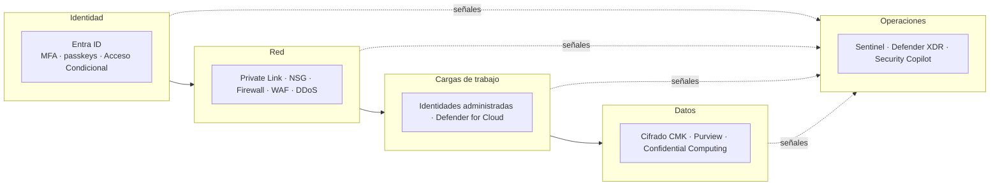
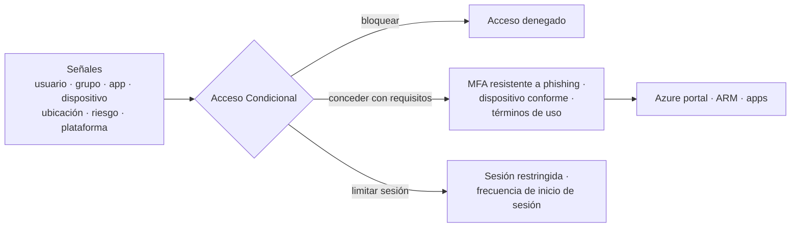
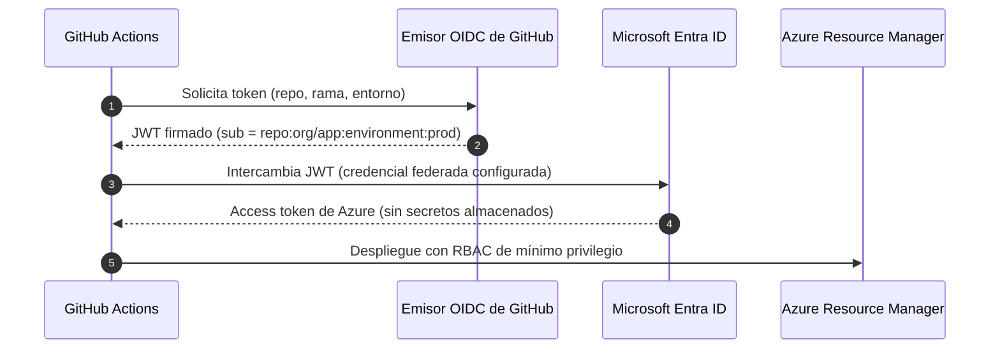

<div align="center">

# 08 · Identidad y seguridad

**Microsoft Entra · identidades administradas · Key Vault · Defender for Cloud · Sentinel · Confidential Computing · cumplimiento**

[⬅ 07 · Observabilidad](07-observabilidad-y-monitoreo.md) · [🏠 Índice](../README.md) · [09 · Datos y analítica ➡](09-datos-y-analitica.md)

</div>

---

## Contenido

1. [Zero Trust en Azure](#1-zero-trust-en-azure)
2. [Catálogo de identidad y seguridad](#2-catálogo-de-identidad-y-seguridad)
3. [Microsoft Entra ID](#3-microsoft-entra-id)
4. [Identidades de carga de trabajo sin secretos](#4-identidades-de-carga-de-trabajo-sin-secretos)
5. [Secretos, claves y HSM](#5-secretos-claves-y-hsm)
6. [Microsoft Defender for Cloud](#6-microsoft-defender-for-cloud)
7. [Microsoft Sentinel y operaciones de seguridad](#7-microsoft-sentinel-y-operaciones-de-seguridad)
8. [Protección de datos y Confidential Computing](#8-protección-de-datos-y-confidential-computing)
9. [Cumplimiento normativo](#9-cumplimiento-normativo)
10. [Checklist de seguridad](#10-checklist-de-seguridad)
11. [Novedades y retiros](#11-novedades-y-retiros)
12. [Referencias](#12-referencias)

---

## 1. Zero Trust en Azure

| Principio | Significado | Implementación en Azure |
|---|---|---|
| **Verificar explícitamente** | Autenticar y autorizar con todas las señales disponibles | Entra ID + Acceso Condicional (usuario, dispositivo, ubicación, riesgo) |
| **Mínimo privilegio** | Acceso justo y a tiempo | RBAC granular, PIM, condiciones ABAC, identidades administradas |
| **Asumir la brecha** | Minimizar el radio de impacto y detectar rápido | Segmentación (NSG, Private Link, NSP), cifrado, Defender, Sentinel |



---

## 2. Catálogo de identidad y seguridad

| Servicio | Categoría | Estado | Función |
|---|---|---|---|
| Microsoft Entra ID | Identidad | 🟢 | Directorio, SSO, MFA, Acceso Condicional (antes Azure AD) |
| Microsoft Entra ID Governance | Identidad | 🟢 | Revisiones de acceso, flujos de ciclo de vida, gestión de derechos |
| Microsoft Entra External ID | Identidad de clientes y socios | 🟢 | B2B y CIAM; sucesor de Azure AD B2C (sin venta a clientes nuevos desde mayo-2025) |
| Microsoft Entra Domain Services | Identidad | 🟢 | Dominio administrado compatible con AD (LDAP, Kerberos, NTLM) |
| Microsoft Entra Agent ID | Identidad de agentes | 🆕 | Identidades y *blueprints* para agentes de IA; Acceso Condicional y protección de identidad para agentes (2026) |
| Global Secure Access (Entra Internet/Private Access) | SSE | 🟢 | Acceso Zero Trust a Internet y a apps privadas (reemplazo de VPN) |
| Microsoft Entra Verified ID | Identidad descentralizada | 🟢 | Credenciales verificables |
| Identidades administradas | Identidad de cargas | 🟢 | Asignadas por el sistema o por el usuario |
| Azure Key Vault | Secretos y claves | 🟢 | Secretos, claves y certificados (Standard y Premium con HSM) |
| Azure Key Vault Managed HSM | HSM | 🟢 | HSM de inquilino único FIPS 140-3 nivel 3 |
| Azure Cloud HSM | HSM | 🟢 | HSM dedicado de inquilino único (sucesor de Dedicated HSM) |
| Azure Payment HSM | HSM | 🟢 | Operaciones criptográficas de pagos (PCI PIN) |
| Microsoft Defender for Cloud | CNAPP | 🟢 | CSPM + protección de cargas multicloud |
| Microsoft Sentinel | SIEM/SOAR | 🟢 (portal de Azure 🟠 31-mar-2027) | Detección e investigación; experiencia unificada en el portal de Defender |
| Microsoft Defender XDR | XDR | 🟢 | Correlación de endpoints, identidad, correo y nube |
| Microsoft Security Copilot | IA para seguridad | 🟢 | Investigación y respuesta asistidas por IA |
| Azure Firewall, WAF, DDoS Protection | Red | 🟢 | Ver [06 § Seguridad de red](06-redes-y-entrega-global.md#8-seguridad-de-red) |
| Azure Confidential Computing | Datos en uso | 🟢 | VM, contenedores y GPU confidenciales |
| Azure Attestation | Confianza | 🟢 | Atestación remota de TEE |
| Azure Confidential Ledger | Integridad | 🟢 | Registro inmutable respaldado por TEE |
| Microsoft Purview | Gobierno de datos | 🟢 | Clasificación, DLP, catálogo (ver [09](09-datos-y-analitica.md)) |
| Customer Lockbox | Control de acceso | 🟢 | Aprobar accesos de ingenieros de Microsoft |
| Microsoft Entra Permissions Management | CIEM | ⛔ oct-2025 | Capacidades en Defender for Cloud |

---

## 3. Microsoft Entra ID

| Capacidad | Para qué | Licencia típica |
|---|---|---|
| SSO y federación (OIDC, SAML, OAuth 2.0) | Acceso a miles de apps | Free |
| MFA y **passkeys** (incluidas *passkeys* sincronizadas, GA mar-2026) | Autenticación resistente al *phishing* | Free/P1 |
| **Acceso Condicional** | Políticas "si … entonces …" con señales de riesgo y dispositivo | P1 |
| **ID Protection** | Riesgo de usuario e inicio de sesión | P2 |
| **Privileged Identity Management** | Elevación *just-in-time* con aprobación y auditoría | P2 / Governance |
| Revisiones de acceso, ciclo de vida, paquetes de acceso | Gobierno de identidades | Governance |
| B2B / External ID | Socios y clientes | Por usuarios activos mensuales |



> [!IMPORTANT]
> Microsoft exige **MFA** para iniciar sesión en el portal de Azure, el centro de administración de Entra, Intune y,
> después, CLI/PowerShell/IaC. Usa **identidades de carga de trabajo** (no usuarios) para automatizaciones.

---

## 4. Identidades de carga de trabajo sin secretos

| Opción | Dónde se usa | Secretos que gestionas |
|---|---|---|
| **Identidad administrada asignada por el sistema** | Un recurso de Azure (VM, App Service, Function, Container App) | Ninguno; vive y muere con el recurso |
| **Identidad administrada asignada por el usuario** | Compartida entre recursos; preaprobada antes del despliegue | Ninguno |
| **Federación de identidad de carga** | GitHub Actions, AKS (Workload ID), otras nubes, Kubernetes | Ninguno (confía en el emisor OIDC externo) |
| Service principal con certificado | Sistemas fuera de Azure sin OIDC | Certificado (rótalo) |
| Service principal con secreto | Último recurso | Secreto (evítalo) |



```csharp
// El mismo código funciona en local (az login / VS) y en Azure (identidad administrada)
var credential = new DefaultAzureCredential();
var secrets = new SecretClient(new Uri("https://kv-comercio.vault.azure.net/"), credential);
KeyVaultSecret s = await secrets.GetSecretAsync("api-socio");
```

---

## 5. Secretos, claves y HSM

| | Key Vault Standard | Key Vault Premium | Managed HSM | Cloud HSM | Payment HSM |
|---|---|---|---|---|---|
| Inquilino | Multiinquilino | Multiinquilino | **Único** | **Único** | Único |
| Protección de claves | Software | HSM FIPS 140-3 nivel 3 | HSM FIPS 140-3 nivel 3 | HSM dedicado | HSM de pagos certificado |
| Control | Microsoft | Microsoft | Tú (dominio de seguridad propio) | Tú (control total del HSM) | Tú |
| Uso | Secretos, certificados | Claves de CMK | CMK a escala, soberanía | Apps *lift-and-shift* que requieren HSM (PKCS#11) | Procesamiento de pagos |

Buenas prácticas: **modelo de permisos RBAC** (no *access policies*), *soft delete* + **protección de purga**,
rotación automática de claves y certificados, *private endpoints*, un vault por aplicación y entorno, eventos de
caducidad a Event Grid. Las nuevas VM AMD v7 incluyen **Azure Integrated HSM** (GA may-2026) en el host.

---

## 6. Microsoft Defender for Cloud

| Componente | Incluye |
|---|---|
| **CSPM básico** (gratuito) | *Secure score*, recomendaciones, MCSB, inventario |
| **Defender CSPM** | Análisis de **rutas de ataque**, *cloud security explorer*, escaneo sin agentes, DSPM (datos sensibles), **AI-SPM** (postura de cargas de IA), gobierno |
| Defender for Servers (P1/P2) | EDR con Defender for Endpoint, evaluación de vulnerabilidades, JIT, FIM |
| Defender for Containers | Postura de Kubernetes, escaneo de imágenes, detección en *runtime* |
| Defender for Databases / Storage / App Service / Key Vault / Resource Manager / APIs | Detección de amenazas específica por servicio (p. ej., *malware scanning* en Storage) |
| Defender for AI services | Amenazas a cargas de IA generativa (inyección de *prompts*, exfiltración) |
| Seguridad de DevOps | GitHub, Azure DevOps y GitLab: secretos, IaC, dependencias |
| Multicloud | AWS y Google Cloud con el mismo modelo |

---

## 7. Microsoft Sentinel y operaciones de seguridad

- **SIEM nativo de nube** con conectores (Azure, Microsoft 365, AWS, GCP, firewalls, SaaS), reglas analíticas
  (KQL, ML, *Fusion*), UEBA, *hunting* y *playbooks* SOAR sobre Logic Apps.
- **Data lake de Sentinel** para retener grandes volúmenes a bajo costo y analizarlos con KQL o *notebooks*.
- **Plataforma unificada de SecOps en el portal de Microsoft Defender** junto con Defender XDR; los workspaces nuevos
  se incorporan allí automáticamente.

> [!WARNING]
> La gestión de Sentinel en el **portal de Azure** se retira el **31-mar-2027** (se extendió desde el 1-jul-2026).
> Después, Sentinel solo estará disponible en el **portal de Defender**: planifica la transición de reglas,
> automatizaciones y permisos.

---

## 8. Protección de datos y Confidential Computing

| Estado del dato | Protección | Servicios |
|---|---|---|
| **En reposo** | Cifrado siempre activo (AES-256) con claves de Microsoft o **CMK**; cifrado de infraestructura doble | Storage, discos (*encryption at host*), SQL TDE, Cosmos DB |
| **En tránsito** | TLS 1.2+ (TLS 1.0/1.1 retirados en los servicios de Azure en 2025), MACsec en la dorsal, IPsec/VPN | Todos |
| **En uso** | **Entornos de ejecución de confianza (TEE)** con memoria cifrada por hardware | VM confidenciales (AMD SEV-SNP, Intel TDX), contenedores confidenciales (ACI), nodos confidenciales de AKS, GPU confidenciales H100, Always Encrypted con enclaves seguros |

**Azure Attestation** verifica la integridad del TEE antes de liberar secretos (*secure key release* desde Managed
HSM). **Microsoft Purview** aporta clasificación, etiquetas de sensibilidad, DLP y gobierno de IA.

---

## 9. Cumplimiento normativo

| Ámbito | Ejemplos de certificaciones y marcos cubiertos |
|---|---|
| Global | ISO/IEC 27001, 27017, 27018, 27701, 22301; SOC 1, 2 y 3; CSA STAR |
| Industria | PCI DSS, HIPAA/HITRUST, SWIFT CSP, ISO 20000 |
| Gobierno | FedRAMP High, DoD IL2–IL6 (Azure Government), CJIS, IRAP (Australia) |
| Regional | GDPR, EU Data Boundary, C5 (Alemania), ENS (España), LGPD (Brasil), MTCS (Singapur) |
| Marco de control de Microsoft | **Microsoft Cloud Security Benchmark (MCSB)** como iniciativa por defecto en Defender for Cloud |

Documentación de auditoría en el **Service Trust Portal**; evaluaciones con Azure Policy (*Regulatory compliance*) y
Microsoft Purview Compliance Manager.

---

## 10. Checklist de seguridad

- [ ] MFA resistente a *phishing* (passkeys/FIDO2) para todos los administradores; cuentas *break-glass* excluidas y vigiladas.
- [ ] Acceso Condicional: bloquear autenticación heredada, exigir dispositivo conforme para roles privilegiados.
- [ ] PIM para todos los roles privilegiados de Entra y de Azure; sin asignaciones permanentes de Owner.
- [ ] Cero secretos en código y pipelines: identidades administradas y federación OIDC.
- [ ] Key Vault con RBAC, protección de purga y *private endpoints*; rotación automática.
- [ ] Servicios PaaS sin acceso público (Private Link o NSP) y autenticación local deshabilitada (Storage, Cosmos DB, Service Bus, Event Hubs, SQL).
- [ ] Defender CSPM y planes de Defender en suscripciones de producción; *secure score* revisado mensualmente.
- [ ] Logs de actividad, Entra y recursos en Log Analytics/Sentinel con retención acorde a la normativa.
- [ ] Azure Policy con la iniciativa MCSB y políticas `deny` para configuraciones críticas.
- [ ] WAF en todo punto de entrada HTTP; DDoS Network Protection en VNets con IP públicas críticas.
- [ ] Plan de respuesta a incidentes ensayado; transición de Sentinel al portal de Defender antes de mar-2027.

---

## 11. Novedades y retiros

| Fecha | Cambio |
|---|---|
| may-2025 | Azure AD B2C sin venta a clientes nuevos → Entra External ID |
| 2025 | Retiro de TLS 1.0/1.1 en servicios de Azure · MFA obligatoria para administración de Azure |
| oct-2025 | ⛔ Entra Permissions Management |
| mar-2026 | 🟢 Passkeys sincronizadas en Entra ID |
| may-2026 | 🟢 Azure Integrated HSM en VM AMD v7 |
| jul–ago-2026 | 🆕 Acceso Condicional y protección de identidad **para agentes** (Entra Agent ID) |
| 4-nov-2026 | Entra deja de conceder automáticamente `AgentIdentity.CreateAsManager` a los *blueprints* de agentes |
| 31-mar-2027 | 🟠 Sentinel en el portal de Azure (solo portal de Defender) |

---

## 12. Referencias

- [Zero Trust guidance](https://learn.microsoft.com/security/zero-trust/) · [Microsoft Entra documentation](https://learn.microsoft.com/entra/)
- [Managed identities](https://learn.microsoft.com/entra/identity/managed-identities-azure-resources/overview) · [Workload identity federation](https://learn.microsoft.com/entra/workload-id/workload-identity-federation)
- [Azure Key Vault](https://learn.microsoft.com/azure/key-vault/) · [Managed HSM](https://learn.microsoft.com/azure/key-vault/managed-hsm/)
- [Microsoft Defender for Cloud](https://learn.microsoft.com/azure/defender-for-cloud/) · [Microsoft Sentinel](https://learn.microsoft.com/azure/sentinel/)
- [Azure confidential computing](https://learn.microsoft.com/azure/confidential-computing/) · [Microsoft Cloud Security Benchmark](https://learn.microsoft.com/security/benchmark/azure/)
- [Service Trust Portal](https://servicetrust.microsoft.com/)

---

<div align="center">

[⬅ 07 · Observabilidad](07-observabilidad-y-monitoreo.md) · [🏠 Índice](../README.md) · [09 · Datos y analítica ➡](09-datos-y-analitica.md)

</div>
