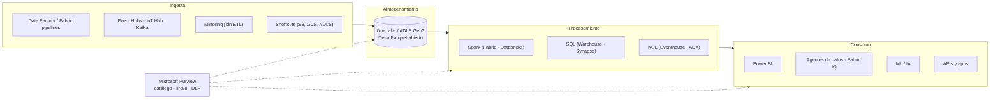
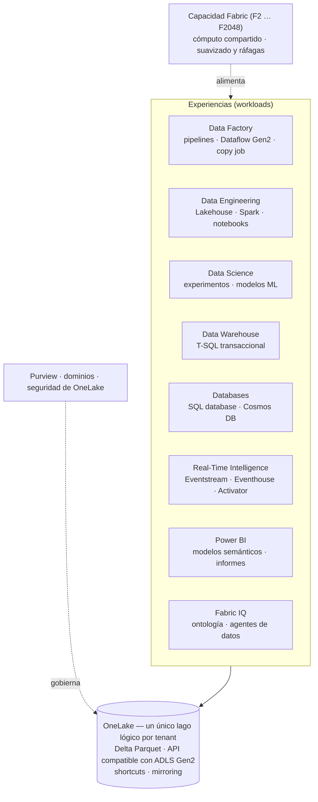
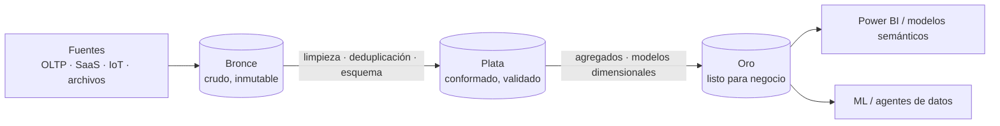
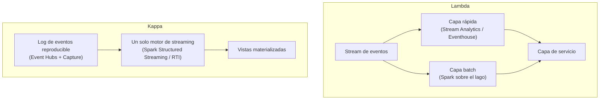

<div align="center">

# 09 · Datos y analítica

**Microsoft Fabric · OneLake · Azure Databricks · Synapse · Data Factory · Data Explorer · Stream Analytics · Purview**

[⬅ 08 · Seguridad](08-identidad-y-seguridad.md) · [🏠 Índice](../README.md) · [10 · IA ➡](10-ia-y-machine-learning.md)

</div>

---

## Contenido

1. [La plataforma de datos moderna](#1-la-plataforma-de-datos-moderna)
2. [Catálogo de analítica](#2-catálogo-de-analítica)
3. [Microsoft Fabric](#3-microsoft-fabric)
4. [Azure Databricks](#4-azure-databricks)
5. [Azure Synapse Analytics](#5-azure-synapse-analytics)
6. [Integración de datos: Data Factory](#6-integración-de-datos-data-factory)
7. [Tiempo real: Data Explorer, Stream Analytics y Eventhouse](#7-tiempo-real-data-explorer-stream-analytics-y-eventhouse)
8. [Gobierno con Microsoft Purview](#8-gobierno-con-microsoft-purview)
9. [Patrones de arquitectura de datos](#9-patrones-de-arquitectura-de-datos)
10. [Cómo elegir](#10-cómo-elegir)
11. [Novedades y retiros](#11-novedades-y-retiros)
12. [Referencias](#12-referencias)

---

## 1. La plataforma de datos moderna



---

## 2. Catálogo de analítica

| Servicio | Modelo | Estado | En una frase |
|---|---|---|---|
| **Microsoft Fabric** | SaaS | 🟢 | Plataforma unificada de datos e IA sobre OneLake (más de 31 000 clientes según FabCon 2026) |
| **Azure Databricks** | PaaS | 🟢 | Plataforma *lakehouse* de Databricks operada en Azure con Unity Catalog |
| **Azure Synapse Analytics** | PaaS | 🟢 (sin nuevas inversiones mayores) | Almacén MPP, SQL *serverless*, Spark y *pipelines*; Fabric es el sucesor recomendado |
| **Azure Data Factory** | PaaS | 🟢 | Integración y orquestación de datos híbrida (90+ conectores) |
| **Azure Data Explorer** | PaaS | 🟢 | Motor Kusto para logs, telemetría y series temporales |
| **Azure Stream Analytics** | PaaS | 🟢 | Procesamiento en *streaming* con SQL |
| **Azure HDInsight** | PaaS | 🟢 (legado) | Hadoop, Spark, Kafka y HBase gestionados |
| **Microsoft Purview** | SaaS | 🟢 | Catálogo unificado, linaje, calidad, DLP y protección de información |
| **Azure Data Share** | PaaS | 🟢 | Compartir datos con organizaciones externas |
| **Power BI Embedded** | PaaS | 🟢 | Informes de Power BI dentro de tus aplicaciones |
| **Azure Analysis Services** | PaaS | 🟢 (legado) | Modelos tabulares; migra a modelos semánticos de Power BI/Fabric |
| Azure Data Lake Analytics (U-SQL) | — | ⛔ feb-2024 | — |
| Azure Data Lake Storage Gen1 | — | ⛔ feb-2024 | Migrado a ADLS Gen2 |
| Azure Time Series Insights | — | ⛔ jul-2024 | Azure Data Explorer / Fabric RTI |
| HDInsight on AKS | — | ⛔ ene-2025 | Fabric / Databricks |
| Synapse Data Explorer (preview) | — | ⛔ oct-2025 | Eventhouse en Fabric |

---

## 3. Microsoft Fabric

### 3.1 Arquitectura



### 3.2 Conceptos clave

| Concepto | Detalle |
|---|---|
| **OneLake** | "El OneDrive de los datos": un lago por tenant; todas las experiencias leen y escriben **Delta Parquet** sin copias |
| **Shortcuts** | Referencias virtuales a ADLS Gen2, Amazon S3, Google Cloud Storage, Dataverse u otros espacios de OneLake |
| **Mirroring** | Réplica casi en tiempo real y sin ETL de Azure SQL, SQL MI, Cosmos DB, PostgreSQL, Snowflake, catálogos de Databricks y más; 🆕 Oracle y SAP Datasphere GA (FabCon 2026) |
| **Capacidades F** | F2 a F2048 (F64 ≈ antigua P1 de Power BI Premium); pago por uso con pausa o reserva |
| **Fabric IQ** | Capa semántica basada en **ontología** (entidades y relaciones de negocio) para analítica y agentes |
| **Agentes de datos y de operaciones** | Preguntas en lenguaje natural sobre lakehouses, almacenes y modelos semánticos (GA según FabCon 2026) |
| **Database Hub** | Gestión centralizada de Azure SQL, Cosmos DB, PostgreSQL, MySQL, SQL Server con Arc y bases nativas de Fabric (*early access*) |

---

## 4. Azure Databricks

| Capacidad | Para qué |
|---|---|
| **Unity Catalog** | Gobierno unificado (permisos, linaje, auditoría) de tablas, archivos, modelos y funciones |
| Delta Lake + **Photon** | Transacciones ACID sobre el lago y motor vectorizado de alto rendimiento |
| Cómputo **serverless** | Notebooks, jobs y SQL sin gestionar clústeres |
| Lakeflow (pipelines declarativos, jobs, conectores) | Ingesta y ETL confiables |
| Databricks SQL | *Warehouse* sobre el lakehouse |
| Mosaic AI | Entrenamiento, *serving*, evaluación y agentes |
| Integración con Azure | Entra ID, Private Link, ADLS Gen2, Key Vault, Power BI y Fabric (catálogos de Unity Catalog reflejados en OneLake) |

---

## 5. Azure Synapse Analytics

| Componente | Estado | Recomendación |
|---|---|---|
| Dedicated SQL pools (MPP) | 🟢 | Mantener; planifica migración a Fabric Warehouse |
| Serverless SQL pools | 🟢 | Fabric Lakehouse/Warehouse para proyectos nuevos |
| Apache Spark pools | 🟢 (runtime 3.4 ⛔ mar-2026 → 3.5) | Fabric Data Engineering o Databricks |
| Pipelines | 🟢 | Fabric Data Factory |
| Data Explorer pools | ⛔ oct-2025 | Eventhouse en Fabric |

> [!NOTE]
> No hay una fecha de retiro global de Synapse, pero Microsoft recomienda **Fabric para nuevos proyectos** y ofrece
> asistentes de migración.

---

## 6. Integración de datos: Data Factory

| Elemento | Detalle |
|---|---|
| Pipelines | Orquestación de actividades (copia, *data flows*, notebooks, procedimientos, webhooks) |
| Mapping data flows | Transformaciones visuales ejecutadas en Spark gestionado |
| **Integration runtimes** | Azure IR (nube), **self-hosted IR** (on-premises/redes privadas), Azure-SSIS IR (paquetes SSIS) |
| Conectividad | 90+ conectores nativos, CDC, *managed VNet* y *private endpoints* |
| Evolución | **Data Factory en Fabric** (pipelines, Dataflow Gen2, *copy job*) con asistentes de migración desde ADF |

---

## 7. Tiempo real: Data Explorer, Stream Analytics y Eventhouse

| Servicio | Lenguaje | Latencia | Fortaleza |
|---|---|---|---|
| **Azure Data Explorer** | KQL | Segundos | Ingesta masiva, series temporales, *materialized views*, consultas *ad hoc* sobre miles de millones de filas |
| **Eventhouse** (Fabric RTI) | KQL | Segundos | El mismo motor Kusto integrado en OneLake, con Eventstream y Activator |
| **Azure Stream Analytics** | SQL | Sub-segundo a segundos | Ventanas temporales, *joins* de streams, editor sin código, ejecución en el borde |

```sql
-- Stream Analytics: alerta si la temperatura media de un dispositivo supera 80 °C en ventanas de 1 minuto
SELECT deviceId, AVG(temperature) AS tempMedia, System.Timestamp() AS finVentana
INTO [alertas]
FROM [telemetria] TIMESTAMP BY eventTime
GROUP BY deviceId, TumblingWindow(minute, 1)
HAVING AVG(temperature) > 80
```

| Ventana | Comportamiento |
|---|---|
| *Tumbling* | Segmentos fijos sin solaparse |
| *Hopping* | Fijas que se solapan (salto < tamaño) |
| *Sliding* | Se evalúa cuando cambia el contenido |
| *Session* | Agrupa eventos cercanos separados por inactividad |
| *Snapshot* | Eventos con la misma marca de tiempo |

---

## 8. Gobierno con Microsoft Purview

| Área | Capacidades |
|---|---|
| **Unified Catalog** | Descubrimiento, glosario, dominios de gobierno, productos de datos |
| **Data Map** | Escaneo de fuentes (Azure, on-premises, multicloud) y **linaje** |
| Calidad de datos | Reglas y puntuaciones de calidad por producto de datos |
| Seguridad de datos | Etiquetas de sensibilidad, **DLP**, *insider risk*, DSPM para IA |
| Cumplimiento | Auditoría, retención, eDiscovery, Compliance Manager |

---

## 9. Patrones de arquitectura de datos

### 9.1 Medallion (*lakehouse*)



### 9.2 Lambda frente a Kappa



| | Lambda | Kappa |
|---|---|---|
| Rutas de procesamiento | Dos (batch + *speed*) | Una (todo es *stream*) |
| Reprocesamiento | Recalcular batch | Re-leer el log desde el inicio |
| Complejidad | Alta (lógica duplicada) | Menor |
| En Azure | Stream Analytics + Spark | Event Hubs (retención larga/Capture) + Spark/Eventhouse |

---

## 10. Cómo elegir

| Necesidad | Recomendación |
|---|---|
| Plataforma de datos integral, BI y autoservicio con mínima operación | **Microsoft Fabric** |
| Ingeniería de datos y ML avanzados, multicloud, ecosistema Spark abierto | **Azure Databricks** (integrable con Fabric vía OneLake) |
| Almacén MPP existente | Synapse dedicated SQL pools → Fabric Warehouse a medio plazo |
| Logs y telemetría con consultas interactivas | **Azure Data Explorer** / Eventhouse |
| ETL híbrido con orígenes on-premises | **Data Factory** (self-hosted IR) o Fabric Data Factory con *gateway* |
| Streaming SQL sencillo | **Stream Analytics** |
| Gobierno y cumplimiento de datos | **Microsoft Purview** |

---

## 11. Novedades y retiros

| Fecha | Cambio |
|---|---|
| ene-2025 | ⛔ HDInsight on AKS |
| oct-2025 | ⛔ Synapse Data Explorer (preview) |
| 2025–2026 | 🟢 SQL database y Cosmos DB en Fabric GA · *mirroring* de Cosmos DB GA |
| mar-2026 | FabCon/SQLCon (Atlanta): **Fabric IQ**, *mirroring* de Oracle y SAP Datasphere GA, agentes de datos y operaciones GA, Database Hub (*early access*) · ⛔ runtime Spark 3.4 de Synapse |
| sep-2026 | FabCon Europe (Barcelona): Fabric IQ en Microsoft Copilot, agente de ingeniería de datos para migraciones |

---

## 12. Referencias

- [Microsoft Fabric documentation](https://learn.microsoft.com/fabric/) · [OneLake](https://learn.microsoft.com/fabric/onelake/onelake-overview) · [Mirroring](https://learn.microsoft.com/fabric/mirroring/overview)
- [Azure Databricks](https://learn.microsoft.com/azure/databricks/) · [Azure Synapse Analytics](https://learn.microsoft.com/azure/synapse-analytics/)
- [Azure Data Factory](https://learn.microsoft.com/azure/data-factory/) · [Azure Data Explorer](https://learn.microsoft.com/azure/data-explorer/) · [Stream Analytics](https://learn.microsoft.com/azure/stream-analytics/)
- [Microsoft Purview](https://learn.microsoft.com/purview/) · [Analytics architecture design](https://learn.microsoft.com/azure/architecture/solution-ideas/articles/analytics-start-here)

---

<div align="center">

[⬅ 08 · Seguridad](08-identidad-y-seguridad.md) · [🏠 Índice](../README.md) · [10 · IA ➡](10-ia-y-machine-learning.md)

</div>
