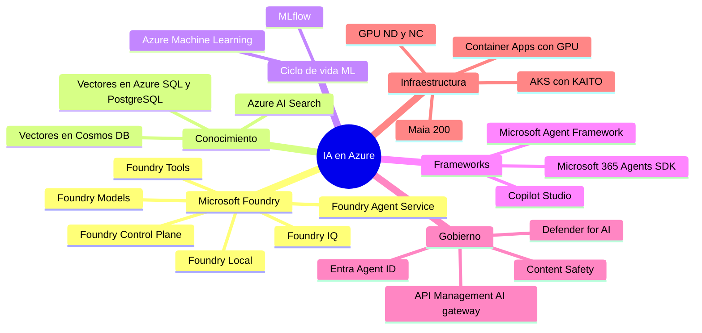
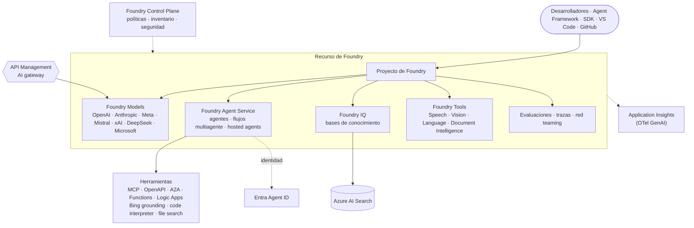
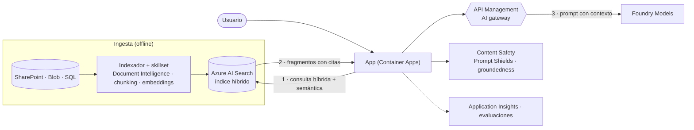
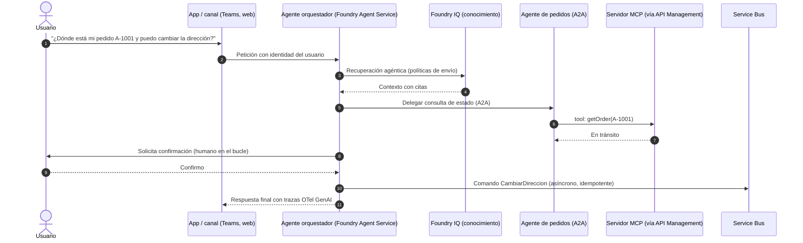

<div align="center">

# 10 · IA y machine learning

**Microsoft Foundry · Foundry Models · Foundry Agent Service · Foundry IQ · Foundry Tools · Azure AI Search · Azure Machine Learning**

[⬅ 09 · Datos y analítica](09-datos-y-analitica.md) · [🏠 Índice](../README.md) · [11 · IoT e híbrido ➡](11-iot-edge-hibrido-y-soberania.md)

</div>

---

## Contenido

1. [Mapa de IA en Azure](#1-mapa-de-ia-en-azure)
2. [Nombres actuales y su historia](#2-nombres-actuales-y-su-historia)
3. [Catálogo de IA](#3-catálogo-de-ia)
4. [Microsoft Foundry](#4-microsoft-foundry)
5. [Azure AI Search y Foundry IQ](#5-azure-ai-search-y-foundry-iq)
6. [Foundry Tools (antes Azure AI Services)](#6-foundry-tools-antes-azure-ai-services)
7. [Azure Machine Learning](#7-azure-machine-learning)
8. [Arquitecturas: RAG y agentes](#8-arquitecturas-rag-y-agentes)
9. [IA responsable y seguridad](#9-ia-responsable-y-seguridad)
10. [Economía de tokens e infraestructura](#10-economía-de-tokens-e-infraestructura)
11. [Novedades y retiros](#11-novedades-y-retiros)
12. [Referencias](#12-referencias)

---

## 1. Mapa de IA en Azure



---

## 2. Nombres actuales y su historia

| Nombre actual (oct-2026) | Nombres anteriores |
|---|---|
| **Microsoft Foundry** | Azure AI Studio (2023) → Azure AI Foundry (2024) → Microsoft Foundry (Ignite 2025) |
| **Foundry Models** / *Azure OpenAI in Foundry Models* | Azure OpenAI Service, catálogo de modelos de Azure AI |
| **Foundry Agent Service** | Azure AI Agent Service |
| **Foundry Tools** | Azure Cognitive Services → Azure AI Services |
| **Azure AI Search** (base de **Foundry IQ**) | Azure Cognitive Search, Azure Search |
| **Document Intelligence** | Form Recognizer |
| **Conversational Language Understanding** | LUIS (retirado oct-2025) |
| *Custom question answering* | QnA Maker (retirado mar-2025) |
| **Microsoft Agent Framework** | Semantic Kernel + AutoGen (ambos en mantenimiento) |
| Rol *Foundry User* | *Azure AI User* |

> [!NOTE]
> Durante la transición verás nombres antiguos en el portal, en SDK y en la facturación. El recurso subyacente y las
> implementaciones existentes se mantienen.

---

## 3. Catálogo de IA

| Servicio | Estado | Para qué |
|---|---|---|
| Microsoft Foundry (portal, proyectos, SDK) | 🟢 | Plataforma unificada para construir, evaluar, desplegar y gobernar apps y agentes de IA |
| Foundry Models | 🟢 | Catálogo de **más de 11 000 modelos** (jul-2026) de OpenAI, Anthropic, Meta, Mistral, xAI, DeepSeek, Cohere, Microsoft y otros |
| Foundry Agent Service | 🟢 | Runtime gestionado de agentes con herramientas, memoria y orquestación multiagente |
| Foundry IQ | 🟢/🟡 según capacidad | Capa de conocimiento para agentes (bases de conocimiento sobre recuperación agéntica de AI Search) |
| Foundry Tools | 🟢 | Speech, Language, Translator, Vision, Document Intelligence, Content Understanding, Content Safety |
| Foundry Control Plane | 🟡 (Ignite 2025) | Gobierno, observabilidad y seguridad de la flota de agentes |
| Foundry Local | 🟢 | Ejecutar modelos en el dispositivo o en entornos desconectados |
| Azure AI Search | 🟢 | Búsqueda híbrida, vectorial y semántica; recuperación agéntica |
| Azure Machine Learning | 🟢 | MLOps de extremo a extremo para modelos propios |
| Microsoft Agent Framework | 🟢 1.0 (abr-2026) | SDK de agentes (.NET y Python) sucesor de Semantic Kernel y AutoGen |
| Azure Bot Service | 🟢 (legado) | Bots con Bot Framework; para nuevos agentes usa Copilot Studio o Microsoft 365 Agents SDK |
| Microsoft Discovery | 🟢 GA (Build 2026) | Plataforma agéntica para I+D científica |
| Azure AI Video Indexer | 🟢 | Indexación y análisis de video y audio |

---

## 4. Microsoft Foundry

### 4.1 Arquitectura



### 4.2 Foundry Models: familias y tipos de implementación

| Proveedor | Familias destacadas (ejemplos 2026) | Notas |
|---|---|---|
| OpenAI | GPT-5.x (p. ej., GPT-5.5 y variantes *mini*), modelos de razonamiento, imagen (gpt-image), audio en tiempo real, video | *Azure OpenAI in Foundry Models* (vendido directamente por Microsoft) |
| Anthropic | Claude (Opus, Sonnet, Haiku) | Disponible desde Ignite 2025 |
| xAI | Grok 4.x | — |
| DeepSeek | DeepSeek V4 / R | — |
| Meta, Mistral, Cohere, Google (Gemma) | Llama, Mistral, Command/Embed/Rerank, Gemma 4 | Pesos abiertos o API |
| Microsoft | MAI, Phi | Modelos de primera parte y pequeños |
| Fireworks AI on Foundry | Modelos abiertos de alto rendimiento | 🟢 GA Build 2026 |

> [!TIP]
> El catálogo cambia cada mes. Usa el **model router** de Foundry para enrutar automáticamente cada petición al modelo
> más eficiente y evalúa con tus propios datos antes de cambiar de versión.

| Tipo de implementación | Facturación | Residencia de procesamiento | Ideal para |
|---|---|---|---|
| **Global Standard** | Por token | Cualquier región de Azure | Mayor disponibilidad y cuota |
| **Data Zone Standard** | Por token | Dentro de la zona de datos (EE. UU. o UE) | Requisitos de residencia regional amplia |
| Regional Standard | Por token | La región del recurso | Residencia estricta |
| **Provisioned (PTU)** — Global/Data Zone/Regional | Unidades de *throughput* reservadas | Según variante | Latencia predecible y volumen alto |
| **Batch** | Por token con descuento (≈50 %) | Global/Data Zone | Trabajos asíncronos con ventana de hasta 24 h |
| Serverless API / cómputo gestionado | Por token o por hora de VM | Según modelo | Modelos de terceros y abiertos |

### 4.3 Foundry Agent Service

| Capacidad | Detalle |
|---|---|
| Agentes declarativos | Instrucciones + modelo + herramientas + conocimiento |
| **Hosted agents** | Tu código de agente (Agent Framework, LangGraph…) ejecutado y escalado por la plataforma; despliegue desde código fuente sin contenedor (Build 2026) |
| Flujos multiagente | Orquestación secuencial, en paralelo y con intervención humana |
| Herramientas | Grounding with Bing Search, *file search*, *code interpreter*, AI Search, agentes de datos de Fabric, SharePoint, Functions, OpenAPI, **MCP**, **A2A**, Logic Apps, automatización de navegador |
| 🆕 *Toolboxes* | 🟡 Agrupan búsqueda web/archivos, MCP, OpenAPI y A2A en un acceso unificado (Build 2026) |
| Memoria y estado | Conversaciones persistentes; almacenamiento propio (Cosmos DB, Storage, AI Search) para soberanía |
| Seguridad | VNet, identidad de agente con **Entra Agent ID**, Content Safety, RBAC |
| Plataforma | Se ejecuta sobre **Azure Container Apps** |

```python
# Llamar a un modelo de Foundry con Entra ID (sin claves) usando la API v1 compatible con OpenAI
from openai import OpenAI
from azure.identity import DefaultAzureCredential, get_bearer_token_provider

token = get_bearer_token_provider(DefaultAzureCredential(), "https://cognitiveservices.azure.com/.default")
client = OpenAI(base_url="https://mi-recurso.openai.azure.com/openai/v1/", api_key=token)

resp = client.responses.create(
    model="mi-deployment-gpt",          # nombre de TU implementación, no del modelo
    input="Resume en 3 viñetas las ventajas de Cosmos DB para sistemas distribuidos.")
print(resp.output_text)
```

---

## 5. Azure AI Search y Foundry IQ

| Capacidad | Detalle |
|---|---|
| Búsqueda híbrida | BM25 + vectores fusionados con RRF |
| **Semantic ranker** | Reordenación con modelos de lenguaje de Microsoft |
| Vectorización integrada | *Chunking* y *embeddings* durante la indexación (indexadores + *skillsets*) |
| Compresión de vectores | Cuantización escalar/binaria y almacenamiento reducido |
| **Recuperación agéntica** | Un LLM planifica subconsultas, consulta varias fuentes, itera y devuelve contexto citado |
| **Bases de conocimiento (Foundry IQ)** | Fuentes (índices, SharePoint, OneLake, web) expuestas a agentes como una sola herramienta de conocimiento |
| Seguridad | Filtros por ACL/etiquetas de sensibilidad, Private Link, Entra ID |

| Tier | Uso |
|---|---|
| Free | Pruebas |
| Basic | Producción pequeña |
| Standard (S1–S3) | Producción general, más particiones y réplicas |
| Storage Optimized (L1–L2) | Índices muy grandes con menos QPS |

---

## 6. Foundry Tools (antes Azure AI Services)

| Herramienta | Capacidades |
|---|---|
| **Speech** | Voz a texto (tiempo real, batch, *diarization*), texto a voz neural y voces personalizadas, traducción de voz, *Voice Live* para agentes de voz |
| **Language** | NER, PII, análisis de sentimiento, resumen, CLU, *custom question answering* |
| **Translator** | Texto y documentos (más de 100 idiomas), modelos personalizados |
| **Vision** | Image Analysis 4.0 (descripciones, OCR/Read, etiquetas); Face con acceso limitado |
| **Document Intelligence** | Modelos precompilados (facturas, recibos, identificaciones) y personalizados; *layout* a Markdown para RAG |
| **Content Understanding** | Extracción multimodal (documentos, imágenes, audio, video) con esquemas definidos |
| **Content Safety** | Detección de daño, **Prompt Shields** (*jailbreak* e inyección indirecta), detección de *groundedness*, material protegido, categorías personalizadas |

> [!WARNING]
> Retiros: Anomaly Detector, Metrics Advisor y Personalizer (**1-oct-2026**), Computer Vision API v1–v3.1 (2026, usa
> Image Analysis 4.0), Content Moderator (**31-mar-2027**, usa Content Safety).

---

## 7. Azure Machine Learning

| Componente | Detalle |
|---|---|
| Workspace y registros | Activos versionados (datos, entornos, modelos, componentes) compartibles entre workspaces |
| Cómputo | Instancias, clústeres, *serverless compute*, Kubernetes conectado (AKS/Arc) |
| Entrenamiento | Jobs de comandos, *sweeps* de hiperparámetros, AutoML, entrenamiento distribuido (PyTorch, DeepSpeed) |
| MLOps | Pipelines, MLflow, integración con GitHub Actions/Azure DevOps |
| Despliegue | *Managed online endpoints* (*blue/green* por tráfico) y *batch endpoints* |
| IA responsable | Dashboard de equidad, explicabilidad, análisis de errores |

> [!IMPORTANT]
> El **SDK v1** de Azure ML (`azureml-core` y relacionados) llegó al fin de su vida el **30-jun-2026**. Usa el SDK v2
> (`azure-ai-ml`) y la CLI v2 (`az ml`).

---

## 8. Arquitecturas: RAG y agentes

### 8.1 RAG de referencia



### 8.2 Sistema de agentes en producción



---

## 9. IA responsable y seguridad

| Riesgo | Control en Azure |
|---|---|
| *Jailbreak* e inyección indirecta (documentos, correos, web) | **Prompt Shields** de Content Safety; separación de instrucciones y datos; herramientas con mínimo privilegio |
| Alucinaciones | RAG con citas, detección de *groundedness*, evaluaciones continuas |
| Fuga de datos | Etiquetas de sensibilidad de Purview, DSPM para IA, filtros por ACL en AI Search |
| Abuso de herramientas por agentes | **Entra Agent ID**, aprobación humana, límites por herramienta en API Management |
| Contenido dañino | Filtros de contenido configurables y listas de bloqueo |
| Ataques a la carga de IA | **Defender for AI services**, AI-SPM en Defender CSPM |
| Regresiones de calidad | Evaluadores de calidad, seguridad y agentes (intención, uso de herramientas, adherencia a la tarea) y *AI red teaming agent* |

Los datos de *prompts* y respuestas de los modelos de Azure OpenAI **no se usan para entrenar** modelos base y no
se comparten con otros clientes.

---

## 10. Economía de tokens e infraestructura

| Palanca | Efecto |
|---|---|
| Elegir el modelo más pequeño que cumpla la evaluación | Mayor impacto en costo y latencia |
| *Model router* | Selección automática por complejidad |
| *Prompt caching* (automático en modelos compatibles) | Descuento en tokens de entrada repetidos |
| Caché semántica en API Management | Evita llamadas repetidas |
| **Batch** | ≈50 % de descuento para trabajo asíncrono |
| **PTU** con *spillover* a Standard | Latencia estable y picos absorbidos |
| Límites de tokens por consumidor (`llm-token-limit`) | Evita "vecinos ruidosos" internos |

**Infraestructura de IA**: VM **ND GB300 v6 / GB200 v6** (NVIDIA Grace Blackwell), ND H200/H100 v5, ND MI300X v5
(AMD), aceleradores propios **Maia 200** (en producción en Iowa y Arizona), redes InfiniBand, Azure Managed Lustre,
AKS con KAITO y GPU *serverless* en Container Apps.

---

## 11. Novedades y retiros

| Fecha | Cambio |
|---|---|
| mar-2025 | ⛔ QnA Maker |
| may-2025 | 🟢 Foundry Agent Service GA (Build 2025) |
| ago-2025 | ⛔ Bing Search APIs → Grounding with Bing Search en Foundry |
| oct-2025 | ⛔ LUIS → CLU |
| nov-2025 | Azure AI Foundry → **Microsoft Foundry**; modelos **Claude**; Foundry Control Plane (🟡); Azure AI Services → **Foundry Tools** |
| abr-2026 | 🟢 **Microsoft Agent Framework 1.0** |
| may-2026 | 🟢 Microsoft Agent 365 |
| jun-2026 | Build 2026: *toolboxes* (🟡), Fireworks AI (🟢), despliegue de agentes desde código, Foundry IQ, Microsoft Discovery (🟢) · ⛔ Azure ML SDK v1 |
| ago-2026 | 🟢 *Hosted agents* y *Agent Harness* de Agent Framework |
| 1-oct-2026 | ⛔ Anomaly Detector, Metrics Advisor, Personalizer |
| 31-mar-2027 | 🟠 Content Moderator |

---

## 12. Referencias

- [Microsoft Foundry documentation](https://learn.microsoft.com/azure/foundry/) · [Foundry Models](https://learn.microsoft.com/azure/foundry/foundry-models/concepts/models-sold-directly-by-azure)
- [Foundry Agent Service](https://learn.microsoft.com/azure/foundry/agents/overview) · [Microsoft Agent Framework](https://learn.microsoft.com/agent-framework/)
- [Azure AI Search](https://learn.microsoft.com/azure/search/) · [Agentic retrieval](https://learn.microsoft.com/azure/search/agentic-retrieval-overview)
- [Azure AI Content Safety](https://learn.microsoft.com/azure/ai-services/content-safety/) · [Azure Machine Learning](https://learn.microsoft.com/azure/machine-learning/)
- [Baseline Microsoft Foundry chat reference architecture](https://learn.microsoft.com/azure/architecture/ai-ml/architecture/baseline-microsoft-foundry-chat)

---

<div align="center">

[⬅ 09 · Datos y analítica](09-datos-y-analitica.md) · [🏠 Índice](../README.md) · [11 · IoT e híbrido ➡](11-iot-edge-hibrido-y-soberania.md)

</div>
