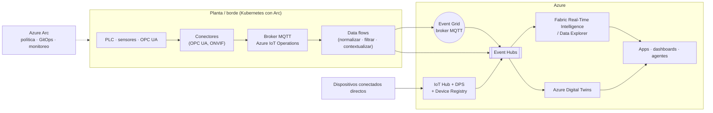
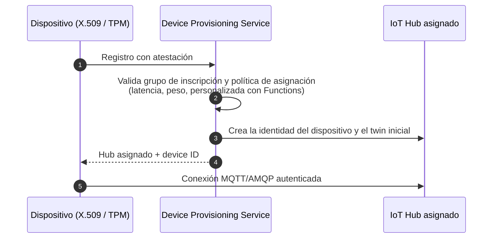
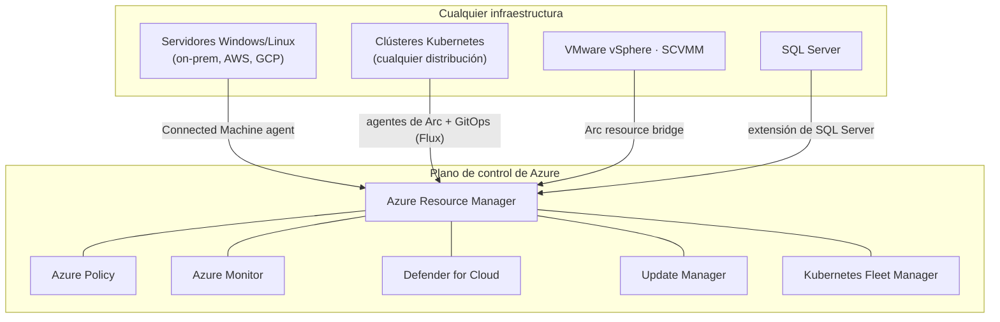

# 11 · IoT, borde, híbrido y soberanía

**IoT Hub · IoT Operations · Device Registry · Digital Twins · Azure Arc · Azure Local · Sovereign Private Cloud**

[⬅ 10 · IA](10-ia-y-machine-learning.md) · [🏠 Índice](../README.md) · [12 · DevOps ➡](12-desarrollo-devops-e-iac.md)

---

## Contenido

1. [Mapa del borde a la nube](#1-mapa-del-borde-a-la-nube)
2. [Catálogo de IoT, borde e híbrido](#2-catálogo-de-iot-borde-e-híbrido)
3. [Plataforma IoT](#3-plataforma-iot)
4. [Azure Arc: Azure en cualquier lugar](#4-azure-arc-azure-en-cualquier-lugar)
5. [Azure Local y la nube privada soberana](#5-azure-local-y-la-nube-privada-soberana)
6. [Otras ofertas de borde](#6-otras-ofertas-de-borde)
7. [Novedades y retiros](#7-novedades-y-retiros)
8. [Referencias](#8-referencias)

---

## 1. Mapa del borde a la nube

---

## 2. Catálogo de IoT, borde e híbrido

| Servicio | Estado | Función |
|---|---|---|
| **Azure IoT Hub** | 🟢 | Gateway de nube bidireccional para millones de dispositivos (MQTT, AMQP, HTTPS) |
| **Device Provisioning Service** | 🟢 | Aprovisionamiento *zero-touch* a escala |
| **Azure Device Registry** | 🟢 | Representación nativa de Azure de dispositivos y activos |
| **Azure IoT Operations** | 🟢 (GA nov-2024) | Plano de datos industrial en el borde sobre Kubernetes habilitado por Arc |
| **Azure IoT Edge** | 🟢 | Runtime de módulos en dispositivos de borde |
| **Azure Digital Twins** | 🟢 | Gemelos digitales con DTDL y grafo de relaciones |
| **Event Grid (broker MQTT)** | 🟢 | Pub/sub MQTT 3.1.1/5 a escala |
| **Microsoft Defender for IoT** | 🟢 | Seguridad de redes OT/IoT sin agentes |
| **Device Update for IoT Hub** | 🟢 | Actualizaciones OTA |
| **Azure IoT Central** | 🟠 **20-sep-2029** | SaaS de IoT; migra a IoT Hub + DPS + Device Registry |
| **Azure Sphere** | 🟠 **31-jul-2031** | Seguridad de microcontroladores; el silicio MT3620 llegó a fin de vida en jul-2026 |
| **Azure Arc** | 🟢 | Proyecta servidores, Kubernetes, VMware/SCVMM y datos al plano de control de Azure |
| **Azure Local** | 🟢 | Infraestructura hiperconvergente de Azure en tu datacenter (antes Azure Stack HCI) |
| Azure Local · operaciones desconectadas | 🟢 GA feb-2026 | Plano de control local sin conexión a la nube |
| **Microsoft 365 Local** / **Foundry Local** | 🟢 | Productividad e IA locales para la nube privada soberana |
| **AKS habilitado por Arc** | 🟢 | Kubernetes de AKS en Azure Local y otros entornos |
| **Azure Stack Hub** | 🟢 | Sistema integrado con servicios de Azure en entornos aislados |
| **Azure Stack Edge** | Consulta el ciclo de vida de cada SKU | Dispositivos de borde gestionados con cómputo e IA |
| **Azure Extended Zones** | Ubicaciones seleccionadas | Extensiones metropolitanas de regiones de Azure |
| **Azure Operator Nexus** | 🟢 | Plataforma híbrida *carrier-grade* para operadores de telecomunicaciones |
| Azure Private 5G Core | ⛔ sep-2025 | Soluciones de socios en Azure Marketplace |
| Azure Time Series Insights | ⛔ jul-2024 | Data Explorer / Fabric RTI |

---

## 3. Plataforma IoT

### 3.1 IoT Hub

| | Free | Basic (B1–B3) | Standard (S1–S3) |
|---|---|---|---|
| Telemetría dispositivo → nube | ✅ | ✅ | ✅ |
| Mensajes nube → dispositivo, *device twins*, métodos directos | ✅ | — | ✅ |
| Soporte de IoT Edge | ✅ | — | ✅ |
| Enrutamiento de mensajes, carga de archivos | ✅ | ✅ | ✅ |
| Mensajes por día y unidad | 8 000 | 400 000 / 6 M / 300 M | 400 000 / 6 M / 300 M |

Conceptos clave: **device twins** (propiedades deseadas/reportadas), **métodos directos** (RPC síncrono),
**enrutamiento** hacia Event Hubs, Service Bus, Storage o Cosmos DB, y particiones para el *endpoint* compatible
con Event Hubs.

### 3.2 Aprovisionamiento seguro (DPS)

### 3.3 Azure IoT Operations

| Componente | Función |
|---|---|
| **Broker MQTT** | Broker distribuido de alta disponibilidad en el borde |
| **Connector for OPC UA** y otros conectores | Integración con equipos industriales |
| **Data flows** | Normalizar, filtrar, enriquecer y enviar a Event Hubs, Event Grid, Fabric, ADLS |
| Gestión de activos | Definición de activos y *endpoints* sincronizada con Device Registry |
| Operación | Instalado como extensión de Arc; gobernado con Azure Policy, GitOps y Azure Monitor |

---

## 4. Azure Arc: Azure en cualquier lugar

| Capacidad de Arc | Para qué |
|---|---|
| **Servidores habilitados por Arc** | Inventario, Policy, Monitor (AMA), Defender, Update Manager, *hotpatching* de Windows Server 2025, ESU de versiones antiguas |
| **Kubernetes habilitado por Arc** | GitOps con Flux, Azure Policy, Container Insights, extensiones (IoT Operations, ML, Event Grid); 🆕 gobierno con **Fleet Manager** (GA Build 2026) |
| **SQL Server habilitado por Arc** | Inventario, licencias de pago por uso, evaluaciones, Defender, Entra ID |
| Servicios de datos habilitados por Arc | SQL Managed Instance en tu Kubernetes |
| VMware vSphere y SCVMM con Arc | Autoservicio de VM on-premises desde Azure |
| Conector multicloud | Inventario y gobierno de recursos de AWS y GCP |

---

## 5. Azure Local y la nube privada soberana

| Elemento | Detalle |
|---|---|
| Hardware | Soluciones validadas de OEM (sistemas integrados o nodos validados) |
| Cargas | VM de Azure Local (gestionadas con Arc), **AKS habilitado por Arc**, Azure Virtual Desktop, SQL Server (GA conectado y desconectado, sep-2026), IoT Operations |
| Gestión | Portal de Azure vía Arc, actualizaciones con cadencia mensual (p. ej., versión 2607 con mejoras para entornos desconectados) |
| **Operaciones desconectadas** (GA feb-2026) | Plano de control local para entornos sin conectividad; requiere justificación de caso de uso, hardware y licencias específicas |
| Sovereign Private Cloud | Azure Local + Microsoft 365 Local + Foundry Local para gobiernos y sectores críticos |

> [!NOTE]
> "Desconectado" no significa que todo funcione sin conexión: el catálogo de servicios disponibles localmente es
> limitado y algunas capacidades (Monitor, Defender) pueden requerir licencias adicionales o sincronización periódica.

---

## 6. Otras ofertas de borde

| Oferta | Para |
|---|---|
| **Azure Stack Hub** | Ejecutar un subconjunto de servicios de Azure (IaaS, App Service, Functions) en entornos aislados o desconectados |
| **Azure Stack Edge** | Cómputo, IA y transferencia de datos en ubicaciones remotas (verifica el ciclo de vida del SKU) |
| **Azure Extended Zones** | Latencia ultrabaja en áreas metropolitanas específicas |
| **Azure Operator Nexus** | Funciones de red 5G y nube de operador |

---

## 7. Novedades y retiros

| Fecha | Cambio |
|---|---|
| jul-2024 | ⛔ Time Series Insights |
| nov-2024 | 🟢 Azure IoT Operations · Azure Stack HCI → **Azure Local** |
| sep-2025 | ⛔ Azure Private 5G Core |
| feb-2026 | 🟢 Azure Local con **operaciones desconectadas** y Microsoft 365 Local |
| mar-2026 | Anuncio de retiro de Azure Sphere (31-jul-2031) |
| jun-2026 | 🟢 Fleet Manager para clústeres habilitados por Arc (hasta 1 000 miembros) |
| jul-2026 | Fin de vida del silicio MT3620 (Azure Sphere) |
| sep-2026 | 🟢 SQL Server en Azure Local · anuncio de retiro de IoT Central (20-sep-2029) |

---

## 8. Referencias

- [Azure IoT documentation](https://learn.microsoft.com/azure/iot/) · [Azure IoT Operations](https://learn.microsoft.com/azure/iot-operations/)
- [IoT Hub](https://learn.microsoft.com/azure/iot-hub/) · [Device Provisioning Service](https://learn.microsoft.com/azure/iot-dps/) · [Azure Digital Twins](https://learn.microsoft.com/azure/digital-twins/)
- [Azure Arc](https://learn.microsoft.com/azure/azure-arc/) · [Azure Local](https://learn.microsoft.com/azure/azure-local/)
- [Microsoft Sovereign Cloud](https://www.microsoft.com/microsoft-sovereign-cloud)

---

[⬅ 10 · IA](10-ia-y-machine-learning.md) · [🏠 Índice](../README.md) · [12 · DevOps ➡](12-desarrollo-devops-e-iac.md)

