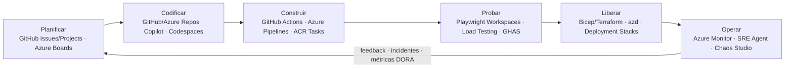
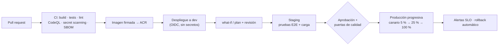

<div align="center">

# 12 · Desarrollo, DevOps e infraestructura como código

**GitHub · Azure DevOps · Bicep · Terraform · azd · Deployment Stacks · App Configuration · Load Testing · Chaos Studio**

[⬅ 11 · IoT e híbrido](11-iot-edge-hibrido-y-soberania.md) · [🏠 Índice](../README.md) · [13 · Gestión y costos ➡](13-gestion-gobierno-costos-y-migracion.md)

</div>

---

## Contenido

1. [El ciclo DevOps en Azure](#1-el-ciclo-devops-en-azure)
2. [Catálogo de herramientas](#2-catálogo-de-herramientas)
3. [Infraestructura como código](#3-infraestructura-como-código)
4. [CI/CD seguro de referencia](#4-cicd-seguro-de-referencia)
5. [Estrategias de despliegue progresivo](#5-estrategias-de-despliegue-progresivo)
6. [Pruebas de carga y caos](#6-pruebas-de-carga-y-caos)
7. [Entornos de desarrollo e ingeniería de plataforma](#7-entornos-de-desarrollo-e-ingeniería-de-plataforma)
8. [Novedades y retiros](#8-novedades-y-retiros)
9. [Referencias](#9-referencias)

---

## 1. El ciclo DevOps en Azure



---

## 2. Catálogo de herramientas

| Herramienta | Estado | Función |
|---|---|---|
| **GitHub** (Actions, Advanced Security, Copilot, Codespaces, Packages) | 🟢 | Plataforma de desarrollo; OIDC con Entra ID para desplegar sin secretos |
| **Azure DevOps** (Boards, Repos, Pipelines, Test Plans, Artifacts) | 🟢 | ALM empresarial; GitHub Advanced Security for Azure DevOps |
| Managed DevOps Pools | 🟢 | Agentes de Azure Pipelines gestionados (VNet, imágenes propias, Spot) |
| **Bicep** | 🟢 | DSL de IaC nativo de Azure (transpila a ARM JSON) |
| ARM templates (JSON) | 🟢 | Formato base de despliegue |
| **Terraform** (proveedores `azurerm` y `azapi`) | 🟢 | IaC multicloud; `azapi` expone cualquier API de ARM el día uno |
| **Azure Verified Modules (AVM)** | 🟢 | Módulos oficiales Bicep/Terraform alineados con WAF |
| **Deployment Stacks** | 🟢 | Gestiona un conjunto de recursos como unidad con *deny settings* y limpieza de huérfanos |
| Template Specs | 🟢 | Plantillas versionadas y compartidas con RBAC |
| **Azure Developer CLI (azd)** | 🟢 | De plantilla a app desplegada (`azd up`), integración con .NET Aspire |
| **Azure MCP Server** | 🟢 1.0 (oct-2025) | Herramientas MCP para que agentes (Copilot, Claude, etc.) gestionen recursos de Azure |
| Azure DevOps MCP Server | 🟢 (oct-2025) | MCP para trabajo con Boards, Repos y Pipelines |
| **Azure App Configuration** | 🟢 | Configuración centralizada y *feature flags* |
| **Azure App Testing** (Playwright Workspaces + Load Testing) | 🟢 | Pruebas E2E a escala y pruebas de carga gestionadas |
| **Azure Chaos Studio** | 🟢 | Ingeniería del caos con fallos sobre servicios y agentes |
| Azure Deployment Environments | 🟠 **22-feb-2027** (cierre progresivo desde 14-sep-2026) | Entornos de autoservicio basados en plantillas |
| Microsoft Dev Box | 🟠 **18-sep-2028** (modo mantenimiento) | Estaciones de desarrollo en la nube → Windows 365 |
| Azure Lab Services | 🟠 **28-jun-2027** | Laboratorios para formación |
| Microsoft Playwright Testing (preview) | ⛔ 8-mar-2026 | Playwright Workspaces en Azure App Testing |

---

## 3. Infraestructura como código

| Criterio | ARM JSON | **Bicep** | **Terraform** | Pulumi |
|---|---|---|---|---|
| Lenguaje | JSON | DSL conciso | HCL | Lenguajes de propósito general |
| Estado | Lo gestiona ARM | Lo gestiona ARM (sin archivo de estado) | Archivo de estado (*backend* remoto) | Archivo de estado |
| Soporte día uno de API nuevas | ✅ | ✅ | `azapi` ✅ / `azurerm` con retraso | Proveedor nativo |
| Vista previa de cambios | `what-if` | `what-if` | `plan` | `preview` |
| Multicloud | — | — (extensiones para Microsoft Graph y Kubernetes) | ✅ | ✅ |
| Módulos oficiales | — | AVM | AVM | — |

```bicep
// main.bicep — Container App con identidad administrada, revisiones múltiples y probes
targetScope = 'resourceGroup'

@description('Región de despliegue')
param location string = resourceGroup().location
param environmentId string
param image string

resource api 'Microsoft.App/containerApps@2024-03-01' = {
  name: 'api-pedidos'
  location: location
  identity: { type: 'SystemAssigned' }
  properties: {
    managedEnvironmentId: environmentId
    configuration: {
      activeRevisionsMode: 'Multiple'                    // permite canarios por peso
      ingress: { external: true, targetPort: 8080, transport: 'auto' }
    }
    template: {
      containers: [
        {
          name: 'api'
          image: image
          resources: { cpu: json('0.5'), memory: '1Gi' }
          probes: [ { type: 'Readiness', httpGet: { path: '/healthz', port: 8080 } } ]
        }
      ]
      scale: { minReplicas: 1, maxReplicas: 30 }
    }
  }
}

output fqdn string = api.properties.configuration.ingress.fqdn
```

```bash
# Vista previa de cambios y despliegue como Deployment Stack que impide borrados manuales
az deployment group what-if -g rg-app -f main.bicep -p main.bicepparam
az stack group create -n stack-app -g rg-app -f main.bicep -p main.bicepparam \
  --action-on-unmanage deleteResources --deny-settings-mode denyDelete
```

> [!TIP]
> Para recursos complejos prefiere los módulos de **Azure Verified Modules** desde el registro público
> (`br/public:avm/res/<proveedor>/<recurso>:<versión>`): traen valores por defecto alineados con WAF. Fija siempre
> la versión y actualízala con Dependabot o Renovate tras revisar el *changelog*.

---

## 4. CI/CD seguro de referencia



```yaml
# .github/workflows/deploy.yml — despliegue con federación OIDC (sin secretos de Azure en GitHub)
name: deploy
on:
  push:
    branches: [ main ]
permissions:
  id-token: write      # necesario para obtener el token OIDC
  contents: read
jobs:
  prod:
    runs-on: ubuntu-latest
    environment: production          # reglas de protección y aprobadores
    steps:
      - uses: actions/checkout@v4
      - uses: azure/login@v2
        with:
          client-id: ${{ vars.AZURE_CLIENT_ID }}
          tenant-id: ${{ vars.AZURE_TENANT_ID }}
          subscription-id: ${{ vars.AZURE_SUBSCRIPTION_ID }}
      - name: What-if
        run: az deployment group what-if -g rg-app -f infra/main.bicep -p infra/prod.bicepparam
      - name: Deploy
        run: az stack group create -n stack-app -g rg-app -f infra/main.bicep -p infra/prod.bicepparam --action-on-unmanage detachAll --deny-settings-mode none --yes
```

---

## 5. Estrategias de despliegue progresivo

| Estrategia | Cómo en Azure | Reversión |
|---|---|---|
| ***Blue-green*** | *Deployment slots* de App Service; etiquetas de revisión en Container Apps; dos *node pools* o clústeres en AKS | *Swap* inverso inmediato |
| **Canario** | Pesos de tráfico en Container Apps; pesos de origen en Front Door; Flagger/Argo Rollouts o Istio en AKS | Devolver el peso a 0 |
| **Anillos** | Regiones o *stamps* en secuencia (como las *Safe Deployment Practices* de Microsoft) con Fleet Manager *update runs* | Detener el despliegue |
| ***Feature flags*** | Azure App Configuration (con filtros por porcentaje, usuario y ventana de tiempo) | Apagar el flag sin desplegar |
| ***Dark launch*** | Tráfico en sombra con API Management o *service mesh* | Sin impacto al usuario |

---

## 6. Pruebas de carga y caos

| Servicio | Qué hace | Integración |
|---|---|---|
| **Azure Load Testing** (en Azure App Testing) | Ejecuta scripts JMeter o Locust a gran escala desde varias regiones; correlaciona con métricas de los recursos | Criterios de éxito/fracaso en CI/CD |
| **Playwright Workspaces** | Ejecuta suites de Playwright en navegadores en la nube en paralelo | GitHub Actions, Azure Pipelines |
| **Azure Chaos Studio** | Experimentos con fallos *service-direct* (p. ej., *failover* de Cosmos DB, apagar VMSS, fallos de AKS con Chaos Mesh) y basados en agente (CPU, memoria, latencia de red en VM) | Validar planes de DR y SLO |

> [!TIP]
> Un plan de recuperación que nunca se ha ejecutado **no es un plan**. Programa experimentos de Chaos Studio y
> pruebas de carga al 2× del pico como parte del calendario de operación.

---

## 7. Entornos de desarrollo e ingeniería de plataforma

| Necesidad | Opción recomendada en 2026 |
|---|---|
| Entorno de desarrollo reproducible | GitHub Codespaces / *dev containers* |
| Estación de trabajo en la nube | **Windows 365** (destino de Microsoft Dev Box) |
| Entornos efímeros de autoservicio | Plantillas `azd` + GitHub Actions + Deployment Stacks (alternativa a Deployment Environments) |
| Portal interno de desarrolladores | Backstage, Radius u otros portales integrados con AVM y *subscription vending* |
| Asistencia con IA | GitHub Copilot (con extensiones de Azure) y **Azure MCP Server** para agentes |

---

## 8. Novedades y retiros

| Fecha | Cambio |
|---|---|
| oct-2025 | 🟢 Azure MCP Server 1.0 · 🟢 Azure DevOps MCP Server |
| 8-mar-2026 | ⛔ Microsoft Playwright Testing (preview) → Playwright Workspaces |
| 14-sep-2026 | Inicio del cierre progresivo de Azure Deployment Environments |
| 22-feb-2027 | 🟠 Retiro de Azure Deployment Environments |
| 28-jun-2027 | 🟠 Azure Lab Services |
| 18-sep-2028 | 🟠 Microsoft Dev Box (Windows 365) |

---

## 9. Referencias

- [Bicep documentation](https://learn.microsoft.com/azure/azure-resource-manager/bicep/) · [Deployment stacks](https://learn.microsoft.com/azure/azure-resource-manager/bicep/deployment-stacks)
- [Azure Verified Modules](https://azure.github.io/Azure-Verified-Modules/) · [Terraform on Azure](https://learn.microsoft.com/azure/developer/terraform/)
- [Azure Developer CLI](https://learn.microsoft.com/azure/developer/azure-developer-cli/) · [Azure MCP Server](https://learn.microsoft.com/azure/developer/azure-mcp-server/)
- [GitHub Actions OIDC with Azure](https://learn.microsoft.com/azure/developer/github/connect-from-azure-openid-connect)
- [Azure Load Testing](https://learn.microsoft.com/azure/load-testing/) · [Azure Chaos Studio](https://learn.microsoft.com/azure/chaos-studio/) · [App Configuration](https://learn.microsoft.com/azure/azure-app-configuration/)

---

<div align="center">

[⬅ 11 · IoT e híbrido](11-iot-edge-hibrido-y-soberania.md) · [🏠 Índice](../README.md) · [13 · Gestión y costos ➡](13-gestion-gobierno-costos-y-migracion.md)

</div>
