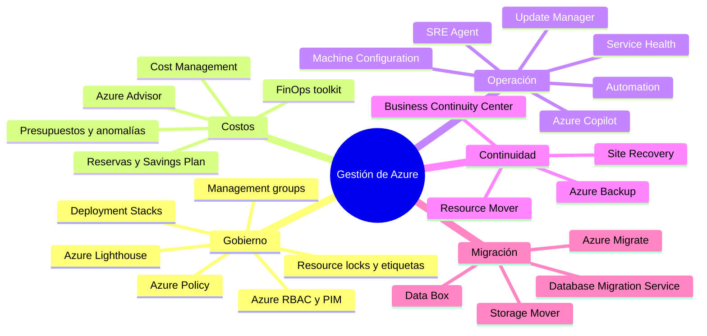
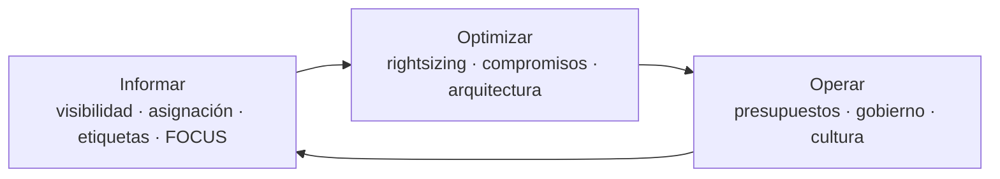
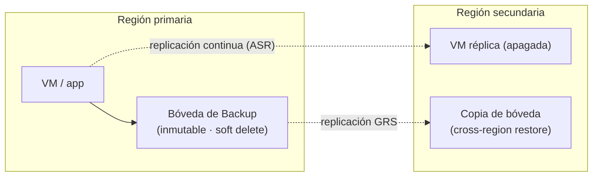
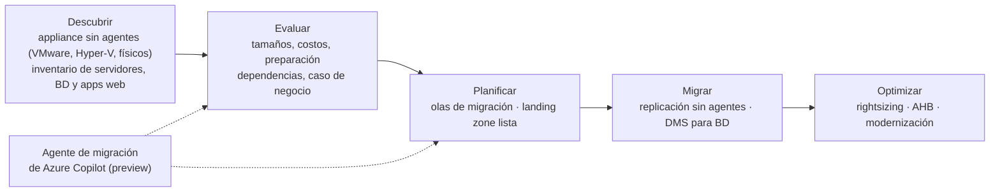

<div align="center">

# 13 · Gestión, gobierno, costos y migración

**Cost Management · Advisor · Resource Graph · Update Manager · Backup · Site Recovery · Azure Migrate · Azure Copilot**

[⬅ 12 · DevOps](12-desarrollo-devops-e-iac.md) · [🏠 Índice](../README.md) · [14 · Web, móvil y escritorio ➡](14-web-movil-comunicaciones-y-escritorio.md)

</div>

---

## Contenido

1. [Mapa de gestión](#1-mapa-de-gestión)
2. [Catálogo de gestión y gobierno](#2-catálogo-de-gestión-y-gobierno)
3. [FinOps y Cost Management](#3-finops-y-cost-management)
4. [Inventario y cumplimiento con Resource Graph](#4-inventario-y-cumplimiento-con-resource-graph)
5. [Operación de servidores y salud del servicio](#5-operación-de-servidores-y-salud-del-servicio)
6. [Continuidad de negocio: Backup y Site Recovery](#6-continuidad-de-negocio-backup-y-site-recovery)
7. [Migración a Azure](#7-migración-a-azure)
8. [Novedades y retiros](#8-novedades-y-retiros)
9. [Referencias](#9-referencias)

---

## 1. Mapa de gestión



---

## 2. Catálogo de gestión y gobierno

| Servicio | Estado | Función |
|---|---|---|
| Azure Policy / Management groups / RBAC | 🟢 | Gobierno a escala (ver [01 § Acceso y gobierno](01-fundamentos-y-plataforma-global.md#6-acceso-y-gobierno)) |
| **Microsoft Cost Management** | 🟢 | Análisis, presupuestos, alertas de anomalías, asignación de costos, exportaciones FOCUS |
| **Azure Advisor** | 🟢 | Recomendaciones por pilar WAF, *Advisor Score*, libro de retiros de servicios |
| **Azure Resource Graph** | 🟢 | Inventario consultable con KQL sobre todas las suscripciones |
| **Azure Lighthouse** | 🟢 | Gestión delegada multitenant (MSP, grupos empresariales) |
| **Azure Update Manager** | 🟢 | Actualizaciones de SO para VM de Azure y servidores con Arc |
| **Azure Machine Configuration** | 🟢 | Configuración de SO declarativa vía Azure Policy |
| **Azure Automation** (runbooks, *hybrid workers*) | 🟢 | Automatización con PowerShell y Python |
| Automation State Configuration (DSC) | 🟠 **30-sep-2027** | Migrar a Machine Configuration |
| Change Tracking and Inventory (con AMA) | 🟢 | Cambios de software, archivos y registro |
| **Service Health / Resource Health** | 🟢 | Incidentes, mantenimiento planificado, avisos de salud y seguridad |
| **Azure Copilot** (agentes de migración, despliegue, optimización, observabilidad, resiliencia y diagnóstico) | 🟡 Agentes en preview controlada (Ignite 2025) | IA integrada en portal, CLI y PowerShell |
| **Azure SRE Agent** | 🟢 GA mar-2026 | Agente de operaciones: diagnóstico, mitigación, aprendizaje de incidentes |
| **Azure Backup** | 🟢 | Copias de VM, discos, Files, Blobs, SQL/SAP HANA en VM, AKS, PostgreSQL |
| **Azure Site Recovery** | 🟢 | Replicación y orquestación de *failover* (Azure ↔ Azure, on-prem → Azure) |
| Azure Business Continuity Center | 🟢 | Vista unificada de protección (Backup + Site Recovery) |
| **Azure Resource Mover** | 🟢 | Mover recursos entre regiones |
| **Azure Migrate** | 🟢 | Descubrimiento, evaluación, caso de negocio y migración |
| **Azure Database Migration Service** | 🟢 | Migraciones de bases de datos en línea y fuera de línea |
| Azure Blueprints | 🟠 **31-ene-2027** | Template Specs + Deployment Stacks + Policy |

---

## 3. FinOps y Cost Management



| Palanca | Ahorro potencial | Herramienta |
|---|---|---|
| Apagar o eliminar recursos ociosos (discos huérfanos, IP sin uso, entornos dev de noche) | Alto | Advisor, Resource Graph, Automation |
| *Rightsizing* de VM, bases de datos y planes | Alto | Advisor, Azure Monitor |
| **Savings Plan for Compute** / **Reservas** | Hasta ~65 % / ~72 % | Recomendaciones de compra en Cost Management |
| **Spot** para cargas tolerantes a interrupciones | Hasta ~90 % | AKS Spot node pools, Batch, VMSS |
| **Azure Hybrid Benefit** | Licencias Windows Server/SQL Server/Linux empresarial | Gestión centralizada de AHB |
| Arquitectura *serverless* y escala a cero | Variable | Functions Flex, Container Apps |
| Niveles de almacenamiento y *smart tier* | Medio | Lifecycle management |
| Optimización de logs | Medio-alto | Planes Basic/Auxiliary, DCR |
| Precios Dev/Test | Medio | Suscripciones Dev/Test |

Buenas prácticas: **presupuestos con *action groups*** por suscripción y equipo, **alertas de anomalías**,
**etiquetas obligatorias** (`costCenter`, `owner`, `env`) impuestas con Azure Policy, exportaciones en formato
**FOCUS** para análisis multicloud y el **FinOps toolkit** (informes de Power BI, *hubs* de FinOps).

> [!NOTE]
> Desde el **1-jul-2026** Microsoft dejó de ofrecer reservas para algunas familias antiguas de VM: al vencer, pasan a
> pago por uso. Evalúa Savings Plan o migrar a series v6/v7.

---

## 4. Inventario y cumplimiento con Resource Graph

```kusto
// Discos administrados sin VM asociada (costo desperdiciado)
resources
| where type == "microsoft.compute/disks"
| where properties.diskState == "Unattached"
| project name, resourceGroup, subscriptionId, sku = sku.name, sizeGB = properties.diskSizeGB, location
```

```kusto
// Recursos sin la etiqueta obligatoria 'owner'
resources
| where isnull(tags.owner) or tostring(tags.owner) == ""
| summarize recursos = count() by type
| order by recursos desc
```

```kusto
// Cuentas de almacenamiento que aún permiten Shared Key o acceso público
resources
| where type == "microsoft.storage/storageaccounts"
| where properties.allowSharedKeyAccess != false or properties.allowBlobPublicAccess == true
| project name, resourceGroup, subscriptionId
```

---

## 5. Operación de servidores y salud del servicio

| Necesidad | Servicio | Detalle |
|---|---|---|
| Parches de SO | **Update Manager** | Evaluación periódica, configuraciones de mantenimiento, *hotpatching* (Windows Server Azure Edition y 2025 con Arc) |
| Configuración declarativa | **Machine Configuration** | Auditar o aplicar configuración (DSC v3) vía Policy |
| Automatización | **Automation runbooks** | PowerShell 7 y Python 3, *hybrid runbook workers* |
| Salud de la plataforma | **Service Health** | Alertas de incidentes y mantenimiento por servicio y región |
| Salud de un recurso | **Resource Health** | ¿Tu recurso está disponible ahora? ¿Qué pasó? |
| Asistencia con IA | **Azure Copilot** / **SRE Agent** | Diagnóstico guiado, consultas en lenguaje natural, mitigaciones con niveles de autonomía configurables |

---

## 6. Continuidad de negocio: Backup y Site Recovery

| | Azure Backup | Azure Site Recovery |
|---|---|---|
| Objetivo | Recuperar **datos** (errores, *ransomware*, corrupción) | Recuperar **servicio** (desastre regional/sitio) |
| RPO típico | Horas (o menos con políticas mejoradas) | Segundos a minutos (replicación continua) |
| RTO típico | Horas | Minutos (planes de recuperación) |
| Alcance | VM, discos, Files, Blobs, SQL/SAP HANA en VM, AKS, PostgreSQL | VM de Azure entre regiones/zonas; VMware, Hyper-V y físicos a Azure |
| Protección | Bóvedas **inmutables**, *soft delete*, **autorización multiusuario**, restauración entre regiones | Pruebas de *failover* sin impacto |



> [!TIP]
> Backup **no** es DR y DR **no** es backup: necesitas ambos. Prueba restauraciones y *failovers* al menos cada
> trimestre; Chaos Studio y los *test failovers* de Site Recovery lo hacen sin afectar producción.

---

## 7. Migración a Azure

### 7.1 Estrategias

| Estrategia | Qué significa | Ejemplo en Azure |
|---|---|---|
| **Retirar** | Apagar lo que no aporta valor | Aplicaciones duplicadas |
| **Retener** | Mantener on-premises (por ahora) | Gestionarlo con Arc |
| **Rehospedar** (*lift-and-shift*) | Mover VM sin cambios | Azure Migrate → VM; VMware → Azure VMware Solution |
| **Replataformar** | Cambios mínimos para usar PaaS | SQL Server → Azure SQL MI; IIS → App Service |
| **Refactorizar** | Adaptar código a servicios gestionados | Monolito → contenedores en Container Apps |
| **Rediseñar** | Cambiar la arquitectura | Microservicios con eventos (Service Bus, Cosmos DB) |
| **Reconstruir / reemplazar** | Nueva solución o SaaS | Dynamics 365, Microsoft 365 |

### 7.2 Flujo con Azure Migrate



Claves: las versiones de Windows Server y SQL Server fuera de soporte reciben **actualizaciones de seguridad
extendidas gratuitas en Azure** (y vía Arc con suscripción); **Database Migration Service** cubre SQL Server → Azure
SQL en línea y fuera de línea, y las migraciones a PostgreSQL/MySQL Flexible Server están integradas en sus portales;
**Data Box** y **Storage Mover** resuelven volúmenes grandes de archivos.

---

## 8. Novedades y retiros

| Fecha | Cambio |
|---|---|
| ago-2024 | ⛔ Automation Update Management y agente MMA → Update Manager + AMA |
| nov-2025 | 🟡 Agentes de Azure Copilot (Ignite 2025) |
| mar-2026 | 🟢 Azure SRE Agent |
| 1-jul-2026 | Fin de reservas para familias antiguas de VM |
| jul–dic-2026 | Retiro escalonado de Azure Blueprints (definitivo **31-ene-2027**) |
| 30-sep-2027 | 🟠 Automation State Configuration (DSC) |
| 31-mar-2028 | 🟠 Extensión DSC para VM |

---

## 9. Referencias

- [Microsoft Cost Management](https://learn.microsoft.com/azure/cost-management-billing/) · [FinOps toolkit](https://learn.microsoft.com/cloud-computing/finops/toolkit/finops-toolkit-overview)
- [Azure Advisor](https://learn.microsoft.com/azure/advisor/) · [Azure Resource Graph](https://learn.microsoft.com/azure/governance/resource-graph/)
- [Azure Update Manager](https://learn.microsoft.com/azure/update-manager/) · [Machine Configuration](https://learn.microsoft.com/azure/governance/machine-configuration/)
- [Azure Backup](https://learn.microsoft.com/azure/backup/) · [Azure Site Recovery](https://learn.microsoft.com/azure/site-recovery/)
- [Azure Migrate](https://learn.microsoft.com/azure/migrate/) · [CAF Migrate methodology](https://learn.microsoft.com/azure/cloud-adoption-framework/migrate/)

---

<div align="center">

[⬅ 12 · DevOps](12-desarrollo-devops-e-iac.md) · [🏠 Índice](../README.md) · [14 · Web, móvil y escritorio ➡](14-web-movil-comunicaciones-y-escritorio.md)

</div>
