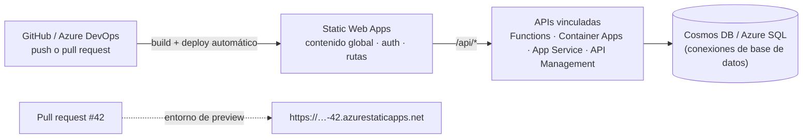
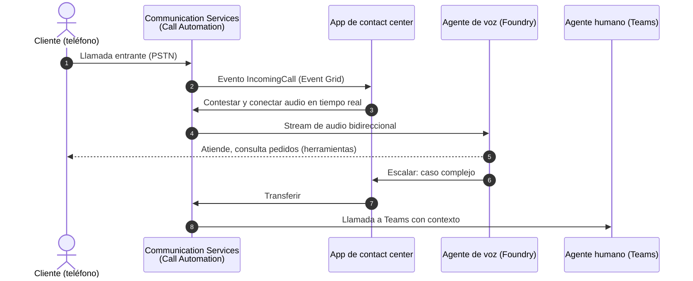
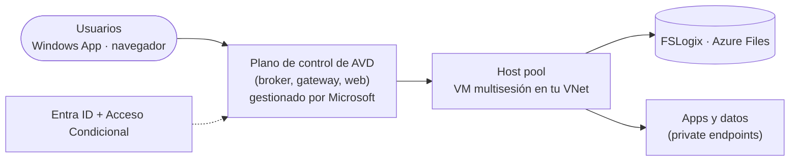

# 14 · Web, móvil, comunicaciones, escritorio y cargas especiales

**Static Web Apps · Communication Services · Azure Maps · Notification Hubs · Azure Virtual Desktop · Windows 365 · SAP · Health Data · Quantum**

[⬅ 13 · Gestión y costos](13-gestion-gobierno-costos-y-migracion.md) · [🏠 Índice](../README.md) · [15 · Arquitecturas ➡](15-arquitecturas-de-referencia.md)

---

## Contenido

1. [Catálogo](#1-catálogo)
2. [Web moderna: Static Web Apps y App Service](#2-web-moderna-static-web-apps-y-app-service)
3. [Azure Communication Services](#3-azure-communication-services)
4. [Azure Maps y Notification Hubs](#4-azure-maps-y-notification-hubs)
5. [Escritorio virtual: Azure Virtual Desktop y Windows 365](#5-escritorio-virtual-azure-virtual-desktop-y-windows-365)
6. [Cargas empresariales y de industria](#6-cargas-empresariales-y-de-industria)
7. [Computación cuántica y ciencia](#7-computación-cuántica-y-ciencia)
8. [Servicios retirados de estas categorías](#8-servicios-retirados-de-estas-categorías)
9. [Referencias](#9-referencias)

---

## 1. Catálogo

| Servicio | Categoría | Estado | Función |
|---|---|---|---|
| **Azure Static Web Apps** | Web | 🟢 | Sitios estáticos y SPA distribuidos globalmente con APIs integradas y entornos por *pull request* |
| **Azure App Service** | Web | 🟢 | Web apps y APIs gestionadas (ver [03 § App Service](03-computo-y-contenedores.md#6-azure-app-service)) |
| **Azure Communication Services** | Comunicaciones | 🟢 | Voz, video, chat, SMS, correo, WhatsApp, números telefónicos, automatización de llamadas |
| **Azure Maps** | Geoespacial | 🟢 | Mapas, búsqueda, rutas, tráfico, clima, geocodificación |
| **Azure Notification Hubs** | Móvil | 🟢 | *Push* multiplataforma a millones de dispositivos |
| **Azure Web PubSub / SignalR Service** | Tiempo real | 🟢 | Ver [05 § Tiempo real](05-mensajeria-e-integracion.md#8-tiempo-real-y-conectividad-híbrida) |
| **Azure Virtual Desktop** | VDI | 🟢 (versión *classic* ⛔ sep-2026) | Escritorios y apps Windows multisesión |
| **Windows 365** | Cloud PC (SaaS) | 🟢 | PC en la nube por usuario; destino de Microsoft Dev Box |
| **Azure Health Data Services** | Salud | 🟢 | Servicios FHIR, DICOM y MedTech |
| **Azure Center for SAP solutions** | SAP | 🟢 | Despliegue y gestión de SAP sobre Azure como unidad |
| **Azure Quantum** | Cuántica | 🟢 | Hardware cuántico de socios, simuladores, estimador de recursos, QDK |
| **Azure AI Video Indexer** | Medios | 🟢 | Índices, transcripción y análisis de video |

---

## 2. Web moderna: Static Web Apps y App Service

| Elegir | Cuando |
|---|---|
| **Static Web Apps** | Front-end JAMstack/SPA (React, Angular, Vue, Blazor WASM, Next.js) con APIs ligeras |
| **App Service** | Apps de servidor (ASP.NET, Java, Node.js, Python, PHP) o contenedores con *slots* y escalado |
| **Container Apps** | Front-ends y APIs en contenedores con escala a cero y microservicios |
| **Front Door + Blob** | Contenido estático masivo con caché global y WAF |

---

## 3. Azure Communication Services

| Capacidad | Detalle |
|---|---|
| Voz y video | SDK WebRTC para web y móvil, salas (*Rooms*), grabación, transcripción en tiempo real |
| Telefonía | Números PSTN, *direct routing* con tus SBC, interoperabilidad con Microsoft Teams |
| **Call Automation** | Control programático de llamadas (IVR, transferencias, reproducción, reconocimiento) |
| Mensajería | Chat, SMS, **correo electrónico**, mensajería avanzada (WhatsApp) |
| Job Router | Distribución de interacciones a agentes humanos por habilidades |
| Agentes de voz | Integración con Foundry (*Voice Live*) para agentes conversacionales en llamadas |

---

## 4. Azure Maps y Notification Hubs

**Azure Maps**: mosaicos vectoriales y ráster, búsqueda y geocodificación, rutas (incluidas matrices y camiones),
tráfico, clima, geolocalización por IP, operaciones espaciales y SDK web/móvil, con autenticación por Entra ID.

> [!WARNING]
> **Bing Maps for Enterprise** se retira (cuentas gratuitas en jun-2025; cuentas empresariales el **30-jun-2028**):
> migra a Azure Maps. **Azure Maps Creator** (mapas de interiores) se retiró en sep-2025.

**Notification Hubs**: *push* a APNs, **FCM v1** (la API heredada de FCM ya no funciona), WNS y otros; etiquetas
y plantillas para segmentar; *namespaces* con disponibilidad por zonas.

---

## 5. Escritorio virtual: Azure Virtual Desktop y Windows 365

| | Azure Virtual Desktop | Windows 365 |
|---|---|---|
| Modelo | PaaS: tú eliges VM, imágenes y escalado | SaaS: Cloud PC por usuario a precio fijo |
| Multisesión | ✅ Windows 11/10 Enterprise multisesión | Una sesión por usuario |
| Gestión | Portal de Azure + Intune | Intune |
| Optimización de costos | *Scaling plans*, apagado automático, Spot (no recomendado para usuarios) | Predecible |
| Perfiles | FSLogix sobre Azure Files o NetApp Files | Integrados |
| Ubicación | Regiones de Azure o **Azure Local** | Nube de Microsoft |
| Para | Escenarios a gran escala, apps remotas, VDI con GPU | Usuarios de conocimiento, contratistas, desarrolladores (destino de Dev Box) |

---

## 6. Cargas empresariales y de industria

| Carga | Servicios clave | Notas |
|---|---|---|
| **SAP** | VM M-series/E-series certificadas, Azure NetApp Files, **Azure Center for SAP solutions**, Azure Monitor for SAP solutions, Backup para HANA | Admite RISE with SAP y despliegues gestionados por el cliente |
| **Oracle** | **Oracle Database@Azure** (Exadata, Autonomous), VM, Azure NetApp Files | Baja latencia con apps de Azure |
| **VMware** | **Azure VMware Solution** + HCX | Migración sin re-plataformar |
| **HPC** | HB/HX/HC, CycleCloud, Batch, Managed Lustre, InfiniBand | CFD, genómica, finanzas |
| **Mainframe y midrange** | Patrones de rehospedaje y refactorización con socios | Guías en Azure Architecture Center |
| **Salud** | **Azure Health Data Services** (FHIR, DICOM, MedTech) | **Azure API for FHIR** se retiró el **30-sep-2026** |
| **Industria y manufactura** | IoT Operations, Fabric RTI, Digital Twins | Ver [11](11-iot-edge-hibrido-y-soberania.md) |

---

## 7. Computación cuántica y ciencia

- **Azure Quantum**: acceso a hardware cuántico de socios, simuladores y el **Quantum Development Kit** (Q# y
  Python), con el **estimador de recursos** para dimensionar algoritmos tolerantes a fallos. Microsoft presentó en
  2025 el chip **Majorana 1** basado en cúbits topológicos.
- **Microsoft Discovery** (GA Build 2026): plataforma agéntica para investigación y desarrollo científico que combina
  agentes, HPC y conocimiento.

---

## 8. Servicios retirados de estas categorías

| Servicio | Retiro | Alternativa |
|---|---|---|
| Azure Blockchain Service | sep-2021 | Azure Confidential Ledger, socios |
| Azure Object Anchors | may-2024 | — |
| Azure Media Services | 30-jun-2024 | Soluciones de socios; Video Indexer para análisis |
| Azure Spatial Anchors | nov-2024 | — |
| Visual Studio App Center | mar-2025 | Soluciones de CI/CD y distribución de terceros |
| Azure Remote Rendering | sep-2025 | — |
| Azure Maps Creator | sep-2025 | Socios de mapas de interiores |
| Azure Virtual Desktop (classic) | sep-2026 | Azure Virtual Desktop (Azure Resource Manager) |
| Azure API for FHIR | 30-sep-2026 | Azure Health Data Services |

---

## 9. Referencias

- [Azure Static Web Apps](https://learn.microsoft.com/azure/static-web-apps/) · [Azure Communication Services](https://learn.microsoft.com/azure/communication-services/)
- [Azure Maps](https://learn.microsoft.com/azure/azure-maps/) · [Notification Hubs](https://learn.microsoft.com/azure/notification-hubs/)
- [Azure Virtual Desktop](https://learn.microsoft.com/azure/virtual-desktop/) · [Windows 365](https://learn.microsoft.com/windows-365/)
- [SAP on Azure](https://learn.microsoft.com/azure/sap/) · [Azure Health Data Services](https://learn.microsoft.com/azure/healthcare-apis/)
- [Azure Quantum](https://learn.microsoft.com/azure/quantum/)

---

[⬅ 13 · Gestión y costos](13-gestion-gobierno-costos-y-migracion.md) · [🏠 Índice](../README.md) · [15 · Arquitecturas ➡](15-arquitecturas-de-referencia.md)

