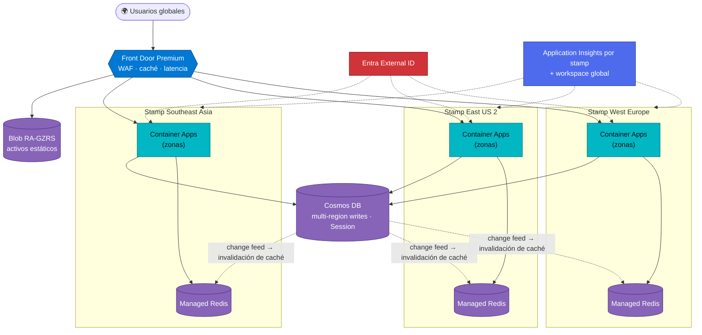
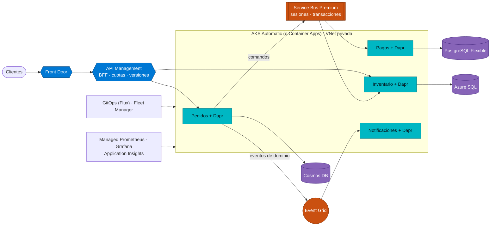
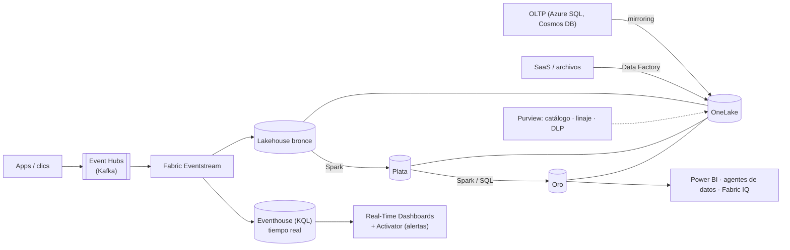
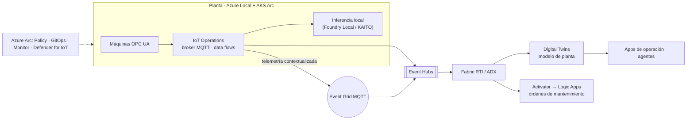
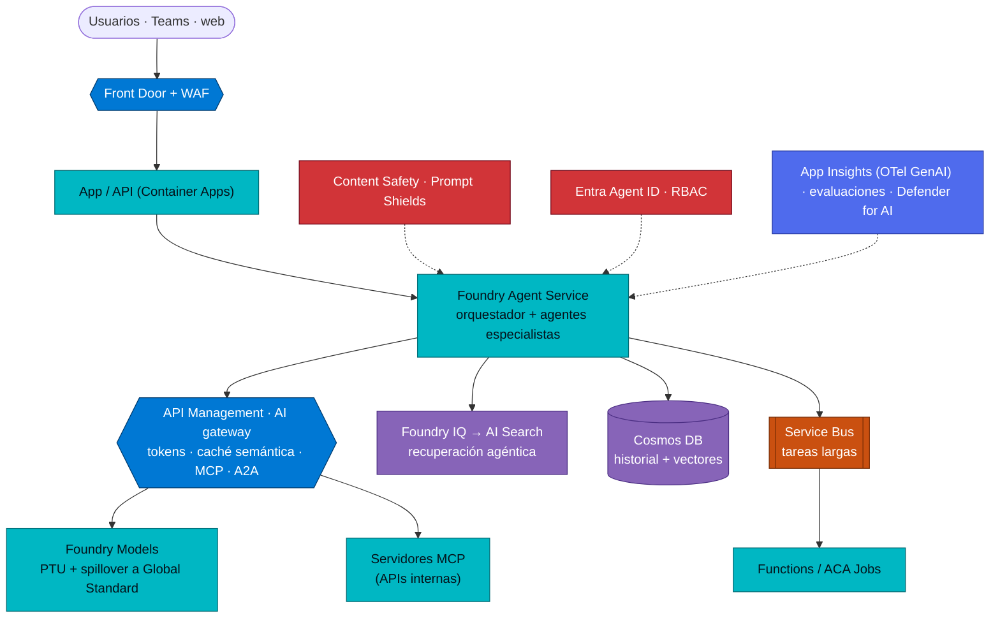
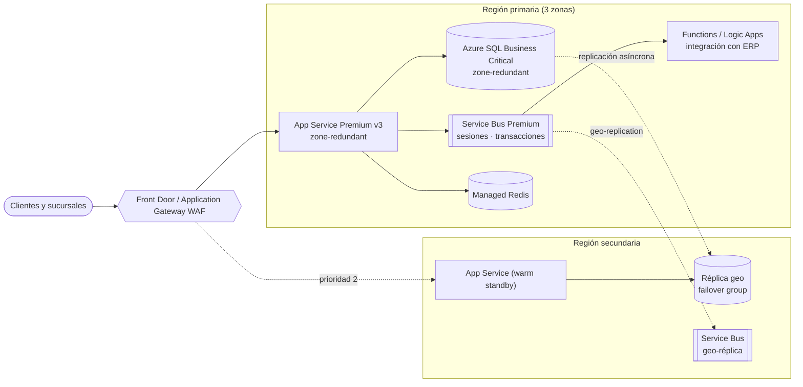
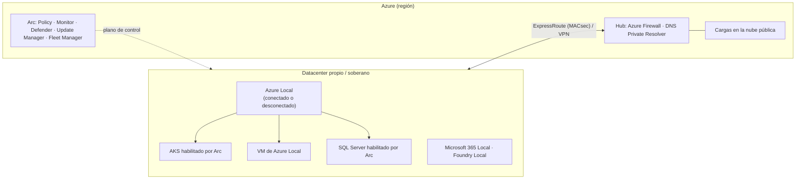

# 15 · Arquitecturas de referencia

**Siete planos completos para los sistemas distribuidos más comunes, con decisiones, compromisos y servicios exactos**

[⬅ 14 · Web, móvil y escritorio](14-web-movil-comunicaciones-y-escritorio.md) · [🏠 Índice](../README.md) · [16 · Guías de decisión ➡](16-guias-de-decision.md)

> [!NOTE]
> Cada arquitectura indica **qué servicio cumple cada rol y por qué**, las decisiones críticas y cómo evoluciona.
> Los colores siguen la convención del atlas: azul = entrada/red, turquesa = cómputo, naranja = mensajería,
> morado = datos, rojo = seguridad, índigo = observabilidad.

---

## Contenido

1. [Aplicación web global activa-activa](#1-aplicación-web-global-activa-activa)
2. [Microservicios en AKS o Container Apps](#2-microservicios-en-aks-o-container-apps)
3. [Big Data y streaming en tiempo real](#3-big-data-y-streaming-en-tiempo-real)
4. [IoT industrial del borde a la nube](#4-iot-industrial-del-borde-a-la-nube)
5. [IA generativa: RAG y agentes](#5-ia-generativa-rag-y-agentes)
6. [Sistema transaccional empresarial](#6-sistema-transaccional-empresarial)
7. [Híbrido y nube soberana](#7-híbrido-y-nube-soberana)
8. [Resumen comparativo](#8-resumen-comparativo)

---

## 1. Aplicación web global activa-activa

**Contexto:** usuarios en varios continentes, objetivo de disponibilidad ≥ 99,99 % y latencia < 100 ms.

| Rol | Servicio | Por qué |
|---|---|---|
| Entrada global | Front Door Premium | Anycast, WAF administrado, orígenes privados, *failover* en segundos |
| Cómputo | Container Apps (o App Service) por *stamp* | Escala automática, redundancia de zona, despliegue idéntico por IaC |
| Datos | Cosmos DB multi-write, Session | Lecturas y escrituras locales; 99,999 % |
| Caché | Azure Managed Redis por región | Latencia sub-ms; invalidación por *change feed* |
| Identidad de clientes | Entra External ID | CIAM gestionado |
| Activos | Blob RA-GZRS + caché de Front Door | Durabilidad y entrega global |

**Decisiones críticas**
- **Conflictos**: con multi-write, define resolución (LWW por `_ts` o procedimiento) y modela datos para minimizarlos
  (p. ej., carritos por usuario con afinidad regional "suave").
- **Sin afinidad de sesión**: el estado vive en Cosmos DB/Redis, no en la instancia.
- **Residencia**: si hay datos que no pueden salir de una geografía, particiona por región (patrón *geode* parcial).
- **Prueba**: *failover* regional mensual con Chaos Studio y Front Door.

---

## 2. Microservicios en AKS o Container Apps

**Contexto:** decenas de servicios con equipos autónomos, despliegues independientes y dominios bien delimitados.

| Rol | Servicio | Por qué |
|---|---|---|
| Gateway | API Management (v2) | Seguridad, versionado, *rate limiting*, BFF por canal |
| Plataforma | **AKS Automatic** (control, operadores, mesh) o **Container Apps** (velocidad, escala a cero) | Según madurez del equipo de plataforma |
| Comunicación síncrona | Invocación Dapr / gRPC con mTLS | Descubrimiento, reintentos y cifrado sin código extra |
| Comandos | Service Bus Premium | Orden por sesión, DLQ, transacciones |
| Eventos de dominio | Event Grid (o Service Bus topics) | *Fan-out* desacoplado |
| Datos | Base de datos por servicio (*polyglot*) | Autonomía y escalado independiente |
| Entrega | GitHub Actions + GitOps + Fleet Manager | Despliegues por etapas y reversibles |

**Decisiones críticas**: transacciones distribuidas con **sagas** y *outbox*; contratos versionados (AsyncAPI/OpenAPI);
*bulkheads* por *node pool* o *namespace*; trazas W3C extremo a extremo.

---

## 3. Big Data y streaming en tiempo real

**Contexto:** millones de eventos por segundo (clics, transacciones, sensores) con paneles en segundos y analítica
histórica.

| Rol | Servicio | Alternativa |
|---|---|---|
| Ingesta de streams | Event Hubs (Premium/Dedicated) | IoT Hub, Kafka gestionado por socios |
| Procesamiento en tiempo real | Eventstream + Eventhouse | Stream Analytics, Azure Data Explorer, Spark Structured Streaming |
| Lago | OneLake (Delta) | ADLS Gen2 + Databricks Unity Catalog |
| Transformación | Spark en Fabric | Azure Databricks |
| Servicio | Power BI, agentes de datos | APIs sobre SQL endpoint |
| Gobierno | Purview | Unity Catalog (si usas Databricks) |

**Decisiones críticas**: clave de partición y número de particiones; esquema (Schema Registry); retención y
reprocesamiento (Kappa); costos de capacidad Fabric (F-SKU) frente a consumo.

---

## 4. IoT industrial del borde a la nube

**Decisiones críticas**: procesar y filtrar en el borde (ancho de banda, latencia, operación desconectada);
identidad de dispositivos (X.509 + DPS + Device Registry); modelo de activos común; segmentación OT/IT con
Defender for IoT; **IoT Central** solo para soluciones existentes (se retira en 2029).

---

## 5. IA generativa: RAG y agentes

| Rol | Servicio | Nota |
|---|---|---|
| Modelos | Foundry Models | Evalúa varios proveedores; *model router* |
| Orquestación | Foundry Agent Service / Agent Framework | *Hosted agents* para lógica propia |
| Conocimiento | Foundry IQ + AI Search | Híbrida + semántica + permisos |
| Herramientas | MCP detrás de API Management | Gobierno, cuotas y auditoría de herramientas |
| Memoria | Cosmos DB (vector + full-text) | Historial por usuario con TTL |
| Seguridad | Content Safety, Entra Agent ID, Purview | Defensa contra inyección y fuga de datos |
| Calidad | Evaluaciones continuas + trazas | Regresiones detectadas antes de producción |

**Decisiones críticas**: humano en el bucle para acciones con efectos; herramientas idempotentes y con mínimo
privilegio; PTU frente a pago por token según perfil de tráfico; evaluación con datos propios antes de cambiar de
modelo.

---

## 6. Sistema transaccional empresarial

**Claves**: ACID en Azure SQL para el núcleo; *outbox* para publicar eventos; mensajes con `MessageId` de negocio;
*failover groups* con un *listener* estable; Backup con retención a largo plazo; RPO ≈ segundos y RTO ≈ minutos.

---

## 7. Híbrido y nube soberana

**Claves**: un único modelo de gobierno (ARM + Policy) para nube y local; decide qué cargas requieren operación
desconectada; controles de soberanía (claves en Managed HSM/Cloud HSM, EU Data Boundary, Customer Lockbox).

---

## 8. Resumen comparativo

| Arquitectura | Disponibilidad objetivo | RPO / RTO orientativos | Patrones clave | Costo relativo |
|---|---|---|---|---|
| Web global activa-activa | ≥ 99,99 % | ~0 / segundos | Geode, *deployment stamps*, cache-aside | $$$$ |
| Microservicios | 99,95–99,99 % | Segundos / minutos | Saga, outbox, BFF, *sidecar* | $$$ |
| Big Data y streaming | 99,9–99,95 % | Minutos / horas | Kappa, *medallion* | $$–$$$ |
| IoT industrial | 99,9 % + operación local | Según borde | *Edge filtering*, gemelos digitales | $$ |
| IA generativa | 99,9–99,95 % | Minutos | RAG, agentes, *gatekeeper* | $$–$$$$ (tokens) |
| Transaccional empresarial | 99,99 % | Segundos / minutos | ACID + outbox, *warm standby* | $$$ |
| Híbrido y soberano | Según diseño | Según diseño | Gobierno unificado con Arc | $$–$$$ |

---

[⬅ 14 · Web, móvil y escritorio](14-web-movil-comunicaciones-y-escritorio.md) · [🏠 Índice](../README.md) · [16 · Guías de decisión ➡](16-guias-de-decision.md)

