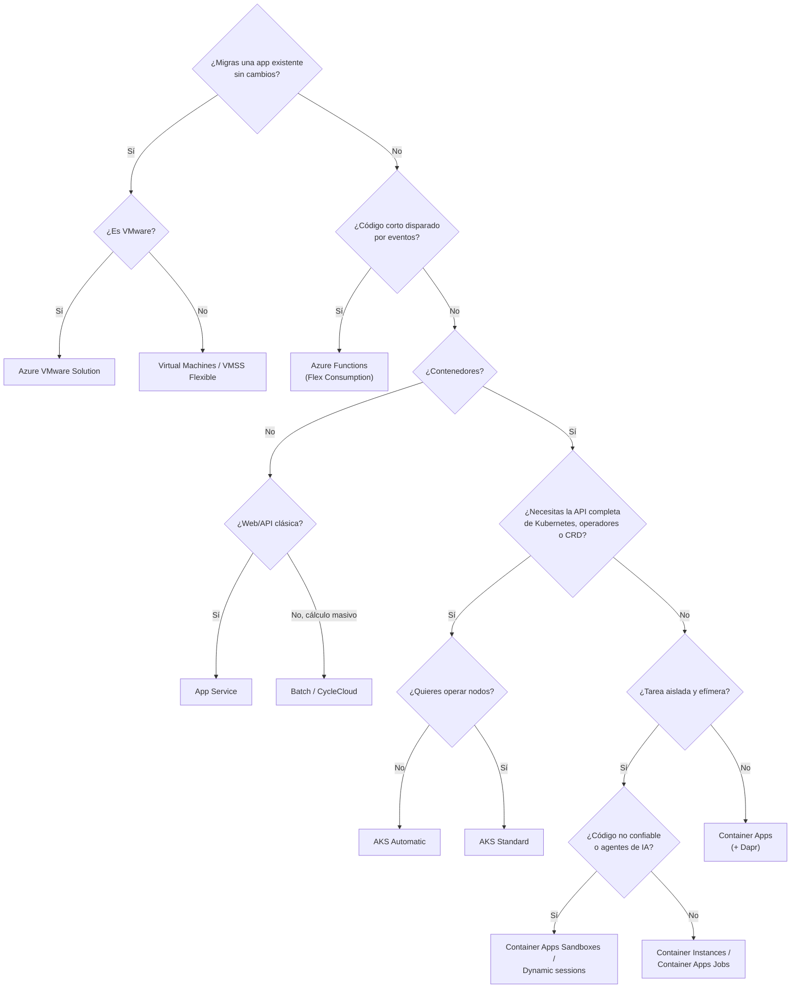
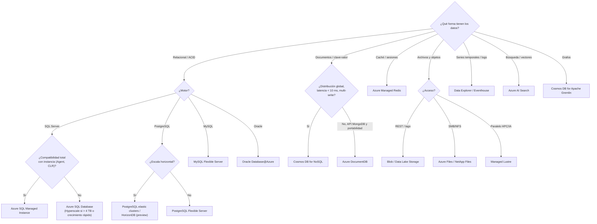
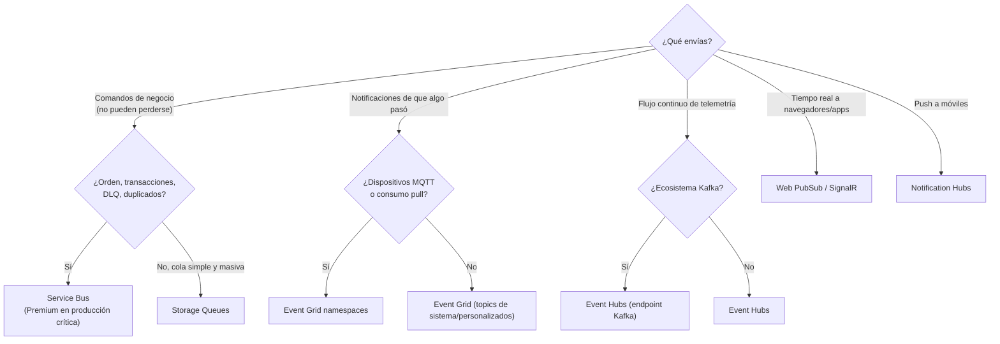
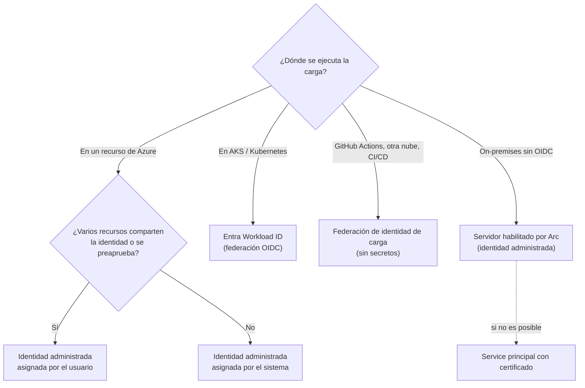
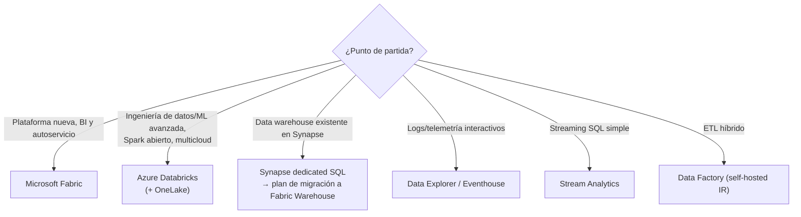
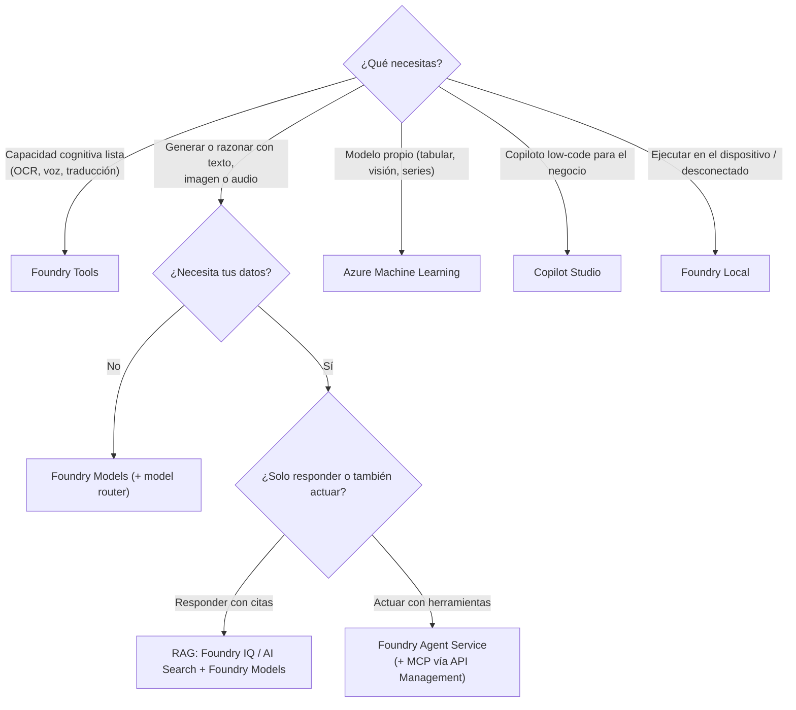

# 16 · Guías de decisión

**Árboles de decisión para elegir el servicio correcto en cada capa**

[⬅ 15 · Arquitecturas](15-arquitecturas-de-referencia.md) · [🏠 Índice](../README.md) · [17 · Catálogo A–Z ➡](17-catalogo-a-z.md)

> [!TIP]
> Los árboles son puntos de partida. Valida siempre con: requisitos no funcionales (SLO, RPO/RTO, residencia),
> habilidades del equipo, costo total y **pruebas de concepto con carga real**.

---

## Contenido

1. [Cómputo](#1-cómputo)
2. [Datos](#2-datos)
3. [Mensajería](#3-mensajería)
4. [Integración y orquestación](#4-integración-y-orquestación)
5. [Entrada de tráfico y balanceo](#5-entrada-de-tráfico-y-balanceo)
6. [Identidad de cargas de trabajo](#6-identidad-de-cargas-de-trabajo)
7. [Analítica](#7-analítica)
8. [Inteligencia artificial](#8-inteligencia-artificial)
9. [Conectividad híbrida](#9-conectividad-híbrida)
10. [Decisiones que conviene evitar](#10-decisiones-que-conviene-evitar)

---

## 1. Cómputo

| Si además necesitas… | Ajusta la elección |
|---|---|
| OpenShift corporativo | Azure Red Hat OpenShift |
| Spring Boot gestionado | Container Apps con componentes Java (Spring Apps se retira en 2028) |
| Windows Server sin contenedores | VM o App Service (Windows) |
| GPU con escala a cero | Container Apps (GPU *serverless*) |
| Entrenamiento distribuido a gran escala | AKS / ND-series / Azure ML |

---

## 2. Datos

---

## 3. Mensajería

---

## 4. Integración y orquestación

| Necesidad | Primera opción | Por qué |
|---|---|---|
| Integrar SaaS/ERP con conectores y poco código | **Logic Apps** (Standard) | 1 400+ conectores, B2B, flujos visuales |
| Orquestación con estado en código | **Durable Functions** (Durable Task Scheduler) | Patrones *fan-out*, sagas, procesos largos |
| Workflows portables en microservicios | **Dapr Workflows** (Container Apps/AKS) | Independiente del proveedor |
| Movimiento y transformación de datos | **Data Factory** / Fabric Data Factory | Integration runtimes, *data flows* |
| Exponer y gobernar APIs (y MCP) | **API Management** | Seguridad, cuotas, versionado, portal de desarrolladores |
| Llamar on-premises sin abrir puertos | **Azure Relay** (Hybrid Connections) | Conectividad saliente segura |

---

## 5. Entrada de tráfico y balanceo

| Pregunta | Respuesta → servicio |
|---|---|
| ¿HTTP/S con usuarios globales? | **Front Door** (+ WAF) |
| ¿HTTP/S regional o ingress de AKS? | **Application Gateway v2** / **Application Gateway for Containers** |
| ¿TCP/UDP regional? | **Load Balancer Standard** |
| ¿TCP/UDP entre regiones con IP estable? | **Load Balancer Global tier** |
| ¿*Failover* por DNS para cualquier protocolo? | **Traffic Manager** |
| ¿APIs con políticas, cuotas y suscripciones? | **API Management** detrás de la entrada |

Árbol completo en [06 § Elegir el balanceador correcto](06-redes-y-entrega-global.md#5-elegir-el-balanceador-correcto).

---

## 6. Identidad de cargas de trabajo

---

## 7. Analítica

---

## 8. Inteligencia artificial

---

## 9. Conectividad híbrida

| Requisito | VPN Gateway | ExpressRoute | Virtual WAN |
|---|---|---|---|
| Ancho de banda | Hasta decenas de Gbps (agregado) | 50 Mbps–100 Gbps (400 Gbps con Direct) | Escala de *hub* |
| Tráfico por Internet | Sí (cifrado IPsec) | No (privado) | Según conexión |
| Latencia predecible | No | **Sí** | Según conexión |
| Muchas sucursales | Manual | Costoso | **Ideal** (SD-WAN de socios) |
| Tiempo de puesta en marcha | Horas | Semanas (proveedor) | Horas a días |
| Recomendación | Pymes, P2S, respaldo de ExpressRoute | Cargas críticas y volumen alto | Topologías globales |

---

## 10. Decisiones que conviene evitar

| Decisión | Por qué evitarla | Mejor opción |
|---|---|---|
| AKS para una sola API sencilla | Sobrecarga operativa | Container Apps o App Service |
| Cosmos DB con clave de partición de baja cardinalidad | Particiones calientes y `429` | Clave de alta cardinalidad o jerárquica |
| Storage Queues para flujos que requieren orden y DLQ | Falta de garantías | Service Bus con sesiones |
| Event Grid para telemetría masiva continua | No es un log reproducible | Event Hubs |
| Strong consistency por defecto | Costo y latencia | Session y excepciones justificadas |
| Secretos en variables de entorno o pipelines | Riesgo de fuga | Identidades administradas, OIDC, Key Vault |
| Una región sin zonas para producción crítica | Sin tolerancia a fallos de datacenter | Servicios zona-redundantes y plan multirregión |
| Nuevos desarrollos en servicios en retiro | Deuda técnica inmediata | Consulta [18 · Retiros](18-retiros-y-ciclo-de-vida.md) |

---

[⬅ 15 · Arquitecturas](15-arquitecturas-de-referencia.md) · [🏠 Índice](../README.md) · [17 · Catálogo A–Z ➡](17-catalogo-a-z.md)

