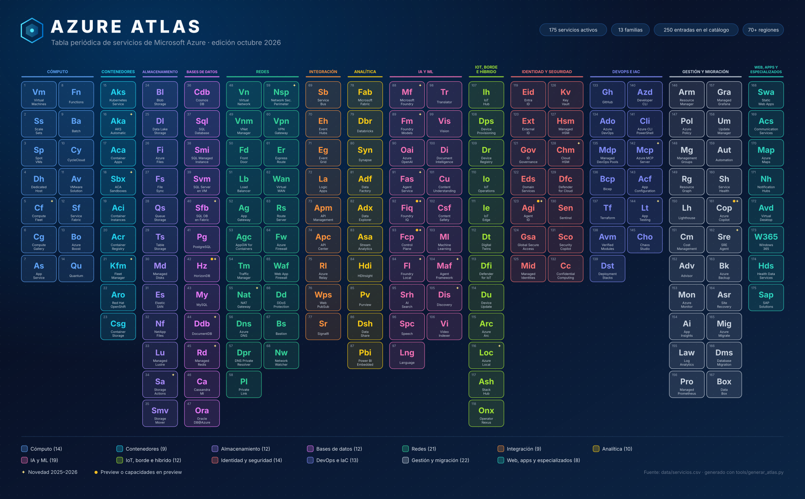

# 17 · Catálogo A–Z de servicios de Azure

**250 servicios, productos y capacidades con su familia, estado y capítulo · edición octubre 2026**

[⬅ 16 · Guías de decisión](16-guias-de-decision.md) · [🏠 Índice](../README.md) · [18 · Retiros ➡](18-retiros-y-ciclo-de-vida.md)

> [!NOTE]
> Este archivo se **genera automáticamente** desde [`data/servicios.csv`](../data/servicios.csv) con
> `python3 tools/generar_atlas.py`. Para corregir o añadir un servicio, edita el CSV y vuelve a ejecutar el script.

## Resumen por familia

| Familia | GA | Preview o mixto | Verificar ciclo | En retiro | Retirados | Total |
|---|---:|---:|---:|---:|---:|---:|
| Cómputo | 15 | 0 | 0 | 2 | 1 | 18 |
| Contenedores | 9 | 0 | 0 | 0 | 0 | 9 |
| Almacenamiento | 12 | 0 | 0 | 0 | 3 | 15 |
| Bases de datos | 11 | 1 | 0 | 2 | 2 | 16 |
| Redes | 24 | 0 | 0 | 2 | 3 | 29 |
| Integración | 9 | 0 | 0 | 0 | 1 | 10 |
| Analítica | 12 | 0 | 0 | 0 | 4 | 16 |
| IA y ML | 18 | 2 | 0 | 1 | 8 | 29 |
| IoT, borde e híbrido | 12 | 0 | 2 | 2 | 2 | 18 |
| Identidad y seguridad | 18 | 1 | 0 | 2 | 1 | 22 |
| DevOps e IaC | 14 | 0 | 0 | 3 | 1 | 18 |
| Gestión y migración | 25 | 1 | 0 | 2 | 3 | 31 |
| Web, apps y especializados | 9 | 0 | 0 | 1 | 9 | 19 |
| **Total** | **188** | **5** | **2** | **17** | **38** | **250** |

**Leyenda:** 🟢 GA · 🟡 Preview · 🟢/🟡 capacidades en GA y en preview · 🟠 en retiro (fecha de retiro) · ⛔ retirado · ℹ️ verifica el ciclo de vida del SKU · 🆕 novedad 2025–2026.

Servicios activos (GA, preview o por verificar): **195** · en retiro o retirados: **55**.

## Índice alfabético

[A](#a) · [B](#b) · [C](#c) · [D](#d) · [E](#e) · [F](#f) · [G](#g) · [H](#h) · [I](#i) · [K](#k) · [L](#l) · [M](#m) · [N](#n) · [O](#o) · [P](#p) · [Q](#q) · [R](#r) · [S](#s) · [T](#t) · [U](#u) · [V](#v) · [W](#w)

## A

| Servicio | Familia | Estado | Qué es | Cap. |
|---|---|---|---|---|
| **Azure AD B2C** | Identidad y seguridad | 🟠 Retiro | Sin venta a clientes nuevos desde may-2025; usar Entra External ID | [08](08-identidad-y-seguridad.md) |
| **Azure Advisor** | Gestión y migración | 🟢 GA | Recomendaciones por pilar del Well-Architected Framework | [13](13-gestion-gobierno-costos-y-migracion.md) |
| **Microsoft Agent Framework** | IA y ML | 🟢 GA 🆕 | SDK de agentes .NET/Python, sucesor de Semantic Kernel y AutoGen | [10](10-ia-y-machine-learning.md) |
| **Azure AI Search** | IA y ML | 🟢 GA | Búsqueda híbrida, vectorial, semántica y recuperación agéntica | [10](10-ia-y-machine-learning.md) |
| **AKS Automatic** | Contenedores | 🟢 GA 🆕 | AKS con nodos, escalado, red y seguridad gestionados (GA sep-2025) | [03](03-computo-y-contenedores.md) |
| **Azure Analysis Services** | Analítica | 🟢 GA | Modelos tabulares (legado); preferir modelos semánticos | [09](09-datos-y-analitica.md) |
| **Anomaly Detector** | IA y ML | ⛔ Retirado 1-oct-2026 | Usar Data Explorer, Fabric o modelos propios | [10](10-ia-y-machine-learning.md) |
| **Azure API Center** | Integración | 🟢 GA | Inventario y gobierno de APIs y servidores MCP | [05](05-mensajeria-e-integracion.md) |
| **Azure API for FHIR** | Web, apps y especializados | ⛔ Retirado 30-sep-2026 | Migrar a Azure Health Data Services | [14](14-web-movil-comunicaciones-y-escritorio.md) |
| **Azure API Management** | Integración | 🟢 GA | Gateway de APIs, AI gateway y servidores MCP | [05](05-mensajeria-e-integracion.md) |
| **Visual Studio App Center** | Web, apps y especializados | ⛔ Retirado 31-mar-2025 | Herramientas de CI/CD y distribución de terceros | [14](14-web-movil-comunicaciones-y-escritorio.md) |
| **Azure App Configuration** | DevOps e IaC | 🟢 GA | Configuración centralizada y feature flags | [12](12-desarrollo-devops-e-iac.md) |
| **Azure App Service** | Cómputo | 🟢 GA | Web apps y APIs gestionadas con slots, autoescalado y sidecars | [03](03-computo-y-contenedores.md) |
| **Azure App Testing** | DevOps e IaC | 🟢 GA 🆕 | Playwright Workspaces y Azure Load Testing | [12](12-desarrollo-devops-e-iac.md) |
| **Azure Application Gateway** | Redes | 🟢 GA | Proxy inverso L7 regional v2 con WAF | [06](06-redes-y-entrega-global.md) |
| **Application Gateway for Containers** | Redes | 🟢 GA | Ingress y Gateway API para AKS con WAF | [06](06-redes-y-entrega-global.md) |
| **Application Gateway v1** | Redes | ⛔ Retirado 28-abr-2026 | Migrar a Application Gateway v2 | [06](06-redes-y-entrega-global.md) |
| **Application Insights** | Gestión y migración | 🟢 GA | APM y rastreo distribuido con OpenTelemetry | [07](07-observabilidad-y-monitoreo.md) |
| **Azure Arc** | IoT, borde e híbrido | 🟢 GA | Gobierno de Azure para servidores, Kubernetes y datos en cualquier lugar | [11](11-iot-edge-hibrido-y-soberania.md) |
| **Microsoft Azure Attestation** | Identidad y seguridad | 🟢 GA | Atestación remota de entornos de ejecución de confianza | [08](08-identidad-y-seguridad.md) |
| **Azure Automation** | Gestión y migración | 🟢 GA | Runbooks PowerShell/Python y hybrid workers | [13](13-gestion-gobierno-costos-y-migracion.md) |
| **Azure Automation State Configuration** | Gestión y migración | 🟠 Retiro 30-sep-2027 | Migrar a Machine Configuration | [13](13-gestion-gobierno-costos-y-migracion.md) |
| **Automation Update Management** | Gestión y migración | ⛔ Retirado 31-ago-2024 | Migrar a Azure Update Manager | [13](13-gestion-gobierno-costos-y-migracion.md) |

## B

| Servicio | Familia | Estado | Qué es | Cap. |
|---|---|---|---|---|
| **Azure Backup** | Gestión y migración | 🟢 GA | Copias inmutables de VM, discos, Files, Blobs y bases de datos | [13](13-gestion-gobierno-costos-y-migracion.md) |
| **Azure Bastion** | Redes | 🟢 GA | RDP/SSH seguro sin IP públicas | [06](06-redes-y-entrega-global.md) |
| **Azure Batch** | Cómputo | 🟢 GA | Trabajos paralelos y HPC a gran escala con nodos Spot | [03](03-computo-y-contenedores.md) |
| **Bicep** | DevOps e IaC | 🟢 GA | Lenguaje de IaC nativo de Azure | [12](12-desarrollo-devops-e-iac.md) |
| **Bing Maps for Enterprise** | Web, apps y especializados | 🟠 Retiro 30-jun-2028 | Migrar a Azure Maps | [14](14-web-movil-comunicaciones-y-escritorio.md) |
| **Bing Search APIs** | IA y ML | ⛔ Retirado 11-ago-2025 | Usar Grounding with Bing Search en Foundry | [10](10-ia-y-machine-learning.md) |
| **Azure Blob Storage** | Almacenamiento | 🟢 GA | Objetos a escala de exabytes; Hot/Cool/Cold/Archive y smart tier | [04](04-almacenamiento-y-bases-de-datos.md) |
| **Azure Blockchain Service** | Web, apps y especializados | ⛔ Retirado 10-sep-2021 | Azure Confidential Ledger o socios | [14](14-web-movil-comunicaciones-y-escritorio.md) |
| **Azure Blueprints** | Gestión y migración | 🟠 Retiro 31-ene-2027 | Template Specs + Deployment Stacks + Policy | [01](01-fundamentos-y-plataforma-global.md) |
| **Azure Boost** | Cómputo | 🟢 GA | Descarga de red y almacenamiento a hardware dedicado en el host | [03](03-computo-y-contenedores.md) |
| **Azure Bot Service** | IA y ML | 🟢 GA | Bots con Bot Framework (legado; preferir Copilot Studio/Agents SDK) | [10](10-ia-y-machine-learning.md) |
| **Azure Business Continuity Center** | Gestión y migración | 🟢 GA | Vista unificada de protección y recuperación | [13](13-gestion-gobierno-costos-y-migracion.md) |

## C

| Servicio | Familia | Estado | Qué es | Cap. |
|---|---|---|---|---|
| **Azure Cache for Redis** | Bases de datos | 🟠 Retiro 30-sep-2028 | Enterprise se retira el 31-mar-2027; migrar a Azure Managed Redis | [04](04-almacenamiento-y-bases-de-datos.md) |
| **Azure CDN from Edgio** | Redes | ⛔ Retirado 15-ene-2025 | Migrado a Front Door | [06](06-redes-y-entrega-global.md) |
| **Azure CDN Standard from Microsoft (classic)** | Redes | 🟠 Retiro 30-sep-2027 | Migrar a Front Door Standard/Premium | [06](06-redes-y-entrega-global.md) |
| **Azure Center for SAP solutions** | Web, apps y especializados | 🟢 GA | Despliegue y gestión de SAP como unidad | [14](14-web-movil-comunicaciones-y-escritorio.md) |
| **Change Tracking and Inventory** | Gestión y migración | 🟢 GA | Cambios de software, archivos y registro con AMA | [13](13-gestion-gobierno-costos-y-migracion.md) |
| **Azure Chaos Studio** | DevOps e IaC | 🟢 GA | Ingeniería del caos con fallos de servicio y agente | [12](12-desarrollo-devops-e-iac.md) |
| **Azure CLI y Azure PowerShell** | DevOps e IaC | 🟢 GA | Automatización de línea de comandos multiplataforma | [01](01-fundamentos-y-plataforma-global.md) |
| **Azure Cloud HSM** | Identidad y seguridad | 🟢 GA 🆕 | HSM dedicado de inquilino único, sucesor de Dedicated HSM | [08](08-identidad-y-seguridad.md) |
| **Cloud Services (classic)** | Cómputo | ⛔ Retirado 31-ago-2024 | Reemplazado por Cloud Services (extended support) y otros PaaS | [03](03-computo-y-contenedores.md) |
| **Cloud Services (extended support)** | Cómputo | 🟠 Retiro 31-mar-2027 | PaaS clásico; migrar a VMSS, App Service o AKS | [03](03-computo-y-contenedores.md) |
| **Azure Communication Services** | Web, apps y especializados | 🟢 GA | Voz, video, chat, SMS, correo, WhatsApp y Call Automation | [14](14-web-movil-comunicaciones-y-escritorio.md) |
| **Azure Compute Fleet** | Cómputo | 🟢 GA 🆕 | Aprovisiona miles de VM mezclando tamaños y Spot/estándar | [03](03-computo-y-contenedores.md) |
| **Azure Compute Gallery** | Cómputo | 🟢 GA | Imágenes y aplicaciones de VM versionadas y replicadas | [03](03-computo-y-contenedores.md) |
| **Computer Vision API v1.0–v3.1** | IA y ML | ⛔ Retirado 13-sep-2026 | Migrar a Image Analysis 4.0 | [10](10-ia-y-machine-learning.md) |
| **Azure Confidential Computing** | Identidad y seguridad | 🟢 GA | VM, contenedores y GPU con memoria cifrada por hardware | [08](08-identidad-y-seguridad.md) |
| **Azure Confidential Ledger** | Identidad y seguridad | 🟢 GA | Registro inmutable respaldado por TEE | [08](08-identidad-y-seguridad.md) |
| **Azure Container Apps** | Contenedores | 🟢 GA | Microservicios serverless con KEDA, Envoy y Dapr gestionado | [03](03-computo-y-contenedores.md) |
| **Container Apps Sandboxes** | Contenedores | 🟢 GA 🆕 | Cómputo efímero en micro-VM con snapshots y suspensión (GA sep-2026) | [03](03-computo-y-contenedores.md) |
| **Azure Container Instances** | Contenedores | 🟢 GA | Contenedores bajo demanda sin orquestador, facturados por segundo | [03](03-computo-y-contenedores.md) |
| **Azure Container Registry** | Contenedores | 🟢 GA | Registro OCI privado con geo-replicación, tasks y Private Link | [03](03-computo-y-contenedores.md) |
| **Azure Container Storage** | Contenedores | 🟢 GA | Volúmenes para contenedores sobre NVMe local y discos | [03](03-computo-y-contenedores.md) |
| **Content Moderator** | IA y ML | 🟠 Retiro 31-mar-2027 | Migrar a Content Safety | [10](10-ia-y-machine-learning.md) |
| **Content Safety (Foundry Tools)** | IA y ML | 🟢 GA | Filtros de daño, Prompt Shields y groundedness | [10](10-ia-y-machine-learning.md) |
| **Content Understanding (Foundry Tools)** | IA y ML | 🟢 GA | Extracción multimodal de documentos, audio y video | [10](10-ia-y-machine-learning.md) |
| **Azure Copilot** | Gestión y migración | 🟢/🟡 GA y preview 🆕 | Asistente de IA en portal, CLI y PowerShell; agentes en preview | [13](13-gestion-gobierno-costos-y-migracion.md) |
| **Azure Cosmos DB** | Bases de datos | 🟢 GA | NoSQL distribuida globalmente, 5 consistencias, vector y full-text | [04](04-almacenamiento-y-bases-de-datos.md) |
| **Azure Cosmos DB for PostgreSQL** | Bases de datos | 🟠 Retiro 31-mar-2029 | Sin nuevas implementaciones; migrar a PostgreSQL elastic clusters | [04](04-almacenamiento-y-bases-de-datos.md) |
| **Microsoft Cost Management** | Gestión y migración | 🟢 GA | Costos, presupuestos, anomalías y exportaciones FOCUS | [13](13-gestion-gobierno-costos-y-migracion.md) |
| **Customer Lockbox for Microsoft Azure** | Identidad y seguridad | 🟢 GA | Aprobación de accesos de ingenieros de Microsoft | [08](08-identidad-y-seguridad.md) |
| **Azure CycleCloud** | Cómputo | 🟢 GA | Orquestación de clústeres HPC (Slurm, PBS Pro, LSF) | [03](03-computo-y-contenedores.md) |

## D

| Servicio | Familia | Estado | Qué es | Cap. |
|---|---|---|---|---|
| **Azure Data Box** | Gestión y migración | 🟢 GA | Transferencia offline de grandes volúmenes | [13](13-gestion-gobierno-costos-y-migracion.md) |
| **Azure Data Explorer** | Analítica | 🟢 GA | Motor Kusto para logs, telemetría y series temporales | [09](09-datos-y-analitica.md) |
| **Azure Data Factory** | Analítica | 🟢 GA | Integración y orquestación de datos híbrida | [09](09-datos-y-analitica.md) |
| **Azure Data Lake Analytics** | Analítica | ⛔ Retirado 29-feb-2024 | U-SQL; migrar a Fabric, Databricks o Synapse | [09](09-datos-y-analitica.md) |
| **Azure Data Lake Storage** | Almacenamiento | 🟢 GA | Blob con espacio de nombres jerárquico y ACL POSIX | [04](04-almacenamiento-y-bases-de-datos.md) |
| **Azure Data Lake Storage Gen1** | Almacenamiento | ⛔ Retirado 29-feb-2024 | Migrado a Data Lake Storage (Gen2) | [04](04-almacenamiento-y-bases-de-datos.md) |
| **Azure Data Share** | Analítica | 🟢 GA | Compartir datos con organizaciones externas | [09](09-datos-y-analitica.md) |
| **Azure Database for MariaDB** | Bases de datos | ⛔ Retirado 19-sep-2025 | Migrado a MySQL Flexible Server | [04](04-almacenamiento-y-bases-de-datos.md) |
| **Azure Database for MySQL** | Bases de datos | 🟢 GA | Flexible Server con HA de zona y réplicas de lectura | [04](04-almacenamiento-y-bases-de-datos.md) |
| **Azure Database for PostgreSQL** | Bases de datos | 🟢 GA | Flexible Server con HA de zona y elastic clusters (Citus) | [04](04-almacenamiento-y-bases-de-datos.md) |
| **Azure Database Migration Service** | Gestión y migración | 🟢 GA | Migraciones de bases de datos en línea y fuera de línea | [13](13-gestion-gobierno-costos-y-migracion.md) |
| **Azure Databricks** | Analítica | 🟢 GA | Lakehouse con Unity Catalog, Spark y Mosaic AI | [09](09-datos-y-analitica.md) |
| **Azure DDoS Protection** | Redes | 🟢 GA | Mitigación DDoS adaptativa (Network e IP Protection) | [06](06-redes-y-entrega-global.md) |
| **Azure Dedicated Host** | Cómputo | 🟢 GA | Servidor físico dedicado para cumplimiento y licencias | [03](03-computo-y-contenedores.md) |
| **Azure Dedicated HSM** | Identidad y seguridad | 🟠 Retiro 31-jul-2028 | Sin nuevos clientes; migrar a Cloud HSM o Managed HSM | [08](08-identidad-y-seguridad.md) |
| **Microsoft Defender for Cloud** | Identidad y seguridad | 🟢 GA | CNAPP: CSPM, rutas de ataque y protección de cargas | [08](08-identidad-y-seguridad.md) |
| **Microsoft Defender for IoT** | IoT, borde e híbrido | 🟢 GA | Seguridad de redes OT/IoT sin agentes | [11](11-iot-edge-hibrido-y-soberania.md) |
| **Azure Deployment Environments** | DevOps e IaC | 🟠 Retiro 22-feb-2027 | Cierre progresivo desde 14-sep-2026 | [12](12-desarrollo-devops-e-iac.md) |
| **Deployment Stacks** | DevOps e IaC | 🟢 GA | Recursos gestionados como unidad con deny settings | [12](12-desarrollo-devops-e-iac.md) |
| **Microsoft Dev Box** | DevOps e IaC | 🟠 Retiro 18-sep-2028 | Modo mantenimiento; destino Windows 365 | [12](12-desarrollo-devops-e-iac.md) |
| **Azure Developer CLI (azd)** | DevOps e IaC | 🟢 GA | De plantilla a aplicación desplegada con azd up | [12](12-desarrollo-devops-e-iac.md) |
| **Azure Device Registry** | IoT, borde e híbrido | 🟢 GA | Representación nativa de dispositivos y activos | [11](11-iot-edge-hibrido-y-soberania.md) |
| **Device Update for IoT Hub** | IoT, borde e híbrido | 🟢 GA | Actualizaciones OTA de dispositivos | [11](11-iot-edge-hibrido-y-soberania.md) |
| **Azure DevOps** | DevOps e IaC | 🟢 GA | Boards, Repos, Pipelines, Test Plans y Artifacts | [12](12-desarrollo-devops-e-iac.md) |
| **Azure Digital Twins** | IoT, borde e híbrido | 🟢 GA | Gemelos digitales con DTDL y grafo de relaciones | [11](11-iot-edge-hibrido-y-soberania.md) |
| **Microsoft Discovery** | IA y ML | 🟢 GA 🆕 | Plataforma agéntica para I+D científica (GA Build 2026) | [10](10-ia-y-machine-learning.md) |
| **Azure DNS** | Redes | 🟢 GA | Zonas DNS públicas y privadas | [06](06-redes-y-entrega-global.md) |
| **Azure DNS Private Resolver** | Redes | 🟢 GA | Resolución DNS híbrida sin VM | [06](06-redes-y-entrega-global.md) |
| **Document Intelligence (Foundry Tools)** | IA y ML | 🟢 GA | Extracción de documentos precompilada y personalizada | [10](10-ia-y-machine-learning.md) |
| **Azure DocumentDB** | Bases de datos | 🟢 GA 🆕 | Documentos compatible con MongoDB sobre motor open source | [04](04-almacenamiento-y-bases-de-datos.md) |

## E

| Servicio | Familia | Estado | Qué es | Cap. |
|---|---|---|---|---|
| **Azure Elastic SAN** | Almacenamiento | 🟢 GA | SAN como servicio (iSCSI) para VM, AKS y AVS | [04](04-almacenamiento-y-bases-de-datos.md) |
| **Microsoft Entra Agent ID** | Identidad y seguridad | 🟢/🟡 GA y preview 🆕 | Identidades para agentes de IA con Acceso Condicional | [08](08-identidad-y-seguridad.md) |
| **Microsoft Entra Domain Services** | Identidad y seguridad | 🟢 GA | Dominio administrado compatible con AD | [08](08-identidad-y-seguridad.md) |
| **Microsoft Entra External ID** | Identidad y seguridad | 🟢 GA | Identidad de clientes y socios (CIAM y B2B) | [08](08-identidad-y-seguridad.md) |
| **Microsoft Entra ID** | Identidad y seguridad | 🟢 GA | Identidad, SSO, MFA y Acceso Condicional (antes Azure AD) | [08](08-identidad-y-seguridad.md) |
| **Microsoft Entra ID Governance** | Identidad y seguridad | 🟢 GA | Revisiones de acceso, ciclo de vida y gestión de derechos | [08](08-identidad-y-seguridad.md) |
| **Microsoft Entra Permissions Management** | Identidad y seguridad | ⛔ Retirado 1-oct-2025 | Capacidades CIEM en Defender for Cloud | [08](08-identidad-y-seguridad.md) |
| **Microsoft Entra Verified ID** | Identidad y seguridad | 🟢 GA | Credenciales verificables | [08](08-identidad-y-seguridad.md) |
| **Azure Event Grid** | Integración | 🟢 GA | Enrutamiento de eventos push/pull y broker MQTT | [05](05-mensajeria-e-integracion.md) |
| **Azure Event Hubs** | Integración | 🟢 GA | Streaming de millones de eventos/s compatible con Kafka | [05](05-mensajeria-e-integracion.md) |
| **Azure ExpressRoute** | Redes | 🟢 GA | Conectividad privada dedicada; Direct hasta 400 Gbps | [06](06-redes-y-entrega-global.md) |
| **Azure Extended Zones** | IoT, borde e híbrido | ℹ️ Ver ciclo de vida | Extensiones metropolitanas de regiones en ubicaciones seleccionadas | [11](11-iot-edge-hibrido-y-soberania.md) |

## F

| Servicio | Familia | Estado | Qué es | Cap. |
|---|---|---|---|---|
| **Microsoft Fabric** | Analítica | 🟢 GA | Plataforma SaaS de datos e IA sobre OneLake | [09](09-datos-y-analitica.md) |
| **Azure File Sync** | Almacenamiento | 🟢 GA | Caché híbrida de Azure Files en Windows Server | [04](04-almacenamiento-y-bases-de-datos.md) |
| **Azure Files** | Almacenamiento | 🟢 GA | Recursos compartidos SMB/NFS administrados (provisioned v2) | [04](04-almacenamiento-y-bases-de-datos.md) |
| **Azure Firewall** | Redes | 🟢 GA | Firewall con estado Basic/Standard/Premium (IDPS, TLS) | [06](06-redes-y-entrega-global.md) |
| **Azure Firewall Manager** | Redes | 🟢 GA | Políticas de firewall centralizadas y hubs seguros | [06](06-redes-y-entrega-global.md) |
| **Azure Fluid Relay** | Web, apps y especializados | 🟢 GA | Colaboración en tiempo real con Fluid Framework | [14](14-web-movil-comunicaciones-y-escritorio.md) |
| **Microsoft Foundry** | IA y ML | 🟢 GA 🆕 | Plataforma para construir, evaluar y gobernar apps y agentes de IA | [10](10-ia-y-machine-learning.md) |
| **Foundry Agent Service** | IA y ML | 🟢 GA 🆕 | Runtime de agentes con herramientas, MCP, A2A y multiagente | [10](10-ia-y-machine-learning.md) |
| **Foundry Control Plane** | IA y ML | 🟡 Preview 🆕 | Gobierno, observabilidad y seguridad de flotas de agentes | [10](10-ia-y-machine-learning.md) |
| **Foundry IQ** | IA y ML | 🟢/🟡 GA y preview 🆕 | Capa de conocimiento para agentes sobre AI Search | [10](10-ia-y-machine-learning.md) |
| **Foundry Local** | IA y ML | 🟢 GA 🆕 | Modelos en el dispositivo o en entornos desconectados | [10](10-ia-y-machine-learning.md) |
| **Foundry Models** | IA y ML | 🟢 GA 🆕 | Catálogo de 11 000+ modelos (OpenAI, Anthropic, Meta, Mistral, xAI…) | [10](10-ia-y-machine-learning.md) |
| **Azure Front Door** | Redes | 🟢 GA | Entrada global L7 con WAF y CDN en 190+ sitios edge | [06](06-redes-y-entrega-global.md) |
| **Azure Front Door (classic)** | Redes | 🟠 Retiro 31-mar-2027 | Migrar a Front Door Standard/Premium | [06](06-redes-y-entrega-global.md) |
| **Azure Functions** | Cómputo | 🟢 GA | Serverless por eventos; plan Flex Consumption recomendado | [03](03-computo-y-contenedores.md) |
| **Azure FXT Edge Filer** | Almacenamiento | ⛔ Retirado 30-sep-2026 | Caché de archivos de borde retirada | [04](04-almacenamiento-y-bases-de-datos.md) |

## G

| Servicio | Familia | Estado | Qué es | Cap. |
|---|---|---|---|---|
| **GitHub (Actions, Advanced Security, Copilot, Codespaces)** | DevOps e IaC | 🟢 GA | Plataforma de desarrollo con CI/CD y OIDC hacia Azure | [12](12-desarrollo-devops-e-iac.md) |
| **Global Secure Access** | Identidad y seguridad | 🟢 GA | Entra Internet Access y Private Access (SSE) | [08](08-identidad-y-seguridad.md) |

## H

| Servicio | Familia | Estado | Qué es | Cap. |
|---|---|---|---|---|
| **Azure HDInsight** | Analítica | 🟢 GA | Hadoop, Spark, Kafka y HBase gestionados (legado) | [09](09-datos-y-analitica.md) |
| **HDInsight on AKS** | Analítica | ⛔ Retirado 31-ene-2025 | Migrar a Fabric o Databricks | [09](09-datos-y-analitica.md) |
| **Azure Health Data Services** | Web, apps y especializados | 🟢 GA | Servicios FHIR, DICOM y MedTech | [14](14-web-movil-comunicaciones-y-escritorio.md) |
| **Azure HorizonDB** | Bases de datos | 🟡 Preview 🆕 | Compatible con PostgreSQL, escala horizontal hasta 3 072 vCores | [04](04-almacenamiento-y-bases-de-datos.md) |
| **Azure HPC Cache** | Almacenamiento | ⛔ Retirado 30-sep-2025 | Reemplazado por Azure Managed Lustre | [04](04-almacenamiento-y-bases-de-datos.md) |
| **HTTP Data Collector API** | Gestión y migración | ⛔ Retirado 14-sep-2026 | Migrar a Logs Ingestion API | [07](07-observabilidad-y-monitoreo.md) |

## I

| Servicio | Familia | Estado | Qué es | Cap. |
|---|---|---|---|---|
| **Integration Service Environment** | Integración | ⛔ Retirado 31-ago-2024 | Migrar a Logic Apps Standard | [05](05-mensajeria-e-integracion.md) |
| **Azure IoT Central** | IoT, borde e híbrido | 🟠 Retiro 20-sep-2029 | Migrar a IoT Hub + DPS + Device Registry | [11](11-iot-edge-hibrido-y-soberania.md) |
| **Azure IoT Edge** | IoT, borde e híbrido | 🟢 GA | Runtime de módulos en dispositivos de borde | [11](11-iot-edge-hibrido-y-soberania.md) |
| **Azure IoT Hub** | IoT, borde e híbrido | 🟢 GA | Gateway bidireccional para millones de dispositivos | [11](11-iot-edge-hibrido-y-soberania.md) |
| **Azure IoT Hub Device Provisioning Service** | IoT, borde e híbrido | 🟢 GA | Aprovisionamiento zero-touch a escala | [11](11-iot-edge-hibrido-y-soberania.md) |
| **Azure IoT Operations** | IoT, borde e híbrido | 🟢 GA | Plano de datos industrial en el borde con Arc | [11](11-iot-edge-hibrido-y-soberania.md) |

## K

| Servicio | Familia | Estado | Qué es | Cap. |
|---|---|---|---|---|
| **Azure Key Vault** | Identidad y seguridad | 🟢 GA | Secretos, claves y certificados (Standard/Premium) | [08](08-identidad-y-seguridad.md) |
| **Azure Key Vault Managed HSM** | Identidad y seguridad | 🟢 GA | HSM de inquilino único FIPS 140-3 nivel 3 | [08](08-identidad-y-seguridad.md) |
| **Azure Kubernetes Fleet Manager** | Contenedores | 🟢 GA 🆕 | Gobierno y actualizaciones de hasta 1 000 clústeres, incluidos Arc | [03](03-computo-y-contenedores.md) |
| **Azure Kubernetes Service (AKS)** | Contenedores | 🟢 GA | Kubernetes gestionado: tiers Free/Standard/Premium, hasta 5 000 nodos | [03](03-computo-y-contenedores.md) |

## L

| Servicio | Familia | Estado | Qué es | Cap. |
|---|---|---|---|---|
| **Azure Lab Services** | DevOps e IaC | 🟠 Retiro 28-jun-2027 | Laboratorios de formación; buscar alternativas | [12](12-desarrollo-devops-e-iac.md) |
| **Language (Foundry Tools)** | IA y ML | 🟢 GA | NER, PII, resumen, CLU y question answering | [10](10-ia-y-machine-learning.md) |
| **Azure Lighthouse** | Gestión y migración | 🟢 GA | Gestión delegada multitenant | [13](13-gestion-gobierno-costos-y-migracion.md) |
| **Azure Load Balancer** | Redes | 🟢 GA | Balanceo L4 regional o global (Standard, Gateway, Global tier) | [06](06-redes-y-entrega-global.md) |
| **Azure Load Balancer Basic** | Redes | ⛔ Retirado 30-sep-2025 | Migrar a Load Balancer Standard | [06](06-redes-y-entrega-global.md) |
| **Azure Local** | IoT, borde e híbrido | 🟢 GA 🆕 | Infraestructura de Azure en tu datacenter, incluso desconectada | [11](11-iot-edge-hibrido-y-soberania.md) |
| **Log Analytics** | Gestión y migración | 🟢 GA | Workspaces de logs con KQL y planes Analytics/Basic/Auxiliary | [07](07-observabilidad-y-monitoreo.md) |
| **Log Analytics agent (MMA/OMS)** | Gestión y migración | ⛔ Retirado 31-ago-2024 | Migrar a Azure Monitor Agent | [07](07-observabilidad-y-monitoreo.md) |
| **Azure Logic Apps** | Integración | 🟢 GA | Flujos con 1 400+ conectores, B2B y agentes | [05](05-mensajeria-e-integracion.md) |
| **Language Understanding (LUIS)** | IA y ML | ⛔ Retirado 1-oct-2025 | Migrar a Conversational Language Understanding | [10](10-ia-y-machine-learning.md) |

## M

| Servicio | Familia | Estado | Qué es | Cap. |
|---|---|---|---|---|
| **Azure Machine Configuration** | Gestión y migración | 🟢 GA | Configuración de SO declarativa vía Policy | [13](13-gestion-gobierno-costos-y-migracion.md) |
| **Azure Machine Learning** | IA y ML | 🟢 GA | MLOps de extremo a extremo para modelos propios | [10](10-ia-y-machine-learning.md) |
| **Machine Learning Studio (classic)** | IA y ML | ⛔ Retirado 31-ago-2024 | Migrar a Azure Machine Learning | [10](10-ia-y-machine-learning.md) |
| **Managed DevOps Pools** | DevOps e IaC | 🟢 GA | Agentes de Azure Pipelines gestionados con VNet | [12](12-desarrollo-devops-e-iac.md) |
| **Azure Managed Disks** | Almacenamiento | 🟢 GA | Ultra, Premium SSD v2, Premium SSD, Standard SSD y HDD | [04](04-almacenamiento-y-bases-de-datos.md) |
| **Azure Managed Grafana** | Gestión y migración | 🟢 GA | Grafana gestionado con Entra ID | [07](07-observabilidad-y-monitoreo.md) |
| **Managed identities for Azure resources** | Identidad y seguridad | 🟢 GA | Identidades sin secretos para recursos de Azure | [08](08-identidad-y-seguridad.md) |
| **Azure Managed Instance for Apache Cassandra** | Bases de datos | 🟢 GA | Cassandra gestionado con clústeres híbridos | [04](04-almacenamiento-y-bases-de-datos.md) |
| **Azure Managed Lustre** | Almacenamiento | 🟢 GA | Sistema de archivos paralelo para HPC e IA integrado con Blob | [04](04-almacenamiento-y-bases-de-datos.md) |
| **Azure Monitor managed service for Prometheus** | Gestión y migración | 🟢 GA | Métricas Prometheus sin servidores que operar | [07](07-observabilidad-y-monitoreo.md) |
| **Azure Managed Redis** | Bases de datos | 🟢 GA 🆕 | Redis Enterprise gestionado con geo-replicación activa | [04](04-almacenamiento-y-bases-de-datos.md) |
| **Management groups** | Gestión y migración | 🟢 GA | Jerarquía de gobierno sobre suscripciones | [01](01-fundamentos-y-plataforma-global.md) |
| **Azure Maps** | Web, apps y especializados | 🟢 GA | Mapas, rutas, búsqueda, tráfico y clima | [14](14-web-movil-comunicaciones-y-escritorio.md) |
| **Azure Maps Creator** | Web, apps y especializados | ⛔ Retirado 30-sep-2025 | Socios de mapas de interiores | [14](14-web-movil-comunicaciones-y-escritorio.md) |
| **Azure MCP Server** | DevOps e IaC | 🟢 GA 🆕 | Herramientas MCP para que agentes gestionen recursos de Azure | [12](12-desarrollo-devops-e-iac.md) |
| **Azure Media Services** | Web, apps y especializados | ⛔ Retirado 30-jun-2024 | Soluciones de socios; Video Indexer para análisis | [14](14-web-movil-comunicaciones-y-escritorio.md) |
| **Metrics Advisor** | IA y ML | ⛔ Retirado 1-oct-2026 | Usar Data Explorer, Fabric o modelos propios | [10](10-ia-y-machine-learning.md) |
| **Azure Migrate** | Gestión y migración | 🟢 GA | Descubrimiento, evaluación y migración de servidores, BD y apps | [13](13-gestion-gobierno-costos-y-migracion.md) |
| **Azure Monitor** | Gestión y migración | 🟢 GA | Métricas, logs, trazas y alertas; ingesta OTLP nativa | [07](07-observabilidad-y-monitoreo.md) |

## N

| Servicio | Familia | Estado | Qué es | Cap. |
|---|---|---|---|---|
| **Azure NAT Gateway** | Redes | 🟢 GA 🆕 | Salida a Internet; StandardV2 zona-redundante de 100 Gbps | [06](06-redes-y-entrega-global.md) |
| **Azure NetApp Files** | Almacenamiento | 🟢 GA | NFS/SMB empresarial de latencia sub-milisegundo | [04](04-almacenamiento-y-bases-de-datos.md) |
| **Network Security Perimeter** | Redes | 🟢 GA 🆕 | Perímetro lógico para recursos PaaS fuera de la VNet | [06](06-redes-y-entrega-global.md) |
| **Azure Network Watcher** | Redes | 🟢 GA | Diagnóstico: connection monitor, flow logs, captura de paquetes | [06](06-redes-y-entrega-global.md) |
| **Azure Notification Hubs** | Web, apps y especializados | 🟢 GA | Push multiplataforma a millones de dispositivos | [14](14-web-movil-comunicaciones-y-escritorio.md) |

## O

| Servicio | Familia | Estado | Qué es | Cap. |
|---|---|---|---|---|
| **Azure Object Anchors** | Web, apps y especializados | ⛔ Retirado 20-may-2024 | Sin sustituto directo de Microsoft | [14](14-web-movil-comunicaciones-y-escritorio.md) |
| **Azure Open Datasets** | Analítica | 🟢 GA | Conjuntos de datos públicos curados para ML | [09](09-datos-y-analitica.md) |
| **Azure OpenAI in Foundry Models** | IA y ML | 🟢 GA | Modelos de OpenAI vendidos directamente por Microsoft | [10](10-ia-y-machine-learning.md) |
| **Azure Operator Nexus** | IoT, borde e híbrido | 🟢 GA | Plataforma carrier-grade para operadores de telecomunicaciones | [11](11-iot-edge-hibrido-y-soberania.md) |
| **Oracle Database@Azure** | Bases de datos | 🟢 GA | Exadata y Autonomous Database dentro de datacenters de Azure | [04](04-almacenamiento-y-bases-de-datos.md) |
| **Azure Orbital Ground Station** | IoT, borde e híbrido | ⛔ Retirado 18-dic-2024 | Redes de estaciones terrestres de socios | [11](11-iot-edge-hibrido-y-soberania.md) |

## P

| Servicio | Familia | Estado | Qué es | Cap. |
|---|---|---|---|---|
| **Azure Payment HSM** | Identidad y seguridad | 🟢 GA | Criptografía para procesamiento de pagos | [08](08-identidad-y-seguridad.md) |
| **Azure Peering Service** | Redes | 🟢 GA | Conectividad optimizada a Microsoft vía ISP socios | [06](06-redes-y-entrega-global.md) |
| **Personalizer** | IA y ML | ⛔ Retirado 1-oct-2026 | Usar modelos propios en Azure ML o Foundry | [10](10-ia-y-machine-learning.md) |
| **Microsoft Playwright Testing (preview)** | DevOps e IaC | ⛔ Retirado 8-mar-2026 | Migrar a Playwright Workspaces en Azure App Testing | [12](12-desarrollo-devops-e-iac.md) |
| **Azure Policy** | Gestión y migración | 🟢 GA | Gobierno declarativo con deny, modify y deployIfNotExists | [01](01-fundamentos-y-plataforma-global.md) |
| **Power BI Embedded** | Analítica | 🟢 GA | Informes de Power BI dentro de tus aplicaciones | [09](09-datos-y-analitica.md) |
| **Azure Private 5G Core** | IoT, borde e híbrido | ⛔ Retirado 30-sep-2025 | Soluciones de socios en Marketplace | [11](11-iot-edge-hibrido-y-soberania.md) |
| **Azure Private Link** | Redes | 🟢 GA | Servicios PaaS y propios con IP privada en tu VNet | [06](06-redes-y-entrega-global.md) |
| **Azure Public IP y prefijos** | Redes | 🟢 GA | IP públicas Standard/StandardV2, prefijos y BYOIP | [06](06-redes-y-entrega-global.md) |
| **Microsoft Purview** | Analítica | 🟢 GA | Catálogo unificado, linaje, calidad, DLP y protección | [09](09-datos-y-analitica.md) |

## Q

| Servicio | Familia | Estado | Qué es | Cap. |
|---|---|---|---|---|
| **QnA Maker** | IA y ML | ⛔ Retirado 31-mar-2025 | Migrar a custom question answering | [10](10-ia-y-machine-learning.md) |
| **Azure Quantum** | Cómputo | 🟢 GA | Hardware cuántico de socios, simuladores, QDK y estimador de recursos | [14](14-web-movil-comunicaciones-y-escritorio.md) |
| **Azure Queue Storage** | Almacenamiento | 🟢 GA | Colas simples y económicas con mensajes de 64 KiB | [04](04-almacenamiento-y-bases-de-datos.md) |

## R

| Servicio | Familia | Estado | Qué es | Cap. |
|---|---|---|---|---|
| **Azure Red Hat OpenShift** | Contenedores | 🟢 GA | OpenShift operado conjuntamente por Microsoft y Red Hat | [03](03-computo-y-contenedores.md) |
| **Azure Relay** | Integración | 🟢 GA | Exponer servicios on-premises sin abrir puertos | [05](05-mensajeria-e-integracion.md) |
| **Azure Remote Rendering** | Web, apps y especializados | ⛔ Retirado 30-sep-2025 | Sin sustituto directo de Microsoft | [14](14-web-movil-comunicaciones-y-escritorio.md) |
| **Azure Resource Graph** | Gestión y migración | 🟢 GA | Inventario con KQL sobre todas las suscripciones | [13](13-gestion-gobierno-costos-y-migracion.md) |
| **Azure Resource Manager** | Gestión y migración | 🟢 GA | Plano de control único: despliegue, RBAC, Policy, locks | [01](01-fundamentos-y-plataforma-global.md) |
| **Azure Resource Mover** | Gestión y migración | 🟢 GA | Mover recursos entre regiones | [13](13-gestion-gobierno-costos-y-migracion.md) |
| **Azure Route Server** | Redes | 🟢 GA | Intercambio BGP con NVA | [06](06-redes-y-entrega-global.md) |

## S

| Servicio | Familia | Estado | Qué es | Cap. |
|---|---|---|---|---|
| **Microsoft Security Copilot** | Identidad y seguridad | 🟢 GA | Investigación y respuesta de seguridad con IA | [08](08-identidad-y-seguridad.md) |
| **Microsoft Sentinel** | Identidad y seguridad | 🟢 GA | SIEM/SOAR; solo en el portal de Defender desde abr-2027 | [08](08-identidad-y-seguridad.md) |
| **Azure Service Bus** | Integración | 🟢 GA | Broker empresarial: colas, topics, sesiones FIFO, transacciones | [05](05-mensajeria-e-integracion.md) |
| **Azure Service Fabric** | Cómputo | 🟢 GA | Microservicios con estado; clústeres administrados | [03](03-computo-y-contenedores.md) |
| **Azure Service Health** | Gestión y migración | 🟢 GA | Incidentes, mantenimiento y avisos por servicio y región | [13](13-gestion-gobierno-costos-y-migracion.md) |
| **Azure SignalR Service** | Integración | 🟢 GA | Escala de ASP.NET Core SignalR | [05](05-mensajeria-e-integracion.md) |
| **Azure Site Recovery** | Gestión y migración | 🟢 GA | Replicación y failover orquestado | [13](13-gestion-gobierno-costos-y-migracion.md) |
| **Azure Spatial Anchors** | Web, apps y especializados | ⛔ Retirado 20-nov-2024 | Sin sustituto directo de Microsoft | [14](14-web-movil-comunicaciones-y-escritorio.md) |
| **Speech (Foundry Tools)** | IA y ML | 🟢 GA | Voz a texto, texto a voz, traducción de voz y Voice Live | [10](10-ia-y-machine-learning.md) |
| **Azure Sphere** | IoT, borde e híbrido | 🟠 Retiro 31-jul-2031 | Silicio MT3620 en fin de vida desde jul-2026 | [11](11-iot-edge-hibrido-y-soberania.md) |
| **Spot Virtual Machines** | Cómputo | 🟢 GA | Capacidad excedente con gran descuento y desalojo con aviso | [03](03-computo-y-contenedores.md) |
| **Azure Spring Apps** | Cómputo | 🟠 Retiro 31-mar-2028 | Spring Boot gestionado; migrar a Container Apps o AKS | [03](03-computo-y-contenedores.md) |
| **Azure SQL Database** | Bases de datos | 🟢 GA | SQL Server PaaS: General Purpose, Business Critical, Hyperscale | [04](04-almacenamiento-y-bases-de-datos.md) |
| **SQL database in Microsoft Fabric** | Bases de datos | 🟢 GA 🆕 | Base operacional SQL integrada en Fabric y OneLake | [04](04-almacenamiento-y-bases-de-datos.md) |
| **Azure SQL Edge** | Bases de datos | ⛔ Retirado 30-sep-2025 | SQL Server en contenedores o Azure Local | [04](04-almacenamiento-y-bases-de-datos.md) |
| **Azure SQL Managed Instance** | Bases de datos | 🟢 GA | Instancia SQL Server casi 100 % compatible y gestionada | [04](04-almacenamiento-y-bases-de-datos.md) |
| **SQL Server on Azure Virtual Machines** | Bases de datos | 🟢 GA | SQL Server (incluido 2025) con control total en VM | [04](04-almacenamiento-y-bases-de-datos.md) |
| **Azure SRE Agent** | Gestión y migración | 🟢 GA 🆕 | Agente de operaciones: diagnóstico y mitigación (GA mar-2026) | [13](13-gestion-gobierno-costos-y-migracion.md) |
| **Azure Stack Edge** | IoT, borde e híbrido | ℹ️ Ver ciclo de vida | Dispositivos de borde gestionados (verifica el ciclo de vida del SKU) | [11](11-iot-edge-hibrido-y-soberania.md) |
| **Azure Stack Hub** | IoT, borde e híbrido | 🟢 GA | Servicios de Azure en entornos aislados | [11](11-iot-edge-hibrido-y-soberania.md) |
| **Azure Static Web Apps** | Web, apps y especializados | 🟢 GA | Front-ends globales con APIs integradas y previews por PR | [14](14-web-movil-comunicaciones-y-escritorio.md) |
| **Azure Storage Actions** | Almacenamiento | 🟢 GA 🆕 | Operaciones serverless sobre millones de blobs | [04](04-almacenamiento-y-bases-de-datos.md) |
| **Azure Storage Mover** | Almacenamiento | 🟢 GA | Migración gestionada de NAS (SMB/NFS) a Azure Storage | [04](04-almacenamiento-y-bases-de-datos.md) |
| **Azure Stream Analytics** | Analítica | 🟢 GA | Streaming con SQL y ventanas temporales | [09](09-datos-y-analitica.md) |
| **Azure Synapse Analytics** | Analítica | 🟢 GA | Almacén MPP, SQL serverless y Spark; Fabric es el sucesor | [09](09-datos-y-analitica.md) |
| **Synapse Data Explorer** | Analítica | ⛔ Retirado 7-oct-2025 | Migrar a Eventhouse en Fabric | [09](09-datos-y-analitica.md) |

## T

| Servicio | Familia | Estado | Qué es | Cap. |
|---|---|---|---|---|
| **Azure Table Storage** | Almacenamiento | 🟢 GA | Almacén NoSQL clave-atributo de bajo costo | [04](04-almacenamiento-y-bases-de-datos.md) |
| **Template Specs** | DevOps e IaC | 🟢 GA | Plantillas ARM/Bicep versionadas y compartidas | [12](12-desarrollo-devops-e-iac.md) |
| **Terraform on Azure (azurerm / azapi)** | DevOps e IaC | 🟢 GA | IaC multicloud con proveedores oficiales | [12](12-desarrollo-devops-e-iac.md) |
| **Azure Time Series Insights** | Analítica | ⛔ Retirado 7-jul-2024 | Migrar a Data Explorer o Fabric RTI | [09](09-datos-y-analitica.md) |
| **Azure Traffic Manager** | Redes | 🟢 GA | Enrutamiento global basado en DNS | [06](06-redes-y-entrega-global.md) |
| **Translator (Foundry Tools)** | IA y ML | 🟢 GA | Traducción de texto y documentos en 100+ idiomas | [10](10-ia-y-machine-learning.md) |

## U

| Servicio | Familia | Estado | Qué es | Cap. |
|---|---|---|---|---|
| **Azure Update Manager** | Gestión y migración | 🟢 GA | Parches de SO para Azure y servidores con Arc | [13](13-gestion-gobierno-costos-y-migracion.md) |

## V

| Servicio | Familia | Estado | Qué es | Cap. |
|---|---|---|---|---|
| **Azure Verified Modules** | DevOps e IaC | 🟢 GA | Módulos oficiales Bicep/Terraform alineados con WAF | [12](12-desarrollo-devops-e-iac.md) |
| **Azure AI Video Indexer** | IA y ML | 🟢 GA | Indexación y análisis de video y audio | [10](10-ia-y-machine-learning.md) |
| **Azure Virtual Desktop** | Web, apps y especializados | 🟢 GA | Escritorios y apps Windows multisesión | [14](14-web-movil-comunicaciones-y-escritorio.md) |
| **Azure Virtual Desktop (classic)** | Web, apps y especializados | ⛔ Retirado 30-sep-2026 | Migrar a Azure Virtual Desktop (ARM) | [14](14-web-movil-comunicaciones-y-escritorio.md) |
| **Virtual Machine Scale Sets** | Cómputo | 🟢 GA | Flotas de VM con autoescalado, zonas y modo Flexible | [03](03-computo-y-contenedores.md) |
| **Virtual Machines** | Cómputo | 🟢 GA | VM Windows/Linux con control total; series v7 Intel y AMD GA en 2026 | [03](03-computo-y-contenedores.md) |
| **Azure Virtual Network** | Redes | 🟢 GA | Red privada aislada; subredes privadas por defecto desde mar-2026 | [06](06-redes-y-entrega-global.md) |
| **Azure Virtual Network Manager** | Redes | 🟢 GA | Topologías y reglas de seguridad centralizadas multisuscripción | [06](06-redes-y-entrega-global.md) |
| **Azure Virtual WAN** | Redes | 🟢 GA | Hubs gestionados con enrutamiento y seguridad integrados | [06](06-redes-y-entrega-global.md) |
| **Vision (Foundry Tools)** | IA y ML | 🟢 GA | Image Analysis 4.0 y OCR; Face con acceso limitado | [10](10-ia-y-machine-learning.md) |
| **Azure VM Image Builder** | Cómputo | 🟢 GA | Construcción automatizada de imágenes doradas (Packer) | [03](03-computo-y-contenedores.md) |
| **Azure VMware Solution** | Cómputo | 🟢 GA | Nube privada VMware sobre bare metal dedicado en Azure | [03](03-computo-y-contenedores.md) |
| **Azure VPN Gateway** | Redes | 🟢 GA | VPN sitio a sitio y punto a sitio (solo SKU AZ desde sep-2026) | [06](06-redes-y-entrega-global.md) |

## W

| Servicio | Familia | Estado | Qué es | Cap. |
|---|---|---|---|---|
| **Azure Web Application Firewall** | Redes | 🟢 GA | WAF para Front Door, Application Gateway y AGC | [06](06-redes-y-entrega-global.md) |
| **Azure Web PubSub** | Integración | 🟢 GA | WebSockets gestionados a gran escala (con Socket.IO) | [05](05-mensajeria-e-integracion.md) |
| **Windows 365** | Web, apps y especializados | 🟢 GA | Cloud PC por usuario (destino de Dev Box) | [14](14-web-movil-comunicaciones-y-escritorio.md) |

---

[⬅ 16 · Guías de decisión](16-guias-de-decision.md) · [🏠 Índice](../README.md) · [18 · Retiros ➡](18-retiros-y-ciclo-de-vida.md)

