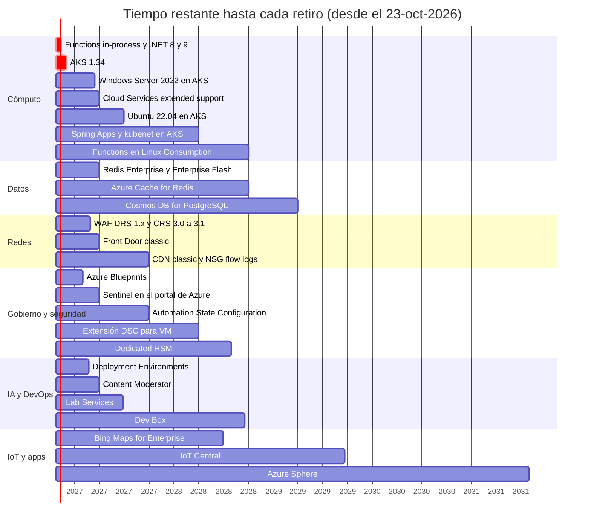

<div align="center">

# 18 · Retiros, renombres y ciclo de vida

**Qué se retira, cuándo, por qué reemplazarlo y cómo encontrar lo afectado en tu entorno**

[⬅ 17 · Catálogo A–Z](17-catalogo-a-z.md) · [🏠 Índice](../README.md) · [19 · Referencia rápida ➡](19-referencia-rapida-y-glosario.md)

</div>

> [!IMPORTANT]
> Fecha de corte de este capítulo: **23 de octubre de 2026**. Las fechas provienen de avisos de *Azure Updates*, páginas
> de ciclo de vida de Microsoft y documentación de cada servicio. Microsoft a veces **extiende** fechas (como hizo con
> Sentinel y Blueprints): confirma siempre en las recomendaciones de **Azure Advisor** de tu suscripción.

---

## Contenido

1. [Cómo gestiona Microsoft los retiros](#1-cómo-gestiona-microsoft-los-retiros)
2. [Urgente: próximos seis meses](#2-urgente-próximos-seis-meses)
3. [Mapa temporal de retiros 2026–2031](#3-mapa-temporal-de-retiros-20262031)
4. [Retiros programados](#4-retiros-programados)
5. [Retiros ya ejecutados (2024–2026)](#5-retiros-ya-ejecutados-20242026)
6. [Renombres: el diccionario antiguo → actual](#6-renombres-el-diccionario-antiguo--actual)
7. [Encontrar recursos afectados](#7-encontrar-recursos-afectados)
8. [Referencias](#8-referencias)

---

## 1. Cómo gestiona Microsoft los retiros

| Aspecto | Práctica habitual |
|---|---|
| Preaviso | Normalmente **3 años** para servicios o funciones GA con reemplazo; plazos menores para *previews* y versiones de runtime/API |
| Canales | *Azure Updates* (filtro *Retirements*), avisos de **Service Health**, correo a administradores, **Azure Advisor** (*Service Upgrade and Retirement*) |
| Después de la fecha | Según el caso: el recurso deja de funcionar, se migra automáticamente (p. ej., GPv1 → GPv2) o sigue funcionando **sin soporte ni SLA** (p. ej., Load Balancer Basic) |
| Versiones de software gestionado | Calendarios propios: Kubernetes en AKS (12 meses + LTS), runtimes de Functions, versiones de PostgreSQL/MySQL, SDK |

---

## 2. Urgente: próximos seis meses

| Fecha | Qué ocurre | Acción |
|---|---|---|
| **4-nov-2026** | Entra deja de conceder automáticamente `AgentIdentity.CreateAsManager` a *blueprints* de agentes | Conceder el permiso explícitamente si tus agentes crean identidades |
| **10-nov-2026** | Fin del modelo **in-process** de Azure Functions; fin de soporte de .NET 8 y .NET 9 en Functions; fin de **PowerShell 7.4** en Functions | Migrar a *isolated worker* con .NET 10; actualizar PowerShell |
| **nov-2026** | Fin de soporte de **AKS 1.34** · fin de parches del **add-on NGINX** de *application routing* | Actualizar a 1.35/1.36 · migrar a Gateway API |
| **31-ene-2027** | Retiro definitivo de **Azure Blueprints** | Template Specs + Deployment Stacks + Policy |
| **22-feb-2027** | Retiro de **Azure Deployment Environments** | Plantillas `azd` + pipelines + Deployment Stacks |
| **26-feb-2027** | Fin de DRS 1.x (Front Door) y CRS 3.0/3.1 (Application Gateway) en el WAF | Pasar a DRS 2.x / CRS 3.2+ |
| **15-mar-2027** | Fin de nodos **Windows Server 2022** en AKS | Windows Server 2025 |
| **31-mar-2027** | Front Door (classic) · Cloud Services (extended support) · Sentinel en el portal de Azure · Content Moderator · Azure Cache for Redis Enterprise | Ver tabla de la sección 4 |
| **mar-2027** | Fin de soporte de **AKS 1.35** | Planificar 1.36+ |

---

## 3. Mapa temporal de retiros 2026–2031

Cada barra muestra el **tiempo restante** desde el 23-oct-2026 hasta la fecha de retiro (en rojo, menos de seis meses).



---

## 4. Retiros programados

| Fecha | Servicio / función | Reemplazo recomendado |
|---|---|---|
| 4-nov-2026 | Concesión automática de `AgentIdentity.CreateAsManager` (Entra Agent ID) | Asignación explícita del permiso |
| 10-nov-2026 | Azure Functions modelo in-process (.NET), .NET 8/9 y PowerShell 7.4 en Functions | Isolated worker + .NET 10; versión de PowerShell soportada |
| nov-2026 | Kubernetes 1.34 en AKS | 1.35 / 1.36 (o LTS en tier Premium) |
| nov-2026 | Parches del add-on de *application routing* con NGINX | *Application routing* con Gateway API, Application Gateway for Containers o Istio |
| 31-ene-2027 | Azure Blueprints | Template Specs, Deployment Stacks, Azure Policy |
| 22-feb-2027 | Azure Deployment Environments | `azd`, GitHub Actions, Deployment Stacks, portales internos |
| 26-feb-2027 | DRS 1.0–1.2 (Front Door) y CRS 3.0/3.1 (Application Gateway) | DRS 2.x / CRS 3.2 o posterior |
| 15-mar-2027 | Nodos Windows Server 2022 en AKS | Windows Server 2025 |
| mar-2027 | Kubernetes 1.35 en AKS | 1.36+ |
| 31-mar-2027 | Azure Front Door (classic) | Front Door Standard/Premium |
| 31-mar-2027 | Cloud Services (extended support) | VMSS, App Service, AKS, Container Apps |
| 31-mar-2027 | Microsoft Sentinel en el portal de Azure | Sentinel en el portal de Microsoft Defender |
| 31-mar-2027 | Content Moderator | Azure AI Content Safety (Foundry Tools) |
| 31-mar-2027 | Azure Cache for Redis Enterprise / Enterprise Flash | Azure Managed Redis |
| 28-jun-2027 | Azure Lab Services | Soluciones de socios, Windows 365, AVD |
| 30-jun-2027 | Ubuntu 22.04 en AKS | Ubuntu 24.04 / Azure Linux / Azure Container Linux |
| 30-sep-2027 | Azure CDN Standard from Microsoft (classic) | Front Door Standard/Premium |
| 30-sep-2027 | NSG flow logs | VNet flow logs |
| 30-sep-2027 | Azure Automation State Configuration | Azure Machine Configuration |
| 31-mar-2028 | Azure Spring Apps | Container Apps (componentes Java) o AKS |
| 31-mar-2028 | kubenet en AKS | Azure CNI Overlay (con Cilium) |
| 31-mar-2028 | Extensión DSC para VM | Machine Configuration |
| 30-jun-2028 | Bing Maps for Enterprise (cuentas empresariales) | Azure Maps |
| 31-jul-2028 | Azure Dedicated HSM (sin nuevos clientes desde ago-2025) | Azure Cloud HSM o Managed HSM (las claves no se migran: hay que crear nuevas) |
| 18-sep-2028 | Microsoft Dev Box (en modo mantenimiento) | Windows 365 |
| 30-sep-2028 | Azure Cache for Redis Basic/Standard/Premium | Azure Managed Redis |
| 30-sep-2028 | Azure Functions en Linux Consumption | Flex Consumption |
| 31-mar-2029 | Azure Cosmos DB for PostgreSQL | Azure Database for PostgreSQL *elastic clusters* |
| 20-sep-2029 | Azure IoT Central | IoT Hub + DPS + Device Registry (+ IoT Operations) |
| 31-jul-2031 | Azure Sphere (silicio MT3620 en fin de vida desde jul-2026) | Rediseño de hardware con otra plataforma segura |

---

## 5. Retiros ya ejecutados (2024–2026)

| Fecha | Servicio / función | Reemplazo |
|---|---|---|
| feb-2024 | Application Insights clásico · Data Lake Storage Gen1 · Data Lake Analytics | App Insights basado en workspace · ADLS Gen2 · Fabric/Databricks |
| may-2024 | Object Anchors | — |
| jun-2024 | Azure Media Services | Socios; Video Indexer |
| jul-2024 | Time Series Insights | Data Explorer / Fabric RTI |
| ago-2024 | Agente de Log Analytics (MMA) · Automation Update Management · Integration Service Environment · Cloud Services (classic) · ML Studio (classic) | AMA · Update Manager · Logic Apps Standard · Cloud Services (ext.) · Azure ML |
| sep-2024 | MySQL Single Server | MySQL Flexible Server |
| nov-2024 | Spatial Anchors | — |
| dic-2024 | Orbital Ground Station | Redes de socios |
| ene-2025 | HDInsight on AKS · CDN de Edgio | Fabric/Databricks · Front Door |
| mar-2025 | PostgreSQL Single Server · QnA Maker · App Center · ingesta por *instrumentation key* | Flexible Server · *custom question answering* · terceros · cadenas de conexión |
| may-2025 | Venta de Azure AD B2C a clientes nuevos | Entra External ID |
| ago-2025 | Bing Search APIs · TLS 1.0/1.1 en servicios de Azure | Grounding with Bing Search · TLS 1.2+ |
| sep-2025 | Load Balancer Basic · IP pública Basic · MariaDB · SQL Edge · HPC Cache · Remote Rendering · Maps Creator · Private 5G Core | LB Standard · IP Standard · MySQL Flexible · SQL Server en contenedores · Managed Lustre · — · socios · socios |
| oct-2025 | LUIS · Entra Permissions Management · Synapse Data Explorer | CLU · Defender for Cloud · Eventhouse |
| nov-2025 | Soporte de Azure Linux 2.0 en AKS | Azure Linux 3 / Azure Container Linux |
| mar-2026 | Microsoft Playwright Testing (preview) · runtime Spark 3.4 de Synapse | Playwright Workspaces · Spark 3.5 |
| 31-mar-2026 | Salida de Internet implícita en VNets nuevas | NAT Gateway, reglas de salida, IP públicas explícitas |
| abr-2026 | Cifrados DHE en Front Door/CDN · creación de Azure Cache for Redis para clientes nuevos | Cifrados ECDHE · Azure Managed Redis |
| 28-abr-2026 | Application Gateway v1 | Application Gateway v2 |
| jun-2026 | Azure ML SDK v1 | SDK v2 (`azure-ai-ml`) |
| 1-jul-2026 | Reservas de familias antiguas de VM | Savings Plan, series v6/v7 |
| sep-2026 | Functions 1.x · runtime v3 en Linux Consumption · HTTP Data Collector API · *URL ping tests* · API keys de Application Insights · Computer Vision v1–v3.1 · AVD (classic) · SDK heredados de Service Bus · VpnGw1–5 sin zona · Azure API for FHIR · FXT Edge Filer | Functions 4.x · Logs Ingestion API · pruebas estándar · Entra ID · Image Analysis 4.0 · AVD (ARM) · SDK `Azure.Messaging.*` · SKU AZ · Health Data Services |
| 1-oct-2026 | Anomaly Detector · Metrics Advisor · Personalizer | Data Explorer, Fabric, modelos propios |
| 13-oct-2026 | Cuentas de almacenamiento GPv1 y Blob Storage heredadas | GPv2 (migración automática) |

---

## 6. Renombres: el diccionario antiguo → actual

| Nombre antiguo | Nombre actual |
|---|---|
| Windows Azure | Microsoft Azure (2014) |
| Azure Active Directory (Azure AD) | **Microsoft Entra ID** |
| Azure AD External Identities / B2C | **Microsoft Entra External ID** |
| Azure AD Domain Services | Microsoft Entra Domain Services |
| Azure Security Center / Azure Defender | **Microsoft Defender for Cloud** |
| Azure Sentinel | Microsoft Sentinel |
| Azure Purview | Microsoft Purview |
| Azure Stack HCI | **Azure Local** |
| AKS on Azure Stack HCI / AKS híbrido | AKS habilitado por Azure Arc |
| Azure Cognitive Services → Azure AI Services | **Foundry Tools** |
| Azure AI Studio → Azure AI Foundry | **Microsoft Foundry** |
| Azure OpenAI Service | Azure OpenAI in Foundry Models |
| Azure AI Agent Service | Foundry Agent Service |
| Azure Cognitive Search | Azure AI Search |
| Form Recognizer | Document Intelligence |
| Video Analyzer for Media | Azure AI Video Indexer |
| Semantic Kernel + AutoGen | Microsoft Agent Framework |
| Cosmos DB for MongoDB (vCore) | **Azure DocumentDB** |
| Azure Cache for Redis (sucesor) | Azure Managed Redis |
| Azure Container Service (ACS) | Azure Kubernetes Service |
| Azure Spring Cloud | Azure Spring Apps (en retiro) |
| Windows Virtual Desktop | Azure Virtual Desktop |
| Visual Studio Team Services | Azure DevOps |
| Copilot in Azure / Microsoft Copilot for Azure | **Azure Copilot** |
| Microsoft Playwright Testing + Azure Load Testing | Azure App Testing |
| Azure Monitor for containers | Container Insights |
| Log Analytics agent (MMA/OMS) | Azure Monitor Agent (AMA) |
| Azure Automation DSC | Azure Machine Configuration |
| Synapse Data Explorer | Eventhouse (Fabric Real-Time Intelligence) |
| Power BI Premium (capacidades P) | Capacidades de Microsoft Fabric (F) |

---

## 7. Encontrar recursos afectados

1. **Azure Advisor → Service Upgrade and Retirement** (y el *workbook* de retiros): lista recursos afectados por suscripción.
2. **Service Health**: crea alertas para *Health advisories* y *Security advisories*.
3. **Azure Resource Graph**: consultas como estas.

```kusto
// Clústeres AKS en versiones próximas a su fin de soporte
resources
| where type == "microsoft.containerservice/managedclusters"
| extend version = tostring(properties.kubernetesVersion)
| where version startswith "1.34" or version startswith "1.35"
| project name, resourceGroup, subscriptionId, version, location
```

```kusto
// Perfiles de Front Door (classic), cachés de Redis y Cloud Services (extended support)
resources
| where type in~ ("microsoft.network/frontdoors",
                  "microsoft.cache/redis",
                  "microsoft.cache/redisenterprise",
                  "microsoft.compute/cloudservices",
                  "microsoft.appplatform/spring")
| summarize recursos = count() by type, subscriptionId
```

```kusto
// IP públicas y balanceadores Basic que siguen en uso (sin soporte ni SLA)
resources
| where (type == "microsoft.network/publicipaddresses" or type == "microsoft.network/loadbalancers")
| where tostring(sku.name) == "Basic"
| project name, type, resourceGroup, subscriptionId
```

> [!TIP]
> Convierte cada retiro en un **ítem de backlog** con propietario, fecha objetivo (al menos 3 meses antes del retiro) y
> prueba de humo posmigración. Usa Azure Policy con efecto `deny` para impedir crear recursos de SKU en retiro.

---

## 8. Referencias

- [Azure Updates — Retirements](https://azure.microsoft.com/updates/?updateType=retirements)
- [Use Service Upgrade and Retirement recommendations (Azure Advisor)](https://learn.microsoft.com/azure/advisor/advisor-how-to-use-service-upgrade-retirement-recommendations)
- [Microsoft Lifecycle — Ending support in 2026](https://learn.microsoft.com/lifecycle/end-of-support/end-of-support-2026) · [2027](https://learn.microsoft.com/lifecycle/end-of-support/end-of-support-2027)
- [AKS supported Kubernetes versions](https://learn.microsoft.com/azure/aks/supported-kubernetes-versions)
- [Migrate .NET apps from the in-process model to the isolated worker model](https://learn.microsoft.com/azure/azure-functions/migrate-dotnet-to-isolated-model)

---

<div align="center">

[⬅ 17 · Catálogo A–Z](17-catalogo-a-z.md) · [🏠 Índice](../README.md) · [19 · Referencia rápida ➡](19-referencia-rapida-y-glosario.md)

</div>
